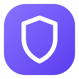
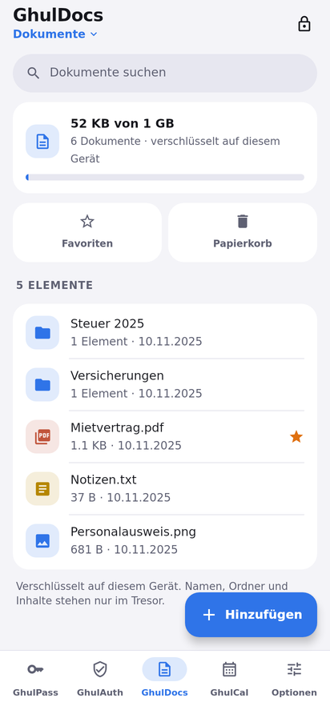
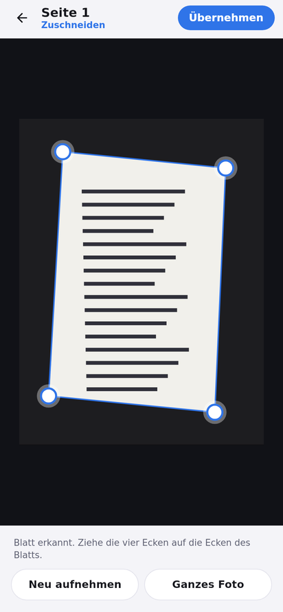
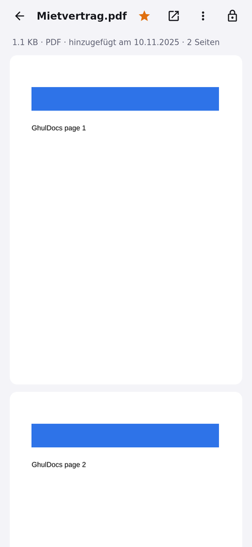
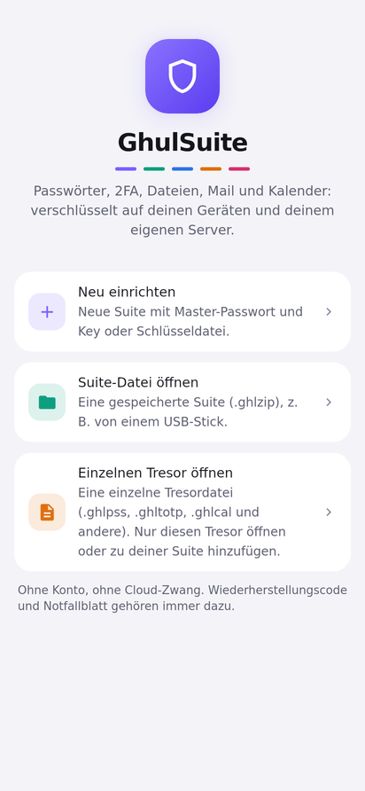
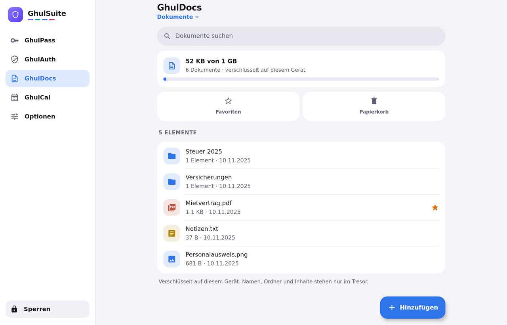
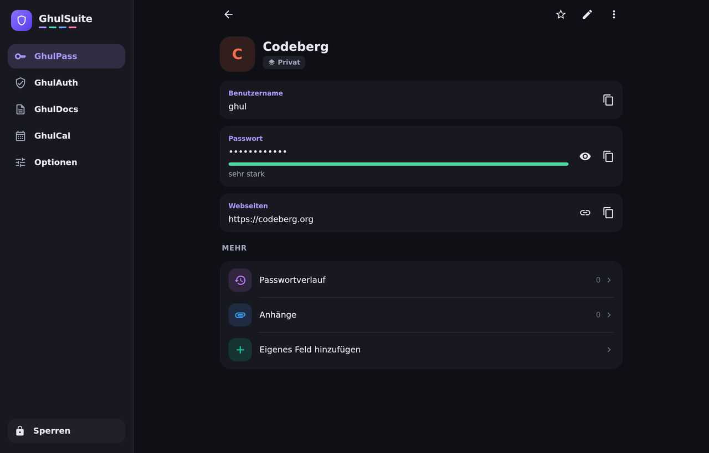

<div align="center">



# GhulSuite


**Passwörter · 2FA · Dokumente · Kalender in einer App, verschlüsselt auf deinem Gerät und in einer Datei, die du mitnimmst.**

Die Offline-Alternative zu den bekannten Privacy-Suiten: gleicher Komfort, aber ohne Abo, ohne Konto, ohne Server,
ohne Sync-Dienst und ohne Vertrauensvorschuss. Die Daten liegen da, wo **du** sie hinlegst.

</div>

> [!WARNING]
> **Entwicklungsversion: noch nicht für den produktiven Einsatz geeignet.**
> GhulSuite ist noch in Entwicklung; bisher gibt es nur Vorabversionen. Das Dateiformat ist seit dem 21.11.2026
> eingefroren (Format 3): Jede spätere Version liest Dateien in diesem Format weiter
> ([Kompatibilitätszusage](docs/FORMAT.md)). Fehler in der App können trotzdem Daten kosten: Bewahre eine zweite
> Kopie deiner Suite-Datei auf und lege nichts hinein, was du nicht zusätzlich woanders hast.

<div align="center">

[](LICENSE)


[](https://www.ghulsuite.de)

<br>

&nbsp;
&nbsp;
&nbsp;


<br>

[Warum?](#warum-ghulsuite) ·
[Die vier Bereiche](#die-vier-bereiche) ·
[Dokumente scannen](#dokumente-scannen) ·
[Einrichten](#einrichten-und-entsperren) ·
[Eine Datei für alle Geräte](#eine-datei-für-alle-geräte) ·
[Verbindungen](#offline-mit-zwei-ausnahmen) ·
[Sicherheit](#so-schützt-ghulsuite-deine-daten) ·
[Download](#download) ·
**[www.ghulsuite.de](https://www.ghulsuite.de)**

</div>

---

## Auf einen Blick

| | |
|---|---|
| **Eine App, vier Bereiche** | Passwörter, 2FA-Codes, Dokumente und Kalender, einzeln ein- und ausschaltbar |
| **Zwei Faktoren** | Master-Passwort **plus** Security Key (FIDO2) oder Schlüsseldatei. Ausnahmen: der Wiederherstellungscode vom Notfallblatt öffnet allein, und auf dem Handy entsperren Fingerabdruck oder App-PIN, wenn du sie einschaltest |
| **Eine Datei** | Die ganze Suite in einer verschlüsselten Datei (`.ghlzip`, bis 3,75 GiB): speichern, z. B. auf einen USB-Stick, und auf dem nächsten Gerät öffnen. Kein Sync, kein Abgleich |
| **Offline** | Keine Server, keine Konten, kein Cloud-Dienst. Nach draußen gehen nur die Update-Prüfung und, wenn du sie einschaltest, die Prüfung auf Datenlecks; beide abschaltbar |
| **Dokumente und Scans** | GhulDocs hält wichtige Dokumente verschlüsselt, in bis zu 3 Tresoren mit je bis 1 GB; auf Android scannst du Papier mit der Kamera direkt als PDF hinein |
| **Plattformen** | Android 12+ und Windows 10/11 (Installer oder portabel vom USB-Stick) |
| **Offen** | Freie Software (AGPL-3.0), Dateiformat dokumentiert, Tests öffentlich |

## Warum GhulSuite?

Die meisten „sicheren“ Suiten verlangen, dass du einem Unternehmen vertraust: dessen Servern, dessen Preisen,
dessen Zukunft. GhulSuite dreht das um:

- 🔐 **Verschlüsselt, immer.** Alles wird auf deinem Gerät verschlüsselt. Was gespeichert wird, auf dem Gerät oder
  in der Suite-Datei, ist ohne Passwort und zweiten Faktor Datensalat: keine Inhalte, keine Datei- und Ordnernamen,
  nicht einmal die Namen deiner Tresore.
- 📴 **Kein Server, kein Konto.** Es gibt nichts, wo du dich anmelden musst, und nichts, was gehackt, abgeschaltet
  oder teurer werden kann. Die App braucht kein Netz.
- 🗝️ **Zwei Faktoren.** Master-Passwort **plus** Security Key (FIDO2) oder Schlüsseldatei. Zwei Ausnahmen, beide
  von dir gewählt: der Wiederherstellungscode mit Notfallblatt für den Tag, an dem alles schiefgeht (er öffnet allein
  alles, darum gehört das Blatt sicher verwahrt), und auf dem Handy das Schnell-Entsperren mit Fingerabdruck oder
  App-PIN, das nur nach einem vollen Entsperren mit beiden Faktoren gilt. Verlierst du einen Key
  oder das Blatt, entfernst bzw. erneuerst du es: Was du ab dann speicherst, öffnet es nicht mehr.
- 📦 **Die Suite ist eine Datei.** Alles steckt in einer verschlüsselten Datei (`.ghlzip`). Speichern, auf den
  USB-Stick legen, auf dem nächsten Gerät öffnen, ohne Konto, ohne Sync-Dienst und ohne Anbieterbindung. Aktuell
  ist immer der Stand, der zuletzt gespeichert wurde; zusammengeführt wird nichts.
- 🧩 **Eine App statt vier.** Ein Entsperren, ein Design, eine Datei.
- 💯 **Open Source.** Jede Zeile ist hier nachlesbar.

## Die vier Bereiche

Jeder Bereich hat seine eigenen verschlüsselten Tresore. Was du nicht brauchst, schaltest du ab: Es verschwindet aus
der Leiste, seine Tresore bleiben unberührt.

### 🟣 GhulPass: Passwörter

<table><tr>
<td width="200" valign="top"></td>
<td valign="top">

- **Alles an einem Ort:** Anmeldungen, Notizen, Kreditkarten, WLAN (mit QR zum Teilen), Identitäten, SSH-Schlüssel;
  eigene Felder, Anhänge, Passwortverlauf, Favoriten und „Zuletzt“.
- **Generator** für Passwörter und Passphrasen.
- **Sicherheitscheck:** schwache und doppelte Passwörter, Konten ohne 2FA; auf Wunsch der Abgleich mit bekannten
  Datenlecks, ohne dass dein Passwort das Gerät verlässt (k-Anonymität: nur der Anfang eines Hashes geht hinaus).
- **Mehrere Tresore**, z. B. „Privat“ und „Familie“, jeder in seiner eigenen Datei. Eine einzelne Tresordatei
  öffnest du auch für sich oder fügst sie deiner Suite hinzu.
- **Als Tresor weitergeben:** einen ganzen Tresor oder ausgewählte Einträge (auch 2FA-Konten aus GhulAuth) als neue
  Tresordatei mit eigenem Passwort und neuer Schlüsseldatei oder eigenem Security Key; vom Schutz deiner Suite geht
  nichts mit.
- **2FA im Eintrag:** Der aktuelle Code steht direkt bei der Anmeldung.

</td></tr></table>

### 🟢 GhulAuth: 2FA-Codes

<table><tr>
<td width="200" valign="top"></td>
<td valign="top">

- **TOTP für jeden Dienst**, als Liste oder Kacheln, mit Favoriten und eigener Sortierung; Steam-Codes inklusive.
- **Hinzufügen** per Kamera, aus einem Bildschirmfoto, als `otpauth://`-Link oder von Hand.
- **Umzug:** Import aus Google Authenticator (Export-QR), Aegis, 2FAS und anderen; Export als QR-Code.
- Auf Wunsch **verdeckte Codes**, die erst beim Antippen erscheinen, und der nächste Code schon vorab.

</td></tr></table>

### 🔵 GhulDocs: Dokumente

<table><tr>
<td width="200" valign="top"></td>
<td valign="top">

- **Verschlüsselter Speicher** für das, was du nicht verlieren und niemandem zeigen willst: Ausweis, Verträge,
  Zeugnisse, Steuer, Versicherungen. Bis zu **3 Tresore** je Suite mit je bis zu **1 GB**,
  zusammen also bis **3 GB**.
- **Jede Datei mit eigenem Schlüssel**, verschlüsselt in Abschnitten. Namen, Ordner und Typen stehen nur im
  verschlüsselten Inhaltsverzeichnis; von außen sieht man nur, wie viele Dokumente es gibt (genau), wie groß sie
  ungefähr sind (in Schritten von 64 KiB) und auf dem Gerät, wann sie hinzukamen.
- **Hinzufügen** aus dem Dateisystem, mehrere auf einmal; auf Android auch über „Teilen“ aus anderen Apps
  („In GhulDocs speichern“) und mit der Kamera, siehe [unten](#dokumente-scannen).
- **Ordner, Suche, Favoriten und Papierkorb**, Anzeige der Belegung je Tresor („412 MB von 1 GB“), bei mehreren
  Tresoren dazu „Alle GhulDocs-Tresore: … von 3 GB“; die App sagt, ob der Tresor oder alle zusammen fast voll sind.
- **Ansehen in der App** ohne Klartext auf dem Datenträger: Bilder, PDF und Text.
- **Exportieren** (entschlüsselt an einen Ort deiner Wahl, mit Rückfrage) oder **mit einer anderen App öffnen**
  (eine befristete Kopie, gelöscht, sobald GhulSuite sperrt).
- **Bis zu 3 Tresore**, z. B. „Privat“ und „Firma“, jeder mit eigenen Ordnern, eigenem Papierkorb und eigenen
  Favoriten; oben wählst du den Tresor oder „Alle Tresore“. Einen ganzen Tresor oder ausgewählte Ordner und Dateien
  gibst du mit den Dokumenten als **GhulDocs-Paket** (`.ghldocs`) weiter, mit eigenem Passwort. Fügt der Empfänger
  das Paket seiner Suite hinzu, wird es dort ein eigener GhulDocs-Tresor (solange er noch keine 3 hat).

</td></tr></table>

### 🔴 GhulCal: Kalender

<table><tr>
<td width="200" valign="top"></td>
<td valign="top">

- **Termine verschlüsselt** in der Suite-Datei, unterwegs mit allem anderen; bewusst ohne CalDAV.
- **Monat, Woche, Tag und Liste**, mehrere Kalender in eigenen Farben, Geburtstage mit Alter. Hast du mehrere
  Kalender-Tresore, stehen die Kalender unter dem Namen ihres Tresors, und ein neuer Kalender fragt, in welchen Tresor.
- **Schnell-Eintragen** in Alltagssprache, etwa „Zahnarzt Fr 10 Uhr“.
- **Serien und Erinnerungen**, auch bei gesperrter App (Android); Zeitzonen-Wechsel auf Reisen werden beachtet.
- **Feiertage** nach Bundesland, für Österreich und die Schweiz.
- **Import und Export** als `.ics`; Termine aus anderen Zeitzonen werden richtig umgerechnet. Einen ganzen
  Kalender-Tresor gibst du auch als Tresor weiter, mit eigenem Passwort und zweitem Faktor.

</td></tr></table>

**Für alle Bereiche:** Sofortsperre (Schütteln oder Schnellkachel), Auto-Sperre, Entsperren per Fingerabdruck oder
App-PIN, Schutz vor Bildschirmfotos und vor Apps, die sich über GhulSuite legen, die ganze Suite als eine Datei,
„Rückgängig“ nach dem Löschen, dunkles Design und Deutsch oder Englisch. Jeden Tresor kannst du unter Optionen →
Tresore **exportieren** (für dich, verschlüsselt mit deinem Passwort und Key bzw. deiner Schlüsseldatei: als
Sicherung oder für ein anderes Gerät) oder **als Tresor weitergeben** (für jemand anderen: mit eigenem Passwort, eigenem Key bzw. eigener
Schlüsseldatei und eigenem Wiederherstellungscode).

## Dokumente scannen

<table><tr>
<td width="200" valign="top"></td>
<td width="200" valign="top"></td>
<td valign="top">

Auf Android scannst du Papier direkt in GhulDocs, ohne Scanner-App und ohne Cloud:

1. **Fotografieren** mit der Kamera in der App, auch mehrere Seiten nacheinander.
2. **Zuschneiden:** Die App schlägt die Ecken des Blatts vor, du verschiebst sie mit dem Finger. Ein schräg
   fotografiertes Blatt wird gerade.
3. Auf Wunsch der Filter **„Dokument“** (Graustufen, mehr Kontrast für Text) und **Drehen**.
4. **Als PDF speichern:** alle Seiten in einer Datei, mit einem Namen aus dem Datum, den du ändern kannst.

Fotos und Seiten bleiben im Arbeitsspeicher, bis die PDF verschlüsselt in GhulDocs liegt. Verlässt du den Scan oder
sperrt die App, sind sie weg. Die Kamera-App des Systems wird nicht benutzt. Unter Windows fügst du Dateien hinzu.

</td></tr></table>

## Einrichten und entsperren

<table><tr>
<td width="200" valign="top"></td>
<td valign="top">

Ein Assistent führt in acht Schritten durch alles:

1. **Master-Passwort** wählen.
2. **Zweiter Faktor:** Security Key (FIDO2, mit Backup) oder eine Schlüsseldatei, getrennt von der Suite-Datei
   aufbewahrt (nicht auf demselben Stick).
3. **Anlegen:** Die Suite entsteht auf diesem Gerät (mit Key: einmal berühren).
4. **Bereiche** auswählen.
5. **Sperre:** wann GhulSuite sich von selbst sperrt.
6. **Entsperren:** auf dem Handy auf Wunsch Fingerabdruck oder App-PIN.
7. **Notfallblatt:** ein Wiederherstellungscode mit QR, falls Passwort oder Key verloren gehen; am besten direkt
   ausdrucken (eine als PDF gespeicherte Kopie danach löschen).
8. **Suite-Datei** an einem Ort deiner Wahl anlegen, am besten auf einem USB-Stick in einem eigenen Ordner. Unter
   Android gibst du danach den Ordner frei, damit die App beim Speichern erst eine neue Datei daneben schreibt und die
   alte nie direkt überschreibt. Cloud-Ordner sind dafür nicht gedacht: Viele Cloud-Apps erlauben nur das direkte
   Überschreiben und behalten ältere Fassungen.

Die Suite liegt dann auf diesem Gerät (Arbeitskopie) und als Datei an dem gewählten Ort. Änderungen kommen in die
Datei, wenn du oben auf das Speichern-Symbol tippst.

**Im Alltag** reicht auf dem Handy Fingerabdruck oder App-PIN; der Schnellzugang liegt geschützt im Schlüsselspeicher
des Geräts. Eingerichtet wird er mit Passwort und zweitem Faktor, mit einer Gültigkeit, die du dabei wählst. Die App-PIN hat 8 bis 12 Ziffern und zwei Versuche; nach zwei falschen ist sie weg. Die **Sofortsperre** schließt alles mit einem Schütteln oder über
die Schnellkachel und löscht den Schnellzugang: Danach entsperrst du mit beiden Faktoren und richtest ihn neu ein.

</td></tr></table>

## Eine Datei für alle Geräte

GhulSuite synchronisiert nicht. Die Suite ist **eine Datei** (`.ghlzip`): Du öffnest sie, arbeitest darin und
speicherst sie. Wohin sie wandert, entscheidest du, etwa auf einen USB-Stick. Am Handy öffnen, arbeiten, speichern;
am PC dieselbe Datei öffnen, arbeiten, speichern; wieder am Handy öffnen.

- **Alles steckt darin:** Passwörter, 2FA, alle GhulDocs-Tresore mit allen Dokumenten und Kalender. Sind die
  GhulDocs-Tresore zusammen voll (3 GB), ist die Datei gut 3 GB groß (höchstens 3,75 GiB, also unter 4 GiB, die auch
  ein USB-Stick mit FAT32 fasst). Speichern und Öffnen zeigen einen Fortschritt; mit 3 GB Dokumenten dauert das Speichern nach unserer
  Schätzung unter Windows etwa 6 bis 15 Sekunden, auf dem Handy bis etwa 40 Sekunden, auf einen langsamen
  USB-Stick bis etwa viereinhalb Minuten.
- **Speichern mit dem Speichern-Button.** Jede Änderung liegt sofort verschlüsselt in der Arbeitskopie auf dem Gerät.
  In die Suite-Datei kommt sie, wenn du oben neben „Sperren“ auf das Speichern-Symbol tippst (am PC auch Strg+S); es
  erscheint, sobald etwas ungespeichert ist. Ein Dialog fragt kurz nach und zeigt den Fortschritt; die App merkt
  sich die Datei und speichert direkt dorthin, auch auf den Stick. Sperrst du mitten im Speichern, läuft es zu Ende.
  Nach einem neuen oder geänderten Passwort oder 2FA-Konto erinnert die App gleich, sonst nach drei Tagen ohne
  Speichern; am PC fragt sie beim Beenden. Die Arbeitskopie sorgt dafür,
  dass die App auch ohne den Stick funktioniert.
- **Aktuell ist, was zuletzt gespeichert wurde.** Zusammengeführt wird nichts. Wurde die Datei inzwischen auf einem
  anderen Gerät gespeichert, sagt die App das gleich nach dem Entsperren und bietet an, sie zu öffnen; vor dem
  Überschreiben fragt sie noch einmal: überschreiben oder unter neuem Namen speichern.
- **Erst prüfen, dann ersetzen.** Beim Öffnen wird jeder Teil der Datei geprüft (Siegel, Liste der Tresore,
  Prüfsumme jedes Dokuments, alles aus derselben Suite), bevor sie den Stand auf dem Gerät ersetzt. Ist die Datei
  älter als der Stand hier, wurde sie von einem anderen Stand aus weiterbearbeitet oder enthält sie eine andere Suite,
  fragt die App nach, ebenso, wenn dabei nicht gespeicherte Änderungen verloren gingen.
- **Nach einer Schutzänderung** (neues Passwort, neuer Wiederherstellungscode, Key oder Schlüsseldatei entfernt)
  bekommen alle Tresore neue innere Schlüssel, und die App bittet, die Suite-Datei zu speichern. Eine Suite-Datei mit
  dem älteren Schutz öffnet sie danach nicht mehr. **Alte Kopien löschen:** Eine Kopie, die schon woanders liegt
  (Stick, Cloud, anderes Gerät), öffnet jemand mit dem alten Passwort **und** dem alten zweiten Faktor weiterhin, mit
  dem Stand von damals. Sicher unbrauchbar wird sie, wenn du den zweiten Faktor tauschst: neuen Key oder neue
  Schlüsseldatei hinzufügen, den alten entfernen und die alte Schlüsseldatei vernichten bzw. den alten Key
  zurücksetzen, **und** einen neuen Wiederherstellungscode erstellen (der bisherige steckt auch in alten Kopien).
- **Einzelne Tresore:** Eine Tresordatei lässt sich auch für sich öffnen, mit Passwort und zweitem Faktor oder dem
  Wiederherstellungscode, und zu deiner Suite hinzufügen; sie wird dort ein eigener Tresor. Einen ganzen Tresor oder
  ausgewählte Einträge gibst du als neuen Tresor mit eigener Schlüsseldatei oder eigenem Security Key weiter. Ein
  GhulDocs-Tresor reist dabei mit seinen Dokumenten als eigene Dateiart, das GhulDocs-Paket (`.ghldocs`); die
  Suite-Datei bleibt `.ghlzip`.

## Auch auf dem großen Bildschirm

Unter Windows (und im Querformat) mit den Bereichen links in einer Seitenleiste und allem anderen in einer gut lesbaren Spalte daneben, als Installer oder portabel vom USB-Stick.

<div align="center">

<br><br>
&nbsp;

</div>

## Offline, mit zwei Ausnahmen

GhulSuite braucht **keinen Server, kein Konto und kein Netz**. Es gibt keine Telemetrie und keine Fehlerberichte im
Hintergrund. Nur zwei Verbindungen baut die App auf, beide abschaltbar:

| Verbindung | Wann | Was hinausgeht |
|---|---|---|
| **Update-Prüfung** | höchstens einmal am Tag nach dem Entsperren und wenn du selbst nachsiehst; abschaltbar unter Optionen → Über und Hilfe → Updates | eine Anfrage an GitHub nach der neuesten Version (deine IP-Adresse, keine Kennung); ein Update wird nur nach deiner Zustimmung geladen |
| **Prüfung auf Datenlecks** (GhulPass) | nur, wenn du sie im Sicherheitscheck einschaltest (standardmäßig aus) | je Passwort die ersten 5 Zeichen seines SHA-1-Werts an „Pwned Passwords“ (Have I Been Pwned), nie das Passwort (k-Anonymität) |

Einen **Fehlerbericht** zeigt die App nur an. Du entscheidest, ob du ihn kopierst, speicherst oder über eine andere
App (etwa deine Mail-App) an den Entwickler schickst. Von selbst sendet GhulSuite nichts.

## So schützt GhulSuite deine Daten

```
 dein Gerät                                         Suite-Datei (z. B. USB-Stick)
┌──────────────────────────────┐                  ┌───────────────────────────┐
│ Master-Passwort  ─┐          │                  │                           │
│ Security Key ─────┼─► Schlüssel ─► XChaCha20    │  nur Verschlüsseltes,     │
│ (oder Schlüsseldatei)        │     -Poly1305 ───┼─► jede Datei versiegelt;  │
│                              │                  │  keine Inhalte, Namen     │
│ Wiederherstellungscode ──────┘ (Notfall)        │  oder Ordner              │
└──────────────────────────────┘                  └───────────────────────────┘
```

**Wer sieht was?**

| Wer | sieht | sieht nicht |
|---|---|---|
| Jemand mit deiner Suite-Datei (z. B. verlorener USB-Stick) | Datensalat; ungefähr, wie viele Dokumente es gibt und wie groß sie sind | ohne Passwort **und** zweiten Faktor nichts; er kann nichts unterschieben (Siegel) und dir keine ältere Datei unbemerkt unterjubeln (die App fragt nach) |
| Jemand mit deinem gesperrten Handy | Termin-Erinnerungen mit Titel und Uhrzeit (einstellbar bis „nur Hinweis“) | Einträge, Codes, Dokumente |
| Jemand, der deine App kurz entsperrt in der Hand hat | alles, was die App zeigt: Passwörter, 2FA-Codes, Dokumente und Termine; er kann sie abschreiben, kopieren, ändern, löschen und Dokumente mit anderen Apps öffnen | ohne Master-Passwort: kein unverschlüsselter Export, kein 2FA-Geheimnis (als QR-Code oder im Eintrag), keine schwächere Sperre; ohne Passwort **und** zweiten Faktor: kein neuer Wiederherstellungscode, kein eigener Key, kein eigenes Schnell-Entsperren, keine Weitergabe als eigener Tresor, kein Löschen oder Ersetzen der Suite auf dem Gerät |
| Ein verlorener Key oder ein altes Notfallblatt | nach dem Entfernen bzw. Erneuern höchstens eine alte Kopie der Suite-Datei, mit dem Stand von damals | alles, was du danach speicherst |
| Wer dein Netz beobachtet | dass die App GitHub nach Updates fragt und, falls eingeschaltet, Pwned Passwords | Inhalte, Passwörter, Dokumente |
| Eine App, mit der du ein Dokument öffnest | genau dieses Dokument (eine befristete Kopie) | alles andere |

- **Schlüssel:** Argon2id für das Passwort, FIDO2 `hmac-secret`/PRF für den Security Key; beide sind nötig.
- **Verschlüsselung:** XChaCha20-Poly1305, jede Datei mit einem Siegel, das nur mit deinem Passwort entsteht;
  jedes Dokument mit eigenem Schlüssel, in Abschnitten verschlüsselt, die sich weder vertauschen noch weglassen
  lassen. Dateiformat offen dokumentiert ([`docs/FORMAT.md`](docs/FORMAT.md)) mit Testvektoren, die eine zweite,
  eigene Implementierung in Python mit anderen Bibliotheken nachrechnet.
- **Kein Klartext auf dem Datenträger:** Dokumente werden beim Einlesen verschlüsselt und beim Ansehen nur im
  Arbeitsspeicher entschlüsselt; gescannte Seiten bleiben im Arbeitsspeicher. Klartext entsteht nur, wenn du ein
  Dokument exportierst oder mit einer anderen App öffnest.
- **Kern in Rust**, eine gemeinsame Codebasis für Android und Windows.
- Der [Sicherheitsbericht](docs/AUDIT.md) fasst alle Prüfungen und Testrunden zusammen: was behoben ist, was offen ist und wogegen GhulSuite schützt.

## Was geprüft ist und was noch fehlt

GhulSuite ist ein Hobbyprojekt ohne Prüfung durch Dritte; Hinweise sind über [`SECURITY.md`](SECURITY.md)
willkommen. Jeder kann nachprüfen, was getestet wird und was nicht:

- **Bei jeder Änderung** laufen über 250 Testfunktionen im Kern, dazu die Desktop-Tests der Oberfläche: Angriffe auf Dateien,
  auf die Suite-Datei und auf GhulDocs (fehlende, vertauschte, alte, fremde oder abgezweigte Teile, ZIP-Tricks,
  vertauschte, abgeschnittene oder fremde Abschnitte eines Dokuments, ein volles GhulDocs), ein „bekloppter
  Nutzer“, der die Suite zwischen drei Geräten hin- und herträgt, kaputte und böswillige Eingaben in jeden Parser.
  Dazu kommen öffentliche Sammlungen wie Project Wycheproof (Kryptografie), die Big List of Naughty Strings,
  JSONTestSuite, Kalenderdateien anderer Programme und die Zeitzonen-Regeln der ganzen
  Welt. Die Oberfläche wird am Desktop durchgeklickt, auch das Scannen mit gezeichneten Fotos.
- **Im Emulator** werden die wichtigsten Abläufe durchgeklickt, mit einem Bild nach jedem Schritt.
- **Jede Nacht** zusätzlich: langes Fuzzing, Dauerläufe, zufällige Bedienung im Emulator, Server mit kaputtem TLS
  und die Zertifikatsketten der Sammlung x509-limbo (zuletzt rund 9.800) gegen den TLS-Prüfer der Update- und
  Leak-Prüfung, ein Scan der APK.
- **Was gefunden wurde und was offen ist,** steht mit Nummer und Schwere im
  [Testprotokoll](docs/TESTPROTOKOLL.md); wie getestet wird, im [Testkonzept](docs/TESTKONZEPT.md); wie der Code durchgesehen, behoben und nachgeprüft wird, im [Prüfkonzept](docs/PRUEFKONZEPT.md); jede Durchsicht bisher (vom Inhaber und von KI-Agenten) und wie und warum sich das Konzept geändert hat, in der [Prüf-Chronik](docs/PRUEFCHRONIK.md).

Kein Test beweist, dass es keine Lücke mehr gibt. Speichere die Suite-Datei regelmäßig und bewahre eine Kopie auf.
Und wenn du dich mit Sicherheit auskennst: Lies mit, greif an, melde, was du findest.

## Umziehen leicht gemacht

Import aus **Proton Pass**, **Bitwarden**, **KeePass/KeePassXC** (CSV), **Proton Authenticator**, **Aegis**, **2FAS**,
**Google Authenticator** (Export-QR) und `otpauth://`-Links. Doppelte Einträge werden erkannt und übersprungen;
was sich nicht übernehmen lässt, wird mit Namen genannt und nicht stillschweigend verworfen. Kalender kommen als
`.ics`, Dokumente als ganz normale Dateien.

## Download

Bisher gibt es **nur Vorabversionen**; eine stabile Version gibt es noch nicht.

| | Vorabversion (Entwicklung) |
|---|---|
| **Android** | `GhulSuite.apk` auf der [Release-Seite](https://github.com/ghulaschsuppe/GhulSuite/releases) |
| **Windows, Installer** | `GhulSuite.msi` auf der [Release-Seite](https://github.com/ghulaschsuppe/GhulSuite/releases) |
| **Windows, portabel** (USB-Stick) | `GhulSuite-portable.zip` auf der [Release-Seite](https://github.com/ghulaschsuppe/GhulSuite/releases) |

- **Vorabversionen** (z. B. `0.5.0-dev.12`) entstehen automatisch aus dem Zweig `dev` und sind auf der
  Release-Seite als „Pre-release“ markiert. Stabile Versionen kommen später vom Zweig `main`.
- **Updates kommen aus der App:** Optionen → Über und Hilfe → Updates. Einmal am Tag nach dem Entsperren schaut GhulSuite nach
  (im Assistenten gefragt, jederzeit abschaltbar), installiert wird nur nach deiner Zustimmung. Dort wählst du auch
  den Kanal: „Vorab“ oder „Stabil“ (Stabil bringt erst ab der ersten stabilen Version Updates).
- **Geprüft vor jeder Installation:** Jede Version enthält `SHA256SUMS`, signiert mit dem Signaturschlüssel der App
  (`SHA256SUMS.sig`). Die App installiert nur, was zu dieser Signatur, Größe und Prüfsumme passt; Android prüft
  zusätzlich, dass das neue APK mit demselben Schlüssel signiert ist. Von Hand: `sha256sum -c SHA256SUMS`.
- Der Windows-Installer ist (noch) nicht von Microsoft signiert: Windows SmartScreen fragt beim ersten Start nach.
- **Testversionen** zu jeder Änderung (als eigene App neben der normalen installierbar, ohne Updates) gibt es weiterhin unter
  **Actions → letzter grüner Lauf → Artefakte**. Die Testversion eines Arbeits-Branches oder Pull Requests ist bei
  jedem Lauf mit einem anderen Wegwerf-Schlüssel signiert: vorher die installierte Testversion deinstallieren.

## Selbst bauen

Rust, Android SDK (NDK 28) und JDK 17, dann:

```bash
cd app && ./gradlew :composeApp:assembleDebug        # Android-APK
cd app && ./gradlew :composeApp:packageMsi           # Windows-Installer (unter Windows)
tools/precheck.sh                                     # alle Prüfungen der CI, die lokal gehen
```

Alles Weitere (Aufbau, Tests, Regeln) steht in [`PROJEKT.md`](PROJEKT.md), das Konzept in [`docs/KONZEPT.md`](docs/KONZEPT.md).

## Mitmachen

Fehler gefunden, Idee gehabt? Issues und Pull Requests sind willkommen. Bitte lies vorher [`CONTRIBUTING.md`](CONTRIBUTING.md).
Sicherheitslücken bitte vertraulich über **Security → Report a vulnerability** melden.

## Lizenz

GhulSuite ist freie Software unter der **[GNU Affero General Public License 3.0](LICENSE)** (oder neuer), mit
[Zusatzbedingungen](NOTICE): Der Urhebervermerk bleibt in jeder Fassung sichtbar. Wer GhulSuite verändert und
weitergibt oder als Dienst betreibt, muss den Quelltext ebenfalls offenlegen.
Name und Logo sind geschützt, siehe [`TRADEMARKS.md`](TRADEMARKS.md).

**Website:** [www.ghulsuite.de](https://www.ghulsuite.de) ·
[Impressum](https://www.ghulsuite.de/impressum.html) ·
[Datenschutz (App)](https://www.ghulsuite.de/datenschutz-app.html) ·
[Datenschutz (Website)](https://www.ghulsuite.de/datenschutz.html).
Die App schickt dem Entwickler keinerlei Daten; welche Verbindungen sie aufbaut, steht vollständig in der
Datenschutzerklärung der App.

---

### English

**GhulSuite** is an offline, encrypted suite for **passwords, 2FA codes, documents and calendar**: one app for Android
and Windows. Everything is encrypted on your device (master password **plus** FIDO2 security key or key file). There
are no servers and no accounts, and there is no sync: the whole suite is one encrypted file (`.ghlzip`, up to
3.75 GiB) you save and open on your next device, e.g. from a USB stick; the state saved last is the current one.
GhulDocs keeps important documents encrypted (up to 3 vaults of up to 1 GB each, every file with its
own key) and, on Android, scans paper with the camera straight into a PDF, with the photos kept in memory only. Every
vault can be exported for yourself (with your password and key) or shared as a separate vault with someone else
(with its own password, second factor and recovery code); a GhulDocs package (`.ghldocs`) added to a suite becomes a
GhulDocs vault of its own. The app only goes online for the update
check and, if you switch it on, the password leak check (k-anonymity, Pwned Passwords); both can be switched off.
Free software under the AGPL-3.0, see [`LICENSE`](LICENSE).

> **Development version, not for production use.** So far there are only pre-releases. The file format is frozen
> since 21 Nov 2026 (format 3): every later version keeps reading files in this format
> ([compatibility promise](docs/FORMAT.md), in German). Bugs in the app can still cost data: keep a second copy of
> your suite file. Unlocking takes master password plus second factor; the exceptions are the recovery code of the
> emergency sheet (it opens everything on its own) and, on the phone, quick unlock with fingerprint or app PIN if
> you switch it on. No review by third parties; reports are welcome via [`SECURITY.md`](SECURITY.md).
Website: [www.ghulsuite.de/en](https://www.ghulsuite.de/en/) · [legal notice](https://www.ghulsuite.de/en/imprint.html) ·
[privacy policy of the app](https://www.ghulsuite.de/en/privacy-app.html).

<div align="center">
<br>
<sub><b>Made by Daniel Erdmann · 2026</b></sub>
</div>
