<div align="center">


# GhulSuite


**Passwörter · 2FA · Dateien · Mail · Kalender in einer App, verschlüsselt auf deinem Gerät, in einer Datei, die du mitnimmst, und auf deinem eigenen Server.**

Die selbst gehostete Alternative zu den bekannten Privacy-Suiten: gleicher Komfort, aber ohne Abo,
ohne Konto bei einem Anbieter, ohne Sync-Dienst und ohne Vertrauensvorschuss. Die Daten liegen da, wo **du** sie hinlegst.

</div>

> [!WARNING]
> **Work in Progress: noch nicht für den produktiven Einsatz geeignet.**
> GhulSuite befindet sich nach wie vor in Entwicklung. Ganze Teile der App, das Dateiformat und die Art, wie Daten
> auf dem Server liegen, können sich jederzeit ändern, auch ohne Umzug älterer Daten. Verlass dich nicht darauf,
> dass heute gespeicherte Daten mit der nächsten Version noch lesbar sind, und lege nichts hinein, was du nicht
> zusätzlich woanders hast.

<div align="center">

[](LICENSE)


[](https://www.ghulsuite.de)

<br>

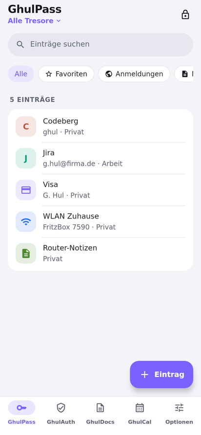&nbsp;
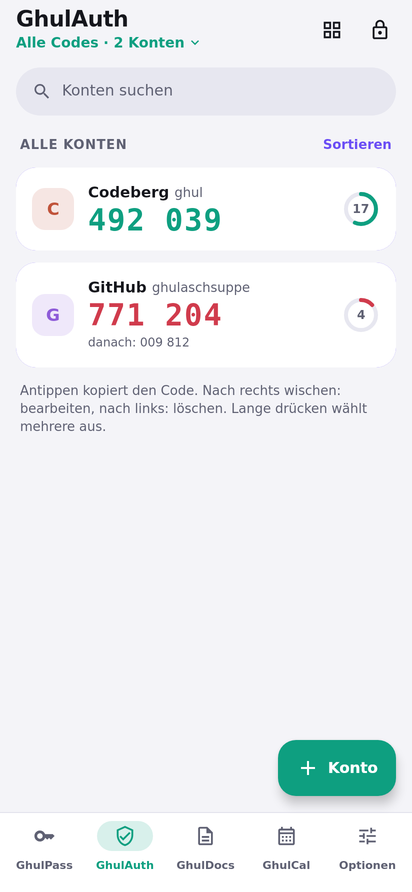&nbsp;
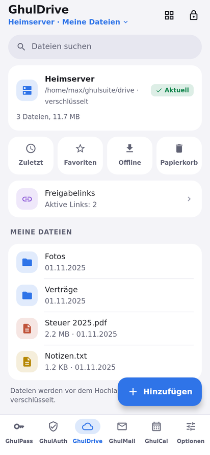&nbsp;
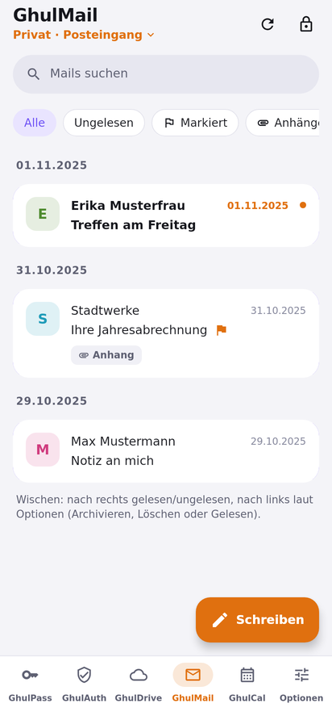&nbsp;
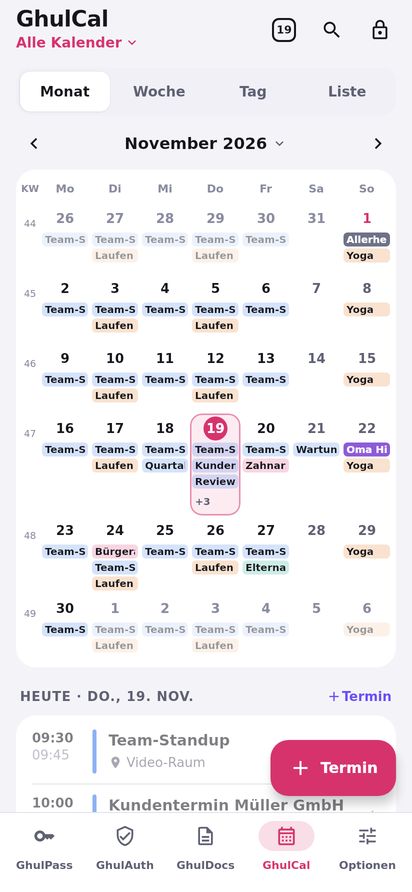

<br>

[Warum?](#warum-ghulsuite) ·
[Die fünf Bereiche](#die-fünf-bereiche) ·
[Teilen](#teilen-per-link) ·
[Mails archivieren](#mails-in-ghuldrive-archivieren) ·
[Einrichten](#einrichten-und-entsperren) ·
[Eine Datei für alle Geräte](#eine-datei-für-alle-geräte) ·
[Selbst hosten](#selbst-hosten-in-fünf-minuten) ·
[Sicherheit](#so-schützt-ghulsuite-deine-daten) ·
[Download](#download) ·
**[www.ghulsuite.de](https://www.ghulsuite.de)**

</div>

---

## Auf einen Blick

| | |
|---|---|
| **Eine App, fünf Bereiche** | Passwörter, 2FA-Codes, Dateien, Mail und Kalender, einzeln ein- und ausschaltbar |
| **Zwei Faktoren, immer** | Master-Passwort **plus** Security Key (FIDO2) oder Schlüsseldatei, dazu ein Notfallblatt |
| **Eine Datei** | Die ganze Suite in einer verschlüsselten Datei (`.ghlzip`): speichern, z. B. auf einen USB-Stick, und auf dem nächsten Gerät öffnen. Kein Sync, kein Abgleich |
| **Dein Server** | Für GhulDrive und Freigabelinks: jeder Server oder jedes Webhosting **mit SSH-Zugang** (SFTP), Anmeldung per SSH-Schlüssel, ganz ohne Datenbank. Ein Webspace nur mit FTP reicht nicht |
| **Teilen per Link** | Mit dem kleinen GhulSuite-Server-Modul (PHP 8.1) auf demselben Server, ohne Kopie |
| **Was der Server sieht** | Nur verschlüsselte Blöcke mit Zufallsnamen: keine Inhalte, keine Namen, keine Ordner |
| **Plattformen** | Android 10+ und Windows 10/11 (Installer oder portabel vom USB-Stick) |
| **Offen** | Freie Software (AGPL-3.0), Dateiformat dokumentiert, Tests öffentlich |

## Warum GhulSuite?

Die meisten „sicheren“ Suiten verlangen, dass du einem Unternehmen vertraust: dessen Servern, dessen Preisen,
dessen Zukunft. GhulSuite dreht das um:

- 🔐 **Ende-zu-Ende verschlüsselt, immer.** Alles wird auf deinem Gerät verschlüsselt, bevor es irgendwohin geht.
  Dein Server sieht nur Datensalat: keine Inhalte, keine Datei- und Ordnernamen deiner Ablage, nicht einmal die
  Namen deiner Tresore.
- 🏠 **Dein Server, deine Regeln.** Für GhulDrive reicht jeder Server mit SSH-Zugang (SFTP), auch ein günstiges
  Webhosting mit SSH. Keine Datenbank, kein Docker, kein Root-Zugang nötig. Die App meldet sich nur mit einem
  SSH-Schlüssel an, nie mit einem gespeicherten Passwort. Für Freigabelinks legt sie ein kleines PHP-Modul dazu.
- 🗝️ **Zwei Faktoren, ohne Ausnahme.** Master-Passwort **plus** Security Key (FIDO2) oder Schlüsseldatei.
  Dazu ein Wiederherstellungscode mit Notfallblatt für den Tag, an dem alles schiefgeht. Verlierst du einen Key
  oder das Blatt, entfernst bzw. erneuerst du es: Was du ab dann speicherst, öffnet es nicht mehr, und GhulDrive und
  deine Server bekommen neue Schlüssel, an die eine alte Kopie der Suite nicht herankommt.
- 📦 **Die Suite ist eine Datei.** Alles steckt in einer verschlüsselten Datei (`.ghlzip`). Speichern, auf den
  USB-Stick legen, auf dem nächsten Gerät öffnen, ohne Konto, ohne Sync-Dienst und ohne Anbieterbindung. Aktuell
  ist immer der Stand, der zuletzt gespeichert wurde; zusammengeführt wird nichts.
- 🧩 **Eine App statt fünf.** Ein Entsperren, ein Design, eine Datei.
- 💯 **Open Source.** Jede Zeile ist hier nachlesbar.

## Die fünf Bereiche

Jeder Bereich hat seine eigene verschlüsselte Datei. Was du nicht brauchst, schaltest du ab: Es verschwindet aus der
Leiste, seine Datei bleibt unberührt.

### 🟣 GhulPass: Passwörter

<table><tr>
<td width="200" valign="top">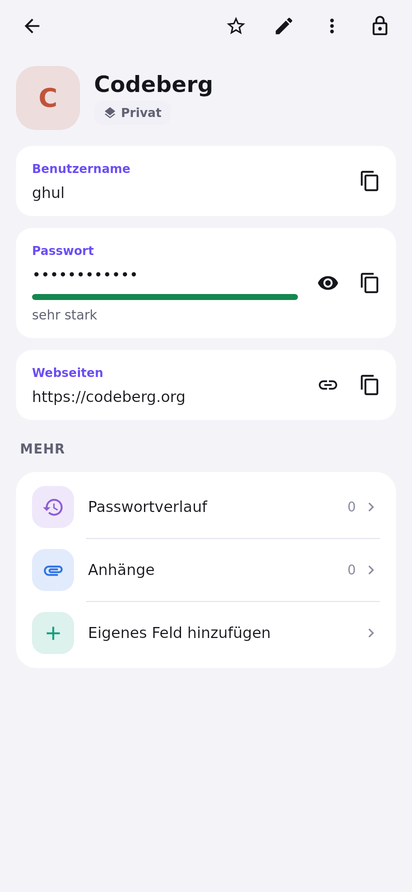</td>
<td valign="top">

- **Alles an einem Ort:** Anmeldungen, Notizen, Kreditkarten, WLAN (mit QR zum Teilen), Identitäten, SSH-Schlüssel;
  eigene Felder, Anhänge, Passwortverlauf, Favoriten und „Zuletzt“.
- **Generator** für Passwörter und Passphrasen.
- **Sicherheitscheck:** schwache und doppelte Passwörter, Konten ohne 2FA; auf Wunsch der Abgleich mit bekannten
  Datenlecks, ohne dass dein Passwort das Gerät verlässt (k-Anonymität: nur der Anfang eines Hashes geht hinaus).
- **Mehrere Tresore**, z. B. „Privat“ und „Familie“, jeder in seiner eigenen Datei. Eine einzelne Tresordatei
  öffnest du auch für sich oder fügst sie deiner Suite hinzu.
- **Als Tresor weitergeben:** ausgewählte Einträge (auch 2FA-Konten aus GhulAuth) als neue Tresordatei mit eigenem
  Passwort und neuer Schlüsseldatei oder eigenem Security Key; vom Schutz deiner Suite geht nichts mit.
- **2FA im Eintrag:** Der aktuelle Code steht direkt bei der Anmeldung.

</td></tr></table>

### 🟢 GhulAuth: 2FA-Codes

<table><tr>
<td width="200" valign="top">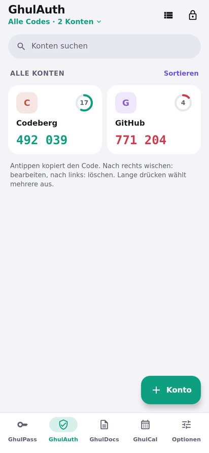</td>
<td valign="top">

- **TOTP für jeden Dienst**, als Liste oder Kacheln, mit Favoriten und eigener Sortierung; Steam-Codes inklusive.
- **Hinzufügen** per Kamera, aus einem Bildschirmfoto, als `otpauth://`-Link oder von Hand.
- **Umzug:** Import aus Google Authenticator (Export-QR), Aegis, 2FAS und anderen; Export als QR-Code.
- **Uhr-Prüfung:** Geht die Uhr des Geräts falsch, warnt die App, statt falsche Codes zu zeigen.
- Auf Wunsch **verdeckte Codes**, die erst beim Antippen erscheinen, und der nächste Code schon vorab.

</td></tr></table>

### 🔵 GhulDrive: Dateien

<table><tr>
<td width="200" valign="top">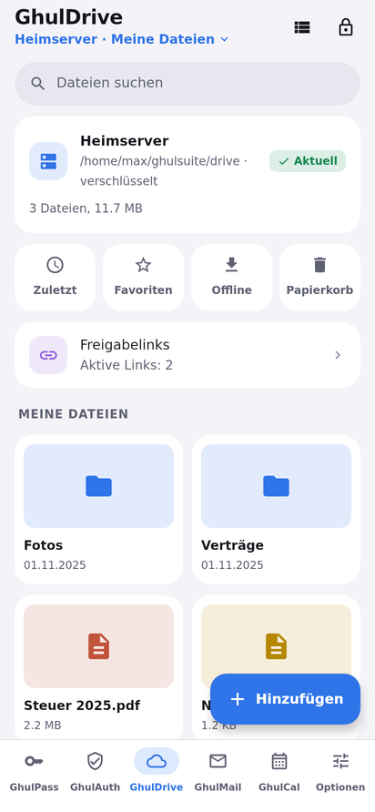</td>
<td valign="top">

- **Verschlüsselte Ablage** auf deinem Server: Dateien werden in Blöcke zerlegt und einzeln verschlüsselt; Namen,
  Ordner und Größen kennt nur dein Gerät.
- **Auf jedem Gerät gleich:** GhulDrive liegt auf deinem Server, nicht in der Suite-Datei. Jede Kopie der
  Suite-Datei seit der letzten Schutzänderung sieht denselben, aktuellen Stand. Arbeiten zwei Geräte gleichzeitig,
  geht nichts verloren (Sperre auf dem Server); ein zurückgespielter oder beschädigter Stand auf dem Server wird
  erkannt, die App warnt und schreibt nichts.
- **Mehrere Speicherorte:** beliebig viele eigene Server, jeder mit eigenen Dateien und Links; einer ist aktiv,
  „Speicherort wechseln“ schaltet um.
- **Ordner, Suche, Favoriten, Zuletzt**, Liste oder Raster mit Vorschaubildern, Speicherbalken nach Dateiart.
- **Offline verfügbar** für ausgewählte Dateien, **Versionen** (die letzten fünf) und **Papierkorb**.
- **Teilen per Link ohne Kopie:** Jede Datei hat ihren eigenen Schlüssel, der Link enthält nur diesen. Ablaufdatum,
  Einmal-Link, Abrufzähler und Passwort; auch große Dateien und ganze Ordner, siehe [unten](#teilen-per-link).
- **Dokumente scannen** (Android) und verschlüsselte ZIPs.

</td></tr></table>

### 🟠 GhulMail: E-Mail

<table><tr>
<td width="200" valign="top">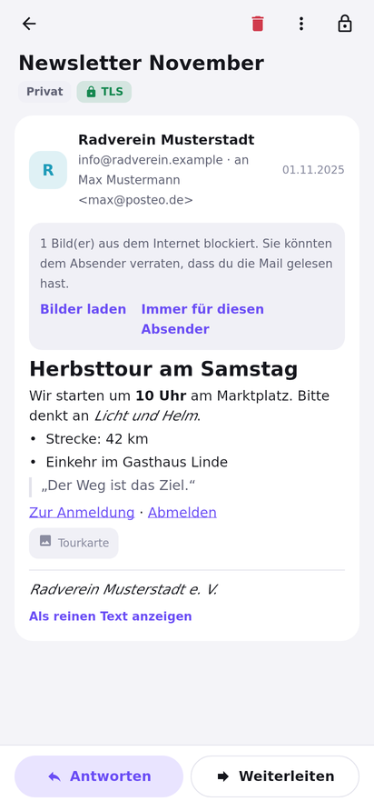</td>
<td valign="top">

- **Jedes Postfach** mit IMAP und SMTP, nur über verschlüsselte Verbindungen; eigene Server mit selbst signiertem
  Zertifikat werden per Fingerabdruck bestätigt.
- **OpenPGP ohne Einrichtung:** Jedes Konto bekommt einen Schlüssel, Mails werden immer signiert und automatisch
  verschlüsselt, sobald der Empfänger einen Schlüssel hat (Autocrypt, WKD). Ein Schloss zeigt, was verschlüsselt ist.
- **Sicher lesen:** HTML wird in sichere Bausteine umgewandelt, Bilder aus dem Internet (Tracking) erst nach Klick.
- **Alles, was man erwartet:** alle Posteingänge, Unterhaltungen, Schlagwörter, markierte Mails, Entwürfe,
  „Später senden“, Wischgesten, Mehrfachauswahl bis zum ganzen Ordner, Papierkorb und Spam leeren, `.eml` und PDF.
- **Benachrichtigungen** mit wählbarem Inhalt; auf dem Sperrbildschirm immer nur „Neue Nachricht“.
- **Archivieren in GhulDrive:** einzelne Mails, ganze Ordner oder automatisch alles Ältere, als `.eml` verschlüsselt
  in GhulDrive, siehe [unten](#mails-in-ghuldrive-archivieren).

</td></tr></table>

### 🔴 GhulCal: Kalender

<table><tr>
<td width="200" valign="top">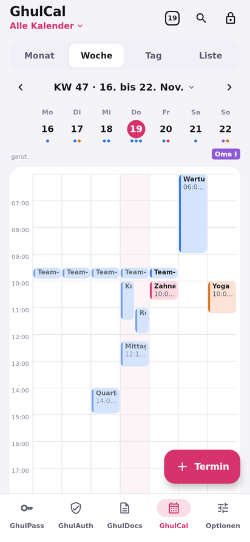</td>
<td valign="top">

- **Termine verschlüsselt** in der Suite-Datei, unterwegs mit allem anderen; bewusst ohne CalDAV.
- **Monat, Woche, Tag und Liste**, mehrere Kalender in eigenen Farben, Geburtstage mit Alter.
- **Schnell-Eintragen** in Alltagssprache, etwa „Zahnarzt Fr 10 Uhr“.
- **Serien und Erinnerungen**, auch bei gesperrter App (Android); Zeitzonen-Wechsel auf Reisen werden beachtet.
- **Feiertage** nach Bundesland, für Österreich und die Schweiz.
- **Import und Export** als `.ics`; Termine aus anderen Zeitzonen werden richtig umgerechnet.

</td></tr></table>

**Für alle Bereiche:** Sofortsperre (Schütteln oder Schnellkachel), Auto-Sperre, Entsperren per Fingerabdruck oder
App-PIN, Schutz vor Bildschirmfotos und vor Apps, die sich über GhulSuite legen, die ganze Suite als eine Datei,
„Rückgängig“ nach dem Löschen, dunkles Design und Deutsch oder Englisch.

## Teilen per Link

Jede Datei in GhulDrive ist mit ihrem **eigenen Schlüssel** verschlüsselt. Ein Freigabelink enthält nur diesen
Schlüssel (hinter dem `#`, den Browser nie an den Server schicken), nie den Schlüssel deines ganzen Drive. Deshalb
wird beim Teilen **nichts kopiert, heruntergeladen oder hochgeladen**: Der Link steht in Sekunden, auch für mehrere
Gigabyte oder ganze Ordner.

- **Das GhulSuite-Server-Modul** (eine PHP-Datei) liefert die verschlüsselten Blöcke aus. Die App installiert es über
  deinen SFTP-Zugang auf demselben Server, auf dem GhulDrive liegt, und prüft, dass es funktioniert.
- **Es setzt alles selbst durch:** Ablaufdatum, Einmal-Links und Abrufzähler gelten auf die Minute, auch wenn keins
  deiner Geräte an ist. Zurückziehen beendet den Link sofort.
- **Es kennt kein Geheimnis und kann nichts schreiben:** Es liefert nur die Blöcke der geteilten Dateien aus, nichts
  sonst aus deinem Drive.
- **Beim Empfänger** entschlüsselt der Browser Stück für Stück und schreibt direkt auf die Festplatte (Chrome, Edge);
  bei mehreren Dateien gibt es jede einzeln.
- **Der Link zeigt die geteilte Fassung**, auch wenn du die Datei danach änderst. Löschst du eine geteilte Datei,
  fragt die App vorher und beendet die Links.
- **Jedes Gerät sieht alle Freigaben:** Sie liegen auf dem Server, nicht in der Suite-Datei; beenden kannst du sie
  von jedem Gerät mit der aktuellen Suite-Datei.

Freigabelinks brauchen einen Server mit SSH-Zugang **und** PHP. Ohne PHP (etwa ein NAS nur mit SFTP) gibt es keine
Freigabelinks, ein Webspace nur mit FTP reicht gar nicht; „An App senden“ und „Als Mail-Anhang“ gehen weiterhin.

## Mails in GhulDrive archivieren

Ältere Mails liegen beim Anbieter oft jahrelang lesbar. GhulMail kopiert sie auf Wunsch als normale `.eml`-Dateien in
GhulDrive, verschlüsselt auf deinem Server: `Mail-Archiv/<Konto>/<Jahr>/2024-05-03 Absender - Betreff.eml`.

- **Einzelne Mails, ganze Ordner oder alles Ältere** auf einmal; große Mengen laufen im Hintergrund mit Fortschritt
  und Meldung am Ende („40 Mails archiviert, 3 waren schon im Archiv“).
- **Automatisch**, wenn du willst: Mails älter als 30, 90 oder 365 Tage aus Posteingang und Gesendet, einmal am Tag.
- **Beim Anbieter bleibt alles**, wie es ist. Aufräumen ist deine Entscheidung: archivieren, dann selbst löschen.
- **Im Archiv lesen:** in GhulMail unter „Archiv“ oder direkt in GhulDrive; die Dateien öffnet jedes Mailprogramm.

## Einrichten und entsperren

<table><tr>
<td width="200" valign="top"></td>
<td valign="top">

Ein Assistent führt in wenigen Schritten durch alles:

1. **Master-Passwort** wählen.
2. **Zweiter Faktor:** Security Key (FIDO2) oder eine Schlüsseldatei, z. B. auf einem USB-Stick.
3. **Notfallblatt** als PDF: ein Wiederherstellungscode mit QR, falls Passwort oder Key verloren gehen.
4. **Bereiche** auswählen. Server für GhulDrive richtest du danach unter Optionen ein.

Die Suite liegt dann auf diesem Gerät. Zum Mitnehmen speicherst du sie unter **Optionen → Suite-Datei** als Datei.

**Im Alltag** reicht auf dem Handy Fingerabdruck oder App-PIN; der Schnellzugang liegt geschützt im Schlüsselspeicher
des Geräts. Die **Sofortsperre** schließt alles mit einem Schütteln oder über
die Schnellkachel und löscht den Schnellzugang, bis du wieder mit beiden Faktoren entsperrst.

</td></tr></table>

## Eine Datei für alle Geräte

GhulSuite synchronisiert nicht. Die Suite ist **eine Datei** (`.ghlzip`): Du öffnest sie, arbeitest darin und
speicherst sie. Wohin sie wandert, entscheidest du, etwa auf einen USB-Stick. Am Handy öffnen, arbeiten, speichern;
am PC dieselbe Datei öffnen, arbeiten, speichern; wieder am Handy öffnen.

- **Speichern unter Optionen → Suite-Datei.** Die App merkt sich die Datei und speichert direkt dorthin, auch auf
  den Stick. Gibt es Änderungen, die noch nicht in der Datei sind, zeigt sie das an („Nicht gespeicherte
  Änderungen“). Auf dem Gerät bleibt eine Arbeitskopie, damit die App auch ohne den Stick funktioniert.
- **Aktuell ist, was zuletzt gespeichert wurde.** Zusammengeführt wird nichts. Wurde die Datei inzwischen auf einem
  anderen Gerät gespeichert, fragt die App, bevor sie sie überschreibt: überschreiben oder unter neuem Namen
  speichern.
- **Erst prüfen, dann ersetzen.** Beim Öffnen wird jeder Teil der Datei geprüft (Siegel, Liste der Tresore, alles
  aus derselben Suite), bevor sie den Stand auf dem Gerät ersetzt. Ist die Datei älter als der Stand hier, wurde
  sie von einem anderen Stand aus weiterbearbeitet oder enthält sie eine andere Suite, fragt die App nach, ebenso,
  wenn dabei nicht gespeicherte Änderungen verloren gingen.
- **Nach einer Schutzänderung** (neues Passwort, neuer Wiederherstellungscode, Key oder Schlüsseldatei entfernt)
  bittet die App, die Suite-Datei zu speichern; damit ersetzt du ältere Kopien. Eine ältere Datei mit dem alten
  Schutz öffnet sich auf einem Gerät, das den neuen Stand kennt, nicht mehr, und auf keinem Gerät kommt sie noch an
  GhulDrive und deine Server.
- **GhulDrive und Mails reisen nicht mit:** GhulDrive liegt auf deinem Server und ist auf jedem Gerät gleich, Mails
  liegen bei deinem Anbieter. In der Datei stehen Passwörter, 2FA, Mail-Konten, Kalender und die Server-Zugänge.
- **Einzelne Tresore:** Eine Tresordatei lässt sich auch für sich öffnen, mit Passwort und zweitem Faktor oder dem
  Wiederherstellungscode, und zu deiner Suite hinzufügen. Ausgewählte Einträge gibst du als neuen Tresor mit eigener
  Schlüsseldatei oder eigenem Security Key weiter.

## Auch auf dem großen Bildschirm

Unter Windows (und im Querformat) mit den Bereichen links in einer Seitenleiste und allem anderen in einer gut lesbaren Spalte daneben, als Installer oder portabel vom USB-Stick.

<div align="center">
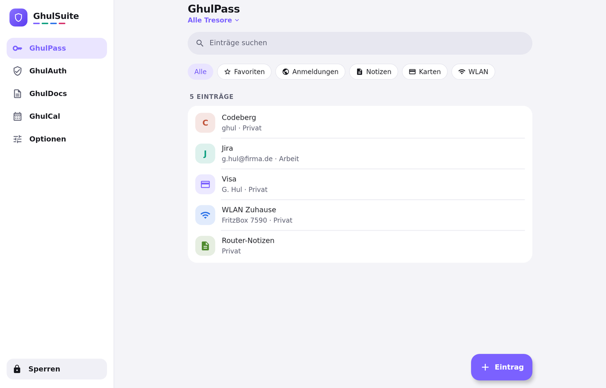
<br><br>
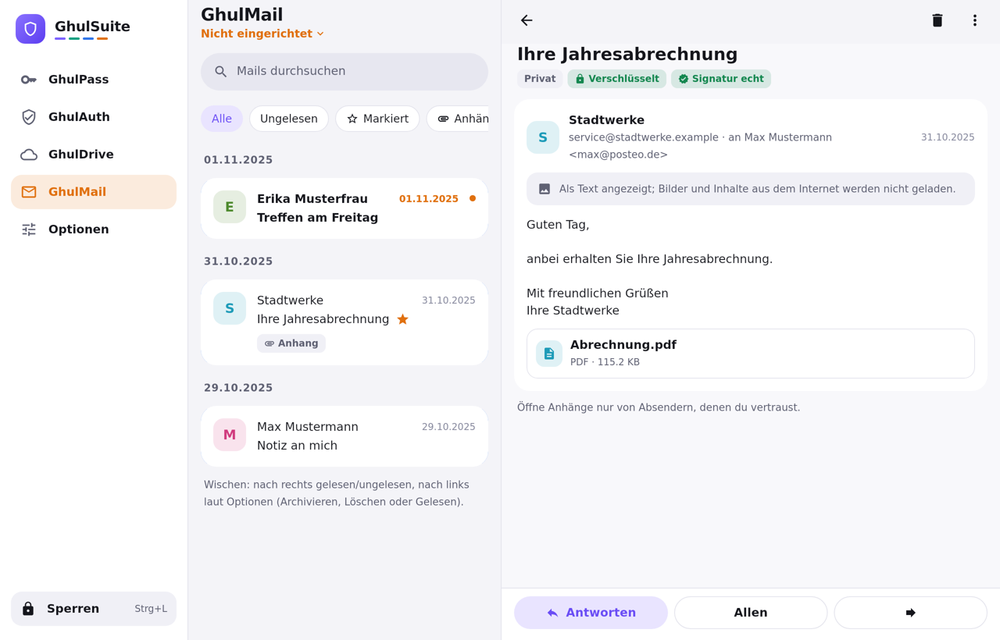&nbsp;
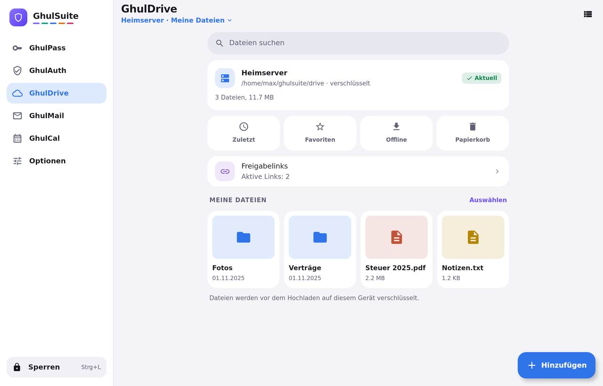
<br><br>

</div>

## Selbst hosten in fünf Minuten

GhulSuite braucht **keinen speziellen Server**, und GhulPass, GhulAuth, GhulMail und GhulCal brauchen gar keinen.
Ein Server in der App ist für **GhulDrive und Freigabelinks** da und immer ein Zugang per SFTP:

> [!IMPORTANT]
> **Voraussetzung: ein Server oder Webhosting mit SSH-Zugang.** Die App meldet sich nur per SFTP mit einem
> SSH-Schlüssel an, der verschlüsselt in deiner Suite liegt, nie mit einem gespeicherten Passwort. Ein Webspace nur
> mit FTP (auch mit FTPS) reicht für GhulDrive und Freigabelinks **nicht**.

| Zugang | Was du brauchst | Ideal für |
|---|---|---|
| **SFTP** | Einen Server mit SSH-Zugang, Anmeldung per Schlüssel | Eigener Server, VPS, NAS, Raspberry Pi, Webhosting mit SSH, Speicherbox mit SFTP |
| **+ Server-Modul** (optional) | **PHP 8.1** oder neuer auf demselben Server, ohne Datenbank | Freigabelinks |

**So geht's:**
1. In der App: **Optionen → GhulDrive → Speicherort hinzufügen**, Server und Benutzer eintragen. Die Suite hat einen
   eigenen SSH-Schlüssel: Mit deinem Passwort trägt die App ihn einmal in `~/.ssh/authorized_keys` ein (das Passwort
   wird nicht gespeichert), oder du trägst den angezeigten öffentlichen Schlüssel selbst ein, bei manchen Anbietern
   im Webpanel. Den Fingerabdruck des Servers bestätigst du beim ersten Verbinden, danach wird er geprüft. Dann den
   Ordner für GhulSuite aussuchen; er muss **außerhalb deiner Website** liegen (siehe unten). **„Verbindung
   testen“** zeigt Schritt für Schritt, was klappt und was nicht; erst danach lässt sich der Server speichern. Bei
   Mail-Konten genauso: Posteingang und Postausgang werden einzeln geprüft, gespeichert wird nur eine Verbindung,
   die funktioniert.
2. Für Freigabelinks: im Block des Speicherorts **„Modul installieren“**, den Ordner deiner Website wählen. Die App
   lädt `ghulsuite.php` per SFTP dorthin und prüft Adresse, PHP, den Zugriff auf den GhulSuite-Ordner und dass
   dieser Ordner nicht aus dem Web abrufbar ist.

**Neue Schlüssel nach einer Schutzänderung.** Änderst du Passwort oder Wiederherstellungscode oder entfernst du einen
Key oder eine Schlüsseldatei, bekommen GhulDrive und deine Server neue Schlüssel: Die App verschlüsselt den Index von
GhulDrive neu, trägt einen neuen SSH-Schlüssel ein, meldet sich damit an und entfernt den alten. Bei eigenen Servern,
NAS und den meisten Webhostern mit SSH geht das ohne dein Zutun. Verwaltet dein Anbieter SSH-Schlüssel nur in seinem
Webpanel, zeigt die App den neuen Schlüssel und führt dich durch Eintragen und Entfernen, mit „Prüfen“ nach jedem
Schritt; bis dahin bleibt der Server mit dem alten Schlüssel nutzbar. Danach kommt eine ältere Kopie der Suite-Datei
(etwa auf einem verlorenen Stick) nicht mehr an GhulDrive und deine Server.

**Wo liegt was?** Zwei Ordner mit zwei Aufgaben:

```
dein Zugang (SFTP)
├── ghulsuite/          ← GhulSuite-Ordner: GhulDrive und Freigaben. NICHT aus dem Web erreichbar
└── public_html/        ← Ordner deiner Website (auch htdocs, www oder ein Ordner mit Domainnamen)
    └── ghulsuite.php   ← nur das Server-Modul, per https erreichbar
```

- Der **GhulSuite-Ordner** gehört neben die Website, nicht hinein. Zwar ist darin alles verschlüsselt, aber niemand
  soll die Dateien überhaupt abrufen können.
- Das **Modul** muss in der Website liegen, damit Empfänger es per https erreichen. Es liest den GhulSuite-Ordner
  über den Dateipfad auf dem Server, nicht über das Web.
- Geht es nicht anders und der GhulSuite-Ordner liegt in der Website, sperrt die App ihn mit einer `.htaccess` (wirkt
  bei Apache). Beim Installieren des Moduls prüft sie, ob er trotzdem abrufbar ist (etwa bei nginx, das `.htaccess`
  nicht kennt); dann richtet sie das Modul nicht ein und sagt dir, was zu tun ist.

Das Modul hat keinen Schlüssel und keinen Schreibzugriff übers Web. Es liest nur, was die App für einen Link in den
GhulSuite-Ordner legt, und gibt genau diese verschlüsselten Blöcke heraus. Für normale Mails brauchst du keinen
eigenen Server: GhulMail spricht direkt mit deinem Postfach.

## So schützt GhulSuite deine Daten

```
 dein Gerät                                        dein Server
┌──────────────────────────────┐                ┌──────────────────────────┐
│ Master-Passwort  ─┐          │                │                          │
│ Security Key ─────┼─► Schlüssel ─► XChaCha20  │  nur verschlüsselte      │
│ (oder Schlüsseldatei)        │     -Poly1305 ─┼─►  Blöcke mit Zufalls-   │
│                              │                │  namen, keine Inhalte,   │
│ Wiederherstellungscode ──────┘ (Notfall)      │  Namen oder Ordner       │
└──────────────────────────────┘                └──────────────────────────┘
```

**Wer sieht was?**

| Wer | sieht | sieht nicht |
|---|---|---|
| Dein Server bzw. Hoster | Anzahl und ungefähre Größe verschlüsselter Blöcke von GhulDrive, wann sie sich ändern | Inhalte, Namen von Dateien und Ordnern; Passwörter, 2FA, Termine und Mail-Konten liegen gar nicht dort. Löscht er Blöcke oder spielt einen alten Stand zurück, merkt es die App |
| Jemand mit deiner Suite-Datei (z. B. verlorener USB-Stick) | Datensalat | ohne Passwort **und** zweiten Faktor nichts; er kann nichts unterschieben (Siegel) und dir keine ältere Datei unbemerkt unterjubeln (die App fragt nach) |
| Jemand mit deinem gesperrten Handy | Benachrichtigungen ohne Inhalt | Einträge, Codes, Dateien, Mails |
| Dein Mail-Anbieter | die Mails, die bei ihm liegen (bei PGP nur verschlüsselt) | Kopien im Archiv in GhulDrive |
| Wer einen Freigabelink hat | genau die geteilten Dateien, solange der Link gilt | alles andere in deinem Drive |
| Ein verlorener Key oder ein altes Notfallblatt | nach dem Entfernen bzw. Erneuern höchstens eine alte Kopie der Suite-Datei, mit dem Stand von damals | alles, was du danach speicherst; GhulDrive und deine Server (sie haben neue Schlüssel) |

- **Schlüssel:** Argon2id für das Passwort, FIDO2 `hmac-secret`/PRF für den Security Key; beide sind nötig.
- **Verschlüsselung:** XChaCha20-Poly1305, jede Datei mit einem Siegel, das nur mit deinem Passwort entsteht;
  Dateiformat offen dokumentiert ([`docs/FORMAT.md`](docs/FORMAT.md)) mit unabhängig geprüften Testvektoren.
- **Kern in Rust**, eine gemeinsame Codebasis für Android und Windows.
- Der [Sicherheitsbericht](docs/AUDIT.md) fasst alle Audits und Testrunden zusammen: was behoben ist, was offen ist und wogegen GhulSuite schützt.

## Was geprüft ist und was noch fehlt

GhulSuite ist ein Soloprojekt ohne bezahlten externen Audit. Umso wichtiger ist, dass jeder nachprüfen kann, was
getestet wird und was nicht:

- **Bei jeder Änderung** laufen über eine Million Einzelprüfungen in über 250 Testfunktionen: Angriffe auf Dateien
  und auf die Suite-Datei (fehlende, vertauschte, alte, fremde oder abgezweigte Teile, ZIP-Tricks), auf Server und
  GhulDrive (gleichzeitige Änderungen, zurückgespielter Index, Abbruch mitten im Schlüsselwechsel), ein „bekloppter
  Nutzer“, der die Suite zwischen drei Geräten hin- und herträgt, kaputte und böswillige Eingaben in jeden Parser,
  Tests gegen echte SFTP-, IMAP- und SMTP-Server. Dazu kommen öffentliche Sammlungen wie Project
  Wycheproof (Kryptografie), die Big List of Naughty Strings, XSS- und CRLF-Sammlungen für Mails, die URL-Testdaten
  der Browser, JSONTestSuite, Kalenderdateien anderer Programme und die Zeitzonen-Regeln der ganzen Welt. Das
  Server-Modul muss gezielte Angriffe abwehren (Tickets, Pfade, Einmal-Links im Wettlauf), und Freigabelinks werden
  im echten Browser geöffnet.
- **Im Emulator** werden die wichtigsten Abläufe durchgeklickt, auch gegen echte Testserver; danach wird geprüft,
  dass dort nur Verschlüsseltes liegt.
- **Jede Nacht** zusätzlich: langes Fuzzing, Dauerläufe, zufällige Bedienung im Emulator, Server mit kaputtem TLS,
  9.807 Zertifikatsketten, OpenPGP gegen GnuPG, Scans von PHP-Modul und APK.
- **Was gefunden wurde und was offen ist,** steht mit Nummer und Schwere im
  [Testprotokoll](docs/TESTPROTOKOLL.md); wie getestet wird, im [Testkonzept](docs/TESTKONZEPT.md).

Kein Test beweist, dass es keine Lücke mehr gibt. GhulSuite ist eine **Entwicklungsversion**: Speichere die
Suite-Datei regelmäßig und bewahre eine Kopie auf. Und wenn du dich mit Sicherheit auskennst: Lies mit, greif an, melde, was du findest.

## Umziehen leicht gemacht

Import aus **Proton Pass**, **Bitwarden**, **KeePass/KeePassXC** (CSV), **Proton Authenticator**, **Aegis**, **2FAS**,
**Google Authenticator** (Export-QR) und `otpauth://`-Links. Doppelte Einträge werden erkannt und übersprungen;
was sich nicht übernehmen lässt, wird mit Namen genannt und nicht stillschweigend verworfen. Kalender kommen als
`.ics`, Mails direkt aus deinem Postfach.

## Download

| | Stabil (freigegeben) | Vorab (Entwicklung) |
|---|---|---|
| **Android** | [GhulSuite.apk](https://github.com/ghulaschsuppe/GhulSuite/releases/latest/download/GhulSuite.apk) | [Vorabversionen](https://github.com/ghulaschsuppe/GhulSuite/releases) |
| **Windows, Installer** | [GhulSuite.msi](https://github.com/ghulaschsuppe/GhulSuite/releases/latest/download/GhulSuite.msi) | [Vorabversionen](https://github.com/ghulaschsuppe/GhulSuite/releases) |
| **Windows, portabel** (USB-Stick) | [GhulSuite-portable.zip](https://github.com/ghulaschsuppe/GhulSuite/releases/latest/download/GhulSuite-portable.zip) | [Vorabversionen](https://github.com/ghulaschsuppe/GhulSuite/releases) |

- **Stabil** sind die freigegebenen Versionen vom Zweig `main`. **Vorabversionen** (`0.6.0-dev.3`) entstehen
  automatisch aus dem Zweig `dev`, bevor sie freigegeben werden: neuer, aber weniger getestet. Auf der
  Release-Seite sind sie als „Pre-release“ markiert.
- **Updates kommen aus der App:** Optionen → Über → Updates. Einmal am Tag nach dem Entsperren schaut GhulSuite nach
  (abschaltbar), installiert wird nur nach deiner Zustimmung. Dort wählst du auch den Kanal: „Stabil“ oder „Vorab“.
- **Geprüft vor jeder Installation:** Jede Version enthält `SHA256SUMS`, signiert mit dem Signaturschlüssel der App
  (`SHA256SUMS.sig`). Die App installiert nur, was zu dieser Signatur, Größe und Prüfsumme passt; Android prüft
  zusätzlich, dass das neue APK mit demselben Schlüssel signiert ist. Von Hand: `sha256sum -c SHA256SUMS`.
- Der Windows-Installer ist (noch) nicht von Microsoft signiert: Windows SmartScreen fragt beim ersten Start nach.
- **Testversionen** zu jeder Änderung (als eigene App neben der normalen installierbar, ohne Updates) gibt es weiterhin unter
  **Actions → letzter grüner Lauf → Artefakte**.

## Selbst bauen

Rust, Android SDK (NDK 28) und JDK 17, dann:

```bash
cd app && ./gradlew :composeApp:assembleDebug        # Android-APK
cd app && ./gradlew :composeApp:packageMsi           # Windows-Installer (unter Windows)
tools/precheck.sh                                     # alle Prüfungen der CI, die lokal gehen
```

Alles Weitere (Aufbau, Tests, Regeln) steht in [`PROJEKT.md`](PROJEKT.md), das Konzept in [`docs/KONZEPT.md`](docs/KONZEPT.md).

## Mitmachen

Fehler gefunden, Idee gehabt? Issues und Pull Requests sind willkommen. Bitte lies vorher [`CONTRIBUTING.md`](CONTRIBUTING.md).
Sicherheitslücken bitte vertraulich über **Security → Report a vulnerability** melden.

## Lizenz

GhulSuite ist freie Software unter der **[GNU Affero General Public License 3.0](LICENSE)** (oder neuer), mit
[Zusatzbedingungen](NOTICE): Der Urhebervermerk bleibt in jeder Fassung sichtbar. Wer GhulSuite verändert und
weitergibt oder als Dienst betreibt, muss den Quelltext ebenfalls offenlegen.
Name und Logo sind geschützt, siehe [`TRADEMARKS.md`](TRADEMARKS.md).

**Website:** [www.ghulsuite.de](https://www.ghulsuite.de) ·
[Impressum](https://www.ghulsuite.de/impressum.html) ·
[Datenschutz (App)](https://www.ghulsuite.de/datenschutz-app.html) ·
[Datenschutz (Website)](https://www.ghulsuite.de/datenschutz.html).
Die App schickt dem Entwickler keinerlei Daten; welche Verbindungen sie aufbaut, steht vollständig in der
Datenschutzerklärung der App.

---

### English

**GhulSuite** is a self-hosted, end-to-end encrypted suite for **passwords, 2FA codes, files, mail and calendar**: one app for
Android and Windows. Everything is encrypted on your device (master password **plus** FIDO2 security key or key
file). There is no sync: the whole suite is one encrypted file (`.ghlzip`) you save and open on your next device,
e.g. from a USB stick; the state saved last is the current one. GhulDrive lives on your own server, which only ever
stores ciphertext and is the same on every device. It needs a server or web hosting **with SSH access** (SFTP, key
login only); plain FTP web space is not enough. Share links come from a small PHP 8.1 module the app installs on the
same server, without copying anything (every file has its own key). Mail can be archived as encrypted `.eml` files
in GhulDrive. Free software under the
AGPL-3.0, see [`LICENSE`](LICENSE).

> **Work in progress, not for production use.** GhulSuite is still under development; whole parts of the app, the
> file format and the server layout may change at any time, without migrating older data.
Website: [www.ghulsuite.de/en](https://www.ghulsuite.de/en/) · [legal notice](https://www.ghulsuite.de/en/imprint.html) ·
[privacy policy of the app](https://www.ghulsuite.de/en/privacy-app.html).

<div align="center">
<br>
<sub><b>Made by Daniel Erdmann · 2026</b></sub>
</div>
