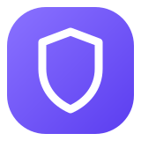
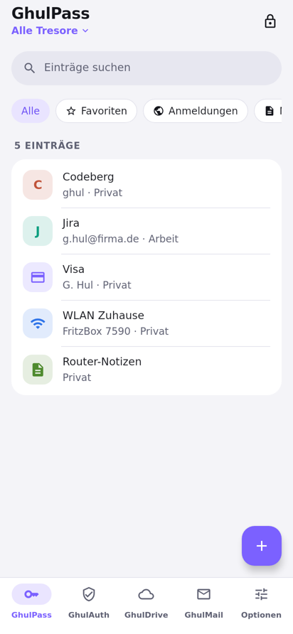
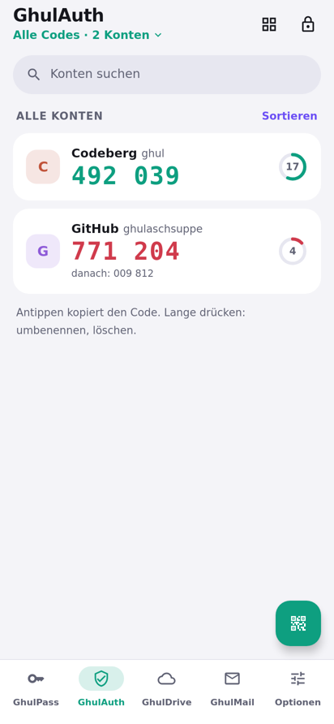
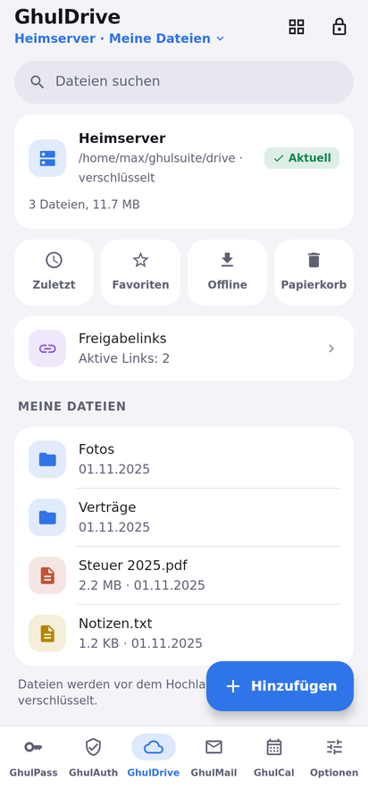
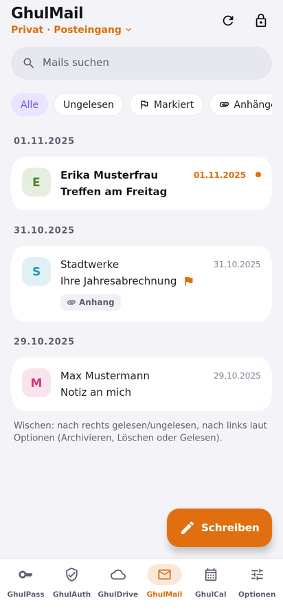
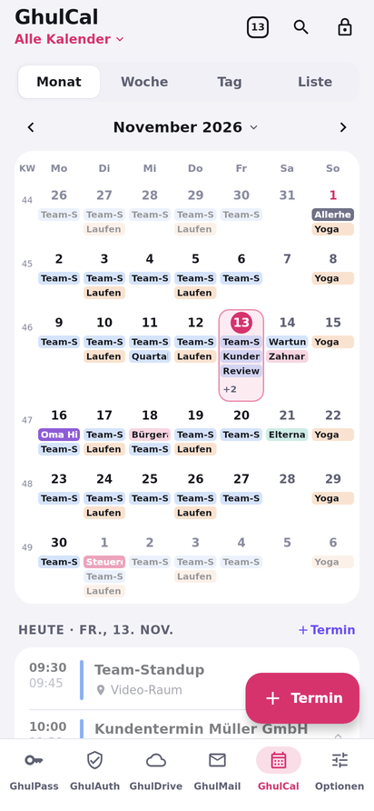
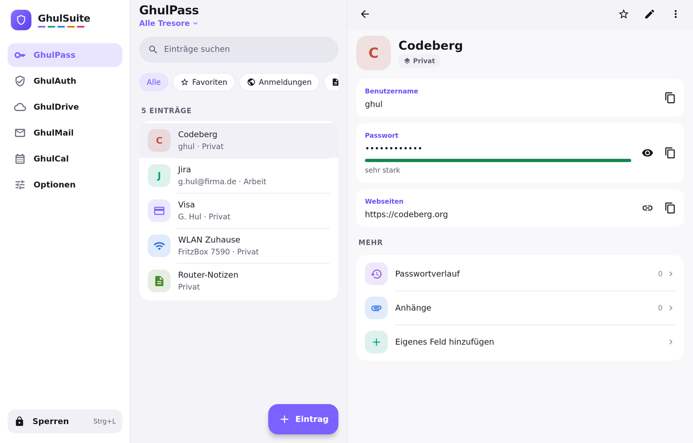
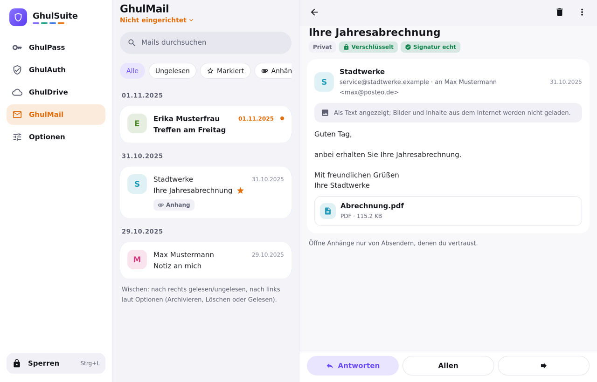
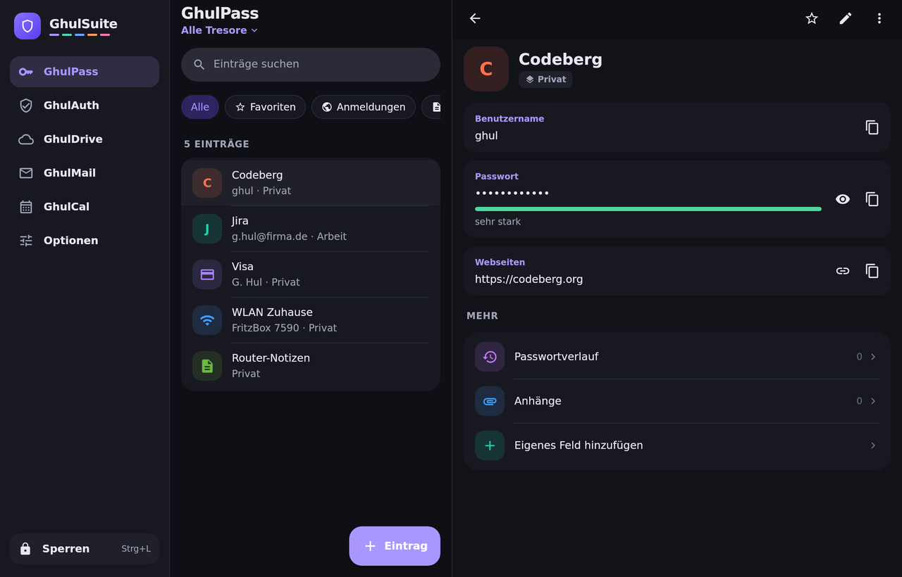

<div align="center">



# GhulSuite


**Passwörter · 2FA · Dateien · Mail · Kalender in einer App, verschlüsselt auf deinem Gerät, gespeichert auf deinem eigenen Server.**

Die selbst gehostete Alternative zu den bekannten Privacy-Suiten: gleicher Komfort, aber ohne Abo,
ohne Konto bei einem Anbieter und ohne Vertrauensvorschuss. Die Daten liegen da, wo **du** sie hinlegst.

[](LICENSE)


<br>

&nbsp;
&nbsp;
&nbsp;
&nbsp;


</div>

---

## Warum GhulSuite?

Die meisten „sicheren“ Suiten verlangen, dass du einem Unternehmen vertraust: dessen Servern, dessen Preisen,
dessen Zukunft. GhulSuite dreht das um:

- 🔐 **Ende-zu-Ende verschlüsselt, immer.** Alles wird auf deinem Gerät verschlüsselt, bevor es irgendwohin geht.
  Dein Server sieht nur Datensalat: keine Inhalte, keine Datei- und Ordnernamen deiner Ablage, nicht einmal die
  Namen deiner Tresore.
- 🏠 **Dein Server, deine Regeln.** Ein günstiges Standard-Webhosting mit PHP reicht. Keine Datenbank, kein Docker,
  kein Root-Zugang nötig. Oder jeder Server mit SFTP/FTPS.
- 🗝️ **Zwei Faktoren, ohne Ausnahme.** Master-Passwort **plus** Security Key (FIDO2) oder Schlüsseldatei.
  Dazu ein Wiederherstellungscode mit Notfallblatt für den Tag, an dem alles schiefgeht. Verlierst du einen Key
  oder das Blatt, entfernst bzw. erneuerst du es: Ab dann öffnet es nichts mehr, auch nicht mit einer alten Sicherung.
- 📦 **Der Ordner ist die Suite.** Deine Daten sind normale, verschlüsselte Dateien. Kopieren, sichern, auf den
  USB-Stick legen, ohne Export-Zwang und ohne Anbieterbindung. Standard ist der private App-Speicher; unter
  Optionen → Tresore wechselst du jederzeit in einen eigenen Ordner und zurück (alles wird kopiert und geprüft).
  Dateinamen sind egal: Umbenannte Tresordateien erkennt die App am Inhalt.
- 🧩 **Eine App statt fünf.** Ein Entsperren, ein Design, eine Synchronisation.
- 💯 **Open Source.** Jede Zeile ist hier nachlesbar.

## Die fünf Bereiche

| | Bereich | Was er kann |
|---|---|---|
| 🟣 | **GhulPass**: Passwörter | Anmeldungen, Notizen, Karten, WLAN, Identitäten, SSH-Schlüssel · Autofill in Apps und Browsern, nur auf der echten Seite (Schutz vor Phishing-Adressen) · Passwort- und Passphrasen-Generator · Sicherheitscheck (schwach, doppelt, ohne 2FA, optional Datenlecks per k-Anonymität) · Passwortverlauf, Anhänge, eigene Felder · mehrere Tresore |
| 🟢 | **GhulAuth**: 2FA-Codes | TOTP für alle Dienste · QR-Code per Kamera oder aus einem Bild · Import aus Google Authenticator, Aegis, 2FAS u. a. · Export als QR · Favoriten, Kachelansicht · Uhr-Prüfung |
| 🔵 | **GhulDrive**: Dateien | Verschlüsselte Ablage auf deinem Server · Ordner, Suche, Favoriten, Zuletzt · Offline verfügbar · Versionen und Papierkorb · Freigabelinks mit Ablauf, Passwort und Einmal-Link · verschlüsselte ZIPs · Dokumente scannen · Foto-Sicherung |
| 🟠 | **GhulMail**: E-Mail | Jedes IMAP/SMTP-Postfach · OpenPGP ohne Einrichtung (Autocrypt, WKD): signiert immer, verschlüsselt automatisch · Alle Posteingänge, Unterhaltungen, Schlagwörter · Mehrfachauswahl bis zum ganzen Ordner, Papierkorb und Spam leeren · Entwürfe, Später senden · Benachrichtigungen mit wählbarem Inhalt · offline lesen · als Standard-Mail-App nutzbar (Android) |
| 🔴 | **GhulCal**: Kalender | Termine verschlüsselt im Suite-Ordner · Monat, Woche, Tag, Liste · Serien und Erinnerungen · Schnell-Eintragen („Zahnarzt Fr 10 Uhr“) · Feiertage nach Bundesland, Österreich, Schweiz · mehrere Kalender, Geburtstage mit Alter · Import und Export als .ics, Zeitzonen werden umgerechnet · bewusst ohne CalDAV |

Dazu: **Sofortsperre** (Schütteln oder Schnellkachel), Auto-Sperre, Entsperren per Fingerabdruck oder App-PIN,
Schutz vor Bildschirmfotos, Komplett-Sicherung als ZIP und Synchronisation zwischen all deinen Geräten.

## Auch auf dem großen Bildschirm

Unter Windows (und auf Tablets im Querformat) mit Seitenleiste und zwei Spalten, als Installer oder portabel vom USB-Stick.

<div align="center">

<br><br>
&nbsp;

</div>

## Selbst hosten in fünf Minuten

GhulSuite braucht **keinen speziellen Server**. Du hast drei Möglichkeiten:

| Variante | Was du brauchst | Ideal für |
|---|---|---|
| **GhulSuite-Server-Modul** | Webspace mit **PHP 8.1** (oder neuer), ohne Datenbank | Günstiges Webhosting, zusätzlich mit Abrufzähler und Einmal-Links beim Teilen |
| **SFTP** | Einen Server mit SSH-Zugang | Eigener Server, NAS, Raspberry Pi |
| **FTPS** | FTP mit TLS-Verschlüsselung | Webhosting ohne SSH |

**So geht's mit dem Server-Modul:**
1. In der App: **Optionen → Server, Sync und Teilen → Server hinzufügen → GhulSuite-Server-Modul**.
2. Die App erzeugt die Datei `ghulsuite.php` mit einem eigenen Zugangsschlüssel.
3. Lade sie auf deinen Webspace (oder lass die App das per FTPS/SFTP erledigen) und trage die Adresse ein.
4. Fertig: Synchronisation, GhulDrive und Freigabelinks laufen über deinen Server.

Mails brauchen keinen eigenen Server: GhulMail spricht direkt mit deinem Postfach (IMAP/SMTP, nur verschlüsselt).

## So schützt GhulSuite deine Daten

```
 dein Gerät                                        dein Server
┌──────────────────────────────┐                ┌──────────────────────────┐
│ Master-Passwort  ─┐          │                │                          │
│ Security Key ─────┼─► Schlüssel ─► XChaCha20  │  nur verschlüsselte      │
│ (oder Schlüsseldatei)        │     -Poly1305 ─┼─►  Blöcke mit Zufalls-   │
│                              │                │  namen, keine Inhalte,   │
│ Wiederherstellungscode ──────┘ (Notfall)      │  Namen oder Ordner       │
└──────────────────────────────┘                └──────────────────────────┘
```

- **Schlüssel:** Argon2id für das Passwort, FIDO2 `hmac-secret`/PRF für den Security Key; beide sind nötig.
- **Verschlüsselung:** XChaCha20-Poly1305, Dateiformat offen dokumentiert ([`docs/FORMAT.md`](docs/FORMAT.md)) mit
  unabhängig geprüften Testvektoren.
- **Kern in Rust**, eine gemeinsame Codebasis für Android und Windows; Fuzzing, Abhängigkeitsprüfung und Tests gegen
  echte SFTP-, FTPS-, IMAP- und SMTP-Server in jeder CI-Runde.
- Der [Sicherheitsbericht](docs/AUDIT.md) fasst alle Audits und Testrunden zusammen: was behoben ist, was offen ist und wogegen GhulSuite schützt.

## Was geprüft ist und was noch fehlt

GhulSuite ist ein Soloprojekt ohne bezahlten externen Audit. Umso wichtiger ist, dass jeder nachprüfen kann, was
getestet wird und was nicht:

- **Bei jeder Änderung** laufen über eine Million Einzelprüfungen: Angriffe auf Dateien, Server und Synchronisation,
  ein „bekloppter Nutzer“ auf drei Geräten, kaputte und böswillige Eingaben in jeden Parser. Dazu kommen öffentliche
  Sammlungen wie Project Wycheproof (Kryptografie), die Big List of Naughty Strings, XSS- und CRLF-Sammlungen für
  Mails, die URL-Testdaten der Browser, JSONTestSuite, Kalenderdateien anderer Programme und die Zeitzonen-Regeln
  der ganzen Welt. Das Server-Modul muss 335 gezielte Angriffe abwehren.
- **Jede Nacht** zusätzlich: langes Fuzzing, Dauerläufe, zufällige Bedienung im Emulator, Server mit kaputtem TLS.
- **Was gefunden wurde und was offen ist,** steht mit Nummer und Schwere im
  [Testprotokoll](docs/TESTPROTOKOLL.md); wie getestet wird, im [Testkonzept](docs/TESTKONZEPT.md).

Kein Test beweist, dass es keine Lücke mehr gibt. GhulSuite ist eine **Entwicklungsversion**: Nutze sie mit
regelmäßiger Sicherung. Und wenn du dich mit Sicherheit auskennst: Lies mit, greif an, melde, was du findest.

## Umziehen leicht gemacht

Import aus **Proton Pass**, **Bitwarden**, **KeePass/KeePassXC** (CSV), **Proton Authenticator**, **Aegis**, **2FAS**,
**Google Authenticator** (Export-QR) und `otpauth://`-Links. Doppelte Einträge werden erkannt und übersprungen.

## Download

GhulSuite ist in Entwicklung. Testversionen (Android-APK, Windows-Installer und portable Version) entstehen bei jeder
Änderung automatisch. Du findest sie unter **Actions → letzter grüner Lauf → Artefakte**. Feste Versionen folgen unter **Releases**.

## Selbst bauen

Rust, Android SDK (NDK 28) und JDK 17, dann:

```bash
cd app && ./gradlew :composeApp:assembleDebug        # Android-APK
cd app && ./gradlew :composeApp:packageMsi           # Windows-Installer (unter Windows)
```

Alles Weitere (Aufbau, Tests, Regeln) steht in [`PROJEKT.md`](PROJEKT.md), das Konzept in [`docs/KONZEPT.md`](docs/KONZEPT.md).

## Mitmachen

Fehler gefunden, Idee gehabt? Issues und Pull Requests sind willkommen. Bitte lies vorher [`CONTRIBUTING.md`](CONTRIBUTING.md).
Sicherheitslücken bitte vertraulich über **Security → Report a vulnerability** melden.

## Lizenz

GhulSuite ist freie Software unter der **[GNU Affero General Public License 3.0](LICENSE)** (oder neuer), mit
[Zusatzbedingungen](NOTICE): Der Urhebervermerk bleibt in jeder Fassung sichtbar. Wer GhulSuite verändert und
weitergibt oder als Dienst betreibt, muss den Quelltext ebenfalls offenlegen.
Name und Logo sind geschützt, siehe [`TRADEMARKS.md`](TRADEMARKS.md).

---

### English

**GhulSuite** is a self-hosted, end-to-end encrypted suite for **passwords, 2FA codes, files, mail and calendar**: one app for
Android and Windows. Everything is encrypted on your device (master password **plus** FIDO2 security key or key
file); your own server only ever stores ciphertext. Any SFTP/FTPS server or plain PHP 8.1 web hosting without a
database is enough. Free software under the AGPL-3.0, see [`LICENSE`](LICENSE).

<div align="center">
<br>
<sub><b>Made by Daniel Erdmann · 2026</b></sub>
</div>
