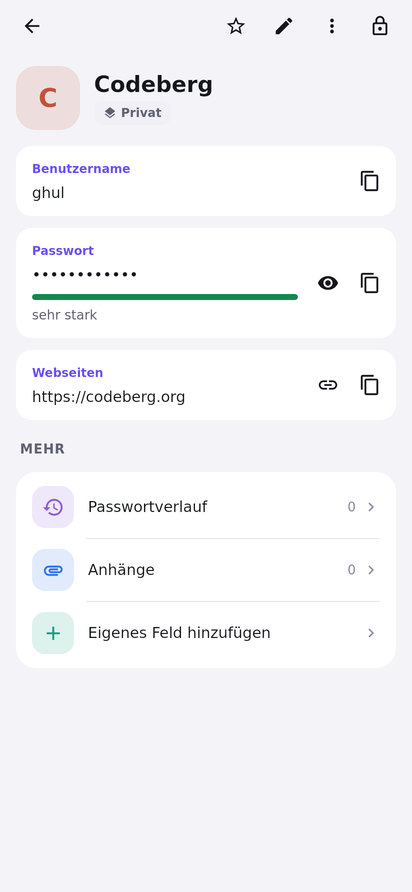
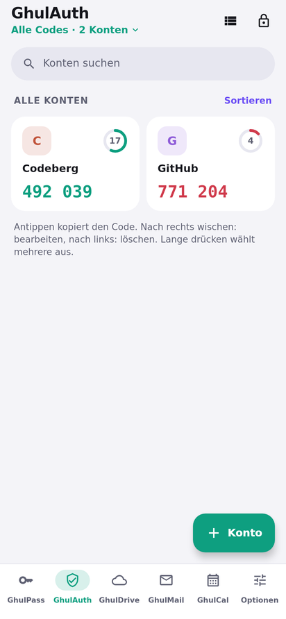
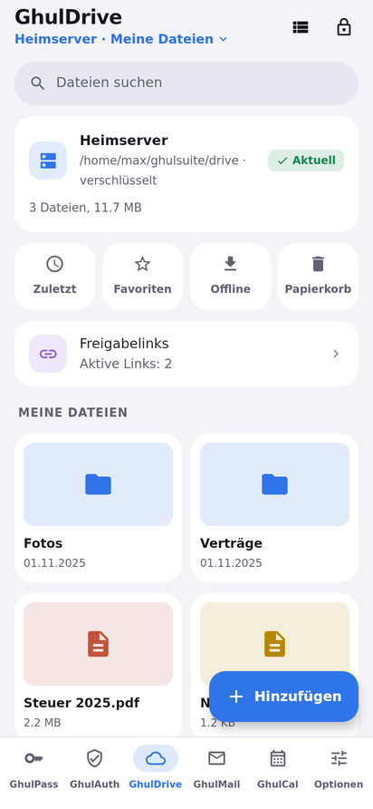
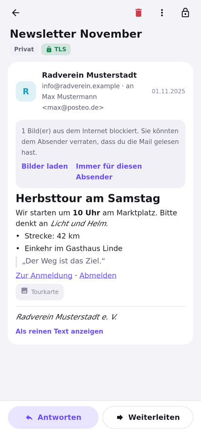
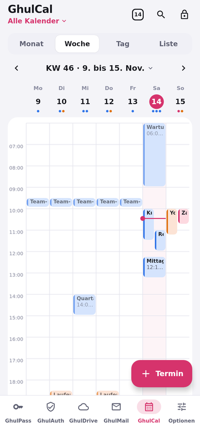
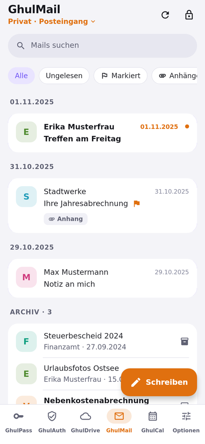
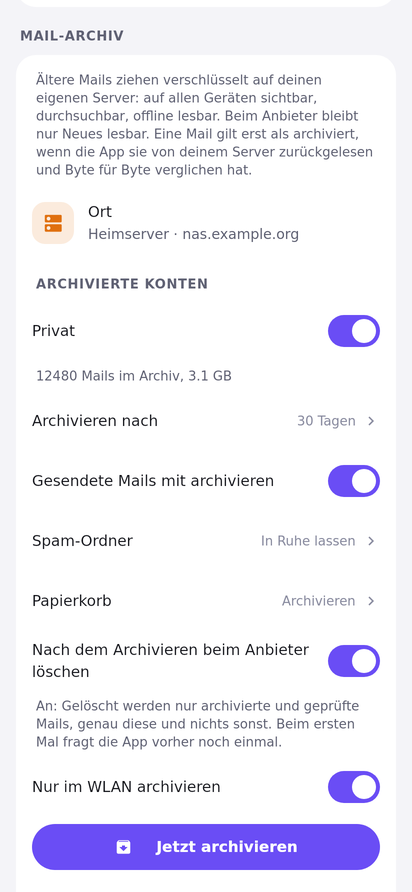
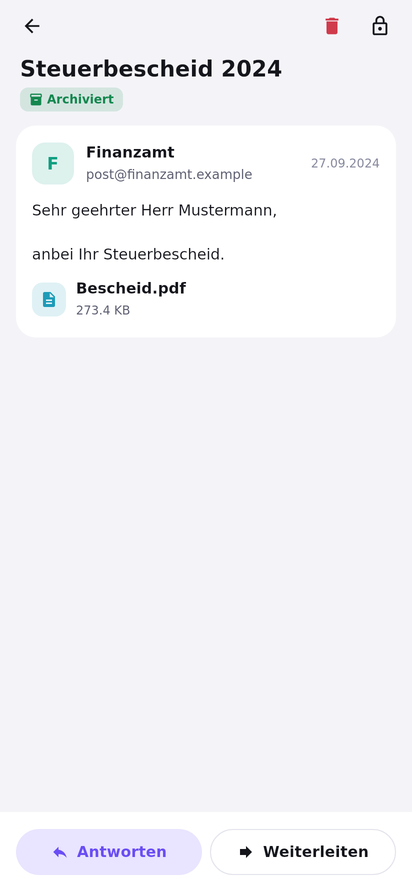
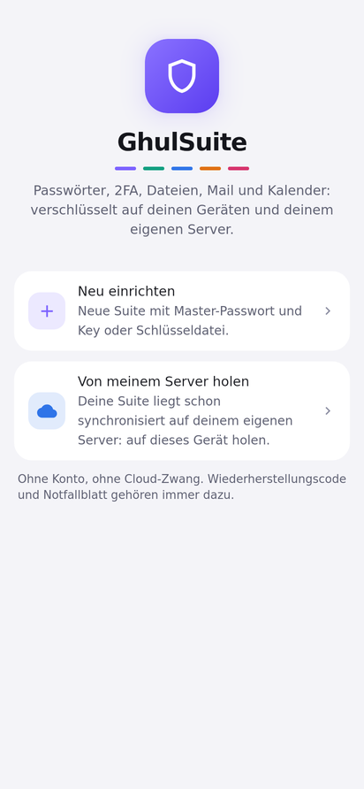
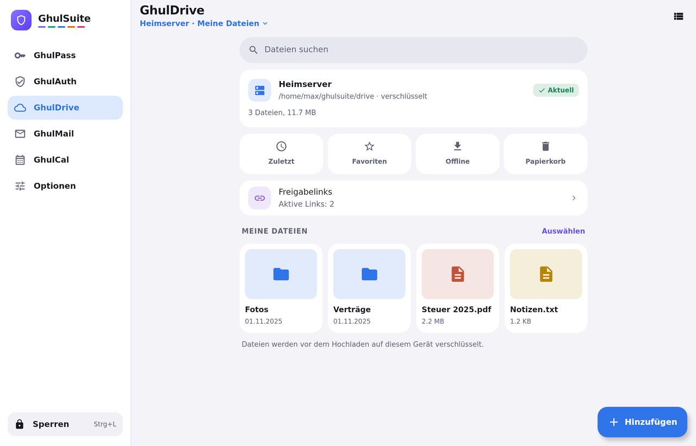

<div align="center">


# GhulSuite


**Passwörter · 2FA · Dateien · Mail · Kalender in einer App, verschlüsselt auf deinem Gerät, gespeichert auf deinem eigenen Server.**

Die selbst gehostete Alternative zu den bekannten Privacy-Suiten: gleicher Komfort, aber ohne Abo,
ohne Konto bei einem Anbieter und ohne Vertrauensvorschuss. Die Daten liegen da, wo **du** sie hinlegst.

[](LICENSE)


<br>

&nbsp;
&nbsp;
&nbsp;
&nbsp;


<br>

[Warum?](#warum-ghulsuite) ·
[Die fünf Bereiche](#die-fünf-bereiche) ·
[Mail-Archiv](#das-verschlüsselte-mail-archiv) ·
[Einrichten](#einrichten-und-entsperren) ·
[Synchronisation](#synchronisation-zwischen-deinen-geräten) ·
[Selbst hosten](#selbst-hosten-in-fünf-minuten) ·
[Sicherheit](#so-schützt-ghulsuite-deine-daten) ·
[Download](#download)

</div>

---

## Auf einen Blick

| | |
|---|---|
| **Eine App, fünf Bereiche** | Passwörter, 2FA-Codes, Dateien, Mail und Kalender, einzeln ein- und ausschaltbar |
| **Zwei Faktoren, immer** | Master-Passwort **plus** Security Key (FIDO2) oder Schlüsseldatei, dazu ein Notfallblatt |
| **Dein Speicher** | Ein Ordner mit verschlüsselten Dateien: App-Speicher, eigener Ordner, USB-Stick oder Sync-Programm |
| **Dein Server** | SFTP, FTPS oder ein einfacher Webspace mit PHP 8.1, ganz ohne Datenbank |
| **Was der Server sieht** | Nur verschlüsselte Blöcke mit Zufallsnamen: keine Inhalte, keine Namen, keine Ordner |
| **Plattformen** | Android 10+ und Windows 10/11 (Installer oder portabel vom USB-Stick) |
| **Offen** | Freie Software (AGPL-3.0), Dateiformat dokumentiert, Tests öffentlich |

## Warum GhulSuite?

Die meisten „sicheren“ Suiten verlangen, dass du einem Unternehmen vertraust: dessen Servern, dessen Preisen,
dessen Zukunft. GhulSuite dreht das um:

- 🔐 **Ende-zu-Ende verschlüsselt, immer.** Alles wird auf deinem Gerät verschlüsselt, bevor es irgendwohin geht.
  Dein Server sieht nur Datensalat: keine Inhalte, keine Datei- und Ordnernamen deiner Ablage, nicht einmal die
  Namen deiner Tresore.
- 🏠 **Dein Server, deine Regeln.** Ein günstiges Standard-Webhosting mit PHP reicht. Keine Datenbank, kein Docker,
  kein Root-Zugang nötig. Oder jeder Server mit SFTP/FTPS.
- 🗝️ **Zwei Faktoren, ohne Ausnahme.** Master-Passwort **plus** Security Key (FIDO2) oder Schlüsseldatei.
  Dazu ein Wiederherstellungscode mit Notfallblatt für den Tag, an dem alles schiefgeht. Verlierst du einen Key
  oder das Blatt, entfernst bzw. erneuerst du es: Ab dann öffnet es nichts mehr, auch nicht mit einer alten Sicherung.
- 📦 **Der Ordner ist die Suite.** Deine Daten sind normale, verschlüsselte Dateien. Kopieren, sichern, auf den
  USB-Stick legen, ohne Export-Zwang und ohne Anbieterbindung. Standard ist der private App-Speicher; unter
  Optionen → Tresore wechselst du jederzeit in einen eigenen Ordner und zurück (alles wird kopiert und geprüft).
  Dateinamen sind egal: Umbenannte Tresordateien erkennt die App am Inhalt.
- 🧩 **Eine App statt fünf.** Ein Entsperren, ein Design, eine Synchronisation.
- 💯 **Open Source.** Jede Zeile ist hier nachlesbar.

## Die fünf Bereiche

Jeder Bereich hat seine eigene verschlüsselte Datei. Was du nicht brauchst, schaltest du ab: Es verschwindet aus der
Leiste, seine Datei bleibt unberührt.

### 🟣 GhulPass: Passwörter

<table><tr>
<td width="200" valign="top"></td>
<td valign="top">

- **Alles an einem Ort:** Anmeldungen, Notizen, Kreditkarten, WLAN (mit QR zum Teilen), Identitäten, SSH-Schlüssel;
  eigene Felder, Anhänge, Passwortverlauf, Favoriten und „Zuletzt“.
- **Autofill** in Apps und Browsern (Android): GhulPass füllt nur auf der echten Seite aus. Ähnlich aussehende
  Adressen (`paypa1.com`, fremde Subdomains) bekommen nichts. Verknüpft eine App sich zum ersten Mal mit einem
  Login, fragt GhulPass mit ihrem Namen nach.
- **Generator** für Passwörter und Passphrasen.
- **Sicherheitscheck:** schwache und doppelte Passwörter, Konten ohne 2FA; auf Wunsch der Abgleich mit bekannten
  Datenlecks, ohne dass dein Passwort das Gerät verlässt (k-Anonymität: nur der Anfang eines Hashes geht hinaus).
- **Mehrere Tresore**, z. B. „Privat“ und „Familie“, jeder in seiner eigenen Datei.
- **2FA im Eintrag:** Der aktuelle Code steht direkt bei der Anmeldung.

</td></tr></table>

### 🟢 GhulAuth: 2FA-Codes

<table><tr>
<td width="200" valign="top"></td>
<td valign="top">

- **TOTP für jeden Dienst**, als Liste oder Kacheln, mit Favoriten und eigener Sortierung; Steam-Codes inklusive.
- **Hinzufügen** per Kamera, aus einem Bildschirmfoto, als `otpauth://`-Link oder von Hand.
- **Umzug:** Import aus Google Authenticator (Export-QR), Aegis, 2FAS und anderen; Export als QR-Code.
- **Uhr-Prüfung:** Geht die Uhr des Geräts falsch, warnt die App, statt falsche Codes zu zeigen.
- Auf Wunsch **verdeckte Codes**, die erst beim Antippen erscheinen, und der nächste Code schon vorab.

</td></tr></table>

### 🔵 GhulDrive: Dateien

<table><tr>
<td width="200" valign="top"></td>
<td valign="top">

- **Verschlüsselte Ablage** auf deinem Server: Dateien werden in Blöcke zerlegt und einzeln verschlüsselt; Namen,
  Ordner und Größen kennt nur dein Gerät.
- **Ordner, Suche, Favoriten, Zuletzt**, Liste oder Raster mit Vorschaubildern, Speicherbalken nach Dateiart.
- **Offline verfügbar** für ausgewählte Dateien, **Versionen** (die letzten fünf) und **Papierkorb**.
- **Teilen per Link** mit Ablaufdatum, Passwort und (mit dem Server-Modul) Abrufzähler und Einmal-Link. Der
  Schlüssel steht nur im Link hinter dem `#`, den Browser nie an den Server schicken.
- **Foto-Sicherung** (Android, auf Wunsch nur im WLAN), **Dokumente scannen**, verschlüsselte ZIPs.

</td></tr></table>

### 🟠 GhulMail: E-Mail

<table><tr>
<td width="200" valign="top"></td>
<td valign="top">

- **Jedes Postfach** mit IMAP und SMTP, nur über verschlüsselte Verbindungen; eigene Server mit selbst signiertem
  Zertifikat werden per Fingerabdruck bestätigt.
- **OpenPGP ohne Einrichtung:** Jedes Konto bekommt einen Schlüssel, Mails werden immer signiert und automatisch
  verschlüsselt, sobald der Empfänger einen Schlüssel hat (Autocrypt, WKD). Ein Schloss zeigt, was verschlüsselt ist.
- **Sicher lesen:** HTML wird in sichere Bausteine umgewandelt, Bilder aus dem Internet (Tracking) erst nach Klick.
- **Alles, was man erwartet:** alle Posteingänge, Unterhaltungen, Schlagwörter, markierte Mails, Entwürfe,
  „Später senden“, Wischgesten, Mehrfachauswahl bis zum ganzen Ordner, Papierkorb und Spam leeren, `.eml` und PDF.
- **Benachrichtigungen** mit wählbarem Inhalt; auf dem Sperrbildschirm immer nur „Neue Nachricht“.
- **Verschlüsseltes Archiv** für ältere Mails auf deinem eigenen Server, siehe [unten](#das-verschlüsselte-mail-archiv).

</td></tr></table>

### 🔴 GhulCal: Kalender

<table><tr>
<td width="200" valign="top"></td>
<td valign="top">

- **Termine verschlüsselt** im Suite-Ordner, synchronisiert wie alles andere; bewusst ohne CalDAV.
- **Monat, Woche, Tag und Liste**, mehrere Kalender in eigenen Farben, Geburtstage mit Alter.
- **Schnell-Eintragen** in Alltagssprache, etwa „Zahnarzt Fr 10 Uhr“.
- **Serien und Erinnerungen**, auch bei gesperrter App (Android); Zeitzonen-Wechsel auf Reisen werden beachtet.
- **Feiertage** nach Bundesland, für Österreich und die Schweiz.
- **Import und Export** als `.ics`; Termine aus anderen Zeitzonen werden richtig umgerechnet.

</td></tr></table>

**Für alle Bereiche:** Sofortsperre (Schütteln oder Schnellkachel), Auto-Sperre, Entsperren per Fingerabdruck oder
App-PIN, Schutz vor Bildschirmfotos und vor Apps, die sich über GhulSuite legen, Komplett-Sicherung als ZIP,
„Rückgängig“ nach dem Löschen, dunkles Design und Deutsch oder Englisch.

## Das verschlüsselte Mail-Archiv

<table><tr>
<td width="200" valign="top"></td>
<td valign="top">

Beim Mail-Anbieter liegen Mails meist lesbar, oft über viele Jahre. Das Archiv ändert das: **Mails, die älter als
eine Frist sind, zieht GhulSuite verschlüsselt auf deinen eigenen Server.** Sie bleiben auf allen Geräten sichtbar,
durchsuchbar und mit einer Kopie auf dem Gerät auch offline lesbar. Beim Anbieter bleibt nur Neues.

- **Frist frei wählbar:** 1, 7, 30 (vorausgewählt), 90 oder 365 Tage oder ein eigener Wert.
- **Gesendete Mails** mit archivieren; **Spam und Papierkorb** in Ruhe lassen, archivieren oder nach der Frist löschen.
- **Keine eigene Ansicht:** Archivierte Mails stehen unter denen des Anbieters, mit einem kleinen Symbol.
- **Ein Server, nie nur ein Gerät:** Das Archiv liegt immer auf einem Server, eine vollständige Kopie auf einem
  Gerät ist die zusätzliche Absicherung.

</td></tr></table>

<div align="center">
&nbsp;&nbsp;

</div>

**Damit keine Mail verloren geht**, gelten feste Regeln, und jede ist mit Tests abgesichert:

1. Eine Mail gilt erst als archiviert, wenn die App sie **über eine zweite Verbindung zurückgelesen und Byte für
   Byte verglichen** hat.
2. **Löschen beim Anbieter ist aus**, bis du es einschaltest. Nach dem ersten vollständigen Lauf fragt die App noch
   einmal: „Alles sicher archiviert. Jetzt N Mails beim Anbieter entfernen?“ Danebentippen heißt „Später“.
3. Gelöscht werden **genau die geprüften Mails**, einzeln über ihre Nummer, und nur, solange der Anbieter seinen Ordner
   nicht neu nummeriert hat. Unmittelbar vorher wird jede Mail noch einmal aus dem Archiv gelesen.
4. **Zählregel:** Mails beim Anbieter plus Mails im Archiv sind nach jedem einzelnen Schritt nie weniger als vorher.
   Die Tests brechen nach jedem Schritt ab (hochgeladen, geprüft, verzeichnet, gelöscht) und prüfen das, nachts mit
   30.000 Mails und zufälligen Abbrüchen.
5. **Ein Gerät zur Zeit** archiviert ein Konto; die anderen warten. Mails über 100 MB bleiben beim Anbieter und werden
   dort nie gelöscht.
6. **Server weg?** Das Archiv zieht auf einen neuen Server um (kopieren, prüfen, umschalten), oder ein Gerät mit
   vollständiger Kopie baut es dort wieder auf. Wiederherstellen fügt nur hinzu, es löscht nie.
7. **Schlüssel-Epochen:** Nach einer Schutzänderung (neues Notfallblatt, Key entfernt) bekommt Neues einen neuen
   Schlüssel. Eine alte Sicherung mit dem alten Faktor öffnet nur, was bis dahin archiviert war.

Details: [Konzept, Abschnitt 9.3.1](docs/KONZEPT.md) und [Dateiformat, Abschnitt 12](docs/FORMAT.md#12-mail-archiv-seit-060).

## Einrichten und entsperren

<table><tr>
<td width="200" valign="top"></td>
<td valign="top">

Ein Assistent führt in wenigen Schritten durch alles:

1. **Master-Passwort** wählen.
2. **Zweiter Faktor:** Security Key (FIDO2) oder eine Schlüsseldatei, z. B. auf einem USB-Stick.
3. **Notfallblatt** als PDF: ein Wiederherstellungscode mit QR, falls Passwort oder Key verloren gehen.
4. **Bereiche** auswählen und, wenn gewünscht, Server und Synchronisation einrichten.

**Im Alltag** reicht auf dem Handy Fingerabdruck oder App-PIN; der Schnellzugang liegt geschützt im Schlüsselspeicher
des Geräts. Die **Sofortsperre** schließt alles mit einem Schütteln oder über
die Schnellkachel und löscht den Schnellzugang, bis du wieder mit beiden Faktoren entsperrst.

</td></tr></table>

## Synchronisation zwischen deinen Geräten

- **Eintrag für Eintrag zusammengeführt:** Ändern zwei Geräte gleichzeitig, bleibt beides erhalten. Bei
  „gelöscht auf A, geändert auf B“ gewinnt die Änderung, die das löschende Gerät nie gesehen hat.
- **Wochenlang offline?** Kein Problem: Ein Gerät liest auch ältere Server-Stände und überschreibt nichts, was es
  nicht lesen kann.
- **Kein Zurücksetzen von außen:** Wer GhulDrive auf dem Server auf einen alten Stand zurücksetzt, kann damit keine
  Dateien verschwinden lassen; die App lehnt den alten Stand ab. Ein entfernter Key kommt nie per Sync zurück.
- **Ohne eigenen Server** geht es auch: Lege den Suite-Ordner in einen Ordner deines Sync-Programms (Syncthing,
  Nextcloud, …). Konfliktkopien führt GhulSuite Eintrag für Eintrag zusammen.

## Auch auf dem großen Bildschirm

Unter Windows (und auf Tablets im Querformat) mit Seitenleiste und zwei Spalten, als Installer oder portabel vom USB-Stick.

<div align="center">

<br><br>
&nbsp;

<br><br>

</div>

## Selbst hosten in fünf Minuten

GhulSuite braucht **keinen speziellen Server**. Du hast drei Möglichkeiten:

| Variante | Was du brauchst | Ideal für |
|---|---|---|
| **GhulSuite-Server-Modul** | Webspace mit **PHP 8.1** (oder neuer), ohne Datenbank | Günstiges Webhosting, zusätzlich mit Abrufzähler und Einmal-Links beim Teilen |
| **SFTP** | Einen Server mit SSH-Zugang | Eigener Server, NAS, Raspberry Pi |
| **FTPS** | FTP mit TLS-Verschlüsselung | Webhosting ohne SSH |

**So geht's mit dem Server-Modul:**
1. In der App: **Optionen → Server, Sync und Teilen → Server hinzufügen → GhulSuite-Server-Modul**.
2. Die App erzeugt die Datei `ghulsuite.php` mit einem eigenen Zugangsschlüssel.
3. Lade sie auf deinen Webspace (oder lass die App das per FTPS/SFTP erledigen) und trage die Adresse ein.
4. Fertig: Synchronisation, GhulDrive, das Mail-Archiv und Freigabelinks laufen über deinen Server.

Das Modul nimmt nur Anfragen an, die mit seinem Schlüssel signiert sind (mit Zeitfenster und Einmal-Nummer), und
sperrt Absender nach Fehlversuchen. Ausführbare Dateien kann es nicht ablegen, auch nicht mit dem Schlüssel.
Für normale Mails brauchst du keinen eigenen Server: GhulMail spricht direkt mit deinem Postfach.

## So schützt GhulSuite deine Daten

```
 dein Gerät                                        dein Server
┌──────────────────────────────┐                ┌──────────────────────────┐
│ Master-Passwort  ─┐          │                │                          │
│ Security Key ─────┼─► Schlüssel ─► XChaCha20  │  nur verschlüsselte      │
│ (oder Schlüsseldatei)        │     -Poly1305 ─┼─►  Blöcke mit Zufalls-   │
│                              │                │  namen, keine Inhalte,   │
│ Wiederherstellungscode ──────┘ (Notfall)      │  Namen oder Ordner       │
└──────────────────────────────┘                └──────────────────────────┘
```

**Wer sieht was?**

| Wer | sieht | sieht nicht |
|---|---|---|
| Dein Server bzw. Hoster | Anzahl und ungefähre Größe verschlüsselter Dateien, wann sie sich ändern | Inhalte, Namen von Tresoren, Dateien, Ordnern, Mail-Konten oder Monaten |
| Jemand mit deinen Dateien (gestohlene Sicherung) | Datensalat | ohne Passwort **und** zweiten Faktor nichts |
| Jemand mit deinem gesperrten Handy | Benachrichtigungen ohne Inhalt | Einträge, Codes, Dateien, Mails |
| Dein Mail-Anbieter | neue Mails (bei PGP nur verschlüsselt) | was im Archiv liegt |
| Ein verlorener Key oder ein altes Notfallblatt | nach dem Entfernen bzw. Erneuern nichts mehr, auch nicht mit alten Sicherungen | |

- **Schlüssel:** Argon2id für das Passwort, FIDO2 `hmac-secret`/PRF für den Security Key; beide sind nötig.
- **Verschlüsselung:** XChaCha20-Poly1305, Dateiformat offen dokumentiert ([`docs/FORMAT.md`](docs/FORMAT.md)) mit
  unabhängig geprüften Testvektoren.
- **Kern in Rust**, eine gemeinsame Codebasis für Android und Windows.
- Der [Sicherheitsbericht](docs/AUDIT.md) fasst alle Audits und Testrunden zusammen: was behoben ist, was offen ist und wogegen GhulSuite schützt.

## Was geprüft ist und was noch fehlt

GhulSuite ist ein Soloprojekt ohne bezahlten externen Audit. Umso wichtiger ist, dass jeder nachprüfen kann, was
getestet wird und was nicht:

- **Bei jeder Änderung** laufen über eine Million Einzelprüfungen in 272 Testfunktionen: Angriffe auf Dateien,
  Server und Synchronisation, ein „bekloppter Nutzer“ auf drei Geräten, kaputte und böswillige Eingaben in jeden
  Parser, Tests gegen echte SFTP-, FTPS-, IMAP- und SMTP-Server. Dazu kommen öffentliche Sammlungen wie Project
  Wycheproof (Kryptografie), die Big List of Naughty Strings, XSS- und CRLF-Sammlungen für Mails, die URL-Testdaten
  der Browser, JSONTestSuite, Kalenderdateien anderer Programme und die Zeitzonen-Regeln der ganzen Welt. Das
  Server-Modul muss 335 gezielte Angriffe abwehren.
- **Im Emulator** werden die wichtigsten Abläufe durchgeklickt, auch gegen echte Testserver; danach wird geprüft,
  dass dort nur Verschlüsseltes liegt.
- **Jede Nacht** zusätzlich: langes Fuzzing, Dauerläufe, zufällige Bedienung im Emulator, Server mit kaputtem TLS,
  9.807 Zertifikatsketten, OpenPGP gegen GnuPG, Scans von PHP-Modul und APK.
- **Was gefunden wurde und was offen ist,** steht mit Nummer und Schwere im
  [Testprotokoll](docs/TESTPROTOKOLL.md); wie getestet wird, im [Testkonzept](docs/TESTKONZEPT.md).

Kein Test beweist, dass es keine Lücke mehr gibt. GhulSuite ist eine **Entwicklungsversion**: Nutze sie mit
regelmäßiger Sicherung. Und wenn du dich mit Sicherheit auskennst: Lies mit, greif an, melde, was du findest.

## Umziehen leicht gemacht

Import aus **Proton Pass**, **Bitwarden**, **KeePass/KeePassXC** (CSV), **Proton Authenticator**, **Aegis**, **2FAS**,
**Google Authenticator** (Export-QR) und `otpauth://`-Links. Doppelte Einträge werden erkannt und übersprungen;
was sich nicht übernehmen lässt, wird mit Namen genannt und nicht stillschweigend verworfen. Kalender kommen als
`.ics`, Mails direkt aus deinem Postfach.

## Download

| | Stabil (freigegeben) | Vorab (Entwicklung) |
|---|---|---|
| **Android** | [GhulSuite.apk](https://github.com/ghulaschsuppe/GhulSuite/releases/latest/download/GhulSuite.apk) | [Vorabversionen](https://github.com/ghulaschsuppe/GhulSuite/releases) |
| **Windows, Installer** | [GhulSuite.msi](https://github.com/ghulaschsuppe/GhulSuite/releases/latest/download/GhulSuite.msi) | [Vorabversionen](https://github.com/ghulaschsuppe/GhulSuite/releases) |
| **Windows, portabel** (USB-Stick) | [GhulSuite-portable.zip](https://github.com/ghulaschsuppe/GhulSuite/releases/latest/download/GhulSuite-portable.zip) | [Vorabversionen](https://github.com/ghulaschsuppe/GhulSuite/releases) |

- **Stabil** sind die freigegebenen Versionen vom Zweig `main`. **Vorabversionen** (`0.6.0-dev.3`) entstehen
  automatisch aus dem Zweig `dev`, bevor sie freigegeben werden: neuer, aber weniger getestet. Auf der
  Release-Seite sind sie als „Pre-release“ markiert.
- **Updates kommen aus der App:** Optionen → Über → Updates. Einmal am Tag nach dem Entsperren schaut GhulSuite nach
  (abschaltbar), installiert wird nur nach deiner Zustimmung. Dort wählst du auch den Kanal: „Stabil“ oder „Vorab“.
- **Geprüft vor jeder Installation:** Jede Version enthält `SHA256SUMS`, signiert mit dem Signaturschlüssel der App
  (`SHA256SUMS.sig`). Die App installiert nur, was zu dieser Signatur, Größe und Prüfsumme passt; Android prüft
  zusätzlich, dass das neue APK mit demselben Schlüssel signiert ist. Von Hand: `sha256sum -c SHA256SUMS`.
- Der Windows-Installer ist (noch) nicht von Microsoft signiert: Windows SmartScreen fragt beim ersten Start nach.
- **Testversionen** zu jeder Änderung (als eigene App neben der normalen installierbar, ohne Updates) gibt es weiterhin unter
  **Actions → letzter grüner Lauf → Artefakte**.

## Selbst bauen

Rust, Android SDK (NDK 28) und JDK 17, dann:

```bash
cd app && ./gradlew :composeApp:assembleDebug        # Android-APK
cd app && ./gradlew :composeApp:packageMsi           # Windows-Installer (unter Windows)
tools/precheck.sh                                     # alle Prüfungen der CI, die lokal gehen
```

Alles Weitere (Aufbau, Tests, Regeln) steht in [`PROJEKT.md`](PROJEKT.md), das Konzept in [`docs/KONZEPT.md`](docs/KONZEPT.md).

## Mitmachen

Fehler gefunden, Idee gehabt? Issues und Pull Requests sind willkommen. Bitte lies vorher [`CONTRIBUTING.md`](CONTRIBUTING.md).
Sicherheitslücken bitte vertraulich über **Security → Report a vulnerability** melden.

## Lizenz

GhulSuite ist freie Software unter der **[GNU Affero General Public License 3.0](LICENSE)** (oder neuer), mit
[Zusatzbedingungen](NOTICE): Der Urhebervermerk bleibt in jeder Fassung sichtbar. Wer GhulSuite verändert und
weitergibt oder als Dienst betreibt, muss den Quelltext ebenfalls offenlegen.
Name und Logo sind geschützt, siehe [`TRADEMARKS.md`](TRADEMARKS.md).

---

### English

**GhulSuite** is a self-hosted, end-to-end encrypted suite for **passwords, 2FA codes, files, mail and calendar**: one app for
Android and Windows. Everything is encrypted on your device (master password **plus** FIDO2 security key or key
file); your own server only ever stores ciphertext. Any SFTP/FTPS server or plain PHP 8.1 web hosting without a
database is enough. Older mail can move into an encrypted archive on your own server, deleted at the provider only
after it was read back and checked. Free software under the AGPL-3.0, see [`LICENSE`](LICENSE).

<div align="center">
<br>
<sub><b>Made by Daniel Erdmann · 2026</b></sub>
</div>
