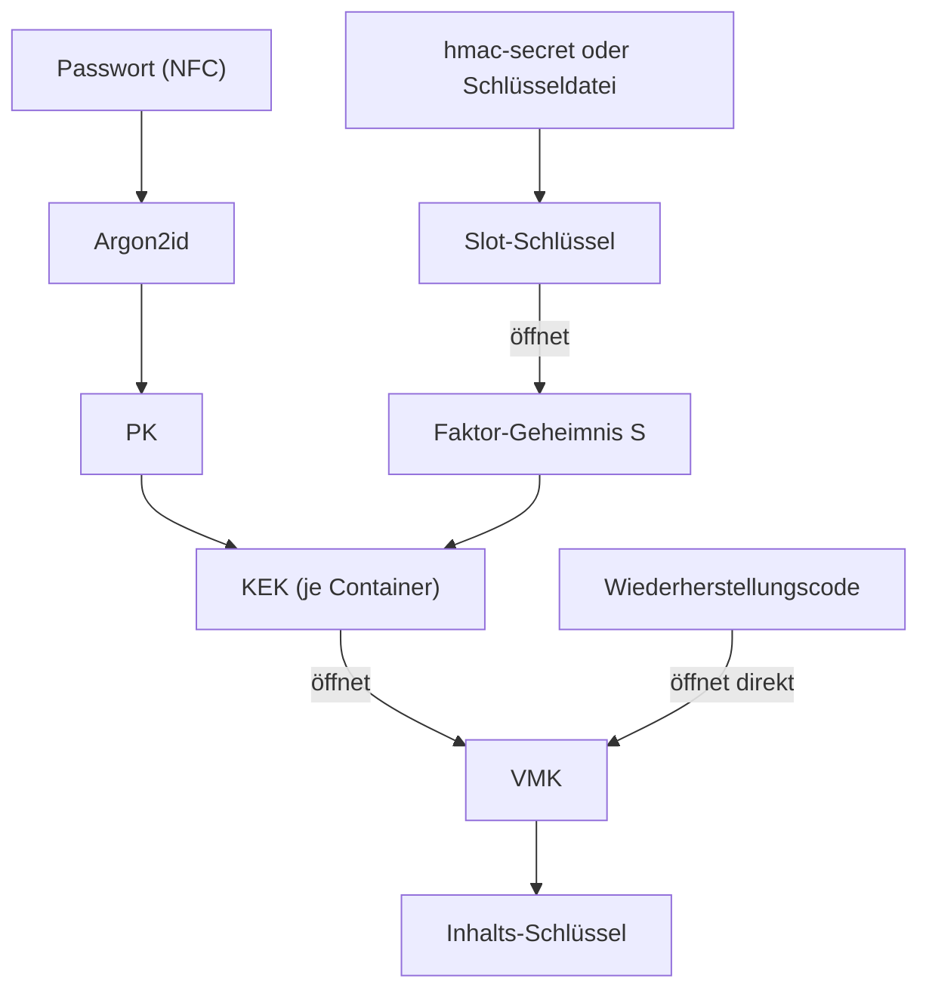

# GhulSuite: Dateiformat, Version 2

**Stand:** 14.11.2026 (Version 2: Keys und Schlüsseldateien mit öffentlichem Schlüssel, innere Schlüssel werden bei jeder Schutzänderung erneuert; Dateinamen ohne Tresornamen. Version 1 wird weiter gelesen) · gilt für `.ghlpss`, `.ghltotp`, `.ghlcal`, `.ghldrv`, `.ghlmail`, `.ghlsuite` und `.ghlkey`
**Referenzimplementierung:** `core/ghul-core/src/vault/`
**Testvektoren:** [`docs/testvectors/container-v2.json`](testvectors/container-v2.json) und für ältere Dateien
[`container-v1.json`](testvectors/container-v1.json), unabhängig geprüft mit
[`tools/verify_testvectors.py`](../tools/verify_testvectors.py) (Python, andere Krypto-Bibliotheken)

Diese Spezifikation ist so geschrieben, dass eine zweite Implementierung allein daraus entstehen kann.
Alle Zahlen sind **Little-Endian**, sofern nicht anders angegeben. `‖` bedeutet Aneinanderhängen von Bytes.

---

## 1. Überblick

| Datei | Magic (8 Byte, ASCII) | Inhalt (`kind`) |
|---|---|---|
| `.ghlpss` | `GHULPASS` | Passwort-Tresor (`pass`) |
| `.ghltotp` | `GHULTOTP` | TOTP/HOTP-Tresor (`totp`) |
| `.ghlcal` | `GHULCLDR` | Kalender-Tresor (`cal`): Einträge `calendar` (name, color, reminder, order) und `event` (calendar, title, start, end, all_day, repeat, until, exceptions, reminders, location, notes, links, birth_year, zone); Zeiten als Ortszeit `YYYY-MM-DDTHH:MM`. `zone` (optional, IANA-Name wie `America/New_York`) trägt eine Serie, die aus einer anderen Zeitzone stammt: `start`, `end`, `until` und `exceptions` stehen dann in der Zeit dieser Zone, und jedes Vorkommen wird für die Anzeige mit dem Versatz seines Tages umgerechnet |
| `.ghldrv` | `GHULDRIV` | GhulDrive-Bereich (`drive`): keine Einträge; Drive-Schlüssel, Speicher und Optionen in `settings` (Abschnitt 10) |
| `.ghlmail` | `GHULMAIL` | GhulMail-Bereich (`mail`): keine Einträge; Konten, Schlüssel, Entwürfe, Postausgang und Optionen in `settings` (Abschnitt 10) |
| `.ghlsuite` | `GHULSUIT` | Suite-Container: Schutz, Sync-Server, Sync-Zustand, Freigaben (`suite`) |
| `.ghlkey` | `GHULKEY\0` | Schlüsseldatei (Abschnitt 7) |

Ein Container besteht aus einem **Klartext-Header**, der nur öffentliche Angaben enthält (Parameter, Salts, Schlüssel-Slots),
und einem **verschlüsselten Inhalt**. Der Header ist vollständig in die Authentifizierung des Inhalts eingebunden:
Jede Änderung an irgendeinem Byte macht die Datei unbrauchbar.

**Ein Bereich, eine Datei:** Jeder Bereich hat seine eigene Datei mit seinen Einstellungen. Eine Datei mit `GHUL`
am Anfang, aber unbekannter Art oder höherer Formatversion stammt von einer neueren App: Leser melden dann „bitte
aktualisieren“ statt „beschädigt“ (Fehler `UpdateRequired`).

### Verwendete Verfahren (keine Alternativen in Version 1)

| Zweck | Verfahren |
|---|---|
| Passwort-Ableitung | Argon2id, Version 0x13 (RFC 9106), 32 Byte Ausgabe |
| Schlüssel-Ableitung | HKDF-SHA256 (RFC 5869), **leerer Salt**, 32 Byte Ausgabe |
| Verschlüsselung | XChaCha20-Poly1305 (24-Byte-Nonce, 16-Byte-Tag) |
| Security Key | FIDO2 `hmac-secret` mit PIN-Prüfung, Salt nach WebAuthn-PRF |
| Inhalt | CBOR (RFC 8949) |

---

## 2. Dateiaufbau

```
Offset        Länge  Feld
0             8      magic
8             2      format_version (u16) = 2 (1 bei Dateien älterer App-Versionen)
10            4      header_len H (u32), 1 ≤ H ≤ 65536
14            H      header (TLV-Records, Abschnitt 3)
14+H          24     payload_nonce
38+H          n      payload_ciphertext (inkl. 16-Byte-Tag), n ≥ 16
```

- Maximale Dateigröße: 256 MiB.
- Leser akzeptieren `format_version` 1 und 2 und lehnen alles andere ab. Version 2 unterscheidet sich nur durch die
  Slot-Typen 4 und 5 (Abschnitt 3.2); in einer Datei der Version 1 sind sie unzulässig. Geschrieben wird immer Version 2.
- **AAD des Inhalts** = Bytes `0 … 14+H−1` (Magic, Version, Header-Länge und Header). Damit sind auch Dateityp
  und Version geschützt: Ein `.ghlpss`, dessen Magic auf `GHULTOTP` geändert wurde, lässt sich nicht mehr öffnen.

---

## 3. Header

Folge von Records: `tag (u16) ‖ len (u32) ‖ value[len]`.

- Records stehen in **aufsteigender Tag-Reihenfolge**. Nur `SLOT` darf mehrfach vorkommen (direkt hintereinander).
- Tags mit gesetztem Bit `0x8000` sind **optional**: Unbekannte optionale Records werden übersprungen (sie sind trotzdem
  authentifiziert). Unbekannte Pflicht-Records führen zur Ablehnung.

| Tag | Name | Pflicht | Wert |
|---|---|---|---|
| `0x0001` | `CONTAINER_ID` | ja | 16 Byte Zufall, eindeutig je Container |
| `0x0002` | `SUITE_ID` | ja | 16 Byte Zufall, gleich für alle Container einer Suite |
| `0x0003` | `KDF` | ja | `alg (u8) = 1` ‖ `memory_kib (u32)` ‖ `iterations (u32)` ‖ `parallelism (u32)` ‖ `salt[32]` (45 Byte) |
| `0x0004` | `CIPHER` | ja | `u8 = 1` (XChaCha20-Poly1305 + HKDF-SHA256) |
| `0x0005` | `FLAGS` | ja | `u32`; derzeit sind keine Bits definiert, Wert muss 0 sein |
| `0x0010` | `SLOT` | 1 … 32 | Schlüssel-Slot (Abschnitt 3.2) |
| `0x0020` | `VMK` | ja | `nonce[24]` ‖ `ciphertext[48]` (Abschnitt 4.4) |

### 3.1 Grenzwerte für Argon2id

| Parameter | Minimum | Maximum |
|---|---|---|
| `memory_kib` | 65 536 (64 MiB) | 2 097 152 (2 GiB) |
| `iterations` | 3 | 64 |
| `parallelism` | 1 | 16 |

Das Minimum verhindert, dass eine manipulierte Datei schwache Parameter unterschiebt. Das Maximum verhindert,
dass eine Datei beim Öffnen Speicher oder Zeit erschöpft. Die App kalibriert beim Anlegen auf ca. 1 Sekunde.

### 3.2 Schlüssel-Slots

```
slot_type (u8) ‖ slot_id[16] ‖ typabhängige Felder
```

| Typ | Name | liefert | Inhalt |
|---|---|---|---|
| 1 | FIDO2 `hmac-secret` (nur noch gelesen) | Faktor-Geheimnis `S` | siehe unten |
| 2 | Wiederherstellung | Container-Schlüssel `VMK` | `nonce[24] ‖ wrapped_vmk[48]` |
| 3 | Schlüsseldatei (nur noch gelesen) | Faktor-Geheimnis `S` | `keyfile_id[8] ‖ nonce[24] ‖ wrapped_S[48]` |
| 4 | FIDO2 `hmac-secret` mit öffentlichem Schlüssel | Faktor-Geheimnis `S` | wie Typ 1, vor `nonce` zusätzlich `public_key[32] ‖ ephemeral[32]` |
| 5 | Schlüsseldatei mit öffentlichem Schlüssel | Faktor-Geheimnis `S` | `keyfile_id[8] ‖ public_key[32] ‖ ephemeral[32] ‖ nonce[24] ‖ wrapped_S[48]` |

Die Typen 1 und 3 stammen von älteren App-Versionen: Die App liest sie, schreibt aber nur noch die Typen 4 und 5.
Ein Slot vom Typ 1 oder 3 wird beim nächsten Entsperren mit genau diesem Key oder dieser
Schlüsseldatei in Typ 4 bzw. 5 umgewandelt (gleiche `slot_id`, Abschnitt 4.2).

**Typ 1 und 4, FIDO2 `hmac-secret`:**

```
rp_id_len (u8, 1…255) ‖ rp_id (UTF-8)
‖ credential_id_len (u16, 1…1023) ‖ credential_id
‖ prf_input[32]
‖ options (u8): Bit 0 = PIN-Prüfung erforderlich (muss gesetzt sein), andere Bits 0
‖ public_key[32] ‖ ephemeral[32]        (nur Typ 4)
‖ nonce[24] ‖ wrapped_S[48]
```

**Typ 4 und 5, mit öffentlichem Schlüssel:** Der Slot trägt den öffentlichen X25519-Schlüssel, dessen privater
Schlüssel nur mit dem Key (bzw. der Schlüsseldatei) entsteht. So kann die App ein **neues** `S` für jeden Key
verpacken, ohne dass er dafür berührt werden muss (Abschnitt 4.6).

**Typ 2, Wiederherstellung mit Vollzugriff:** Der Code öffnet den Container-Schlüssel direkt,
ohne Passwort, Security Key oder Schlüsseldatei. In GhulSuite trägt **jede Datei** eines Ordners einen solchen Slot
für **denselben** Code; der Code öffnet also jede Datei auch einzeln.

**Typ 3, Schlüsseldatei:** Die Schlüsseldatei ist ein gleichwertiger zweiter Faktor anstelle eines Security Keys.
`keyfile_id` (Abschnitt 7) sagt nur, welche Datei gemeint ist.

Regeln:
- `slot_id` ist innerhalb des Containers eindeutig.
- Mindestens ein Slot vom Typ 1, 3, 4 oder 5 muss vorhanden sein: Ein zweiter Faktor ist **immer** Pflicht.
- Slots vom Typ 1, 3, 4 und 5 dürfen beliebig gemischt werden. Jeder davon öffnet dasselbe `S`; Hinzufügen eines Slots
  ändert nichts an den anderen, Entfernen erneuert `S` für die übrigen (Abschnitt 4.6).
- Bezeichnungen der Slots („Key zu Hause“) stehen **nicht** im Header, sondern verschlüsselt im Inhalt (Abschnitt 5).
- Alle Container einer Suite tragen **identische** Slots vom Typ 1, 3, 4 und 5. So öffnet eine Key-Berührung (oder eine
  Schlüsseldatei) alle Container.

## 4. Kryptografie



`HKDF(ikm, info)` bedeutet HKDF-SHA256 mit leerem Salt (also 32 Null-Bytes nach RFC 5869) und 32 Byte Ausgabe.
`AEAD(k, n, m, aad)` bedeutet XChaCha20-Poly1305.

### 4.1 Passwort-Schlüssel

```
PK = Argon2id(password = UTF-8(NFC(Passwort)), salt = KDF.salt, m, t, p, Länge 32)
```

Das Passwort wird nach **Unicode NFC** normalisiert, damit z. B. „ü“ auf jeder Tastatur denselben Schlüssel ergibt.
Leere Passwörter sind unzulässig.

### 4.2 Zweiter Faktor → Faktor-Geheimnis `S`

**FIDO2-Slot (Typ 1, nur noch gelesen; `hmac_salt` und `hmac_output` gelten auch für Typ 4):**

```
hmac_salt   = SHA-256("WebAuthn PRF" ‖ 0x00 ‖ prf_input)       (wie WebAuthn-PRF, auch im Browser nutzbar)
hmac_output = hmac-secret(credential_id, rp_id, hmac_salt) mit PIN-Prüfung (UV), erste 32 Byte
slot_key    = HKDF(hmac_output, "ghul/v1/slot/fido2" ‖ slot_id)
S           = AEAD-Decrypt(slot_key, nonce, wrapped_S, aad = "ghul/v1/factor" ‖ suite_id ‖ slot_id)
```

**Typ 4 und 5 (X25519):**

```
seed        = HKDF(hmac_output, "ghul/v2/slot/fido2-x25519" ‖ slot_id)      (Typ 4)
seed        = HKDF(keyfile.secret, "ghul/v2/slot/keyfile-x25519" ‖ slot_id)  (Typ 5)
private     = X25519-Schlüssel aus seed (geklemmt nach RFC 7748)
public_key  = X25519(private, 9)                                            muss dem Slot entsprechen
shared      = X25519(private, ephemeral)                                    darf nicht nur aus Nullen bestehen
slot_key    = HKDF(shared ‖ ephemeral ‖ public_key, "ghul/v2/slot/x25519-wrap" ‖ slot_id)
S           = AEAD-Decrypt(slot_key, nonce, wrapped_S, aad = "ghul/v1/factor" ‖ suite_id ‖ slot_id)
```

Zum Verpacken erzeugt die App einen zufälligen Schlüssel `e`, setzt `ephemeral = X25519(e, 9)` und
`shared = X25519(e, public_key)`; der Rest ist gleich. Dafür braucht sie nur `public_key` aus dem Slot.

`hmac-secret` liefert mit und ohne PIN-Prüfung verschiedene Werte; GhulSuite verwendet immer den Wert **mit** PIN-Prüfung.
Die RP-ID ist `ghulsuite.invalid` (reservierte Endung nach RFC 6761, damit keine Webseite das Credential ansprechen kann).

**Schlüsseldatei-Slot (Typ 3, nur noch gelesen):**

```
slot_key = HKDF(keyfile.secret, "ghul/v1/slot/keyfile" ‖ slot_id)
S        = AEAD-Decrypt(slot_key, nonce, wrapped_S, aad = "ghul/v1/factor" ‖ suite_id ‖ slot_id)
```

Passt die `keyfile_id` keines Slots, wird die Datei mit klarer Meldung abgelehnt.

### 4.3 KEK

```
KEK = HKDF(PK ‖ S, "ghul/v1/kek" ‖ container_id)
```

### 4.4 Container-Schlüssel und Inhalt

```
VMK       = AEAD-Decrypt(KEK, VMK.nonce, VMK.ciphertext, aad = "ghul/v1/vmk" ‖ container_id)   (32 Byte Zufall)
PKEY      = HKDF(VMK, "ghul/v1/payload" ‖ container_id)
plaintext = AEAD-Decrypt(PKEY, payload_nonce, payload_ciphertext, aad = Bytes 0 … 14+H−1)
```

**Wiederherstellung (Slot Typ 2):**

```
slot_key = HKDF(code_secret, "ghul/v1/slot/recovery" ‖ slot_id ‖ container_id)
VMK      = AEAD-Decrypt(slot_key, nonce, wrapped_vmk, aad = "ghul/v1/recovery" ‖ container_id ‖ slot_id)
S        = factor_secret aus dem entschlüsselten Inhalt (Abschnitt 5.2)
```

Beim Entsperren mit dem Code werden alle Wiederherstellungs-Slots probiert. Danach muss die App ein neues Passwort
verlangen (neues `PK`, `VMK` neu verpacken); Security Keys bleiben gültig, weil `S` erhalten bleibt.

Alle Nonces (24 Byte) werden bei jedem Schreiben zufällig neu erzeugt. Bei 192 Bit ist eine Wiederholung praktisch ausgeschlossen.

### 4.5 Eigenschaften

- **Nur Key oder nur Schlüsseldatei:** liefert `S`, ohne Passwort aber kein `KEK`.
- **Nur Passwort:** liefert `PK`, ohne zweiten Faktor aber kein `S`. Einen Schutz nur mit Passwort gibt es nicht.
- **Wiederherstellungscode:** öffnet den Container allein. Wer das Notfallblatt hat, hat Zugriff, es ist wie ein
  Tresorschlüssel aufzubewahren. 256 Bit Zufall sind nicht zu erraten.
- **Key oder Schlüsseldatei hinzufügen:** nur einen Slot hinzufügen; alles andere bleibt gültig.
- **Passwort ändern, neuer Wiederherstellungscode, Key oder Schlüsseldatei entfernen:** Danach wird erneuert
  (Abschnitt 4.6). Die übrigen Keys, Schlüsseldateien und der aktuelle Code bleiben gültig.
- **Container einer Suite sind getrennt:** Jeder hat eine eigene `container_id` und damit eigenen `KEK`, `VMK` und Inhalts-Schlüssel.
- **Fehlerunterscheidung:** Ein falscher zweiter Faktor wird erkannt (Slot öffnet nicht), eine fremde Schlüsseldatei
  schon an ihrer ID. Schlägt danach nur noch der `KEK` fehl, ist das Passwort falsch.

### 4.6 Erneuern bei jeder Schutzänderung

Eine ältere Kopie einer Datei (Sicherung, `.bak`, ältere Serverversion) öffnet sich mit dem, was damals galt:
dem alten Code, einem inzwischen entfernten Key, dem alten Passwort. Damit sie nichts öffnet, was danach gespeichert
wird, gilt:

| Änderung | Neuer `VMK` in jeder Datei | Neues `S` |
|---|---|---|
| Neuer Wiederherstellungscode | ja | nein |
| Passwort ändern (auch nach Wiederherstellung mit dem Code) | ja | nein |
| Key oder Schlüsseldatei entfernen | ja | ja, für alle übrigen Slots (nur Typ 4 und 5) |

- Neuer `VMK`: 32 Byte Zufall, mit dem `KEK` verpackt; der Wiederherstellungs-Slot wird für den neuen `VMK` neu angelegt.
- Neues `S`: 32 Byte Zufall, für jeden übrigen Slot mit dessen `public_key` neu verpackt (neues `ephemeral`, gleiche
  `slot_id`). Alle Dateien der Suite bekommen dieselben neuen Slots.
- Solange noch ein Slot vom Typ 1 oder 3 übrig ist, kann `S` nicht erneuert werden (dafür bräuchte die App diesen
  Key). Dann wird nur der `VMK` erneuert; die App zeigt den Slot als „einmal damit entsperren“ an, und die nächste
  Schutzänderung erneuert auch `S`.
- Wer eine alte Kopie öffnen kann, kennt danach das alte `S`. Ohne das aktuelle Passwort öffnet das nichts.

---

## 5. Inhalt (Payload)

### 5.1 Auffüllen

```
plaintext = L (u32) ‖ cbor[L] ‖ 0x00 … 0x00
Gesamtlänge = max(4096, nächste Zweierpotenz ≥ L + 4)
```

Leser prüfen die Gesamtlänge und dass alle Füllbytes Null sind. Die Dateigröße verrät damit nur grob, wie viel gespeichert ist.

### 5.2 CBOR-Dokument

Ein CBOR-Map mit Text-Schlüsseln. **Unbekannte Schlüssel müssen beim Zurückschreiben erhalten bleiben**, auf jeder Ebene.

| Schlüssel | Typ | Bedeutung |
|---|---|---|
| `schema` | uint | `1` |
| `kind` | text | `pass`, `totp` oder `suite`: muss zur Magic passen |
| `revision` | uint | Zähler, wird bei jedem Speichern erhöht (Rollback-Erkennung) |
| `factor_secret` | bytes(32) | Kopie von `S`, damit die Wiederherstellung über den Container-Schlüssel `S` zurückgewinnt |
| `recovery_secret` | bytes(32) | Der Wiederherstellungscode der Suite, damit neue Tresore denselben Code-Slot bekommen (nur lesbar, wer den Container ohnehin öffnen kann) |
| `slots` | map | `slot_id` (Hex, Kleinbuchstaben) → `{label: text, created: int}` |
| `entries` | array | Einträge (Abschnitt 5.3) |
| `settings` | map | Freie Einstellungen (vor allem im Suite-Container) |

**Der Ordner ist die Suite:** Alle Tresordateien eines Ordners mit derselben `SUITE_ID` gehören zusammen und tragen
dieselben Faktor-Slots, dasselbe Passwort und denselben Code. Es gibt keine Liste der Tresore. Der Name eines Tresors
steht verschlüsselt in `settings.name`; der **Dateiname** verrät ihn nicht: die ersten 16 Hex-Zeichen der
`CONTAINER_ID` und die Endung der Art, z. B. `3f9a1c2b7d4e5f60.ghlpss`. Ältere App-Versionen haben Tresore nach ihrem
Namen benannt; solche Dateien werden beim Entsperren und beim Synchronisieren umbenannt. Der Suite-Container (`suite.ghlsuite`) enthält nur Einstellungen und kann aus
jeder Tresordatei neu erzeugt werden.

**Rollback-Erkennung:** Der Suite-Container merkt sich in `settings.revisions` je `container_id` (hex) die höchste
gesehene `revision`. Taucht eine niedrigere auf, warnt die App, bis der Stand bewusst übernommen wird.
`settings.ignored_files` enthält Dateinamen, die nicht mehr angeboten werden sollen.

### 5.3 Einträge

| Schlüssel | Typ | Bedeutung |
|---|---|---|
| `id` | bytes(16) | Zufällige Kennung |
| `type` | text | Eintragstyp (unten) |
| `revision` | uint | Änderungszähler des Eintrags (zum Zusammenführen) |
| `modified` | int | Unix-Zeit in Millisekunden |
| `deleted` | bool | Löschmarker; Felder werden geleert, der Eintrag bleibt für die Synchronisation erhalten |
| `deleted_from` | uint | nur bei Löschmarkern: die `revision`, die gelöscht wurde (fehlt bei älteren Löschmarkern) |
| `fields` | map | Feldname → Feld (unten) |
| `tags` | array of text | Schlagworte |
| `folder` | text | optional |

**Zusammenführen zweier Stände desselben Eintrags:** Die höhere `revision` gewinnt, bei Gleichstand die spätere
`modified`. Ausnahme Löschen gegen Ändern: Eine Löschmarke gewinnt nur gegen Stände mit `revision` ≤ `deleted_from`,
also gegen das, was das löschende Gerät kannte. Eine Änderung, die es nie gesehen hat, bleibt erhalten. Die Uhren der
Geräte spielen dabei keine Rolle. Löschmarken ohne `deleted_from` folgen der allgemeinen Regel.

**Feld:** `{ "t": Typ, "v": Wert }` mit

| `t` | `v` | Verwendung |
|---|---|---|
| `text` | text | sichtbarer Text |
| `secret` | text | verdeckt angezeigt (Passwort, PIN, Kartennummer) |
| `url` | text | Adresse |
| `bytes` | bytes | Binärdaten (z. B. TOTP-Geheimnis) |
| `int` | int | Zahl |
| `bool` | bool | Schalter |
| `list` | array of text | Liste |

### 5.4 Standardfelder

**GhulPass (`kind = pass`)**

| Typ | Felder |
|---|---|
| `login` | `title` (text), `username` (text), `password` (secret), `urls` (list), `notes` (text), `android_apps` (list: `paket:sha256-zertifikat`), `totp_ref` (bytes: `id` des GhulAuth-Eintrags) |
| `note` | `title`, `notes` |
| `card` | `title`, `holder`, `number` (secret), `expiry`, `cvc` (secret), `pin` (secret) |
| `identity` | `title`, `name`, `email`, `phone`, `address`, `birthday` |
| `ssh` | `title`, `private_key` (secret), `public_key`, `passphrase` (secret) |
| `wifi` | `title`, `ssid`, `password` (secret), `security` |

Weitere, eigene Felder sind erlaubt.

**GhulAuth (`kind = totp`)**

| Typ | Felder |
|---|---|
| `totp` | `issuer` (text), `account` (text), `secret` (bytes), `algorithm` (text: `SHA1`/`SHA256`/`SHA512`), `digits` (int, 6 bis 8), `period` (int, Sekunden) |
| `hotp` | wie `totp`, statt `period`: `counter` (int) |

TOTP nach RFC 6238, HOTP nach RFC 4226 (`core/ghul-core/src/totp.rs`, geprüft mit den Testvektoren der RFCs).

---

## 6. Wiederherstellungscode

- 32 Byte Zufall (`code_secret`) ‖ 2 Byte Prüfsumme = `SHA-256("ghul/v1/recovery-check" ‖ code_secret)[0..2]`.
- Der Code öffnet den Suite-Container **allein** (Slot Typ 2) und damit alle Tresore.
- Diese 34 Byte (272 Bit) werden als **Crockford-Base32** (`0123456789ABCDEFGHJKMNPQRSTVWXYZ`) kodiert:
  55 Zeichen, die letzten 3 Bit sind Null-Füllung. Dargestellt in **11 Gruppen zu 5 Zeichen** mit `-`.
- Beim Einlesen: Groß-/Kleinschreibung egal, `-` und Leerzeichen werden ignoriert, `O` gilt als `0`, `I`/`L` als `1`.
- Die Prüfsumme erkennt Tippfehler (Wahrscheinlichkeit für einen unerkannten Fehler 1 : 65 536), bevor gerechnet wird.

Beispiel (aus den Testvektoren): `D8PDS-YB7RF-3NA3V-N1716-HWNGZ-KEAP8-AGJGS-YH7FG-G6FYM-N98TM-Z5M98`

---

## 7. Schlüsseldatei `.ghlkey`

```
"GHULKEY\0" (8) ‖ version (u16) = 1 ‖ secret[32] ‖ check[4]        (46 Byte)
check = SHA-256(Bytes 0 … 41)[0..4]
```

```
KEYFILE_ID = SHA-256("ghul/v1/keyfile-id" ‖ secret)[0..8]     (steht im Slot vom Typ 3)
```

`secret` verpackt `S` wie in Abschnitt 4.2 beschrieben. Wer die Datei hat, hat damit einen zweiten Faktor, aber ohne
Passwort noch keinen Zugriff. Sie gehört daher nicht neben das Passwort.

Die ID dient nur dazu, eine falsche Schlüsseldatei mit klarer Meldung abzulehnen. Bei 256 Bit Zufall in `secret`
verrät sie nichts Verwertbares.

---

## 8. Robustheit

- Jede Längenangabe wird gegen die verbleibenden Bytes und die Grenzwerte geprüft, bevor gelesen wird.
- Unbekannte Pflicht-Records, unbekannte Slot-Typen, unbekannte Flags und Optionen führen zur Ablehnung.
- **Geprüft durch:**
  - Mutationstests: 4000 veränderte Dateien je Lauf (Bits kippen, abschneiden, einfügen); keine wird akzeptiert.
  - Fuzzing mit `cargo-fuzz` (`core/fuzz/`): Container-, Schlüsseldatei- und Code-Parser sowie Antworten des Security Keys.
  - Unabhängige Zweitimplementierung der Entschlüsselung in Python für die Testvektoren.

---

## 9. Begründungen

| Entscheidung | Grund |
|---|---|
| Nur ein Verfahren je Formatversion | Weniger Optionen, weniger Fehler; neue Verfahren bedeuten neue Formatversion |
| XChaCha20-Poly1305 | 192-Bit-Zufallsnonces ohne Wiederholungsrisiko, schnell auch ohne AES-Hardware |
| Header als AAD statt eigenem Header-MAC | Ein Mechanismus statt zwei; jede Header-Änderung macht den Inhalt unentschlüsselbar. Das Konzept v0.1 bis v0.4 sah noch einen separaten MAC vor; er ist damit überflüssig |
| Faktor-Geheimnis `S` statt direkter Kombination | Passwortwechsel und Key-Verwaltung ohne alle Keys gleichzeitig |
| Wiederherstellung über den Container-Schlüssel | Hilft auch bei vergessenem Passwort; übersteht Passwortwechsel, weil `VMK` dabei gleich bleibt |
| Zweiter Faktor immer Pflicht, Schlüsseldatei als eigener Slot-Typ | Einheitlicher Schutz; Schlüsseldatei und Key sind austauschbar, ohne dass etwas neu verschlüsselt oder ein Code ungültig wird |
| Slot-Bezeichnungen verschlüsselt | Der Header verrät nicht, welche Keys es gibt oder wo sie liegen |
| Öffentlicher Schlüssel je Key (Version 2) | Ein neues `S` nach dem Entfernen eines Keys erreicht alle übrigen Keys, ohne dass jemand sie holen und berühren muss |
| Erneuern bei jeder Schutzänderung | Ein verlorenes Notfallblatt oder ein entfernter Key wird zusammen mit einer alten Sicherung nicht zum Generalschlüssel |
| Dateinamen ohne Tresornamen | Server und Sicherungen verraten nicht, welche Tresore es gibt |
| Auffüllen auf Zweierpotenzen | Die Dateigröße verrät nur grob die Datenmenge |
| Unbekannte CBOR-Schlüssel erhalten | Ältere App-Versionen zerstören keine Daten neuerer Versionen |
| Strenge Reihenfolge der Records | Eindeutige Kodierung, einfachere Prüfung |

---

<a id="drive"></a>
## 10. GhulDrive und Server-Daten (seit 0.4.0)

Diese Daten liegen **nicht** in den Tresor-Containern, sondern auf dem eigenen Server des Nutzers. Ihre Schlüssel und
Zugangsdaten stehen nur in verschlüsselten Einstellungen (CBOR-Map `settings`). Seit 0.5.0 gilt **ein Bereich, eine
Datei**: Der Suite-Container behält Schutz, Sync-Server, Sync-Zustand und Freigaben; GhulDrive und GhulMail haben
ihre eigenen Dateien (`.ghldrv`, `.ghlmail`).

**Suite-Container (`suite.ghlsuite`):**

| Schlüssel | Inhalt | Synchronisiert |
|---|---|---|
| `servers` | Liste: `id`, `name`, `kind` (`sftp`, `ftps`, `php`; leer = `sftp`), `host`, `port`, `user`, `password` (SFTP: leer = Schlüssel; FTPS: Passwort; PHP: Zugangsschlüssel hex), `base`, `host_key` (SSH-Schlüssel- bzw. Zertifikat-Fingerabdruck SHA256), `url` (PHP-Modul), `location`, `share_dir`, `share_url` (Teilen-Ordner und seine https-Adresse; leer = Teilen nicht eingerichtet) | ja |
| `ssh_key` | privater Ed25519-Schlüssel der Suite (OpenSSH-Format) | ja |
| `sync` | `server` (ID), `last` (ms) | nein (je Gerät) |
| `sync_known` | bereits synchronisierte Tresor-IDs (für das Übertragen von Löschungen) | nein (je Gerät) |
| `protection_before` | Liste (neueste zuerst, höchstens 256): `s` (vorheriges `S`), `code` (vorheriges Code-Geheimnis). Damit liest das Gerät Dateien auf dem Server, die ein anderes Gerät schrieb, bevor es von der Schutzänderung wusste | nein (je Gerät) |
| `protection_changed` | Zeitpunkt der letzten Schutzänderung (ms) | ja |
| `removed_slots` | Slot-IDs (hex) absichtlich entfernter Keys und Schlüsseldateien. Werden beim Synchronisieren vereinigt; ein Gerät, das die Entfernung verpasst hat, entfernt sie ebenfalls | ja |
| `recovery_confirmed` | `{v, at}`: `v` = hex(SHA-256(„ghul/recovery-confirmed/v1“ ‖ Code-Geheimnis)[0..8]) des bestätigten Codes, `at` = Zeit (ms); fehlt bei Suiten von vor 0.5.0 (gilt als bestätigt) | ja |
| `shares` | Liste der eigenen Freigaben: `id`, `server`, `name`, `size`, `created`, `expires` (ms, 0 = nie), `password`, `max_downloads`, `url` (vollständiger Link mit Schlüssel) | ja |
| `mail_accounts` | Liste: `id`, `name`, `display_name`, `email`, `username`, `password`, `servers`, `imap_cert`, `smtp_cert`, `signature` | ja |

**GhulDrive (`.ghldrv`):**

| Schlüssel | Inhalt | Synchronisiert |
|---|---|---|
| `drive` | `server` (ID, leer bei `use_sync`), `use_sync` (bool: der Server, mit dem dieses Gerät synchronisiert; nur ein Verweis), `key` (32 Byte, Drive-Schlüssel DK), `seen` (Server-ID → höchste gesehene Index-Revision; ein älterer Index wird abgelehnt) | ja |
| `servers` | höchstens ein eigener Server nur für GhulDrive (Aufbau wie im Suite-Container); ein PHP-Modul kann `upload` mit dem FTPS-Zugang für Updates tragen (`host`, `port`, `user`, `password`, `cert`, `dir`, `data_dir`) | ja |
| `options` | Optionen des Bereichs, je Schlüssel `{v, at}` (Text, Zeit in ms) | ja |

**GhulMail (`.ghlmail`):** `mail_accounts` (wie oben), `mail_keys`, `mail_contacts`, `mail_cache_key`, `mail_drafts`,
`mail_outbox`, `options`. **GhulPass, GhulAuth, GhulCal:** `options` in ihren Dateien.

**Listen mit `changed`:** Einträge von `servers` und `mail_accounts` tragen `changed` (ms). Beim Zusammenführen gewinnt
der später geänderte Eintrag derselben `id`; ohne `changed` bleibt der lokale.

**Optionen und Zusammenführen:** Ein Wert `{v, at}` (Map aus genau `v` und ganzzahligem `at`) wird beim Synchronisieren
als Ganzes übernommen, wenn sein `at` neuer ist, die letzte Änderung gewinnt. Bekannte Optionen: GhulPass
`generator_mode`, `generator_length`; GhulDrive `drive_trash_days`; GhulMail `mail_image_senders`; GhulCal
`cal_holidays`, `cal_region`, `cal_default_reminder`, `cal_allday_reminder`, `cal_default`, `cal_week_start`.
Unbekannte Optionen bleiben erhalten.

**Umzug älterer Suiten:** Stehen `drive` oder `mail_*` noch im Suite-Container, wandern sie beim Entsperren samt ihren
Löschmarken in die Bereichsdatei (die bei Bedarf angelegt wird). Das geschieht auch, wenn eine Synchronisation sie von
einem Gerät mit älterer App zurückbringt.

**Ablage auf dem Server** (`<base>` = gewählter Ordner):

```text
<base>/suite/                 Tresore (.ghlpss, .ghltotp, .ghlcal) und suite.ghlsuite, unverändert im Container-Format
<base>/drive/index.ghldrv     "GHULDRV1" ‖ nonce[24] ‖ XChaCha20-Poly1305(IK, pad(CBOR-Index), aad = "")
<base>/drive/blocks/<ab>/<id> "GHULBLK1" ‖ nonce[24] ‖ XChaCha20-Poly1305(BK, Block, aad = "GHULBLK1" ‖ id)
```

```text
IK  = HKDF-SHA256(DK, info = "ghul/v1/drive/index")
BK  = HKDF-SHA256(DK, info = "ghul/v1/drive/block")
BIK = HKDF-SHA256(DK, info = "ghul/v1/drive/block-id")
id  = hex(HMAC-SHA256(BIK, Klartext-Block))      <ab> = die ersten zwei Zeichen von id
```

- Blöcke: höchstens 4 MiB Klartext. Gleiche Blöcke werden einmal gespeichert.
- Index (CBOR): `revision` (u64) und `nodes`: je Knoten `id`, `parent` (leer = oberste Ebene), `name`, `dir`,
  `size`, `modified` (ms), `blocks` (Liste der Block-IDs in Reihenfolge). Aufgefüllt wie der Tresor-Inhalt (Abschnitt 5.1).
- Schreiben immer atomar (temporäre Datei, dann Umbenennen). Vor jeder Änderung wird der Index neu geladen.
  Nicht mehr referenzierte Blöcke werden nach dem Löschen entfernt.

## 11. Freigaben (seit 0.5.0)

Eine Freigabe ist ein eigenständiges Paket, das ein Browser allein mit WebCrypto entschlüsseln kann. Jede Freigabe hat
einen neuen, zufälligen 256-Bit-**Link-Schlüssel**; sie verrät nichts über Tresore, Drive-Schlüssel oder andere Freigaben.

```text
Kopf (48 Byte)
  "GHSHARE1" | Version u8 = 1 | Flags u8 (Bit 0: Passwort) | reserviert u16 = 0
  chunk_size u32 BE | PBKDF2-Runden u32 BE | salt[16] | nonce_prefix[8] | meta_len u32 BE
Stück 0       AES-256-GCM(Meta-JSON)                      meta_len Byte
Stück 1..n    AES-256-GCM(chunk_size Byte der Datei)      das letzte kürzer

nonce(i) = nonce_prefix ‖ u32 BE i
aad(i)   = Kopf ‖ u8 (1 = letztes Stück des Pakets, sonst 0); erkennt Abschneiden
key      = HKDF-SHA256(ikm = Link-Schlüssel[32] (‖ PBKDF2-SHA256(Passwort NFC, salt, Runden, 32)),
                       salt = leer, info = "ghul/v1/share")
```

- `chunk_size` = 1 MiB, PBKDF2 mit 600 000 Runden (ohne Passwort steht 0 im Kopf). Beim Öffnen werden höchstens
  10 000 000 Runden akzeptiert, damit ein manipuliertes Paket den Empfänger nicht lahmlegt.
- Meta-JSON: `name`, `type` (MIME), `size`, `created`, `expires` (Unix-ms, 0 = nie). Der Empfänger prüft `expires` selbst.
- Mehrere Dateien oder ein Ordner werden vorher zu einem ZIP (ohne Kompression) zusammengefasst. Höchstens 1 GiB.
- Kopf und Ende sind über `aad` an jedes Stück gebunden: Änderungen, Vertauschen und Abschneiden fallen auf.

**Link:** `<Adresse>#<id>.<Schlüssel>`: `id` = 32 Hex-Zeichen, **zufällig und unabhängig vom Schlüssel**;
Schlüssel = Base64url ohne Auffüllung (43 Zeichen). Der Teil nach `#` wird von Browsern nie an den Server gesendet;
die Empfängerseite entfernt ihn nach dem Lesen aus der Adresszeile.

**Teilen-Ordner (SFTP/FTPS + Webserver):**

```text
<share_dir>/index.html, viewer.js, viewer.css   Empfängerseite (keine fremden Inhalte)
<share_dir>/.htaccess                           strenge CSP, kein Listing, kein Caching, no-referrer
<share_dir>/s/index.html                        leer, verhindert das Auflisten
<share_dir>/s/<id>                              das Paket
```

Adresse = `share_url` (nur https). Ablauf: die Empfängerseite verweigert abgelaufene Pakete, die App löscht sie beim
nächsten Verbinden. Abrufzähler und Einmal-Links gibt es hier nicht.

**Server-Modul (`ghulsuite.php`, PHP 8.1+, ohne Datenbank):** eine Datei mit eingebautem Zugangsschlüssel `K` (32 Byte),
zufälligem Datenordner `ghul-data-<24 hex>` daneben (`.htaccess` „deny“, `index.html`) und eingebetteter Empfängerseite.

| Aufruf | Bedeutung |
|---|---|
| `GET` ohne Parameter | Empfängerseite (CSP `default-src 'none'; script-src 'self'; …`); `?v=js`, `?v=css` |
| `GET ?s=<id>` | Paket ausliefern; zählt unter Dateisperre, prüft Ablauf und Höchstzahl; danach 404/410 |
| `POST ?a=info` | `{version, php, free, limit}`; `limit` = größte Anfrage des Hostings in Byte (`post_max_size`, höchstens ein Drittel von `memory_limit`; 0 = unbekannt) |
| `POST ?a=list&p=` · `read` · `write` · `delete` · `mkdir` | Speicher wie ein Ordner (`p` = relativer Pfad) |
| `POST ?a=write_part&p=&n=&u=` · `write_done&p=&u=&size=` | (ab Version 2) große Datei in Teilen in eine temporäre Datei, dann atomar ersetzen; `u` = 16 bis 64 Hex-Zeichen je Upload; unvollständige Teile verfallen nach einem Tag |
| `POST ?a=share_part&id=&n=` · `share_done&id=&exp=&max=` | Freigabe in Teilen hochladen, dann veröffentlichen |
| `POST ?a=share_delete&id=` · `share_list` | Freigabe beenden; Liste `{id, exp, max, count}` |

Jeder `POST` ist signiert:

```text
X-Ghul-Time  = Unix-Sekunden (±300 s)          X-Ghul-Nonce = 32 Hex-Zeichen, jede nur einmal
X-Ghul-Sig   = hex(HMAC-SHA256(K, "ghul/v1\n" ‖ Methode ‖ "\n" ‖ kanonisch ‖ "\n" ‖ Zeit ‖ "\n" ‖ Nonce ‖ "\n" ‖ hex(SHA-256(Body))))
kanonisch    = die vorhandenen Parameter in der Reihenfolge a, p, id, exp, max, n, u, size als k=rawurlencode(v), mit & verbunden
```

**Teilgröße:** Die App fragt `info` einmal je Verbindung und teilt Uploads in Teile von `limit` − 64 KiB, mindestens
256 KiB und höchstens 4 MiB. Dateien bis 256 KiB (und alles bei Modul-Version 1) gehen in einem Stück.

Pfade: keine `.`/`..`-Teile, keine Steuerzeichen, kein `\`; Dateien mit ausführbarer Endung (`.php`, `.phtml`, `.phar`,
`.cgi`, …) sowie `.htaccess`, `.htpasswd`, `.user.ini` werden abgelehnt. Nach 20 Fehlversuchen in 10 Minuten
antwortet das Modul der Adresse mit 429.

