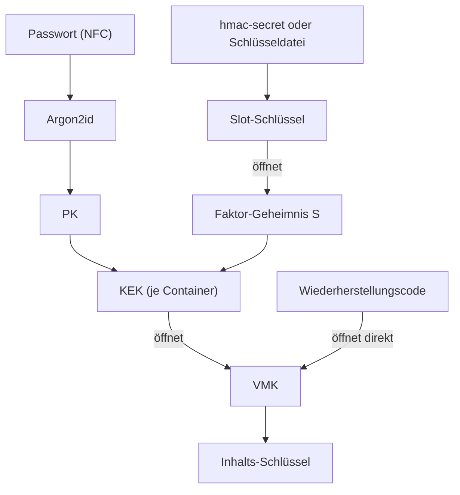

# GhulSuite: Dateiformat, Version 3

**Stand:** 19.11.2026 (Version 3: jede Datei trägt ein Schreibsiegel, das nur mit dem Passwort entsteht; nur noch Keys und Schlüsseldateien mit öffentlichem Schlüssel. Ältere Versionen werden nicht mehr gelesen. Seit dem Umbau zu GhulDocs ohne GhulDrive, GhulMail, Server und Freigaben) · gilt für `.ghlpss`, `.ghltotp`, `.ghlcal`, `.ghldoc`, `.ghlsuite` und `.ghlkey`, dazu die Inhaltsdateien `.ghlblob` von GhulDocs (Abschnitt 11) und die Suite-Datei `.ghlzip` (Abschnitt 10)
**Referenzimplementierung:** `core/ghul-core/src/vault/`
**Testvektoren:** [`docs/testvectors/container-v3.json`](testvectors/container-v3.json) und
[`docs/testvectors/docs-blob-v1.json`](testvectors/docs-blob-v1.json) (Inhaltsdateien), unabhängig geprüft mit
[`tools/verify_testvectors.py`](../tools/verify_testvectors.py) (Python, andere Krypto-Bibliotheken)

Diese Spezifikation ist so geschrieben, dass eine zweite Implementierung allein daraus entstehen kann.
Alle Zahlen sind **Little-Endian**, sofern nicht anders angegeben. `‖` bedeutet Aneinanderhängen von Bytes.

---

## 1. Überblick

| Datei | Magic (8 Byte, ASCII) | Inhalt (`kind`) |
|---|---|---|
| `.ghlpss` | `GHULPASS` | Passwort-Tresor (`pass`) |
| `.ghltotp` | `GHULTOTP` | TOTP/HOTP-Tresor (`totp`) |
| `.ghlcal` | `GHULCLDR` | Kalender-Tresor (`cal`): Einträge `calendar` (name, color, reminder, order) und `event` (calendar, title, start, end, all_day, repeat, until, exceptions, reminders, location, notes, links, birth_year, zone); Zeiten als Ortszeit `YYYY-MM-DDTHH:MM`. `zone` (optional, IANA-Name wie `America/New_York`) trägt eine Serie, die aus einer anderen Zeitzone stammt: `start`, `end`, `until` und `exceptions` stehen dann in der Zeit dieser Zone, und jedes Vorkommen wird für die Anzeige mit dem Versatz seines Tages umgerechnet |
| `.ghldoc` | `GHULDOCS` | GhulDocs-Tresor (`docs`): das Inhaltsverzeichnis der Dokumente als Einträge `folder` und `file` (Abschnitt 11); der Inhalt jeder Datei liegt in einer eigenen Inhaltsdatei `.ghlblob` |
| `.ghlsuite` | `GHULSUIT` | Suite-Container (`suite`): Schutz-Epoche, Stand der Suite-Datei, bestätigter Wiederherstellungscode (Abschnitt 5.5) |
| `.ghlkey` | `GHULKEY\0` | Schlüsseldatei (Abschnitt 7) |

Dazu kommen die Inhaltsdateien `.ghlblob` von GhulDocs (eigenes Format, Abschnitt 11.2) und die Suite-Datei `.ghlzip`
(ein ZIP mit allen Containern und Inhaltsdateien, Abschnitt 10). Die Magic `GHULDRIV` und `GHULMAIL` früherer Versionen
(GhulDrive, GhulMail) gibt es nicht mehr; solche Dateien werden nicht gelesen.

Ein Container besteht aus einem **Klartext-Header**, der nur öffentliche Angaben enthält (Parameter, Salts, Schlüssel-Slots),
und einem **verschlüsselten Inhalt**. Der Header ist vollständig in die Authentifizierung des Inhalts eingebunden:
Jede Änderung an irgendeinem Byte macht die Datei unbrauchbar.

**Ein Bereich, eine Datei:** Jeder Bereich hat seine eigene Datei mit seinen Einstellungen. Eine Datei mit `GHUL`
am Anfang, aber unbekannter Art oder höherer Formatversion stammt von einer neueren App: Leser melden dann „bitte
aktualisieren“ statt „beschädigt“ (Fehler `UpdateRequired`).

### Verwendete Verfahren (keine Alternativen)

| Zweck | Verfahren |
|---|---|
| Passwort-Ableitung | Argon2id, Version 0x13 (RFC 9106), 32 Byte Ausgabe |
| Schlüssel-Ableitung | HKDF-SHA256 (RFC 5869), **leerer Salt**, 32 Byte Ausgabe |
| Verschlüsselung | XChaCha20-Poly1305 (24-Byte-Nonce, 16-Byte-Tag) |
| Security Key | FIDO2 `hmac-secret` mit PIN-Prüfung, Salt nach WebAuthn-PRF |
| Inhalt | CBOR (RFC 8949) |

---

## 2. Dateiaufbau

```
Offset        Länge  Feld
0             8      magic
8             2      format_version (u16) = 3
10            4      header_len H (u32), 1 ≤ H ≤ 65536
14            H      header (TLV-Records, Abschnitt 3)
14+H          24     payload_nonce
38+H          n      payload_ciphertext (inkl. 16-Byte-Tag), n ≥ 16
38+H+n        32     auth: Schreibsiegel (Abschnitt 4.7)
```

- Maximale Dateigröße: 256 MiB.
- Leser akzeptieren nur `format_version` 3 und lehnen alles andere ab.
- **AAD des Inhalts** = Bytes `0 … 14+H−1` (Magic, Version, Header-Länge und Header). Damit sind auch Dateityp
  und Version geschützt: Ein `.ghlpss`, dessen Magic auf `GHULTOTP` geändert wurde, lässt sich nicht mehr öffnen.

---

## 3. Header

Folge von Records: `tag (u16) ‖ len (u32) ‖ value[len]`.

- Records stehen in **aufsteigender Tag-Reihenfolge**. Nur `SLOT` darf mehrfach vorkommen (direkt hintereinander).
- Tags mit gesetztem Bit `0x8000` sind **optional**: Unbekannte optionale Records werden übersprungen (sie sind trotzdem
  authentifiziert). Unbekannte Pflicht-Records führen zur Ablehnung.

| Tag | Name | Pflicht | Wert |
|---|---|---|---|
| `0x0001` | `CONTAINER_ID` | ja | 16 Byte Zufall, eindeutig je Container |
| `0x0002` | `SUITE_ID` | ja | 16 Byte Zufall, gleich für alle Container einer Suite |
| `0x0003` | `KDF` | ja | `alg (u8) = 1` ‖ `memory_kib (u32)` ‖ `iterations (u32)` ‖ `parallelism (u32)` ‖ `salt[32]` (45 Byte) |
| `0x0004` | `CIPHER` | ja | `u8 = 1` (XChaCha20-Poly1305 + HKDF-SHA256) |
| `0x0005` | `FLAGS` | ja | `u32`; derzeit sind keine Bits definiert, Wert muss 0 sein |
| `0x0010` | `SLOT` | 1 … 32 | Schlüssel-Slot (Abschnitt 3.2) |
| `0x0020` | `VMK` | ja | `nonce[24]` ‖ `ciphertext[48]` (Abschnitt 4.4) |

### 3.1 Grenzwerte für Argon2id

| Parameter | Minimum | Maximum |
|---|---|---|
| `memory_kib` | 65 536 (64 MiB) | 2 097 152 (2 GiB) |
| `iterations` | 3 | 64 |
| `parallelism` | 1 | 16 |

Das Minimum verhindert, dass eine manipulierte Datei schwache Parameter unterschiebt. Das Maximum verhindert,
dass eine Datei beim Öffnen Speicher oder Zeit erschöpft. Die App kalibriert beim Anlegen auf ca. 1 Sekunde.

### 3.2 Schlüssel-Slots

```
slot_type (u8) ‖ slot_id[16] ‖ typabhängige Felder
```

| Typ | Name | liefert | Inhalt |
|---|---|---|---|
| 2 | Wiederherstellung | Container-Schlüssel `VMK` | `nonce[24] ‖ wrapped_vmk[48]` |
| 4 | FIDO2 `hmac-secret` mit öffentlichem Schlüssel | Faktor-Geheimnis `S` | siehe unten |
| 5 | Schlüsseldatei mit öffentlichem Schlüssel | Faktor-Geheimnis `S` | `keyfile_id[8] ‖ public_key[32] ‖ ephemeral[32] ‖ nonce[24] ‖ wrapped_S[48]` |

Andere Slot-Typen werden abgelehnt.

**Typ 4, FIDO2 `hmac-secret`:**

```
rp_id_len (u8, 1…255) ‖ rp_id (UTF-8)
‖ credential_id_len (u16, 1…1023) ‖ credential_id
‖ prf_input[32]
‖ options (u8): Bit 0 = PIN-Prüfung erforderlich (muss gesetzt sein), andere Bits 0
‖ public_key[32] ‖ ephemeral[32]
‖ nonce[24] ‖ wrapped_S[48]
```

**Typ 4 und 5, mit öffentlichem Schlüssel:** Der Slot trägt den öffentlichen X25519-Schlüssel, dessen privater
Schlüssel nur mit dem Key (bzw. der Schlüsseldatei) entsteht. So kann die App ein **neues** `S` für jeden Key
verpacken, ohne dass er dafür berührt werden muss (Abschnitt 4.6).

**Typ 2, Wiederherstellung mit Vollzugriff:** Der Code öffnet den Container-Schlüssel direkt,
ohne Passwort, Security Key oder Schlüsseldatei. In GhulSuite trägt **jede Datei** eines Ordners einen solchen Slot
für **denselben** Code; der Code öffnet also jede Datei auch einzeln.

**Typ 5, Schlüsseldatei:** Die Schlüsseldatei ist ein gleichwertiger zweiter Faktor anstelle eines Security Keys.
`keyfile_id` (Abschnitt 7) sagt nur, welche Datei gemeint ist.

Regeln:
- `slot_id` ist innerhalb des Containers eindeutig.
- Mindestens ein Slot vom Typ 4 oder 5 muss vorhanden sein: Ein zweiter Faktor ist **immer** Pflicht.
- Slots vom Typ 4 und 5 dürfen beliebig gemischt werden. Jeder davon öffnet dasselbe `S`; Hinzufügen eines Slots
  ändert nichts an den anderen, Entfernen erneuert `S` für die übrigen (Abschnitt 4.6).
- Bezeichnungen der Slots („Key zu Hause“) stehen **nicht** im Header, sondern verschlüsselt im Inhalt (Abschnitt 5).
- Alle Container einer Suite tragen **identische** Slots vom Typ 4 und 5. So öffnet eine Key-Berührung (oder eine
  Schlüsseldatei) alle Container.

## 4. Kryptografie



`HKDF(ikm, info)` bedeutet HKDF-SHA256 mit leerem Salt (also 32 Null-Bytes nach RFC 5869) und 32 Byte Ausgabe.
`AEAD(k, n, m, aad)` bedeutet XChaCha20-Poly1305.

### 4.1 Passwort-Schlüssel

```
PK = Argon2id(password = UTF-8(NFC(Passwort)), salt = KDF.salt, m, t, p, Länge 32)
```

Das Passwort wird nach **Unicode NFC** normalisiert, damit z. B. „ü“ auf jeder Tastatur denselben Schlüssel ergibt.
Leere Passwörter sind unzulässig.

### 4.2 Zweiter Faktor → Faktor-Geheimnis `S`

**FIDO2-Slot (Typ 4):**

```
hmac_salt   = SHA-256("WebAuthn PRF" ‖ 0x00 ‖ prf_input)       (wie WebAuthn-PRF, auch im Browser nutzbar)
hmac_output = hmac-secret(credential_id, rp_id, hmac_salt) mit PIN-Prüfung (UV), erste 32 Byte
```

**Typ 4 und 5 (X25519):**

```
seed        = HKDF(hmac_output, "ghul/v2/slot/fido2-x25519" ‖ slot_id)      (Typ 4)
seed        = HKDF(keyfile.secret, "ghul/v2/slot/keyfile-x25519" ‖ slot_id)  (Typ 5)
private     = X25519-Schlüssel aus seed (geklemmt nach RFC 7748)
public_key  = X25519(private, 9)                                            muss dem Slot entsprechen
shared      = X25519(private, ephemeral)                                    darf nicht nur aus Nullen bestehen
slot_key    = HKDF(shared ‖ ephemeral ‖ public_key, "ghul/v2/slot/x25519-wrap" ‖ slot_id)
S           = AEAD-Decrypt(slot_key, nonce, wrapped_S, aad = "ghul/v1/factor" ‖ suite_id ‖ slot_id)
```

Zum Verpacken erzeugt die App einen zufälligen Schlüssel `e`, setzt `ephemeral = X25519(e, 9)` und
`shared = X25519(e, public_key)`; der Rest ist gleich. Dafür braucht sie nur `public_key` aus dem Slot.

`hmac-secret` liefert mit und ohne PIN-Prüfung verschiedene Werte; GhulSuite verwendet immer den Wert **mit** PIN-Prüfung.
Die RP-ID ist `ghulsuite.invalid` (reservierte Endung nach RFC 6761, damit keine Webseite das Credential ansprechen kann).

Passt die `keyfile_id` keines Slots, wird die Datei mit klarer Meldung abgelehnt.

### 4.3 KEK

```
KEK = HKDF(PK ‖ S, "ghul/v1/kek" ‖ container_id)
```

### 4.4 Container-Schlüssel und Inhalt

```
VMK       = AEAD-Decrypt(KEK, VMK.nonce, VMK.ciphertext, aad = "ghul/v1/vmk" ‖ container_id)   (32 Byte Zufall)
PKEY      = HKDF(VMK, "ghul/v1/payload" ‖ container_id)
plaintext = AEAD-Decrypt(PKEY, payload_nonce, payload_ciphertext, aad = Bytes 0 … 14+H−1)
```

**Wiederherstellung (Slot Typ 2):**

```
slot_key = HKDF(code_secret, "ghul/v1/slot/recovery" ‖ slot_id ‖ container_id)
VMK      = AEAD-Decrypt(slot_key, nonce, wrapped_vmk, aad = "ghul/v1/recovery" ‖ container_id ‖ slot_id)
S        = factor_secret aus dem entschlüsselten Inhalt (Abschnitt 5.2)
```

Beim Entsperren mit dem Code werden alle Wiederherstellungs-Slots probiert. Danach muss die App ein neues Passwort
verlangen (neues `PK`, `VMK` neu verpacken); Security Keys bleiben gültig, weil `S` erhalten bleibt.

Alle Nonces (24 Byte) werden bei jedem Schreiben zufällig neu erzeugt. Bei 192 Bit ist eine Wiederholung praktisch ausgeschlossen.

### 4.5 Eigenschaften

- **Nur Key oder nur Schlüsseldatei:** liefert `S`, ohne Passwort aber kein `KEK`.
- **Nur Passwort:** liefert `PK`, ohne zweiten Faktor aber kein `S`. Einen Schutz nur mit Passwort gibt es nicht.
- **Wiederherstellungscode:** öffnet den Container allein. Wer das Notfallblatt hat, hat Zugriff, es ist wie ein
  Tresorschlüssel aufzubewahren. 256 Bit Zufall sind nicht zu erraten.
- **Key oder Schlüsseldatei hinzufügen:** nur einen Slot hinzufügen; alles andere bleibt gültig.
- **Passwort ändern, neuer Wiederherstellungscode, Key oder Schlüsseldatei entfernen:** Danach wird erneuert
  (Abschnitt 4.6). Die übrigen Keys, Schlüsseldateien und der aktuelle Code bleiben gültig.
- **Container einer Suite sind getrennt:** Jeder hat eine eigene `container_id` und damit eigenen `KEK`, `VMK` und Inhalts-Schlüssel.
- **Fehlerunterscheidung:** Ein falscher zweiter Faktor wird erkannt (Slot öffnet nicht), eine fremde Schlüsseldatei
  schon an ihrer ID. Schlägt danach nur noch der `KEK` fehl, ist das Passwort falsch.

### 4.6 Erneuern bei jeder Schutzänderung

Eine ältere Kopie einer Datei (eine ältere Suite-Datei, eine Kopie auf einem Stick) öffnet sich mit dem, was damals galt:
dem alten Code, einem inzwischen entfernten Key, dem alten Passwort. Damit sie nichts öffnet, was danach gespeichert
wird, gilt:

| Änderung | Neuer `VMK` in jeder Datei | Neues `S` |
|---|---|---|
| Neuer Wiederherstellungscode | ja | nein |
| Passwort ändern (auch nach Wiederherstellung mit dem Code) | ja | nein |
| Key oder Schlüsseldatei entfernen | ja | ja, für alle übrigen Slots |

- Neuer `VMK`: 32 Byte Zufall, mit dem `KEK` verpackt; der Wiederherstellungs-Slot wird für den neuen `VMK` neu angelegt.
- Neues `S`: 32 Byte Zufall, für jeden übrigen Slot mit dessen `public_key` neu verpackt (neues `ephemeral`, gleiche
  `slot_id`). Alle Dateien der Suite bekommen dieselben neuen Slots.
- Wer eine alte Kopie öffnen kann, kennt danach das alte `S`. Ohne das aktuelle Passwort öffnet das nichts, und ohne
  das Passwort entsteht auch keine Datei, die ein Gerät annimmt (Abschnitt 4.7).
- Jede dieser Änderungen erhöht die Schutz-Epoche (`protection_epoch`, Abschnitt 5.5). Eine Suite-Datei mit kleinerer
  Epoche öffnet die App danach nie mehr (Abschnitt 10). Eine alte Kopie, die schon anderswo liegt, lässt sich ohne
  Server nicht unbrauchbar machen: Wer das alte Passwort **und** den alten zweiten Faktor hat, öffnet sie mit einer
  frischen Installation. Sicher unbrauchbar wird sie erst, wenn der alte zweite Faktor entfernt und vernichtet bzw.
  zurückgesetzt ist.

### 4.7 Schreibsiegel

Der Wiederherstellungscode öffnet den `VMK` allein (Lesen ohne Passwort ist gewollt). Wer aber einen alten Code und
eine alte Kopie hat, kennt damit den alten `VMK` und `S`: Ohne Siegel könnte er eine Datei bauen, die mit dem aktuellen
Passwort und `S` aufgeht (der alte `VMK`-Eintrag passt noch, wenn sich nur der Code geändert hat), und darin eigene
Keys, Einstellungen oder Einträge unterbringen. Darum endet jede Datei mit einem Siegel, das nur mit dem Passwort
entsteht:

```
AK   = HKDF(PK ‖ S, "ghul/v3/auth" ‖ container_id)       (S der Datei, also das S in ihrem Inhalt)
auth = HMAC-SHA256(AK, alle Bytes vor auth)
```

- **Öffnen mit Passwort und `S`:** erst `VMK` entpacken (sonst „falsches Passwort“), dann das Siegel prüfen (sonst
  „verändert“, nie „falsches Passwort“), erst danach den Inhalt entschlüsseln.
- **Öffnen mit dem Code:** liefert `S` aus dem Inhalt; das Siegel lässt sich ohne Passwort nicht prüfen. Das ist die
  Notfall-Ausnahme: Es wird nur gelesen, danach schreibt die App alles mit dem neuen Passwort neu.
- **Schreiben:** nur ein Container mit Passwort-Schlüssel wird versiegelt, und nur wenn sein `VMK`-Eintrag zu
  `PK` und `S` passt.
- Eine Datei, die mit Passwort und `S` aufgeht und deren Inhalt sich entschlüsseln lässt, deren Siegel aber nicht
  stimmt, gilt als verändert (Fehler `Tampered`) und wird nicht verwendet. Lässt sich auch der Inhalt nicht
  entschlüsseln, ist die Datei nur beschädigt.
- Der Inhalt der Suite-Datei, den auch der Code öffnet, enthält keinen Passwort-Schlüssel und keinen früheren Code.

---

## 5. Inhalt (Payload)

### 5.1 Auffüllen

```
plaintext = L (u32) ‖ cbor[L] ‖ 0x00 … 0x00
Gesamtlänge = max(4096, nächste Zweierpotenz ≥ L + 4)
```

Leser prüfen die Gesamtlänge und dass alle Füllbytes Null sind. Die Dateigröße verrät damit nur grob, wie viel gespeichert ist.

### 5.2 CBOR-Dokument

Ein CBOR-Map mit Text-Schlüsseln. **Unbekannte Schlüssel müssen beim Zurückschreiben erhalten bleiben**, auf jeder Ebene.

| Schlüssel | Typ | Bedeutung |
|---|---|---|
| `schema` | uint | `1` |
| `kind` | text | `pass`, `totp`, `cal`, `docs`, `suite` oder `export`: muss zur Magic passen |
| `revision` | uint | Zähler, wird bei jedem Speichern erhöht (Rollback-Erkennung) |
| `factor_secret` | bytes(32) | Kopie von `S`, damit die Wiederherstellung über den Container-Schlüssel `S` zurückgewinnt |
| `recovery_secret` | bytes(32) | Der Wiederherstellungscode der Suite, damit neue Tresore denselben Code-Slot bekommen (nur lesbar, wer den Container ohnehin öffnen kann) |
| `slots` | map | `slot_id` (Hex, Kleinbuchstaben) → `{label: text, created: int}` |
| `entries` | array | Einträge (Abschnitt 5.3) |
| `settings` | map | Freie Einstellungen (vor allem im Suite-Container) |

**Eine Suite:** Alle Tresordateien mit derselben `SUITE_ID` gehören zusammen und tragen dieselben Faktor-Slots,
dasselbe Passwort und denselben Code. Welche Tresore zur Suite gehören, nennt die Kopfdatei der Suite-Datei
(Abschnitt 10). Der Name eines Tresors steht verschlüsselt in `settings.name`; der **Dateiname** verrät ihn nicht: die
ersten 16 Hex-Zeichen der `CONTAINER_ID` und die Endung der Art, z. B. `3f9a1c2b7d4e5f60.ghlpss`. Der Suite-Container
(`suite.ghlsuite`) enthält nur Einstellungen (Abschnitt 5.5).

**Rollback-Erkennung:** für die ganze Suite über Zähler, Stand-ID und Schutz-Epoche der Suite-Datei (Abschnitt 10).
`revision` im Container wächst weiter mit jedem Speichern, wird aber nicht mehr zum Abgleich genutzt.

### 5.3 Einträge

| Schlüssel | Typ | Bedeutung |
|---|---|---|
| `id` | bytes(16) | Zufällige Kennung |
| `type` | text | Eintragstyp (unten) |
| `revision` | uint | Änderungszähler des Eintrags |
| `modified` | int | Unix-Zeit in Millisekunden |
| `deleted` | bool | Löschmarker; Felder werden geleert, der Eintrag bleibt als Marke erhalten und wird nicht angezeigt |
| `deleted_from` | uint | nur bei Löschmarkern: die `revision`, die gelöscht wurde (fehlt bei älteren Löschmarkern) |
| `fields` | map | Feldname → Feld (unten) |
| `tags` | array of text | Schlagworte |
| `folder` | text | optional |

**Löschmarken:** Ein gelöschter Eintrag bleibt als Marke ohne Inhalt stehen (`deleted`, `deleted_from`). Seit es keine
Synchronisation mehr gibt, werden zwei Stände nicht mehr zusammengeführt; die Marken stören nicht und bleiben im
Format. Die Regel von damals: Die höhere `revision` gewinnt, bei Gleichstand die spätere `modified`; eine Löschmarke
gewinnt nur gegen Stände mit `revision` ≤ `deleted_from`. GhulDocs nutzt keine Löschmarken (Abschnitt 11.1).

**Feld:** `{ "t": Typ, "v": Wert }` mit

| `t` | `v` | Verwendung |
|---|---|---|
| `text` | text | sichtbarer Text |
| `secret` | text | verdeckt angezeigt (Passwort, PIN, Kartennummer) |
| `url` | text | Adresse |
| `bytes` | bytes | Binärdaten (z. B. TOTP-Geheimnis) |
| `int` | int | Zahl |
| `bool` | bool | Schalter |
| `list` | array of text | Liste |

### 5.4 Standardfelder

**GhulPass (`kind = pass`)**

| Typ | Felder |
|---|---|
| `login` | `title` (text), `username` (text), `password` (secret), `urls` (list), `notes` (text), `android_apps` (list: `paket:sha256-zertifikat`), `totp_ref` (bytes: `id` des GhulAuth-Eintrags) |
| `note` | `title`, `notes` |
| `card` | `title`, `holder`, `number` (secret), `expiry`, `cvc` (secret), `pin` (secret) |
| `identity` | `title`, `name`, `email`, `phone`, `address`, `birthday` |
| `ssh` | `title`, `private_key` (secret), `public_key`, `passphrase` (secret) |
| `wifi` | `title`, `ssid`, `password` (secret), `security` |

Weitere, eigene Felder sind erlaubt.

**GhulAuth (`kind = totp`)**

| Typ | Felder |
|---|---|
| `totp` | `issuer` (text), `account` (text), `secret` (bytes), `algorithm` (text: `SHA1`/`SHA256`/`SHA512`), `digits` (int, 6 bis 8), `period` (int, Sekunden) |
| `hotp` | wie `totp`, statt `period`: `counter` (int) |

TOTP nach RFC 6238, HOTP nach RFC 4226 (`core/ghul-core/src/totp.rs`, geprüft mit den Testvektoren der RFCs).

**GhulCal (`kind = cal`):** siehe die Tabelle in Abschnitt 1. **GhulDocs (`kind = docs`):** Abschnitt 11.1.

### 5.5 Einstellungen (`settings`)

**Suite-Container (`suite.ghlsuite`):**

| Schlüssel | Inhalt |
|---|---|
| `protection_epoch` | Schutz-Epoche: wächst mit jeder Schutzänderung (Abschnitt 4.6); eine Suite-Datei mit kleinerer Epoche als auf dem Gerät gesehen öffnet nicht (Abschnitt 10) |
| `archive_state` | welcher Stand der Suite-Datei die Arbeitskopie ist (`state`, `counter`, `previous`, `ancestors`, `complete`; Abschnitt 10) |
| `recovery_confirmed` | `{v, at}`: `v` = hex(SHA-256(„ghul/recovery-confirmed/v1“ ‖ Code-Geheimnis)[0..8]) des bestätigten Codes, `at` = Zeit (ms) |
| `single` | nur in der vorübergehenden Suite um einen einzeln geöffneten Tresor: dessen Datei, in die zurückgeschrieben wird |

Schlüssel früherer Versionen (`servers`, `ssh_key`, `key_change`, `shares`, `revisions`, `ignored_files`) haben keine
Bedeutung mehr; die App legt sie nicht mehr an.

**Tresore:** `name` (der Name des Tresors) und `options`, die Optionen des Bereichs, die mit seiner Datei reisen. Ein
Wert `{v, at}` (Map aus genau `v` und ganzzahligem `at`, Zeit der Änderung). Zusammengeführt wird nichts: Es gilt der
Stand der zuletzt gespeicherten Suite-Datei. Bekannte Optionen: GhulPass `generator_mode`, `generator_length`; GhulCal
`cal_holidays`, `cal_region`, `cal_default_reminder`, `cal_allday_reminder`, `cal_default`, `cal_week_start`.
Unbekannte Optionen bleiben erhalten. Was nur ein Gerät betrifft (Sperren, Schnell-Entsperren, Design,
Update-Prüfung, Prüfung auf Datenlecks), bleibt auf dem Gerät und steht in keiner Datei.

---

## 6. Wiederherstellungscode

- 32 Byte Zufall (`code_secret`) ‖ 2 Byte Prüfsumme = `SHA-256("ghul/v1/recovery-check" ‖ code_secret)[0..2]`.
- Der Code öffnet den Suite-Container **allein** (Slot Typ 2) und damit alle Tresore.
- Diese 34 Byte (272 Bit) werden als **Crockford-Base32** (`0123456789ABCDEFGHJKMNPQRSTVWXYZ`) kodiert:
  55 Zeichen, die letzten 3 Bit sind Null-Füllung. Dargestellt in **11 Gruppen zu 5 Zeichen** mit `-`.
- Beim Einlesen: Groß-/Kleinschreibung egal, `-` und Leerzeichen werden ignoriert, `O` gilt als `0`, `I`/`L` als `1`.
- Die Prüfsumme erkennt Tippfehler (Wahrscheinlichkeit für einen unerkannten Fehler 1 : 65 536), bevor gerechnet wird.

Beispiel (aus den Testvektoren): `D8PDS-YB7RF-3NA3V-N1716-HWNGZ-KEAP8-AGJGS-YH7FG-G6FYM-N98TM-Z5M98`

---

## 7. Schlüsseldatei `.ghlkey`

```
"GHULKEY\0" (8) ‖ version (u16) = 1 ‖ secret[32] ‖ check[4]        (46 Byte)
check = SHA-256(Bytes 0 … 41)[0..4]
```

```
KEYFILE_ID = SHA-256("ghul/v1/keyfile-id" ‖ secret)[0..8]     (steht im Slot vom Typ 5)
```

`secret` verpackt `S` wie in Abschnitt 4.2 beschrieben. Wer die Datei hat, hat damit einen zweiten Faktor, aber ohne
Passwort noch keinen Zugriff. Sie gehört daher nicht neben das Passwort.

Die ID dient nur dazu, eine falsche Schlüsseldatei mit klarer Meldung abzulehnen. Bei 256 Bit Zufall in `secret`
verrät sie nichts Verwertbares.

---

## 8. Robustheit

- Jede Längenangabe wird gegen die verbleibenden Bytes und die Grenzwerte geprüft, bevor gelesen wird.
- Unbekannte Pflicht-Records, unbekannte Slot-Typen, unbekannte Flags und Optionen führen zur Ablehnung.
- **Geprüft durch:**
  - Mutationstests: 4000 veränderte Dateien je Lauf (Bits kippen, abschneiden, einfügen); keine wird akzeptiert.
  - Fuzzing mit `cargo-fuzz` (`core/fuzz/`): Container-, Schlüsseldatei- und Code-Parser sowie Antworten des Security Keys.
  - Unabhängige Zweitimplementierung der Entschlüsselung in Python für die Testvektoren.

---

## 9. Begründungen

| Entscheidung | Grund |
|---|---|
| Nur ein Verfahren je Formatversion | Weniger Optionen, weniger Fehler; neue Verfahren bedeuten neue Formatversion |
| XChaCha20-Poly1305 | 192-Bit-Zufallsnonces ohne Wiederholungsrisiko, schnell auch ohne AES-Hardware |
| Header als AAD statt eigenem Header-MAC | Ein Mechanismus statt zwei; jede Header-Änderung macht den Inhalt unentschlüsselbar. Das Konzept v0.1 bis v0.4 sah noch einen separaten MAC vor; er ist damit überflüssig |
| Faktor-Geheimnis `S` statt direkter Kombination | Passwortwechsel und Key-Verwaltung ohne alle Keys gleichzeitig |
| Wiederherstellung über den Container-Schlüssel | Hilft auch bei vergessenem Passwort; übersteht Passwortwechsel, weil `VMK` dabei gleich bleibt |
| Zweiter Faktor immer Pflicht, Schlüsseldatei als eigener Slot-Typ | Einheitlicher Schutz; Schlüsseldatei und Key sind austauschbar, ohne dass etwas neu verschlüsselt oder ein Code ungültig wird |
| Slot-Bezeichnungen verschlüsselt | Der Header verrät nicht, welche Keys es gibt oder wo sie liegen |
| Öffentlicher Schlüssel je Key | Ein neues `S` nach dem Entfernen eines Keys erreicht alle übrigen Keys, ohne dass jemand sie holen und berühren muss |
| Erneuern bei jeder Schutzänderung | Ein verlorenes Notfallblatt oder ein entfernter Key wird zusammen mit einer alten Kopie der Suite-Datei nicht zum Generalschlüssel |
| Dateinamen ohne Tresornamen | Die Arbeitskopie und die Einträge der Suite-Datei verraten nicht, welche Tresore es gibt |
| Auffüllen auf Zweierpotenzen | Die Dateigröße verrät nur grob die Datenmenge |
| Unbekannte CBOR-Schlüssel erhalten | Ältere App-Versionen zerstören keine Daten neuerer Versionen |
| Strenge Reihenfolge der Records | Eindeutige Kodierung, einfachere Prüfung |

---

## 10. Suite-Datei (`.ghlzip`)

Die Suite reist als **eine Datei** von Gerät zu Gerät (z. B. auf einem USB-Stick). Es gibt keine Synchronisation und
kein Zusammenführen: Aktuell ist der Stand, der zuletzt gespeichert wurde. Auf dem Gerät arbeitet die App mit einer
Arbeitskopie im eigenen Speicher; die Datei wird nur beim Speichern geschrieben und beim Öffnen gelesen.

**Aufbau:** ein ZIP mit genau diesen Einträgen, ohne Ordner-Einträge, jeder Name einmal, der Kopf als **erster**
Eintrag:

```text
export.ghlexp                       Kopf: Container der Art "export", wie die Tresore geschützt und versiegelt (Abschnitt 4.7)
<id>.ghlpss …                       jede Tresordatei (.ghlpss, .ghltotp, .ghlcal, .ghldoc)
suite.ghlsuite                      der Suite-Container
docs-<Tresor-ID>/<Inhalts-ID>.ghlblob  jede Inhaltsdatei jedes GhulDocs-Tresors (Abschnitt 11)
```

Die App schreibt die Einträge in dieser Reihenfolge. Pflicht beim Lesen ist nur: der Kopf zuerst und jede
Inhaltsdatei **nach** ihrem GhulDocs-Tresor. `<Tresor-ID>` ist die `CONTAINER_ID` des Tresors, `<Inhalts-ID>` die
Kennung der Inhaltsdatei, beide als 32 Hex-Zeichen in Kleinbuchstaben; andere Namen mit `/` gibt es nicht.

Das ZIP wird als Datenstrom geschrieben und gelesen (nichts davon liegt ganz im Arbeitsspeicher, nichts muss
springen). Darum ist es in einer festen, einfachen Form geschrieben, und nur diese wird gelesen:

- jeder Eintrag unkomprimiert gespeichert (Methode 0; der Inhalt ist ohnehin verschlüsselt), ohne Verschlüsselung;
- im lokalen Kopf jedes Eintrags stehen CRC-32 und Größe (keine Data Descriptors, kein ZIP64, kein Extra-Feld);
  Flags genau `0x0800` (Name in UTF-8), „needed“ 10, Zeit und Datum fest 1980-01-01 00:00;
- danach das zentrale Verzeichnis, das jeden lokalen Kopf genau wiederholt („made by“ 20, Attribute 0, Offset),
  und das Ende des Verzeichnisses ohne Kommentar; dahinter nichts.

Jedes ZIP-Programm kann die Datei lesen; eine Datei in anderer Form (komprimiert, von einem anderen Programm neu
gepackt) ist keine Suite-Datei. Weil der Kopf zuerst kommt, kennt die App beim Öffnen alle SHA-256-Werte, bevor die
Dateien kommen, und prüft jede, während sie gelesen wird. Für Inhaltsdateien, die schon verschlüsselt auf dem Gerät
liegen, braucht das Schreiben CRC-32 und SHA-256 vorher (ein Durchgang über die Datei, oder der SHA-256 ist schon
bekannt); beim Hineinkopieren wird die CRC erneut gerechnet, eine inzwischen geänderte Datei bricht das Schreiben ab.
Für die Inhaltsdateien von GhulDocs stehen beide im Inhaltsverzeichnis (`sha256`, `crc32`, Abschnitt 11.1): sie werden
ohne vorherigen Durchgang direkt von der Arbeitskopie hineinkopiert, unkomprimiert. Fehlt eine oder hat sie nicht
die erwartete Länge, wird nichts geschrieben (das Dokument wäre sonst überall verloren, wo die Datei geöffnet wird).

Der Kopf trägt in `settings.export` (CBOR):

| Feld | Inhalt |
|---|---|
| `files` | Liste aller Container-Einträge (ohne die Inhaltsdateien): `name`, `kind` (Art des Containers), `id` (hex der `CONTAINER_ID`), `sha256` (hex der Datei) |
| `state` | zufällige Stand-ID (16 Byte hex), neu bei jedem Speichern |
| `previous` | die Stand-ID, von der aus gespeichert wurde (leer beim ersten Mal) |
| `ancestors`, `complete` | die Stände, aus denen dieser hervorging, neuester zuerst (höchstens 64); `complete`: die Liste reicht bis zum ersten Speichern |
| `counter` | Zähler, wächst mit jedem Speichern über alles hinaus, was das Gerät gesehen hat |
| `epoch` | Schutz-Epoche der Suite (`protection_epoch`, Abschnitt 5.5) |
| `time`, `device` | wann und auf welchem Gerät gespeichert (ms, Gerätename) |

**Speichern:** Alle Container werden neu versiegelt (die Arbeitskopie ist danach dieser Stand), der Kopf mit neuer
Stand-ID gebaut und das ZIP als Datenstrom an die gewählte Stelle geschrieben, mit Fortschritt. Danach wird die
geschriebene Datei zurückgelesen und mit Größe und SHA-256 des Geschriebenen verglichen. Erst dann gilt die
Arbeitskopie als gespeichert (eine Änderung, die während des Schreibens geschah, bleibt ungespeichert); bis dahin
hält die Arbeitskopie den ganzen Stand, eine halb geschriebene Datei ist also nie die einzige Kopie.

- Windows: erst in eine Zwischendatei daneben (`<Name>.ghltmp`), die zurückgelesen und erst dann in einem Schritt
  über die alte Datei geschoben wird. Bricht etwas ab, bleibt die alte Datei unverändert und die Zwischendatei wird
  gelöscht. Kurzzeitig ist doppelter Platz nötig.
- Android: Das Storage Access Framework gibt nur das gewählte Dokument frei, keinen Ordner, in dem eine
  Zwischendatei entstehen könnte. Geschrieben wird darum direkt in das Dokument; ein Abbruch kann dort eine halbe
  Datei hinterlassen, die beim nächsten Speichern ersetzt wird (die Arbeitskopie hat alles). Ein unter neuem Namen
  angelegtes Dokument, das nicht vollständig geschrieben werden konnte, wird gelöscht.

Liegt dort schon eine Datei, wird vorher ihr Kopf gelesen: derselbe Stand wie die Arbeitskopie (überschreiben),
inzwischen woanders gespeichert oder eine andere Suite (Rückfrage: überschreiben oder unter neuem Namen speichern);
eine leere Datei gilt als keine.

**Öffnen:** Höchstens 1,25 GiB (1 GB Dokumente und die übrigen Tresore) und 21 000 Einträge (bis zu 20 000
Dokumente und die Tresore), beim Lesen gezählt,
gleich was in den Köpfen steht; ein Container höchstens 256 MiB. Die Datei wird einmal als Datenstrom gelesen, mit
Fortschritt. Geprüft wird vor jeder Änderung auf dem Gerät:

1. die Form oben (abgeschnitten, beschädigt, zu groß, zu viele Einträge: keine Suite-Datei); nur die erlaubten
   Einträge, keine doppelt, keine Ordner und keine anderen Pfade als die der Inhaltsdateien;
2. der Kopf (erster Eintrag) öffnet mit Passwort und zweitem Faktor, sein Siegel stimmt;
3. genau die gelisteten Dateien sind da, jede mit ihrem SHA-256 (beim Lesen gerechnet), ihrer Art, ihrer
   `CONTAINER_ID` und derselben `suite_id`; jede öffnet, sobald sie gelesen ist, ihr Siegel stimmt; die Epoche des
   Suite-Containers ist die des Kopfs;
4. das Inhaltsverzeichnis jedes GhulDocs-Tresors ist in sich stimmig (Abschnitt 11.1), und genau seine Inhaltsdateien
   folgen ihm: jede Kennung steht darin, keine kommt doppelt, jede hat die Länge, die sich aus `size` ergibt, und den
   SHA-256 aus `sha256` (beim Lesen gerechnet, bevor die nächste gelesen wird); keine fehlt.

Inhaltsdateien kommen beim Lesen nie in den Arbeitsspeicher: Sie werden in einen Zwischenordner `.staging/<Zufall>/`
neben der Arbeitskopie geschrieben und erst nach dem Bestätigen in einem Schritt (Umbenennen der Ordner
`docs-<Tresor-ID>`) an ihren Platz gebracht. Wird abgelehnt, abgebrochen oder gesperrt, wird der Zwischenordner
gelöscht; einen, den eine beendete App zurückließ, löscht die App nach einem Tag.

Danach vergleicht die App mit dem, was dieses Gerät zuletzt gesehen hat (gemerkt je Suite im Gerätespeicher:
`archive-seen.json` mit Stand-ID, höchstem Zähler, Epoche und Herkunft):

| Ergebnis | Bedeutung | App |
|---|---|---|
| kleinere Epoche | ein Stand von vor einer Schutzänderung | wird nie geöffnet (`ProtectionOutdated`), auch nicht nach Rückfrage oder mit dem Wiederherstellungscode |
| keine Suite | noch keine Suite auf dem Gerät | öffnen |
| andere Suite | eine andere `suite_id` als die Arbeitskopie | Rückfrage, ersetzt alles |
| gleich, neuer | derselbe Stand, oder er stammt (über `ancestors`) von diesem ab | öffnen |
| älter | ein früherer Stand dieses Geräts | Rückfrage |
| Abzweig | von einem anderen Stand aus weitergeführt | Rückfrage |

Hat die Arbeitskopie Änderungen, die in keiner Datei stehen, fragt die App zusätzlich nach. Erst nach dem Bestätigen
ersetzt der Inhalt die Arbeitskopie; die Schnell-Entsperr-Daten des Geräts werden dabei gelöscht.

**Mit dem Wiederherstellungscode** (Passwort vergessen) öffnet die Datei ohne Passwort; die Siegel lassen sich dann
nicht prüfen (die App sagt das). Danach schützt ein neues Passwort die Suite, und alles wird neu versiegelt.

**Ein GhulDocs-Tresor für sich** (weitergeben, sichern) ist ebenfalls eine `.ghlzip` in derselben Form, aber ohne Kopf
und Suite-Container:

```text
<id>.ghldoc                         der GhulDocs-Tresor, der erste Eintrag (sein Inhaltsverzeichnis nennt alle Inhaltsdateien)
docs-<Tresor-ID>/<Inhalts-ID>.ghlblob  genau seine Inhaltsdateien
```

Geprüft wird wie oben (Punkte 1, 3 und 4): der Tresor öffnet mit seinem Passwort und zweitem Faktor, sein Siegel
stimmt, sein Name passt zu seiner `CONTAINER_ID`, und es folgen genau seine Inhaltsdateien mit ihrem SHA-256.
Gespeichert wird er entweder mit dem Schutz der Suite (wie eine exportierte Tresordatei) oder mit eigenem Passwort,
neuer Schlüsseldatei oder eigenem Security Key und neuem Wiederherstellungscode (weitergeben, auch nur ausgewählte
Ordner und Dateien). Die Inhaltsdateien werden dabei unverändert kopiert, ihre Schlüssel stehen im neuen
Inhaltsverzeichnis. Der Empfänger öffnet ihn für sich (eigene, vorübergehende Arbeitskopie, Zurückschreiben in
dieselbe Form) oder fügt ihn seiner Suite hinzu (dann bekommt er deren Schutz und einen neuen Container-Schlüssel).
Ob eine `.ghlzip` eine Suite-Datei oder ein GhulDocs-Tresor ist, zeigt ihr erster Eintrag.

**Einzelner Tresor:** Eine Tresordatei lässt sich auch ohne `.ghlzip` öffnen (nur dieser Tresor, in einer eigenen,
vorübergehenden Arbeitskopie) oder der Suite hinzufügen. „Als Tresor weitergeben“ schreibt ausgewählte Einträge in
eine neue Tresordatei mit eigenem Passwort und neuer Schlüsseldatei oder eigenem Security Key.

**Dateizuordnung:** Unter Android öffnet ein Tippen auf eine `.ghlzip` im Dateimanager GhulSuite (über den Namen
erkannt), unter Windows ein Doppelklick (MSI); läuft GhulSuite schon, übernimmt das laufende Programm die Datei. In
beiden Fällen gilt alles oben, es ist dasselbe wie „Suite-Datei öffnen“.

## 11. GhulDocs (`.ghldoc` und `.ghlblob`)

GhulDocs speichert wichtige Dokumente und Scans verschlüsselt. Ein GhulDocs-Tresor besteht aus

- der Tresordatei `<id>.ghldoc`: ein Container wie alle anderen (Abschnitte 2 bis 5, Magic `GHULDOCS`, `kind` =
  `docs`, gleiche Schlüssel, gleiches Schreibsiegel), der nur das **Inhaltsverzeichnis** enthält;
- je Datei einer **Inhaltsdatei** `docs-<Tresor-ID>/<Inhalts-ID>.ghlblob` neben den Tresordateien der Arbeitskopie,
  mit dem verschlüsselten Inhalt. `<Tresor-ID>` ist die `CONTAINER_ID` des Tresors (32 Hex-Zeichen),
  `<Inhalts-ID>` eine zufällige Kennung (16 Byte, 32 Hex-Zeichen). Eine Inhaltsdatei wird einmal geschrieben und
  nie geändert; ein neuer Inhalt bekommt eine neue Kennung und einen neuen Schlüssel.

Eine Suite darf mehrere GhulDocs-Tresore haben.

### 11.1 Inhaltsverzeichnis

Die Einträge des Containers (Abschnitt 5.3, `entries`) sind Ordner und Dateien; `settings.name` ist der Name des
Tresors. `id` (16 Byte Zufall) kennzeichnet einen Eintrag, `modified` ist die letzte Änderung, `revision` wächst mit
jeder Änderung. Felder (`fields`, Abschnitt 5.3):

| Feld | Typ | Ordner | Datei | Bedeutung |
|---|---|---|---|---|
| `name` | `text` | ja | ja | Name, ohne Steuerzeichen, Richtungszeichen, `/` und `\`, höchstens 255 Zeichen; in einem Ordner einmal (ohne Groß- und Kleinschreibung, Papierkorb ausgenommen) |
| `parent` | `bytes` (16) | optional | optional | `id` des Ordners, in dem er liegt; fehlt = oberste Ebene |
| `created` | `int` | ja | ja | angelegt (Unix-ms) |
| `favorite` | `bool` | optional | optional | `true` = Favorit |
| `trashed` | `int` | optional | optional | in den Papierkorb gelegt (Unix-ms); fehlt = nicht. Was in einem Ordner im Papierkorb liegt, ist mit ihm im Papierkorb |
| `size` | `int` | | ja | Länge des Inhalts in Byte (0 bis 1 000 000 000) |
| `mime` | `text` | | ja | Medientyp, z. B. `application/pdf` |
| `key` | `bytes` (32) | | ja | der eigene, zufällige Schlüssel dieser Datei `K` |
| `blob` | `bytes` (16) | | ja | Kennung ihrer Inhaltsdatei |
| `sha256` | `bytes` (32) | | ja | SHA-256 der ganzen Inhaltsdatei |
| `crc32` | `int` | | ja | CRC-32 der ganzen Inhaltsdatei (für den Eintrag im ZIP) |

Ein Inhaltsverzeichnis, das von außen kommt (Suite-Datei, weitergegebener Tresor), muss in sich stimmig sein: nur
Einträge `folder` und `file` mit allen Pflichtfeldern, jede `id` und jede Inhaltsdatei nur einmal, `parent` nennt
einen Ordner dieses Verzeichnisses, keine Kreise. Sonst wird der Tresor nicht übernommen.

Endgültig gelöschte Ordner und Dateien werden aus dem Verzeichnis entfernt (keine Löschmarken), ihre Inhaltsdateien
danach gelöscht (Abschnitt 11.2).

Schützt eine Schutzänderung die Suite neu (Abschnitt 4.6), bekommt auch der GhulDocs-Tresor einen neuen
Container-Schlüssel; die Inhaltsdateien bleiben, wie sie sind, denn ihre Schlüssel stehen nur im (neu
verschlüsselten) Inhaltsverzeichnis. Wer eine alte Kopie mit dem alten Schutz öffnen kann (Abschnitt 4.6), kennt
damit die Schlüssel der Dokumente von damals, aber keinen Schlüssel eines Dokuments, das danach hinzukommt.

### 11.2 Inhaltsdatei `.ghlblob`

```
Offset          Länge   Feld
0               8       magic "GHULBLOB"
8               2       version (u16) = 1
10              16      id: die Kennung der Inhaltsdatei (= `blob` im Inhaltsverzeichnis, = Dateiname)
26              …       Abschnitte i = 0 … n−1: nonce[24] ‖ ciphertext (Länge des Abschnitts + 16-Byte-Tag)
…               …       Nullbytes (Auffüllung)
F−48            24      end_nonce
F−24            24      XChaCha20-Poly1305(BK, end_nonce, L als u64, aad = Bytes 0 … 25 ‖ "end"), mit Tag
```

```
BK        = HKDF(K, "ghul/v1/docs/blob" ‖ id)                        K = `key` aus dem Inhaltsverzeichnis
prefix    = Bytes 0 … 25 (magic, version, id)
aad(i)    = prefix ‖ i (u64) ‖ last (u8: 1 beim letzten Abschnitt, sonst 0)
Abschnitt = nonce ‖ XChaCha20-Poly1305(BK, nonce, Klartext des Abschnitts, aad(i))
```

- Der Inhalt (Länge `L`) wird in Abschnitte zu **4 MiB** (4 194 304 Byte) geteilt, der letzte trägt den Rest:
  `n = max(1, ⌈L / 4 MiB⌉)`. Ein leeres Dokument hat einen leeren Abschnitt; ein Dokument von genau 4 MiB hat einen.
  Jede Nonce (24 Byte) ist zufällig.
- **Größe:** `F` = die Länge `26 + n · 40 + L + 48`, aufgerundet auf ein Vielfaches von **64 KiB** (65 536 Byte). Die
  Lücke vor dem Ende ist mit Nullbytes gefüllt. Von außen sind so nur die Zahl der Dokumente und ihre ungefähre Größe
  zu sehen.
- **Lesen:** `L` aus dem Ende entschlüsseln; daraus folgen `n`, die Länge jedes Abschnitts und `F`. Die Datei muss
  genau `F` Byte lang sein, die ersten 26 Byte müssen `prefix` mit der erwarteten Kennung sein, die Füllung muss aus
  Nullbytes bestehen, und `L` muss `size` im Inhaltsverzeichnis entsprechen. Dann wird Abschnitt für Abschnitt
  entschlüsselt; jeder ist geprüft, bevor sein Klartext weitergegeben wird. Schlägt einer fehl, ist das Dokument
  beschädigt; was bis dahin weitergegeben wurde, ist unvollständig und wird verworfen.
- **Eigenschaften:** Abschnitte lassen sich weder ändern noch vertauschen (Nummer in `aad`), noch weglassen oder
  abschneiden (`last` und `L`), noch an eine andere Datei hängen (`id` in `aad` und im Schlüssel). Die Füllung trägt
  nichts: sie muss null sein, und `sha256` im Inhaltsverzeichnis deckt die ganze Datei ab (beim Öffnen einer
  Suite-Datei geprüft).
- **Schreiben:** Klartext erreicht nie den Datenträger. Der Inhalt wird beim Einlesen verschlüsselt und in
  `<id>.ghlblob.tmp` geschrieben, dabei werden SHA-256 und CRC-32 der Datei gerechnet; erst wenn sie vollständig und
  auf den Datenträger geschrieben ist, wird sie umbenannt und danach ins Inhaltsverzeichnis eingetragen. Scheitert
  etwas, wird die Zwischendatei gelöscht. Beim Löschen wird zuerst das Inhaltsverzeichnis gespeichert, dann die
  Inhaltsdatei gelöscht. Was nach einem Abbruch übrig bleibt (Inhaltsdateien, die kein Verzeichnis nennt, Ordner von
  Tresoren, die es nicht mehr gibt), entfernt die App beim nächsten Entsperren; Ordner von Tresoren, deren Datei noch
  da ist, aber nicht geöffnet werden kann, bleiben.

### 11.3 Grenzen

- Höchstens **1 GB** (1 000 000 000 Byte) Inhalt je Suite, alle GhulDocs-Tresore zusammen und mit dem Papierkorb,
  bis er geleert wird. Ein einzelnes Dokument ebenso.
- Die Inhaltsdateien zusammen höchstens 1 100 000 000 Byte (der Inhalt und die Aufrundung auf 64 KiB), damit ein
  volles GhulDocs mit den übrigen Tresoren in die größte Suite-Datei passt (1,25 GiB); bei sehr vielen sehr kleinen
  Dokumenten greift diese Grenze vor der ersten (jedes belegt mindestens 64 KiB).
- Höchstens 20 000 Dokumente je Suite.

Darüber wird das Hinzufügen abgelehnt (Fehler `DocsLimit`), bevor etwas geschrieben wird, wenn die Größe vorher
bekannt ist; sonst, sobald es zu viel wird, und nichts bleibt zurück.
