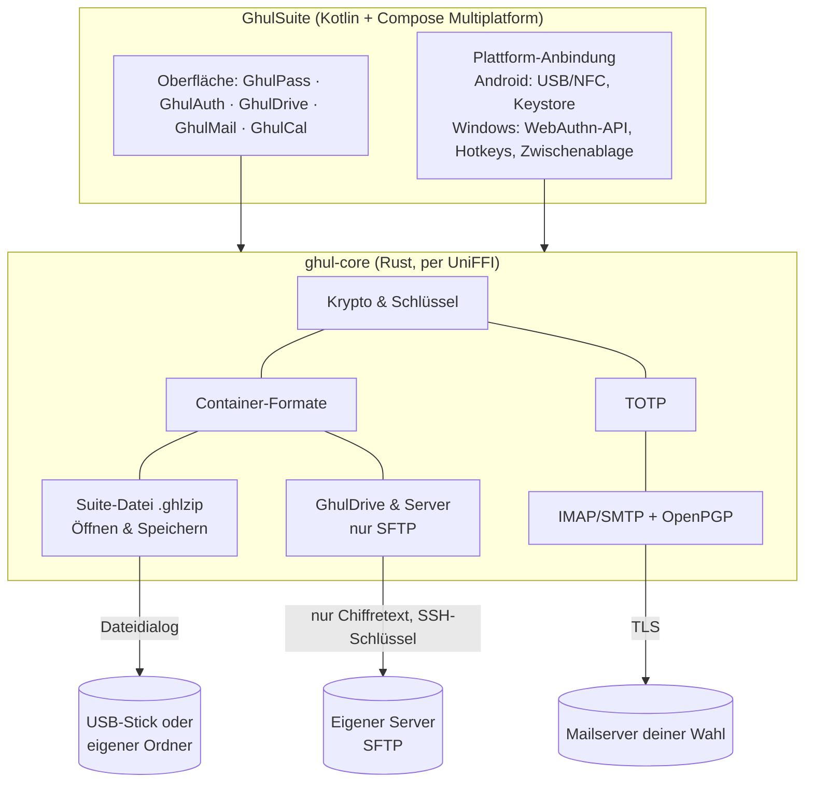
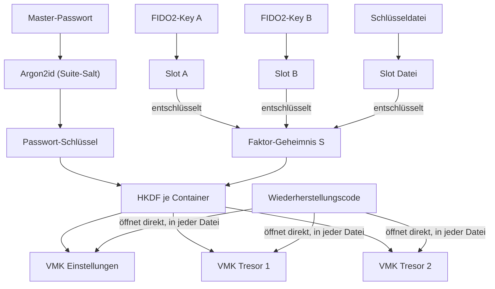

# GhulSuite: Sicherheits- und Architekturkonzept

**Stand:** Entwurf v0.8 · 17.11.2026 (v0.7: eigene Server, GhulDrive und GhulMail umgesetzt; **v0.8: ohne Synchronisation. Die Suite ist eine Datei (`.ghlzip`), die man speichert und öffnet; Server nur per SFTP; Formatversion 3 mit Schreibsiegel; GhulDrive mit Sperre, Revision und Schlüsselwechsel**, Abschnitt 8. Begründung und Ablauf des Umbaus: [`UMBAU-OHNE-SYNC.md`](UMBAU-OHNE-SYNC.md))
**App:** GhulSuite mit den Bereichen **GhulPass** (Passwörter) · **GhulAuth** (TOTP) · **GhulCal** (Kalender) · **GhulMail** (Mail) · **GhulDrive** (Dateien)
**Plattformen:** Android (nativ) **zuerst** · Windows (nativ, auch portabel vom USB-Stick) **später**
**Lizenz:** AGPL-3.0-or-later
**Sprachen:** Deutsch und Englisch ab der ersten Version

---

## 1. Ziel und Leitprinzipien

Eine benutzerfreundliche, universelle Suite, die ohne Anbieterbindung funktioniert. Die Suite ist **eine
verschlüsselte Datei**, die man öffnet, darin arbeitet und speichert, und die man überall hin mitnehmen kann
(z. B. auf einem USB-Stick). Server (für GhulDrive) und Mailserver sind frei wählbar.

1. **Zero Knowledge:** Ver- und entschlüsselt wird nur auf deinen Geräten. Speicher, Server und Netzwerk sehen nur Chiffretext.
2. **Zwei Faktoren sind kryptografisch erzwungen:** Ohne Master-Passwort **und** zweiten Faktor (FIDO2-Key oder
   Schlüsseldatei) lässt sich nichts entschlüsseln, auch nicht offline, auch nicht mit der Datei in der Hand.
   Einzige Ausnahme ist der ausgedruckte **Wiederherstellungscode**: Er öffnet bewusst alles allein (Abschnitt 6.3).
3. **Keine eigene Kryptografie:** Nur etablierte Verfahren aus geprüften Bibliotheken.
4. **Ein Kern für alles:** Ein Rust-Kern (`ghul-core`) für Krypto, Formate, die Suite-Datei, TOTP, Drive und Mail-Protokolle, identisch auf Android und Windows.
5. **Offline zuerst:** Passwörter, TOTP und Kalender sind immer lokal verfügbar und brauchen keinen Server. Ein eigener Server wird nur für GhulDrive und Freigabelinks gebraucht.
6. **Universell:** Kein bestimmter Hoster, Mailanbieter oder Cloud-Dienst wird vorausgesetzt.
7. **Benutzerfreundlich:** Sicherheit über verständliche Abläufe, nicht über Fachbegriffe.
8. **Öffentlich prüfbar:** Das Repository wird später veröffentlicht. Die Sicherheit hängt nie davon ab, dass der Code
   geheim ist. Im Repository liegen keine Geheimnisse.

---

## 2. Getroffene Entscheidungen

| Thema | Entscheidung |
|---|---|
| App-Struktur | **Eine App „GhulSuite“** mit fünf Bereichen (GhulPass, GhulAuth, GhulCal, GhulDrive, GhulMail; der Kalender kam als fünfter dazu) |
| Web-Client | **Keiner.** Ersatz für unterwegs: portables Windows-Programm auf dem USB-Stick |
| Ablage der Suite | **Eine Datei** (`.ghlzip`), die der Nutzer speichert und öffnet, wo er will (USB-Stick, eigener Ordner). Kein Abgleich zwischen Geräten: Aktuell ist der Stand, der zuletzt gespeichert wurde (geändert am 17.11.2026) |
| Synchronisation | **Keine** (entfernt am 17.11.2026): kein Sync-Server, kein Zusammenführen, kein „Von meinem Server holen“, keine eigene Sicherung/Wiederherstellung. Ersetzt durch Öffnen und Speichern der Suite-Datei (Abschnitt 8.1) |
| Teilen | Tresore werden nicht gemeinsam mit anderen Personen bearbeitet; ausgewählte Einträge lassen sich aber **als eigener Tresor weitergeben** (eigenes Passwort, neue Schlüsseldatei oder Security Key, Abschnitt 8.6). Dateien und einzelne Einträge: **Ende-zu-Ende-verschlüsselte Freigabelinks** über den eigenen Server (Abschnitt 9.4, Teilen) |
| Mail-Benachrichtigung | **Ja, auch bei gesperrter App**: mit eigenem, gerätegebundenem Mail-Zugang (Abschnitt 9.3); geändert am 11.11.2026 |
| Schnell-Entsperren | **Fingerabdruck und/oder App-PIN**, optional und mit engen Grenzen (Abschnitt 6.5) |
| Module | Jeder Bereich (GhulPass, GhulAuth, später GhulMail, GhulDrive) ist in den Einstellungen **abschaltbar**; er verschwindet dann aus dem Menü, die Daten bleiben erhalten |
| Sofortsperre | **Sofort sperren** (Stufe 1), auch durch **Schütteln**; kein Löschen, kein Notfall-Passwort (Abschnitt 6.6) |
| Server-Zugang | **Nur SFTP**, angemeldet wird mit dem SSH-Schlüssel der Suite, nie mit einem gespeicherten Passwort (das Passwort dient nur einmal zum Eintragen des Schlüssels). FTP und FTPS sind entfernt (17.11.2026) |
| Drive-Speicher | **Eigene Server** per SFTP (auch Webhosting, sofern es SSH-Zugang bietet; reiner FTP-Webspace reicht nicht); Freigabelinks über das Server-Modul (PHP) auf demselben Server |
| Plattformen | **Zuerst nur Android.** Windows folgt später; die Architektur ist von Anfang an darauf ausgelegt (Abschnitt 4.1) |
| Schutz | **Master-Passwort plus zweiter Faktor, immer.** Zweiter Faktor: Security Key (empfohlen) oder Schlüsseldatei; beliebig viele, jederzeit austauschbar, ohne dass etwas ungültig wird. Einen Schutz nur mit Passwort gibt es nicht (geändert am 11.11.2026) |
| Wiederherstellungscode | **Pflicht** bei jeder Suite; öffnet alles allein, auch ohne Passwort, Key und Schlüsseldatei; danach wird ein neues Passwort gesetzt |
| Suite und Tresore | **Die Suite ist eine Datei:** Die Suite-Datei `suite.ghlsuite`, alle Tresore und eine Kopfdatei liegen zusammen in der `.ghlzip`. Je Bereich beliebig viele Tresore (z. B. GhulPass „Privat“ und „Arbeit“). Auf dem Gerät gibt es eine Arbeitskopie (geändert am 17.11.2026; davor „Der Ordner ist die Suite“) |
| Erster Start | Auswahl: **neu einrichten**, **Suite-Datei öffnen** (`.ghlzip`) oder **einzelnen Tresor öffnen** (Tresordatei: nur diesen Tresor öffnen, zur eigenen Suite hinzufügen oder eine neue Suite damit anlegen; Abschnitt 8.6) |
| Speicherort | Die **Arbeitskopie** liegt im privaten App-Speicher (Windows portabel: im Ordner `GhulSuite-Daten` neben dem Programm), damit die App auch ohne den Stick funktioniert. Die **Suite-Datei** liegt, wo der Nutzer sie speichert; die App merkt sich die zuletzt geöffnete Datei und speichert direkt dorthin |
| GhulAuth-Passwort | Alle Tresore einer Suite haben dasselbe Passwort und dieselben Faktoren. Wer ein getrenntes Passwort will, legt eine zweite Suite an |
| Lizenz | **AGPL-3.0-or-later** |
| Windows-Code-Signatur | **Nein** (SmartScreen-Warnung beim ersten Start wird in Kauf genommen) |
| Sprachen | Deutsch und Englisch |

---

## 3. Ergebnis der kritischen Überprüfung

Was sich gegenüber v0.1 geändert hat und warum:

| # | Befund | Änderung |
|---|---|---|
| 1 | Ohne Web-Client entfällt der Grund für Tauri (gemeinsame Oberfläche mit dem Web). Zwei getrennte Oberflächen für Android und Windows wären doppelte Arbeit für alle Bereiche. | **Kotlin + Compose Multiplatform** für beide Plattformen: eine Oberfläche, einheitliche Bedienung. Der Rust-Kern hängt per UniFFI an beiden. |
| 2 | Android bindet FIDO2 für Apps über den Credential Manager an eine **eigene, verifizierte Web-Domain**. Für eine universelle, öffentliche App hat nicht jeder Nutzer eine. | **Direkter CTAP2-Zugriff** auf den Key über USB (später NFC). Keine Domain nötig, keine Abhängigkeit von Google-Diensten, läuft auch auf Android ohne Google (z. B. GrapheneOS). |
| 3 | Die Credential-ID und der PRF-Salt stehen offen im Datei-Header. Wäre die RP-ID eine echte Domain, könnte deren Besitzer eine Webseite bauen, die mit einer Key-Berührung den geheimen Wert abfragt. | **Feste RP-ID, die keine gültige Web-Domain ist** (Vorschlag: `ghulsuite.invalid`, reservierte Endung). Kein Browser kann sie je anfragen. |
| 4 | Cloud-Anbindungen über den Android-Dateidialog (z. B. Google Drive) sind beim Zurückschreiben bekanntermaßen unzuverlässig: Zwischenspeicher, verzögerter Upload, Konflikte. | Seit 17.11.2026 gibt es keine Synchronisation mehr: Die Suite wandert als **eine Datei**, die der Nutzer über den Dateidialog öffnet und speichert (z. B. auf einem USB-Stick). Die App schreibt die ganze Datei auf einmal und prüft beim Öffnen alles, bevor sie etwas ersetzt (Abschnitt 8.1). |
| 5 | Geräte-Registrierung am Server mit FIDO2-Freigabe ist aufwendig und bringt kaum Gewinn: Wer den Suite-Container entschlüsseln kann, hat ohnehin alle Zugänge. | **Zugangsdaten für alle Server stehen verschlüsselt in der Suite.** Ein neues Gerät muss nur die Suite-Datei öffnen, ohne Konto und ohne Freischaltung. |
| 6 | Vier Container einzeln zu entsperren wäre umständlich; WebAuthn-PRF liefert pro Berührung nur zwei Werte. | Alle Container einer Suite teilen sich Passwort-Ableitung und Faktor-Geheimnis. **Ein Passwort, eine Berührung, alles offen**: die Container bleiben dabei kryptografisch getrennt. |
| 7 | HTML-Mails sind der größte Angriffsweg. Eine Browser-Engine zur Anzeige ist zudem unter Compose Desktop schwierig. | **Standard: native, vereinfachte Darstellung** (Text, Formatierung, Links, Bilder nach Klick) **ohne Browser-Engine**. Original-HTML nur auf Wunsch in einer abgeschotteten Ansicht ohne Skripte. |
| 8 | Gmail und Microsoft-Konten verlangen inzwischen OAuth2. Für Gmail braucht eine öffentliche App dazu eine kostenpflichtige Sicherheitsprüfung durch Google. | GhulMail unterstützt **Standard-IMAP/SMTP** (eigener Server, Posteo, mailbox.org, GMX, Web.de, die meisten Hoster). Gmail nur über App-Passwort, OAuth-Anbieter frühestens später. |
| 9 | Ein lokaler Ordner als Drive-Speicher wirkte unsicher. | Jeder Server speichert **ausschließlich verschlüsselte Blöcke**. Ein lokaler Datenträger als Drive-Speicher oder Sicherungsziel ist nicht umgesetzt; GhulDrive liegt auf dem eigenen Server (SFTP). |
| 10 | Unverschlüsseltes FTP ist unsicher; ein gespeichertes Server-Passwort kann die App nach einer Schutzänderung nicht selbst wechseln. | **Nur SFTP mit SSH-Schlüssel** (seit 17.11.2026). FTPS (seit 0.5.0) ist mit dem Umbau entfernt; Webhosting ohne SSH-Zugang reicht für GhulDrive und Freigabelinks nicht. Das PHP-Modul dient seit 0.7.0 nur Freigabelinks. |
| 11 | Mail-Abruf im Hintergrund braucht Zugangsdaten bei gesperrter App. | Seit v0.5 gewünscht: eigener, gerätegebundener Mail-Zugang nur für den Abruf (Abschnitt 9.3). |
| 12 | Die Drive-Schlüssel liegen nur in der Suite. Geht sie verloren, sind die Drive-Daten weg. | Die Suite-Datei ist das, was man aufbewahrt (auch in Kopien an mehreren Orten). Die App zeigt **„Nicht gespeicherte Änderungen“** und fordert nach jeder Schutzänderung auf, die Datei zu speichern. Das automatische Mitsichern auf den Server entfällt mit der Synchronisation. |

---

## 4. Architektur



| Baustein | Technik | Begründung |
|---|---|---|
| Kern | **Rust** | Speichersicher, Schlüssel im RAM werden überschrieben (`zeroize`), eine Implementierung für beide Plattformen |
| Oberfläche | **Kotlin + Compose Multiplatform** | Eine Oberfläche für Android und Windows; auf Android echt nativ (Credential-Provider, Kamera) |
| Anbindung | **UniFFI** | Erzeugt sichere Kotlin-Anbindungen an den Rust-Kern für Android und Windows |
| Windows-Paket | Installer **und** portable Version (Ordner mit Programm und Laufzeit, startet vom Stick) | Die Java-Laufzeit wird mitgeliefert, auf dem PC muss nichts installiert sein |

### 4.1 Android zuerst, Windows später

Windows später nachzuziehen ist **kein großer Mehraufwand, wenn das Projekt von Anfang an dafür angelegt ist**:

- **Gemeinsamer Code (`commonMain`):** Oberfläche, Abläufe, Texte (Deutsch/Englisch) und die gesamte Logik im Rust-Kern.
  Erfahrungsgemäß sind das deutlich mehr als drei Viertel des Codes.
- **Plattform-Code nur hinter klaren Schnittstellen:** FIDO2-Zugriff, Fingerabdruck, Zwischenablage, Dateiauswahl,
  Auto-Type, Hintergrundaufgaben, Bewegungssensor. Für Windows wird später nur dieser Teil neu geschrieben.
- Der Windows-Build bleibt bis dahin abgeschaltet, das Projekt kompiliert aber gegen beide Ziele, damit sich keine
  Android-Abhängigkeiten in den gemeinsamen Code einschleichen.

**Echter Mehraufwand für Windows später:** FIDO2 über die Windows-WebAuthn-API, Auto-Type und Tastenkürzel,
Windows Hello, portabler Modus und das Paket. Das ist überschaubar, aber nicht null.

**Risiko RP-ID:** Sollte die Windows-API die RP-ID `ghulsuite.invalid` nicht annehmen, ist das kein Problem für bestehende
Daten. Die Android-App kann für denselben Key einen **zusätzlichen Slot** mit einer anderen RP-ID anlegen, ohne dass
Daten neu verschlüsselt werden müssen.

**Bekannte Risiken, die früh im Prototyp geprüft werden:**
- Direkter CTAP2-Zugriff per USB-C auf Android mit deinem Key (Phase 0b)
- Später für Windows: `hmac-secret` über die Windows-WebAuthn-API mit eigener RP-ID, Startzeit und Größe der portablen Version

---

## 5. FIDO2

- Jeder FIDO2-Key mit der Erweiterung **`hmac-secret`** funktioniert, z. B. Yubico, Nitrokey 3, Token2, Feitian, SoloKeys.
  Der Key liefert zu einem gespeicherten Salt einen geheimen 32-Byte-Wert, den nur dieser Key berechnen kann.
- **Android:** direkter CTAP2-Zugriff über USB-C, NFC später. Android fragt beim ersten Mal, ob GhulSuite auf den Key zugreifen darf.
- **Windows:** über die Windows-WebAuthn-API. Es erscheint der bekannte Windows-Sicherheitsdialog. Das funktioniert
  ohne Administratorrechte, also auch portabel auf fremden PCs.
- **PIN auf dem Key ist Pflicht.** Der Key sperrt sich nach 8 Fehlversuchen. `hmac-secret` wird immer „mit PIN“ ausgewertet,
  dieser Wert unterscheidet sich vom Wert ohne PIN.
- **Feste RP-ID** `ghulsuite.invalid` auf allen Plattformen, damit derselbe Key überall denselben Wert liefert
  und keine Webseite die Credentials ansprechen kann (siehe Abschnitt 3, Befund 3).
- **Nicht auffindbare Credentials:** Sie belegen keinen Speicher auf dem Key. Die Credential-ID steht im Container-Header.
- **Mindestens zwei Keys** werden empfohlen. Die App erinnert daran, solange nur einer registriert ist.
- Passkeys des Handys oder Windows Hello als zweiter Faktor sind vorerst **nicht** vorgesehen (Verfügbarkeit von `hmac-secret` uneinheitlich). Später prüfen.

---

## 6. Schlüsselkonzept

### 6.1 Faktoren

| Faktor | Rolle |
|---|---|
| **Master-Passwort** | immer erforderlich |
| **FIDO2-Key** (mit PIN) | zweiter Faktor (empfohlen), beliebig viele |
| **Schlüsseldatei** `.ghlkey` | zweiter Faktor, gleichwertig zum Key, beliebig viele; z. B. zum Einstieg oder als Reserve |
| **Wiederherstellungscode** (Notfallblatt) | öffnet allein **alles**: für den Fall, dass nichts anderes mehr da ist |

Mindestens ein Key oder eine Schlüsseldatei muss immer eingetragen sein. Jeder Key und jede Schlüsseldatei öffnet
zusammen mit dem Passwort dasselbe Faktor-Geheimnis `S`. Darum lässt sich eine Schlüsseldatei später gegen einen Key
tauschen (Key hinzufügen, Datei entfernen), ohne dass der Wiederherstellungscode oder die übrigen Keys ungültig werden.

### 6.2 Schlüsselhierarchie



1. `PK = Argon2id(NFC(Passwort), suite_salt)`: einmal pro Entsperren. Mindestens 64 MiB und 3 Durchläufe,
   kalibriert auf ca. 1 Sekunde am langsamsten Gerät.
2. Jeder zweite Faktor hat einen **Slot**, der das zufällige **Faktor-Geheimnis `S`** (256 Bit) verschlüsselt enthält.
   - FIDO2-Slot: privater X25519-Schlüssel = `HKDF(hmac-secret(Key, slot_salt))`
   - Schlüsseldatei-Slot: privater X25519-Schlüssel = `HKDF(Geheimnis der Datei)`
   - Im Slot steht der zugehörige **öffentliche** Schlüssel. Damit kann die App ein neues `S` für jeden Key
     verschließen, ohne ihn zu berühren.
3. Je Container: `KEK = HKDF-SHA256(PK ‖ S, info = "ghul/v1/kek" ‖ Container-UUID)`
4. Der `KEK` entschlüsselt den zufälligen **Container-Hauptschlüssel (VMK)**. Aus dem VMK wird der Inhalts-Schlüssel
   abgeleitet; der Header ist als AAD eingebunden. Exakte Ableitungen: [`docs/FORMAT.md`](FORMAT.md), Abschnitt 4.
5. **Schreibsiegel (Formatversion 3):** Jede Datei endet mit einem HMAC über alle Bytes davor, mit einem Schlüssel aus
   `PK` und `S`. Es entsteht nur mit dem Passwort. Wer eine alte Kopie und einen alten Code hat, kann damit lesen, was
   damals galt, aber keine Datei bauen, die ein Gerät annimmt. Dass eine Datei aktuell ist, beweist das Siegel nicht;
   dafür sorgen Zähler und Schutz-Epoche der Suite-Datei (Abschnitt 8.1). Ältere Formatversionen werden nicht mehr
   gelesen.

**Eigenschaften:**
- Nur Key oder nur Schlüsseldatei → `S`, aber ohne Passwort kein `KEK` → wertlos.
- Nur Passwort → kein `S` → wertlos.
- **Ein Passwort, eine Berührung** öffnet alle Container. Jeder Container hat trotzdem seinen eigenen VMK.
- Jeder Container enthält alle Slots in seinem eigenen Header und lässt sich daher **auch einzeln** öffnen,
  z. B. nur eine `.ghlpss` vom USB-Stick ohne Suite-Datei (Abschnitt 8.6).
- Passwort ändern geht mit einem einzigen Key. Ein Key oder eine Schlüsseldatei wird hinzugefügt oder entfernt, indem man einen Slot hinzufügt oder löscht. Die App aktualisiert dabei alle Container. Der letzte zweite Faktor lässt sich nicht entfernen.
- **Erneuern bei jeder Schutzänderung:** Neues Notfallblatt, neues Passwort oder ein entfernter Key geben jedem
  Container einen neuen VMK; ein entfernter Key erneuert zusätzlich `S` für alle übrigen Keys. So öffnet ein
  verlorenes Notfallblatt oder ein entfernter Key zusammen mit einer **alten Kopie der Suite-Datei** nichts, was
  danach gespeichert wurde. Die alte Kopie selbst zeigt weiter den Stand von damals. Zusätzlich bekommen GhulDrive und
  der Server-Zugang neue Schlüssel (Schlüsselwechsel, Abschnitt 8.4.1): Die alte Kopie kommt danach nicht mehr an
  den Server.
- **Dateinamen verraten nichts:** Tresordateien heißen nach ihrer zufälligen Kennung (`3f9a1c2b7d4e5f60.ghlpss`),
  der Name steht nur verschlüsselt darin.
- **Die Suite ist eine Datei:** Die Suite-Datei `suite.ghlsuite` (Schutz, Server, SSH-Schlüssel, Freigaben) und alle
  Tresore gehören zusammen und reisen gemeinsam in der `.ghlzip` (Abschnitt 8.1). Auf dem Gerät arbeitet die App in
  einer Arbeitskopie; sie gleicht nichts mit Dateien in fremden Ordnern ab und übernimmt nichts von selbst.
- **Tresore mit anderem Schutz** (aus einer anderen Suite) kommen nur auf ausdrücklichen Wunsch dazu: „Zu meiner Suite
  hinzufügen“ öffnet sie einmal mit ihrem bisherigen Passwort und Key bzw. Schlüsseldatei und stellt sie auf Passwort,
  Faktoren und Code der Suite um. Oder man öffnet sie einzeln, mit ihrem eigenen Schutz (Abschnitt 8.6).
- **Älterer Stand:** Ob eine Suite-Datei älter, abgezweigt oder mit einem älteren Schutz ist, erkennt die App beim
  Öffnen an Zähler, Stand-ID und Schutz-Epoche in der Kopfdatei (Abschnitt 8.1).
- **Passwort vergessen heißt Daten weg.** Das ist bewusst so: Es gibt keine Hintertür.

### 6.3 Wiederherstellungscode und Notfallblatt

- **Pflicht** bei jeder Suite. Derselbe Code steckt in **jeder** Datei der Suite und öffnet sie direkt (ohne Passwort,
  Key oder Schlüsseldatei), auch eine einzelne Tresordatei ohne den Rest und eine ganze `.ghlzip`. Danach wird ein neues
  Master-Passwort gesetzt; Keys, Schlüsseldateien und der Code selbst bleiben gültig. Empfohlen wird anschließend ein
  neuer Code. Ein neuer Code macht das alte Blatt wertlos, auch zusammen mit einer alten Kopie der Suite-Datei (für
  alles, was danach gespeichert wird).
- **Notfall-Ausnahme beim Siegel:** Ohne Passwort lässt sich das Schreibsiegel nicht prüfen, nur lesen. Die App sagt
  das beim Öffnen, prüft Stand und Schutz-Epoche trotzdem und versiegelt danach alles mit dem neuen Passwort neu.
- Bewusste Abwägung: Wer Notfallblatt **und** Dateien hat, hat Zugriff. Das Blatt ist wie ein Tresorschlüssel aufzubewahren.

- 256 Bit Zufall, dargestellt als 52 Zeichen Base32 in Vierergruppen mit Prüfsumme, zusätzlich als QR-Code.
- Das Notfallblatt wird **lokal** als PDF erzeugt. Es enthält Suite-Name, ID, Datum, den Code und eine Anleitung,
  **aber nicht das Passwort**.
- Nach dem Drucken tippt man zur Bestätigung vier Zeichen vom Ausdruck ab.
- Warnhinweis: Netzwerk- und Cloud-Drucker speichern Druckaufträge teilweise.

### 6.4 Schlüsseldatei `.ghlkey`

32 Byte Zufall mit Kennung und Prüfsumme. Sie ist ein **zweiter Faktor wie ein Key**: Sie verpackt `S` in einem eigenen
Slot. Gegenüber einem Key ist sie kopierbar, darum ist der Key empfohlen. Die App weist darauf hin, sie nie zusammen
mit dem Passwort aufzubewahren und eine Kopie anzulegen.

### 6.5 Schnell-Entsperren per Fingerabdruck oder App-PIN (optional)

Nach einer vollständigen Entsperrung (Passwort und Key) lässt sich die App für eine einstellbare Zeit per
**Fingerabdruck** und/oder **App-PIN** öffnen. Umgesetzt in Etappe 2a:

- Der Kern legt `PK` und den Suite-Schlüssel in `quick-<bio|pin>.ghlq` ab, verschlüsselt mit einem zufälligen Schnellschlüssel `QK`
  (bei der App-PIN zusätzlich mit Argon2id(PIN)). `QK` liegt nur verschlüsselt durch einen **Android-Keystore-Schlüssel** vor:
  - Fingerabdruck: Keystore-Schlüssel nur nach **starker biometrischer Prüfung** (Klasse 3) nutzbar, wird beim
    Registrieren eines **neuen Fingerabdrucks ungültig**.
  - App-PIN: 6 bis 12 Ziffern, Keystore-Schlüssel nur bei entsperrtem Gerät nutzbar, wenn vorhanden in **StrongBox**;
    nach **5 Fehlversuchen** wird der PIN-Zugang gelöscht.
- **Gültigkeit** (1 Stunde bis 7 Tage, Standard 24 Stunden) zählt ab dem **letzten vollständigen Entsperren**
  (signierter Zeitstempel, nur mit `S` fälschbar).
- Passwort und Key sind immer wieder nötig: nach **jedem Neustart**, nach Ablauf, nach einer **Sofortsperre**, nach
  einem **Passwortwechsel**, nach dem **Öffnen einer Suite-Datei** (die Schnell-Entsperren-Dateien des alten Stands
  werden gelöscht) und wenn Fingerabdrücke geändert wurden.
- **Ehrlich:** In der Gültigkeitszeit reichen das entsperrte Handy plus Finger bzw. App-PIN. Deshalb optional und
  standardmäßig aus. Ein Angreifer mit Root-Zugriff auf das laufende Gerät könnte den Fehlversuchszähler umgehen;
  die PIN ist aber an den Hardware-Schlüssel des Geräts gebunden, ein Durchprobieren außerhalb des Geräts ist nicht möglich.
- **Nicht verfügbar in der portablen Windows-Version.**

### 6.6 Sofortsperre

Ein Fingerabdruck kann erzwungen werden, ein Passwort im Kopf nicht so leicht. Deshalb gibt es eine Sofort-Sperre:

- **Wirkung:** Alle Bereiche werden gesperrt, alle Schlüssel aus dem Arbeitsspeicher gelöscht und Fingerabdruck- und
  App-PIN-Zugang werden **vernichtet** (Keystore-Schlüssel und Schnell-Dateien werden gelöscht). Danach öffnet die App
  nur noch mit Passwort **und** Key.
- **Das reicht kryptografisch vollständig:** Alle Dateien auf dem Gerät sind ohnehin verschlüsselt. Ohne
  Fingerabdruck-Zugang lassen sie sich ohne Passwort und Key nicht öffnen, auch nicht forensisch. Löschen ist nicht nötig.
- **Auslöser Android:**
  - **Schütteln** (Bewegungssensor, kurzes kräftiges Schütteln). Die Erkennung läuft nur, solange etwas entsperrt
    ist, danach gibt es nichts mehr zu sperren, und der Akku wird geschont.
  - Schnellkachel „GhulSuite sperren“ in den Schnelleinstellungen.
  - Der Sperr-Knopf in der App und der Knopf in der Benachrichtigung sperren dagegen **normal** (Schnell-Entsperren bleibt).
- **Auslöser Windows:** globales Tastenkürzel und Tray-Symbol.
- Ein versehentliches Auslösen schadet nicht: Man entsperrt danach einfach einmal mit Passwort und Key.
- Die Empfindlichkeit beim Schütteln ist einstellbar, Schütteln lässt sich abschalten.
- **Bewusst nicht vorgesehen:** Löschen der lokalen Daten, Notfall-Passwort, Fernsperre (siehe Abschnitt 14).

---

## 7. Dateien und Formate

| Datei | Magic | Inhalt |
|---|---|---|
| `.ghlpss` | `GHULPASS` | GhulPass-Tresor |
| `.ghltotp` | `GHULTOTP` | GhulAuth-Tresor |
| `.ghlcal` | `GHULCLDR` | GhulCal-Kalender (bewusst ohne CalDAV; Austausch per .ics) |
| `.ghldrv` | `GHULDRIV` | GhulDrive-Tresor: Speicherorte, Drive-Schlüssel, höchste gesehene Index-Revision je Speicherort, Optionen (kein Index, keine Dateiliste) |
| `.ghlmail` | `GHULMAIL` | GhulMail-Tresor: Konten, Schlüssel, Entwürfe, Postausgang, Optionen |
| `.ghlsuite` | `GHULSUIT` | Suite-Datei: Schutz, Server, SSH-Schlüssel der Suite, laufender Schlüsselwechsel, Freigaben, Einstellungen |
| `.ghlkey` | `GHULKEY\0` | Schlüsseldatei |
| `.ghlzip` | ZIP | Die ganze Suite zum Mitnehmen: `suite.ghlsuite`, alle Tresore und die Kopfdatei `export.ghlexp` (ein eigener, versiegelter Container mit Liste, Hashes, Stand-ID, Zähler und Schutz-Epoche). Kein zweites Passwort; Abschnitt 8.1 |

Gerätegebundene Daten (Arbeitskopie, Mail-Zwischenspeicher, Drive-Offline-Dateien, unfertige Uploads,
Vorschaubilder) sind **keine** Austauschdateien. Sie liegen verschlüsselt im App-Speicher, bzw. bei der portablen
Version auf dem Stick.

### 7.1 Container-Aufbau (gemeinsam für alle Container)

Die verbindliche Byte-Spezifikation steht in **[`docs/FORMAT.md`](FORMAT.md)** (mit Testvektoren).

```
┌─ Präfix + Header (Klartext, authentifiziert) ──────────────────┐
│ Magic · Format-Version · Header-Länge                           │
│ Container-ID · Suite-ID · Argon2id-Parameter + Salt             │
│ Slots[]: Typ · ID · Credential-ID · PRF-Input · verpacktes S    │
│ Flags (derzeit 0) · verpackter VMK                              │
├─ Inhalt: XChaCha20-Poly1305, AAD = Präfix + Header ─────────────┤
│ CBOR-Dokument mit Revisionszähler, aufgefüllt auf Blockgrößen   │
├─ Schreibsiegel: HMAC-SHA256 über alles davor (nur mit Passwort) ┤
└─────────────────────────────────────────────────────────────────┘
```

Ein separater Header-MAC (Entwurf v0.1 bis v0.4) entfällt: Der Header ist vollständig als AAD in die Verschlüsselung
des Inhalts eingebunden.

- **XChaCha20-Poly1305:** Zufalls-Nonces ohne Wiederverwendungsrisiko. Bewusst nur **ein** Verfahren je Formatversion.
- **Header als AAD:** Jede Änderung am Header macht die Entschlüsselung ungültig. Zusätzlich gelten Mindest- und Höchstwerte für Argon2id.
- **Auffüllen:** Die Dateigröße verrät nicht die Anzahl der Einträge.
- **Schreibsiegel:** Eine Datei, die mit Passwort und `S` aufgeht, deren Siegel aber nicht stimmt, gilt als verändert
  und wird nicht verwendet.
- **Rollback-Schutz:** Für die ganze Suite über Zähler, Stand-ID und Schutz-Epoche der `.ghlzip` (Abschnitt 8.1), für
  GhulDrive über die Revision des Index (Abschnitt 8.4).
- **Einträge** haben UUID, Revision und Änderungszeit.

---

## 8. Suite-Datei, Server und GhulDrive

Bis zum Umbau hielt eine Synchronisation über den eigenen Server (später auch über fremde Sync-Programme im Ordner) die
Geräte gleich. Sie war die Quelle der meisten Sicherheitsfunde (fremde Dateien übernehmen, Schutzstände
zusammenführen, ersetzte Codes, gleichzeitige Änderungen, gefälschte Server-Dateien) und ist seit dem 17.11.2026
vollständig entfernt. Begründung und Pakete des Umbaus: [`UMBAU-OHNE-SYNC.md`](UMBAU-OHNE-SYNC.md).

### 8.1 Die Suite als Datei (`.ghlzip`)

**Die Suite ist eine Datei. Man öffnet sie, arbeitet darin und speichert sie.** Wohin die Datei wandert (USB-Stick,
eigener Ordner), entscheidet der Nutzer; die App gleicht nichts ab und führt nichts zusammen. Aktuell ist immer der
Stand, der zuletzt in die Datei gespeichert wurde.

Beispiel: Handy: Datei auf dem Stick öffnen, arbeiten, speichern. Windows: dieselbe Datei öffnen, arbeiten,
speichern. Wieder auf dem Handy: öffnen.

- **Arbeitskopie:** Öffnen lädt die Datei (nach allen Prüfungen) in die Arbeitskopie im App-Speicher. Sie bleibt
  bestehen, damit die App auch ohne den Stick funktioniert; sie ist Zwischenstand, nicht die Datenbank.
- **Die zuletzt geöffnete Datei** merkt sich die App (Android: über die Dateiauswahl des Systems mit dauerhafter
  Berechtigung; Windows: Pfad). „Speichern“ schreibt dorthin, „Speichern unter“ an einen neuen Ort. Ist der Stick
  nicht da, sagt die App das und bietet „Speichern unter“ an. Zu finden unter Optionen → Suite-Datei.
- **Eigene Endung**, damit Android und Windows die Datei der App zuordnen. **Kein zweites Passwort:** Die Inhalte sind
  die verschlüsselten, versiegelten Container; die ZIP fügt nichts hinzu.

**Inhalt.** Genau diese Einträge, keine Ordner, keine doppelten oder zusätzlichen; Größen werden beim Lesen gezählt,
nicht aus dem ZIP-Verzeichnis übernommen:

- `suite.ghlsuite` und alle Tresore (neutrale Dateinamen);
- die Kopfdatei `export.ghlexp`, ein eigener kleiner Container, verschlüsselt und versiegelt wie die Tresore, mit:
  Suite-ID und `container_id` der Suite-Datei; je Datei `container_id`, Art, Dateiname und SHA-256; **Stand-ID**
  (zufällig, neu bei jedem Speichern), **Vorgänger** (die Stand-IDs, aus denen dieser Stand hervorging) und **Zähler**;
  **Schutz-Epoche** (wächst bei jeder Schutzänderung); Zeitpunkt und Gerätename.

**Speichern.**

1. Alle Container werden frisch versiegelt und mit der Kopfdatei in eine temporäre Datei neben dem Ziel geschrieben,
   dann in einem Schritt ersetzt. Schlägt das Schreiben fehl, bleibt die bisherige Datei unverändert.
2. Vorher vergleicht die App die Zieldatei mit der Arbeitskopie. Wurde sie seit dem Öffnen anderswo gespeichert
   (andere Stand-ID), fragt sie: „Die Datei wurde inzwischen anderswo gespeichert. Überschreiben (die Änderungen von
   dort gehen verloren) oder unter neuem Namen speichern?“ Liegt dort eine andere Suite oder gar keine GhulSuite-Datei,
   fragt sie ebenfalls. Zusammengeführt wird nicht.
3. Danach merkt sich das Gerät Stand-ID, Zähler und Schutz-Epoche. Eine Änderung, die während des Schreibens
   entstand, bleibt als „nicht gespeichert“ markiert.

**Öffnen.**

1. Die App liest die Kopfdatei und fragt nach Passwort und Key bzw. Schlüsseldatei.
2. **Alles wird geprüft, bevor etwas ersetzt wird:** das Schreibsiegel jeder Datei und der Kopfdatei; jede Datei steht
   in der Liste mit Art, `container_id` und Hash; die Liste stimmt genau mit den Tresoren der Suite-Datei überein,
   nichts fehlt, nichts ist zu viel; alles gehört zu derselben Suite. Schlägt etwas fehl, wird nichts geladen, und die
   App sagt, was nicht stimmt.
3. **Rückfragen** (alle auf einmal, in einem Dialog, vor dem Ersetzen):
   - **Andere Suite** als die auf dem Gerät: „Diese Datei enthält eine andere Suite als die auf diesem Gerät. Sie
     ersetzt alles hier.“
   - **Älterer Stand** (kleinerer Zähler als hier zuletzt gesehen): „Diese Datei ist älter als dein Stand hier.“
   - **Abzweig** (von einem anderen Stand aus weiterbearbeitet als dem hier bekannten): „Diese Datei wurde von einem
     anderen Stand aus weiterbearbeitet als deinem hier.“
   - **Nicht gespeicherte Änderungen** auf dem Gerät: Sie gehen verloren; die App bietet an, vorher zu speichern, und
     sagt, dass GhulDrive-Dateien, Freigabelinks und gesendete Mails auf dem Server liegen und bleiben.
   - **Älterer Schutz** (kleinere Schutz-Epoche als hier zuletzt gesehen): **wird nicht geöffnet.** Die Datei ist
     durch eine neuere mit geändertem Schutz ersetzt. Auf einem Gerät, das den neueren Stand nie gesehen hat, öffnet
     sie sich zwar, kommt aber nach dem Schlüsselwechsel nicht mehr an den Server (8.4.1).
4. Ersetzt wird in einem Schritt; bricht es mittendrin ab, bleibt der bisherige Stand.
5. **Gerätedaten des alten Stands werden gelöscht:** Schnell-Entsperren (Dateien und Zeitstempel, sie enthalten den
   alten Passwort-Schlüssel und `S`), Mail-Zwischenspeicher, Drive-Offline-Kopien, unfertige Uploads.
6. **Mit dem Wiederherstellungscode** (Passwort vergessen): Die Siegel lassen sich dann nicht prüfen, nur lesen. Das ist
   die bewusste Notfall-Ausnahme; die App weist darauf hin, prüft Stand und Schutz-Epoche trotzdem, setzt ein neues
   Passwort und versiegelt alles neu.

Was ein Gerät zuletzt gesehen hat (höchster Zähler, Stand-ID, Schutz-Epoche), steht je Suite in seinem eigenen Ordner,
nicht in der Arbeitskopie: Eine ältere Datei, ein Abzweig oder ein älterer Schutz fallen auch auf, nachdem die
Arbeitskopie ersetzt wurde.

**„Nicht gespeicherte Änderungen“.** Gibt es Änderungen seit dem letzten Speichern, zeigt die App oben einen Hinweis
(„Nicht gespeicherte Änderungen. Tippen zum Speichern.“) und auf der Seite Suite-Datei den Stand. Ohne Änderungen:
„Alles ist in der Suite-Datei gespeichert.“

**Nach einer Schutzänderung** (neues Passwort, neuer Code, Key oder Schlüsseldatei entfernt) fordert die App auf, die
Suite-Datei jetzt zu speichern und damit ältere Kopien zu ersetzen. Diese öffnen sich zwar weiter mit dem alten
Schutz, kommen aber nach dem Schlüsselwechsel nicht mehr an GhulDrive und die Server.

**Schutzänderungen** wirken in der Arbeitskopie und reisen mit dem nächsten Speichern mit; sie erneuern die inneren
Schlüssel (Abschnitt 6.2) und erhöhen die Schutz-Epoche. Keys und Schlüsseldateien funktionieren auf jedem Gerät;
Schnell-Entsperren bleibt je Gerät.

### 8.2 Server: nur SFTP

| Adapter | Für wen | Verbindung |
|---|---|---|
| **SFTP** | Jeder vServer oder Root-Server, NAS, Raspberry Pi, Speicherboxen mit SFTP, Webhosting **mit SSH-Zugang** | SSH-Schlüssel der Suite, Server-Fingerabdruck wird beim ersten Verbinden bestätigt und fest gespeichert |

- **Nur SFTP** (seit 17.11.2026). FTP und FTPS sind vollständig entfernt (Adapter, Zertifikatsprüfung für FTP,
  Sonderfälle beim Ersetzen). WebDAV und S3 sind nicht geplant. Grund: Als Server-Zugang steht in der Suite nur ein
  **SSH-Schlüssel**, nie ein Passwort. Nur so kann die App den Zugang bei einer Schutzänderung selbst tauschen (8.4.1).
- **Wofür ein Server nötig ist:** nur für **GhulDrive** und **Freigabelinks**. GhulPass, GhulAuth, GhulCal und
  GhulMail brauchen keinen eigenen Server. Ohne SSH-Zugang beim Hoster (reiner FTP-Webspace) gibt es kein GhulDrive und
  keine Freigabelinks.
- Alle Zugangsdaten (Host, Benutzer, SSH-Schlüssel) liegen **nur verschlüsselt** in der Suite: der SSH-Schlüssel in
  der Suite-Datei, die Speicherorte von GhulDrive im Drive-Tresor. Ohne Entsperren ist nicht erkennbar, welche Server
  eingerichtet sind.
- **Mehrere Speicherorte für GhulDrive** (abgestimmt am 16.11.2026): beliebig viele Server, jeder mit eigenem Ordner,
  eigenen Dateien, eigenem Server-Modul und eigenen Freigabelinks. **Einer ist aktiv**; GhulDrive zeigt nur ihn,
  „Speicherort wechseln“ schaltet um, ohne etwas zu kopieren. Hinzufügen prüft den Server und lässt den aktiven
  Speicherort, wie er ist. Entfernen fragt, ob auch die Dateien auf dem Server gelöscht werden sollen (sonst bleiben
  sie verschlüsselt liegen); die Freigabelinks des Speicherorts enden in beiden Fällen. Das Mail-Archiv schreibt in
  einen **fest eingestellten** Speicherort (Optionen → GhulMail, änderbar), auch wenn GhulDrive gerade einen anderen
  zeigt. Entfernen löscht auf Wunsch nur GhulDrives eigene Dateien und nie in einem Ordner, den ein anderer
  Speicherort nutzt; ist der Server nicht erreichbar, kann der Speicherort trotzdem entfernt werden (die Links werden
  dann nur vergessen). Ein laufendes Hochladen endet in seinem Speicherort, auch nach einem Wechsel.
- **Ein Server ist ein Webspace** (abgestimmt am 15.11.2026, 0.7.0): sein SFTP-Zugang und, nur für Freigabelinks,
  optional das GhulSuite-Server-Modul, das die App über **denselben** Zugang installiert. Ein weiterer Server ist völlig
  getrennt (eigener Zugang, eigenes Modul, eigene Links).
- **Zwei Ordner, zwei Aufgaben:** Der GhulSuite-Ordner (GhulDrive, Freigaben) liegt außerhalb der Website, das Modul
  (`ghulsuite.php`) im Ordner der Website. Die Ordnerauswahl markiert Website-Ordner und warnt darin; die Installation
  des Moduls prüft, dass der GhulSuite-Ordner nicht aus dem Web abrufbar ist.
- **Ein Server-Formular** für Assistent, GhulDrive und Optionen: per SFTP anmelden, **Ordner aus der Liste des Servers
  wählen**, Verbindung testen. Modul: Ordner der Website wählen, die App legt `ghulsuite.php` hinein (mit dem Pfad zum
  GhulSuite-Ordner) und prüft Adresse, ob PHP läuft, ob das Modul den GhulSuite-Ordner lesen und darin schreiben kann
  (Testdatei) und dass der GhulSuite-Ordner selbst nicht aus dem Web abrufbar ist. Eine Checkliste nennt den fehlenden
  Schritt.
- **Erst prüfen, dann speichern** (Server und Mail-Konten, abgestimmt am 15.11.2026): ein Knopf „Verbindung prüfen“
  prüft Schritt für Schritt und zeigt jeden Schritt mit Haken oder Grund (Server nicht erreichbar, Anmeldung
  abgelehnt, Fingerabdruck bestätigen, Ordner nicht beschreibbar). Erst wenn alles geklappt hat, erscheint „Speichern“;
  nichts wird automatisch gespeichert. Wer danach an der Verbindung etwas ändert, prüft erneut. Der Kern speichert
  ein Mail-Konto nur mit Einstellungen, die gerade erfolgreich geprüft wurden, und einen Server nur nach erneuter
  Anmeldung und Schreibprobe.

### 8.2.1 SFTP im Detail

**Anmeldung und Rechte**
- **Ein SSH-Schlüssel der Suite** (Ed25519), von der App erzeugt, privat nur verschlüsselt in der Suite-Datei. Er reist
  mit der Suite-Datei auf jedes Gerät. Die App zeigt den öffentlichen Teil zum Kopieren an.
- **Eintragen auf dem Server:** entweder von Hand in `~/.ssh/authorized_keys` (bzw. im Webpanel des Hosters), oder die
  App meldet sich **einmal mit dem SSH-Passwort** an und hängt den Schlüssel selbst an `~/.ssh/authorized_keys` an
  (bestehende Zeilen bleiben). Das Passwort wird nicht gespeichert; danach meldet sich die App nur mit dem Schlüssel
  an. Server, die nur Passwort-Anmeldung kennen, nimmt die App nicht auf.
- **Bei einer Schutzänderung** bekommt die Suite einen neuen Schlüssel, der alte wird auf jedem Server entfernt
  (8.4.1). Ein verlorenes Gerät oder eine alte Suite-Datei kommt danach nicht mehr auf den Server.
- **Eigener Benutzer, eingesperrt** (empfohlen, nicht nötig): Er darf nur SFTP (`ForceCommand internal-sftp`), hat
  keine Kommandozeile und keine Weiterleitungen und sieht nur seinen Ordner (`ChrootDirectory`). Selbst mit einem
  gestohlenen Schlüssel kommt man dann nur an verschlüsselte Blöcke, nicht an den Server.
- **Server-Fingerabdruck** (SHA256, wie `ssh-keygen -lf`) wird beim ersten Verbinden angezeigt und fest gespeichert.
  Ändert er sich, verbindet die App nicht und warnt (`HostKeyChanged`).
- **Später vielleicht:** der SSH-Schlüssel auf dem FIDO2-Key selbst (`ed25519-sk`, ab OpenSSH 8.2). Jede Verbindung
  bräuchte dann eine Key-Berührung.

**Stabilität**
- Hochladen unter temporärem Namen, danach **atomares Umbenennen** (`posix-rename@openssh.com`), nie halbe Dateien.
- Eine Verbindung für mehrere Übertragungen, Keep-Alive, Wiederaufbau bei Netzwechsel (WLAN und Mobilfunk).
- Implementierung im Rust-Kern (reine Rust-SSH-Bibliothek), damit Android und Windows identisch arbeiten.

**Ordnerstruktur auf dem Server** (nur Chiffretext, Namen ohne Aussagekraft; `<Ordner>` = der gewählte
GhulSuite-Ordner)
```
<Ordner>/drive/index.ghldrv     der Index von GhulDrive (verschlüsselt, an die Suite gebunden)
<Ordner>/drive/index.bak        der Index vor der letzten Änderung
<Ordner>/drive/index.lock       Sperre während einer Änderung
<Ordner>/drive/blocks/<ab>/<id> verschlüsselte Blöcke
<Ordner>/shares/                Beschreibungen der Freigabelinks und ihr Abrufzustand
```
Einen Ordner `suite/` mit Tresoren gibt es nicht mehr: Die Suite liegt nicht auf dem Server.

**Server zu Hause hinter dem Router:** über DynDNS oder ein VPN (z. B. WireGuard). Den SSH-Port nur mit
Schlüsselanmeldung ins Internet stellen, idealerweise zusätzlich mit `fail2ban` o. Ä.

### 8.3 Stabile Übertragung

- **Blöcke** bis 4 MiB, jeder einzeln verschlüsselt und authentisiert.
- **Erst Blöcke, dann Eintrag:** Eine Datei erscheint erst im Index, wenn alle Blöcke angekommen sind. Bricht das
  Hochladen ab, fehlt nur der Eintrag, nie ein Block. Reste räumt die App automatisch auf (8.4).
- **Unterbrochenes Hochladen** lässt sich fortsetzen: Das Gerät merkt sich den Dateischlüssel höchstens 7 Tage,
  versiegelt mit einem eigenen **Geräteschlüssel**, der das Gerät nie verlässt (so geht es auch nach einem
  Schlüsselwechsel weiter). Ein erneutes Hochladen derselben Datei überspringt die Blöcke, die schon da sind.
- Lange Arbeiten laufen als Aufgabe im Hintergrund mit Fortschritt und „Abbrechen“.

### 8.4 GhulDrive auf dem Server

Drive ist nicht Teil des Speicherns: Änderungen liegen sofort auf dem Server. **Jede Kopie der Suite-Datei seit der
letzten Schutzänderung** sieht denselben, aktuellen Drive-Stand, egal auf welchem Gerät sie geöffnet wird (wer den
ganzen Tag am Telefon hoch- und herunterlädt, sieht am PC alles, auch mit einer älteren Kopie). Nur Passwörter, 2FA,
Kalender und Mail-Einstellungen stehen in der Suite-Datei selbst; für sie gilt die zuletzt gespeicherte.

**Was wo liegt**
- **Auf dem Server, im Drive-Ordner:** `index.ghldrv`, der eine Index (Ordner, Namen, Größen, Dateischlüssel,
  Blocklisten, Papierkorb, Versionen), verschlüsselt und authentisiert mit dem Drive-Schlüssel und an die Suite
  gebunden (ein eigenes Siegel mit dem Passwort braucht er nicht: der Drive-Schlüssel steht nur im Drive-Tresor, gegen
  alte Kopien hilft der Schlüsselwechsel); `index.bak`, der vorige Stand; die **Blöcke**, je Dateifassung mit
  eigenem, zufälligem Schlüssel, nie überschrieben.
- **In der Suite** (Drive-Tresor): Drive-Schlüssel, Speicherorte (Serveradresse, Host-Key) und je Speicherort die
  höchste gesehene Index-Revision. Kein Index, keine Dateiliste.

**Lesen:** Index laden, entschlüsseln und prüfen. Ist die Revision kleiner als die gemerkte, hat der Server einen
alten Stand zurückgespielt: Die App warnt und schreibt nichts. Ist der Index beschädigt, öffnet die App `index.bak`,
meldet einen älteren Stand und schreibt ebenfalls nichts. Fehlt der Index, obwohl schon einer gesehen wurde, gilt
dasselbe. In allen drei Fällen entscheidet der Nutzer: „Älteren Serverstand übernehmen“ (Optionen → GhulDrive, nur
nach Rückfrage) nimmt den Stand des Servers an und schreibt ihn wieder als Index.

**Ändern** (Hochladen, Umbenennen, Verschieben, Löschen) unter einer Sperre:
1. `index.lock` exklusiv anlegen (SFTP legt sie nur an, wenn es sie noch nicht gibt). Wer sie nicht bekommt, wartet
   (höchstens 30 Sekunden); eine Sperre, die älter als zwei Minuten ist, gilt als verwaist und wird übernommen.
2. Index neu laden, ändern, als neue Datei schreiben und in einem Schritt ersetzen; der bisherige wird `index.bak`.
3. Sperre löschen.

So ändert immer nur ein Gerät zur Zeit, und nichts geht verloren, auch wenn zwei Geräte gleichzeitig arbeiten.

**Löschen:** erst in den Papierkorb (Markierung im Index). Endgültig löschen: erst den Index schreiben, dann die
Blöcke löschen; Blöcke, die ein Freigabelink noch braucht, bleiben, bis der letzte Link endet.

**Aufräumen** (automatisch, höchstens einmal am Tag je Gerät und Speicherort): Der Index ist der vollständige Stand.
Blöcke, die in keinem Eintrag, keiner Fassung, nicht im Papierkorb und in keinem Freigabelink vorkommen und älter als
einen Tag sind (Schutz für laufende Uploads), werden gelöscht. Ist der Index des Servers älter als der gesehene oder
beschädigt, wird nichts gelöscht.

#### 8.4.1 Schlüsselwechsel

Bei jeder Schutzänderung (neues Passwort, neuer Wiederherstellungscode, Key oder Schlüsseldatei entfernt; nicht beim
Hinzufügen) bekommen GhulDrive und der Server-Zugang neue Schlüssel. Danach kommt eine ältere Kopie der Suite-Datei
weder an GhulDrive noch an die Server.

1. **Lokal vormerken:** Die Arbeitskopie bekommt einen neuen Drive-Schlüssel und einen neuen SSH-Schlüssel,
   zusätzlich zu den alten, mit dem Vermerk „Wechsel läuft“. Bricht etwas ab (kein Netz, App beendet), setzt die App
   beim nächsten Entsperren dort fort.
2. **Index umschlüsseln** (unter der Sperre, je Speicherort): mit dem alten Schlüssel lesen, mit dem neuen schreiben,
   eine `index.bak` mit altem Schlüssel löschen. Die Blöcke bleiben unverändert, ihre Schlüssel stehen nur im Index.
   Ist der Index älter als gesehen, beschädigt oder fehlt er, wird nichts still übernommen: Der Nutzer entscheidet wie
   beim normalen Lesen.
3. **SSH-Zugang tauschen** (je Server, siehe unten).
4. **Abschließen:** Erst wenn alle Server und alle Drive-Speicherorte durch sind, werden die alten SSH- und
   Drive-Schlüssel aus der Suite gelöscht. Die App fordert auf, die Suite-Datei zu speichern.

**Je Anbieter.** Wie Schritt 3 abläuft, hängt davon ab, wo der Anbieter die erlaubten Schlüssel hält. Die App erkennt
das selbst, eine Einstellung braucht es nicht:

- **Der Server liest `~/.ssh/authorized_keys`** (eigene Server, VPS, NAS, die meisten Webhoster mit SSH-Zugang,
  Speicherboxen mit SFTP): Die App meldet sich mit dem alten Schlüssel an, hängt den neuen an die Datei an, meldet sich
  mit dem neuen an, entfernt die Zeilen der alten Schlüssel (alle anderen Zeilen bleiben Byte für Byte, Rechte 0600),
  prüft, dass der neue weiter funktioniert (sonst schreibt sie die Datei zurück), und prüft zum Schluss, dass der alte
  abgewiesen wird. Ohne Zutun des Nutzers.
- **Der Anbieter verwaltet Schlüssel nur in seinem Webpanel** (die Datei wird nicht gelesen oder ist nicht
  beschreibbar): Die Anmeldung mit dem neuen Schlüssel scheitert. Die App zeigt den neuen öffentlichen Schlüssel und
  bittet, ihn im Webpanel einzutragen; „Prüfen“ meldet sich damit an. Danach bittet sie, den alten dort zu entfernen;
  „Prüfen“ stellt sicher, dass er abgewiesen wird. Bis dahin meldet sich die App mit dem alten Schlüssel an, der Server
  bleibt also nutzbar.
- **Nur Passwort-Anmeldung:** Solche Server nimmt die App gar nicht erst auf (8.2.1).

Ist ein Server gerade nicht erreichbar, bleibt er auf „wartet“ und wird nach dem nächsten Entsperren wieder versucht.
Nur eine abgewiesene Anmeldung zählt als „alter Schlüssel abgewiesen“; bricht die Verbindung ab (Zeitlimit,
Verbindungssperren nach vielen Anmeldungen), wartet der Server.

**Danach:**
- Eine **alte Datei** (z. B. auf einem verlorenen Stick) kann sich nicht mehr am Server anmelden und den Index nicht
  öffnen. Selbst mit einer früher gezogenen Kopie des Index sieht sie nur die Dateien von damals.
- Ein **anderes Gerät mit der vorigen Datei** wird abgewiesen („… Wurde der Schutz deiner Suite auf einem anderen
  Gerät geändert, öffne hier die aktuelle Suite-Datei.“). Es kann nichts zerstören; seine Drive-Änderungen liegen
  bereits auf dem Server.
- Ein Index, den jemand mit einer älteren Kopie der Suite-Datei unter dem alten Drive-Schlüssel ablegt, wird nach dem
  Wechsel nicht mehr geöffnet; während des Wechsels nur nach Bestätigung einer eigenen Warnung.
- **Regel:** Nach einer Schutzänderung arbeitet nur das Gerät weiter, das sie gemacht hat; alle anderen öffnen zuerst
  die neue Suite-Datei.

**Grenzen**
- Verliert der Server Daten (Hoster setzt zurück, Datenträger kaputt), merkt die App es (Revision, fehlende Blöcke),
  retten kann sie es nicht. Dagegen hilft nur eine Sicherung beim Hoster, und zwar eine von **nach** der letzten
  Schutzänderung: Ältere sind mit einem Drive-Schlüssel verschlüsselt, den die Suite nicht mehr hat.
- Wer die aktuelle Datei mit Passwort und Key öffnen kann, hat Zugriff auf Drive. So ist es gedacht.

### 8.5 Server-Modul (PHP, nur für Freigabelinks)

Läuft auf **jedem PHP-Webhosting ab 8.1 ohne Datenbank**, auf demselben Server wie GhulDrive (seit 0.7.0).
- **Kein Speicher, kein Geheimnis, kein Schreiben übers Web.** Die App schreibt Freigaben über SFTP als
  Beschreibung in den GhulSuite-Ordner (`shares/*.json`); jedes Gerät mit der aktuellen Suite-Datei sieht und beendet
  so alle Freigaben; das Modul liest sie und gibt genau die verschlüsselten Blöcke dieser Freigabe
  heraus. Es schreibt nur Abrufzähler und Tickets (`shares/<id>.state`).
- **Setzt Ablauf, Einmal-Links und Abrufzähler selbst durch**, unter Dateisperre, auch wenn kein Gerät läuft.
- Blöcke nur mit einem Ticket, das beim Öffnen der Freigabe ausgegeben wird (24 Stunden, gehasht gespeichert); so
  läuft ein Download Block für Block (kurze Anfragen, kein Zeitlimit des Hostings) und lässt sich fortsetzen.
- Liegt der GhulSuite-Ordner innerhalb der Website, sperrt eine `.htaccess` ihn für den Webserver. Die App prüft beim
  Installieren, dass er wirklich nicht abrufbar ist (nicht jeder Webserver beachtet `.htaccess`); sonst wird das
  Modul nicht eingerichtet, bis der Ordner außerhalb der Website liegt.
- Voraussetzung: PHP darf den GhulSuite-Ordner lesen und in `shares/` schreiben (bei manchen Hostern verhindert
  `open_basedir` das). Die App prüft beides beim Installieren und sagt es klar; ohne Modul gibt es keine Freigabelinks.
- Viele gleichzeitige Öffnungen verdrängen keine laufenden Downloads: ab 1000 gültigen Tickets heißt es „später
  erneut versuchen“. Ein beschädigter Zähler wird abgewiesen, nie auf null gesetzt; geschrieben wird er atomar
  (Zwischendatei, dann umbenennen).

### 8.6 Einzelne Tresore

Jede Tresordatei (`.ghlpss`, `.ghltotp`, `.ghlcal` …) trägt alle Slots und den Wiederherstellungscode in sich und
lässt sich deshalb auch ohne die übrige Suite öffnen. Startbildschirm → „Einzelnen Tresor öffnen“ bzw. eine
Tresordatei mit der App öffnen bietet:

- **Nur diesen Tresor öffnen:** Die App öffnet ihn mit seinem eigenen Passwort und Key bzw. Schlüsseldatei in einer
  eigenen, leeren Umgebung; die eigene Suite bleibt gesperrt. Sein Schutz bleibt, wie er ist; jede Änderung wird direkt
  in die Datei zurückgeschrieben, aus der er kam. Wurde die Datei inzwischen anderswo geändert, fragt die App, ob sie
  überschreiben oder als neue Datei speichern soll. Schutz, weitere Tresore und Server gibt es in diesem Modus nicht.
  GhulDrive- und GhulMail-Tresore brauchen die Server und Konten einer Suite und lassen sich nur hinzufügen.
- **Zu meiner Suite hinzufügen:** nach dem Entsperren der eigenen Suite. Hat der Tresor deren Schutz, gehört er
  sofort dazu; sonst wird er einmal mit seinem bisherigen Passwort und Key bzw. Schlüsseldatei geöffnet und auf
  Passwort, Keys und Wiederherstellungscode der Suite umgestellt (mit neuem Inhalts-Schlüssel, damit die alte Datei
  nichts öffnet, was danach gespeichert wird).
- **Neue Suite damit anlegen** (wenn auf dem Gerät noch keine ist): Um den Tresor wird eine neue Suite gebaut, nur
  dieser Bereich wird eingeschaltet; hat er noch keinen Wiederherstellungscode, entsteht ein neuer.

**Als Tresor weitergeben:** Ausgewählte Einträge aus GhulPass oder GhulAuth lassen sich als **eigener Tresor**
weitergeben, z. B. an eine Person, die selbst GhulSuite nutzt. Der neue Tresor bekommt eine eigene Suite-ID, ein
eigenes Passwort, als zweiten Faktor eine **neue Schlüsseldatei** oder einen **Security Key** (zwei Berührungen) und
einen eigenen Wiederherstellungscode (wird nur einmal angezeigt). Nichts vom Schutz der eigenen Suite geht mit;
Einträge bekommen neue Kennungen, Passwort-Verläufe bleiben zurück. Zur Bestätigung fragt die App das eigene
Master-Passwort ab, damit niemand an einem entsperrten Gerät Einträge unter eigenem Passwort mitnimmt. Tresordatei,
Schlüsseldatei und Passwort gibt man getrennt weiter.

---

## 9. Die Bereiche

**Ein Bereich, eine Datei** (abgestimmt am 13.11.2026, #24): GhulPass `.ghlpss`, GhulAuth `.ghltotp`, GhulDrive
`.ghldrv`, GhulMail `.ghlmail`, GhulCal `.ghlcal`. Jede Datei trägt die Einstellungen ihres Bereichs, die auf allen
Geräten gelten; was nur dieses Gerät betrifft (Sperren, Schnell-Entsperren, Thema, Benachrichtigungen,
Datenleck-Prüfung …), bleibt auf dem Gerät. Die Bereichsseiten der Optionen zeigen beides getrennt.
- **Bereich entfernen** löscht seine Datei aus der Suite (mit Rückfrage); andere Geräte bekommen das mit der nächsten
  gespeicherten Suite-Datei. **Auf diesem Gerät ausblenden** ändert nur die Anzeige. Ein später eingeschalteter Bereich fragt sofort nach seiner Einrichtung; nichts wird still angelegt.
- **GhulDrive und GhulMail ohne Zugang** zeigen auf ihrem Hauptbildschirm „Noch nicht eingerichtet“ mit der
  Einrichtung direkt dort (Drive: Speicherwahl; Mail: vollständiges Kontoformular mit Benutzername, IMAP, SMTP).

**Einrichtungsassistent** in sieben Schritten: Master-Passwort, zweiter Faktor, Anlegen, Bereiche (mit Server für
GhulDrive), Sperren, Entsperren (Schnell entsperren = Fingerabdruck oder App-PIN; gültig 4 Std., 24 Std., 3 Tage,
7 Tage oder immer, nach Neustart, Sofortsperre oder Passwortwechsel trotzdem wieder Passwort und Key),
Wiederherstellungscode. Die Suite entsteht nach Schritt 3 im App-Speicher; als Datei zum Mitnehmen speichert man sie
später (Optionen → Suite-Datei); der Code gilt erst als bestätigt, wenn ein Block
richtig abgetippt wurde. **Absturzsicher:** Wurde der Code nie bestätigt, verlangt die App nach dem Entsperren einen
neuen (ohne „später“). Liegen Tresordateien ohne Suite-Datei vor, erkennt die App die unterbrochene Einrichtung, und
das Entsperren vervollständigt die Suite. Auf dem Security Key ist nichts aufzuräumen: GhulSuite legt nicht-residente
Zugänge an (`rk = false`), der Key speichert nichts.

### 9.1 GhulPass

- Eintragstypen: Login, sichere Notiz, Karte, Identität, SSH-Schlüssel, WLAN. Dazu eigene Felder, Tags, Ordner,
  kleine Anhänge und die Passwort-Historie.
- Passwort-Generator (Zeichen oder gut merkbare Passphrase in Deutsch bzw. Englisch).
- **Windows:** Kopieren mit automatischem Leeren der Zwischenablage, ohne Eintrag im Zwischenablage-Verlauf.
  **Auto-Type** per Tastenkürzel: Benutzername, Tab, Passwort und Enter werden ins aktive Fenster getippt.
- Nach dem Ausfüllen eines Logins bietet die App den passenden **TOTP-Code aus GhulAuth** an.
- Import (umgesetzt): Proton Pass (ZIP/JSON/CSV), Bitwarden (JSON/CSV), KeePass/KeePassXC- und andere CSV-Dateien;
  Duplikate werden übersprungen. `.kdbx` direkt folgt später. Export: `.ghlpss` (verschlüsselt) und unverschlüsselt
  als CSV nur mit Master-Passwort und deutlicher Warnung; `.kdbx` als Notausgang später.
- Optionaler Leak-Check (Have I Been Pwned, k-Anonymität), standardmäßig aus.

### 9.2 GhulAuth

- TOTP/HOTP nach RFC 6238/4226, SHA-1/256/512, 6 bis 8 Stellen.
- QR-Scan mit der Kamera (Android) bzw. per Bildschirmausschnitt (Windows), `otpauth://`-Links.
- Import: Proton Authenticator, Aegis, 2FAS, Google Authenticator (Migrations-QR).
- Optional: Codes erst nach Antippen zeigen. Warnung, wenn die Geräteuhr abweicht.
- Vollständig offline.

### 9.3 GhulMail

- **Standard-IMAP/SMTP** über TLS, mehrere Konten, gemeinsamer Posteingang.
- **Einrichtung:** Server werden über DNS-Einträge (RFC 6186) und die Autoconfig-Adresse des eigenen Anbieters gefunden.
  **Keine** Abfrage bei zentralen Verzeichnissen Dritter, die verraten würden, welchen Anbieter du nutzt.
- Der Mail-Server ist die Wahrheit für Mails. Zugangsdaten, Schlüssel, Entwürfe und Kontoeinstellungen stehen nur im
  Mail-Tresor (`.ghlmail`) und reisen mit der Suite-Datei. Der Mail-Zwischenspeicher liegt verschlüsselt auf dem Gerät
  und wird beim Öffnen einer anderen Suite-Datei gelöscht.
- **Benachrichtigungen auch bei gesperrter App** (Entscheidung vom 11.11.2026). Damit der Tresor dafür nicht offen
  bleiben muss, bekommt jedes Mail-Konto einen **eigenen Abruf-Zugang auf dem Gerät**: Die IMAP-Zugangsdaten werden
  zusätzlich mit einem gerätegebundenen Android-Keystore-Schlüssel gespeichert (ohne Biometrie, im Sicherheitschip
  **StrongBox**, wo vorhanden, sonst in der geschützten Umgebung des Keystores). Er ist auch bei gesperrtem Gerät
  nutzbar, sonst kämen bei gesperrtem Handy keine Benachrichtigungen. Der Hintergrunddienst kann damit nur **prüfen,
  ob neue Mails da sind**: Inhalte und alle anderen Geheimnisse bleiben im gesperrten Tresor.
  - Inhalt der Benachrichtigung einstellbar: neutral („Neue Nachricht“, Standard), Absender, oder Absender und Betreff.
  - Standardmäßig an, pro Konto abschaltbar. Die Sofortsperre lässt die Abruf-Zugänge bestehen, damit Mails weiter
    ankommen; wahlweise löscht sie sie mit („Sofortsperre stoppt auch Mail-Benachrichtigungen“, bis zum nächsten Entsperren).
  - Wo der Anbieter es erlaubt, sollte dafür ein **App-Passwort** genutzt werden, das sich einzeln widerrufen lässt.
  - **Ehrlich:** Wer das entsperrte Handy samt Root-Zugriff hat, kommt an diesen Abruf-Zugang, also an das Postfach,
    nicht an Passwörter, 2FA oder Drive.
- **Darstellung:** standardmäßig nativ und vereinfacht, ohne Browser-Engine. Externe Bilder (Tracking) erst nach Klick.
  Original-HTML nur auf Wunsch, abgeschottet und ohne Skripte.
- **OpenPGP** (rPGP) mit Autocrypt und WKD: läuft automatisch, ein Schloss-Symbol zeigt verschlüsselte Mails.
- Import aus dem Proton-Mail-Export (EML/MBOX).
- **Bewusst nicht:** Kalender, Kontakte-Synchronisation (CardDAV), OAuth-Anbieter. Adressvorschläge kommen aus bisherigen Mails.

**Stand der Umsetzung (0.4.0-dev):**
- IMAP (TLS oder STARTTLS, nie unverschlüsselt) und SMTP (TLS oder STARTTLS, AUTH PLAIN), mehrere Konten.
  Server-Vorschläge aus einer eingebauten Liste bekannter Anbieter, sonst `imap.`/`smtp.` + Domain, ohne Anfrage bei
  Dritten. DNS-Suche (RFC 6186) und Autoconfig folgen.
- Eigene Server mit selbst signiertem Zertifikat: Fingerabdruck (SHA-256 des Zertifikats) wird angezeigt und nach
  Bestätigung festgehalten.
- Lesen nur als Text (HTML wird in Text umgewandelt), keine Bilder oder Inhalte aus dem Internet. Anhänge speichern und
  senden, Antworten (mit `In-Reply-To`/`References`), Allen antworten, Weiterleiten, Markieren, Ungelesen, Verschieben,
  Löschen über den Papierkorb, Suche, Kopie gesendeter Mails im Ordner „Gesendet“.
- Kein Zwischenspeicher auf dem Gerät (alles wird bei Bedarf geladen).
- Benachrichtigungen: siehe oben (Abruf-Zugang je Konto, AES-GCM mit einem Keystore-Schlüssel, StrongBox wo
  vorhanden). Sofort per IMAP IDLE, zusätzlich alle 15 Minuten (WorkManager). Inhalt wählbar (neutral, Absender,
  Absender und Betreff); auf dem Sperrbildschirm immer die neutrale Fassung.

**Ehrliche Grenzen:**
- Mails von außen liegen beim Anbieter im Klartext, sofern nicht mit PGP verschlüsselt.
- Wer dein Netzwerk beobachtet, sieht, welchen Mailserver du ansprichst (DNS und TLS-Verbindungsaufbau).
  Abhilfe: privates DNS bzw. DNS-over-HTTPS, VPN.
- Manche Mailserver schreiben beim Versand deine IP-Adresse in den Mail-Header.

**Auswahl und Aufräumen (abgestimmt am 14.11.2026):**
- Mehrfachauswahl per langem Drücken, „Alle“ wählt die geladenen Mails. Sind alle geladen ausgewählt, erscheint
  „Alle N Mails in diesem Ordner auswählen“; die Aktionen (gelesen, markieren, archivieren, verschieben, löschen)
  wirken dann auf den ganzen Ordner. Löschen heißt wie überall: in den Papierkorb.
- **„Ordner leeren“** nur in Papierkorb und Spam: Rückfrage mit Anzahl, danach beim Anbieter endgültig gelöscht.

#### 9.3.1 Mails in GhulDrive archivieren (abgestimmt am 15.11.2026, umgesetzt in 0.7.0-dev)

Ersetzt das eigene verschlüsselte Archiv aus 0.6.0 (eigenes Format, Fristen, Abgleich, Löschen beim Anbieter nach
Gegenlesen, Geräte-Kopien), das für Nutzer und Technik zu verwickelt war.

- **Archivieren heißt kopieren:** Mails werden als `.eml` (unverändert, wie beim Anbieter) in GhulDrive abgelegt,
  unter `Mail-Archiv/<Konto>/<Jahr>/`. Beim Anbieter ändert sich nichts, auch „gelesen“ nicht. Aufräumen ist eine
  eigene, sichtbare Entscheidung: archivieren, dann selbst löschen (mit der üblichen Rückfrage).
- **Kein Gegenlesen:** Blöcke werden vollständig unter einem Ersatznamen geschrieben und erst dann umbenannt; die
  Verschlüsselung erkennt jede spätere Veränderung. Archivieren dauert so lange wie einmal laden und hochladen.
- **Auswahl, ganzer Ordner oder „älter als …“**, als Vorgang im Hintergrund mit Fortschritt; am Ende eine Meldung
  wie „40 Mails archiviert, 3 waren schon im Archiv“.
- **Doppeltes wird erkannt** am Code aus der Message-ID im Dateinamen; eine umbenannte Datei ergibt höchstens eine
  zweite Kopie, verloren geht nichts.
- **Automatisch** (Mail-Optionen, aus/30/90/365 Tage): nach dem Entsperren, höchstens einmal am Tag, Posteingang und
  Gesendet aller Konten. Die App merkt sich je Ordner, bis zu welcher Mail sie gekommen ist, und lädt nicht alles neu.
- **Der Ordner gehört dem Nutzer:** eigene Dateien und Unterordner darin stören nicht; GhulMail zeigt im Eintrag
  „Archiv“ nur `.eml`-Dateien als Mails. Gefunden wird der Ordner über seine Kennung, Umbenennen und Verschieben
  ändern nichts. Format: [`FORMAT.md`, Abschnitt 12](FORMAT.md#12-mail-archiv-seit-070-in-ghuldrive).
- **Voraussetzung:** GhulDrive ist eingerichtet; sonst sagt die App, dass das Archiv GhulDrive braucht.

### 9.4 GhulDrive

- Jede Datei hat einen eigenen Schlüssel. Sie wird in Blöcke zerlegt und im STREAM-Verfahren verschlüsselt
  (Reihenfolge und Vollständigkeit sind gesichert).
- Blöcke haben **zufällige IDs**, keine Inhalts-Hashes. Sonst ließe sich prüfen, ob du eine bestimmte Datei besitzt.
- Dateinamen, Ordner und Vorschaubilder sind verschlüsselt. Vorschaubilder werden auf dem Gerät erzeugt.
- Der Speicher sieht nur Anzahl, ungefähre Größe und Zeitpunkte der Blöcke.
- **Funktionen:** Ordner, Upload und Download (fortsetzbar), Vorschau, Suche, Papierkorb, Versionen, Videos ansehen ohne vollständigen Download.
- **Android:** „In GhulDrive speichern“ im Teilen-Menü (die automatische Foto-Sicherung ist gestrichen, Abschnitt 14),
  GhulDrive erscheint im Dateiauswahl-Dialog jeder App, Offline-Dateien.
- **Windows:** Drive-Ansicht in der App mit Drag & Drop. Ein Windows-Ordner, der mit GhulDrive abgeglichen wird, ist vielleicht später möglich (siehe Abschnitt 14).

**Teilen (abgestimmt am 15.11.2026, umgesetzt in 0.7.0-dev; ersetzt das Teilen per Kopie aus 0.5.0):**
- *An eine andere App:* immer möglich, entschlüsselt auf dem Gerät, über das Android-Teilen-Menü.
- *Freigabelink:* **nur über das Server-Modul** auf dem Server, auf dem GhulDrive liegt. Ohne PHP (z. B. ein NAS nur mit
  SFTP) gibt es keine Links; „An App senden“ und „Als Mail-Anhang“ gehen weiter. Fehlt das Modul, bietet die App beim
  Teilen direkt die Installation an.
- *Ohne Kopie:* Jeder Inhalt einer Datei hat seinen eigenen Schlüssel (siehe Stand der Umsetzung). Ein Link enthält
  ein kleines Paket mit Namen, Größen und diesen Dateischlüsseln, verschlüsselt mit einem neuen, zufälligen
  256-Bit-Link-Schlüssel (AES-256-GCM). Nichts wird heruntergeladen oder hochgeladen; der Link steht in Sekunden,
  auch für viele Gigabyte. Der Link-Schlüssel steht nur im Teil nach `#`: Browser schicken ihn nie an den Server.
  Optionales Passwort: Schlüssel = HKDF(Link-Schlüssel ‖ PBKDF2-SHA256(Passwort, 600 000 Runden)).
- *Empfängerseite:* vom Modul ausgeliefert, ohne fremde Inhalte (strenge CSP). Jede Datei einzeln (auch bei Ordnern),
  Block für Block entschlüsselt und direkt auf die Festplatte geschrieben, wo der Browser das kann (Chrome, Edge),
  sonst über den Arbeitsspeicher mit Hinweis bei sehr großen Dateien. Abbrechen und Fortsetzen. Geöffnet (und
  gezählt) wird erst nach einem Klick auf „Freigabe öffnen“, damit Link-Scanner keinen Einmal-Link verbrauchen. Die
  Blockliste steht verschlüsselt im Paket; weicht die des Servers ab, bricht die Seite ab.
- *Ablauf und Widerruf:* Ablaufdatum, Einmal-Link und Abrufzähler setzt das Modul durch. Zurückziehen löscht die
  Beschreibung sofort. Ein Link zeigt die Fassung, die geteilt wurde: ihre Blöcke bleiben, solange ein Link sie braucht,
  auch wenn die Datei geändert oder gelöscht wird. Löschen einer geteilten Datei fragt vorher und beendet die Links.
- *Mehrfachauswahl und Ordner:* eine Freigabe mit allen Dateien (Momentaufnahme), keine Größengrenze.
- *GhulPass:* einzelne Einträge als Einmal-Link (Text, standardmäßig 1 Tag und 1 Abruf); der Text wird mit eigenem
  Schlüssel in eigene Blöcke auf GhulDrives Server geschrieben und mit dem Link gelöscht.
- *Strikt modular:* „Als Mail-Anhang“ und „Mit GhulMail senden“ erscheinen nur, wenn GhulMail eingeschaltet ist **und**
  ein Konto hat; sonst bleiben Link kopieren und „An App senden“. GhulMail selbst kennt GhulDrive nicht, es bekommt nur
  einen fertigen Entwurf (Text, Anhänge). Anhänge über 20 MB werden nicht angeboten (Mailserver lehnen sie meist ab),
  dann als Link. Format und Modul: [`FORMAT.md`, Abschnitt 11](FORMAT.md#11-freigaben-seit-070-nur-über-das-server-modul).

**Stand der Umsetzung (0.7.0-dev), Format in [`FORMAT.md`](FORMAT.md#drive):**
- Ein zufälliger Drive-Schlüssel (im Drive-Tresor, neu bei jeder Schutzänderung, 8.4.1) verschlüsselt den Index. **Jeder Inhalt einer
  Datei hat einen eigenen, zufälligen Dateischlüssel** im Index (eine neue Fassung bekommt einen neuen); seine Blöcke
  sind mit AES-256-GCM verschlüsselt und über die zusätzlichen Daten an ihre ID gebunden. Dateien werden in Blöcke
  bis 4 MiB zerlegt, die Reihenfolge steht im verschlüsselten Index.
- Block-IDs sind ein **geheimer** HMAC über den Klartext mit einem Schlüssel aus dem Dateischlüssel: Ohne ihn kann
  niemand prüfen, ob du eine bestimmte Datei besitzt, und dass zwei Dateien gleich sind, ist auf dem Server nicht zu
  sehen (gleiche Blöcke werden nur innerhalb einer Datei einmal gespeichert).
- Ordner, Hoch- und Herunterladen (gestreamt), Umbenennen, Verschieben, Löschen (nicht mehr genutzte Blöcke werden
  entfernt), Suche nach Namen. Papierkorb, Versionen, Vorschau, Fortsetzen, Teilen-Menü und
  Dateiauswahl-Anbieter folgen. Index, Sperre, Revision und Aufräumen: Abschnitt 8.4.

---

## 10. Benutzerfreundlichkeit

1. **Erster Start:** „Neu einrichten“, „Suite-Datei öffnen“ oder „Einzelnen Tresor öffnen“.
   **Einrichtung:** Passwort (Stärkeanzeige, Vorschlag) → zweiter Faktor (Key empfohlen oder Schlüsseldatei, ggf.
   erstellen und speichern) → Key berühren → Bereiche und Tresornamen → Sperren und Entsperren →
   Notfallblatt drucken und Gruppe 3 bestätigen.
2. **Neues Gerät:** App installieren, Suite-Datei öffnen (z. B. vom Stick), Passwort, Key, fertig. Kein Konto, keine
   Registrierung. GhulDrive ist sofort da, weil es auf dem Server liegt.
3. **Ein Entsperren für alles.** Die automatische Sperre ist pro Bereich einstellbar (z. B. GhulPass 2 Minuten, GhulMail 1 Stunde).
4. **Ein einheitliches Schutzmodell** statt Stufen: Passwort plus Key oder Schlüsseldatei, Ersatz jederzeit hinzufügbar. Fachbegriffe nur unter „Experte“.
5. **Umzugsassistent von anderen Anbietern** für Pass, Authenticator, Mail und Drive.
6. **Sicherheitszentrale:** schwache oder doppelte Passwörter, kein Ersatzkey, altes Notfallblatt, nicht gespeicherte Änderungen, laufender Schlüsselwechsel.
7. **Geführte Notfälle:** „Key verloren“, „Neues Notfallblatt“, „Gerät verloren“ (Schutz ändern; der Schlüsselwechsel sperrt die alte Suite-Datei von Drive und Servern aus).
8. **Klarer Stand statt Abgleich:** Der Hinweis „Nicht gespeicherte Änderungen“ zeigt, ob die Suite-Datei aktuell ist. Rückfragen kommen nur, wenn beim Öffnen oder Speichern etwas verloren ginge.
9. **Gemeinsame Suche** über alle Bereiche.
10. **Sprache:** Deutsch und Englisch von Anfang an, umschaltbar, Standard ist die Systemsprache. Fehlermeldungen in Klartext, mit einem Vorschlag, was zu tun ist.
11. Barrierefreiheit (Schriftgröße, Screenreader, Kontrast), heller und dunkler Modus.

---

## 11. Gerätesicherheit

| Maßnahme | Android | Windows (installiert / portabel) |
|---|---|---|
| Automatische Sperre (Zeit, Bildschirm aus, Hintergrund bzw. Windows-Sperre) | ✓ | ✓ |
| Bildschirmfotos und Aufnahmen verhindern | `FLAG_SECURE` | `SetWindowDisplayAffinity` |
| Zwischenablage leeren, als sensibel markieren | ✓ (Android 13+) | ✓, nicht im Verlauf |
| Keine Cloud-Sicherung der App-Daten durch das System | `allowBackup=false` | - |
| Tastatur lernt keine Eingaben | `IME_FLAG_NO_PERSONALIZED_LEARNING` | - |
| Schlüssel im RAM überschreiben | Rust `zeroize` | Rust `zeroize`, `VirtualLock` |
| Portabler Modus: nichts in Registry/Benutzerprofil, temporäre Dateien beim Beenden löschen | - | ✓ |

**Grenzen:**
- Ein mit Schadsoftware infiziertes Gerät kann bei geöffnetem Tresor mitlesen. Das verhindert keine Software.
- Ein fremder PC hinterlässt trotz portablem Modus Spuren (z. B. Auslagerungsdatei, Verlauf gestarteter Programme).
  Fremde PCs nur im Notfall nutzen.
- Firmen-PCs blockieren oft Programme vom USB-Stick.

---

## 12. Bedrohungsmodell

| Szenario | Ergebnis |
|---|---|
| Suite-Datei oder Tresordatei gestohlen (Stick, Gerät) | wertlos ohne Passwort **und** Key bzw. Schlüsseldatei (oder das Notfallblatt) |
| Hat den Stick, sonst nichts | kann die Datei kopieren, löschen oder durch eine ältere ersetzen; kann sie nicht lesen, nichts unterschieben (Schreibsiegel) und eine ältere Datei nicht unbemerkt öffnen lassen (Zähler, Rückfrage) |
| Hat Stick und einen alten Code | liest, was im alten Stand galt; kann nichts unterschieben, den aktuellen Stand nicht lesen und nach dem Schlüsselwechsel nicht an den Server |
| Hat Stick, alten Code und altes Passwort | kann einen alten Stand mit altem Schutz anbieten; ein Gerät mit neuerem Stand öffnet ihn nicht (Schutz-Epoche), an den Server kommt er nicht |
| Hat eine alte Suite-Datei (von vor einer Schutzänderung) | liest die damaligen Inhalte; kann sich nicht am Server anmelden, den aktuellen Drive-Index nicht öffnen, neue Drive-Dateien nicht lesen |
| Passwort ausgespäht | wertlos ohne Key |
| Key gestohlen | wertlos ohne Passwort; der Key sperrt sich nach 8 falschen PINs |
| Entsperren per Fingerabdruck wird erzwungen | Sofortsperre vorher auslösen (Schütteln); danach nur noch Passwort und Key |
| Gerät mit aktivem Fingerabdruck-Zugang gestohlen | ohne deinen Finger wertlos; erlischt spätestens nach Neustart oder Ablauf der Frist |
| SSH-Schlüssel der Suite gestohlen (mit Suite-Datei, Passwort und Key) | nur Zugriff auf verschlüsselte Blöcke im eingesperrten Ordner; Schutz ändern, der Schlüsselwechsel entfernt den alten Schlüssel auf jedem Server |
| Key **und** Passwort gestohlen | Zugriff, sofort Slot des Keys löschen (von jedem anderen Gerät aus) |
| Notfallblatt gefunden | zusammen mit den Dateien voller Zugriff (bewusst so gewählt); sofort neuen Code erzeugen, der alte wird damit ungültig |
| Schlüsseldatei kopiert | wertlos ohne Passwort; Datei in den Einstellungen entfernen (andere Keys bleiben gültig) |
| Server kompromittiert (Betreiber, Einbruch) | nur Chiffretext; kann Blöcke löschen, einen alten Index zurückspielen und Freigaben stören, aber keine Dateien lesen und keinen Index fälschen (authentisiert mit dem Drive-Schlüssel) |
| Server spielt einen alten Drive-Index zurück | fällt an der Revision auf; die App warnt und schreibt nichts, bis der Nutzer den Stand übernimmt |
| Server-Betreiber mit einer alten Kopie der Suite-Datei | kann einen Index unter dem alten Drive-Schlüssel ablegen; nach dem Schlüsselwechsel öffnet die Suite ihn nicht, während des Wechsels nur nach einer eigenen Warnung |
| Angreifer im Netzwerk | TLS bzw. SSH plus gespeicherte Fingerabdrücke, Inhalte ohnehin verschlüsselt |
| Präparierte Webseite will den Key-Wert abfragen | unmöglich durch die RP-ID `ghulsuite.invalid` |
| Präparierte HTML-Mail | native, vereinfachte Darstellung ohne Browser-Engine und ohne Skripte |
| Manipuliertes Update | Release-Signaturen, die die App vor dem Update prüft |
| GitHub-Konto übernommen | 2FA mit FIDO2 auf GitHub, Branch-Schutz, signierte Releases |
| Passwort vergessen | Daten weg, bewusst keine Hintertür |

Ausführlich, mit Grenzen und Befunden: [`AUDIT.md`](AUDIT.md), Abschnitt 2.

---

## 13. Lieferkette, Qualität, Veröffentlichung

- **Bibliotheken:** RustCrypto (`chacha20poly1305`, `argon2`, `hkdf`, `hmac`, `sha2`, `zeroize`), `rpgp`,
  bewährte Bibliotheken für SSH/SFTP, ZIP und IMAP. Für CTAP2 eine etablierte Rust-Implementierung. Keine eigenen Krypto-Primitive.
- **Abhängigkeiten festgeschrieben** (`Cargo.lock`, Gradle-Prüfsummen), geprüft mit `cargo-audit`, `cargo-deny` und Dependabot.
  GitHub Actions auf Commit-Hashes festgelegt, CodeQL.
- **Tests:** Testvektoren für jede Ableitung, Fuzzing des Container-Parsers, Tests über beide Plattformen hinweg
  (eine Suite-Datei von Android öffnet sich unter Windows identisch und umgekehrt), Tests gegen echte Testserver (SFTP, IMAP, SMTP, PHP-Modul) in CI.
- **Signierte Releases** (`.github/workflows/release.yml`):
  - Zwei Kanäle: **stabil** aus `main` (`v0.6.0`) und **Vorab** aus `dev` (`v0.6.0-dev.3`, GitHub-Pre-Release). Die
    Nummer zählt der Workflow selbst weiter (nach `v0.5.0` kommt `0.6.0`); die Datei `VERSION` braucht man nur für
    einen Sprung oder eine Fehlerbehebung.
  - Android-APK mit dem Signaturschlüssel der App.
  - `SHA256SUMS` mit den Prüfsummen aller Dateien, signiert mit **demselben Schlüssel** (`SHA256SUMS.sig`; ein
    Schlüssel für alles, siehe AUDIT 4.1). Abweichung vom ursprünglichen Plan einer zweiten, offline liegenden
    Ed25519-Signatur: Ein zweiter Schlüssel müsste in der CI liegen, um automatisch zu signieren, und brächte dort
    keinen zusätzlichen Schutz.
  - Windows: **keine** kostenpflichtige Code-Signatur. SmartScreen warnt beim ersten Start („Weitere Informationen → Trotzdem ausführen“).
    Zur Prüfung der Echtheit gibt es die signierten SHA-256-Prüfsummen.
  - Die Signaturschlüssel trägt der Inhaber selbst als GitHub-Secrets ein.
- **Updates aus der App** (`core/ghul-core/src/update.rs`): Optionen → Über → Updates, Kanal „Stabil“ oder „Vorab“,
  automatische Prüfung höchstens einmal am Tag nach dem Entsperren (abschaltbar), Installation nur nach Zustimmung.
  Angenommen wird eine Datei nur, wenn die Signatur über `SHA256SUMS` zum eingebauten öffentlichen Schlüssel passt und
  Größe und SHA-256 stimmen; geladen wird nur per `https` von GitHub (auch nach Weiterleitungen). Android installiert
  über den System-Installer (der zusätzlich den Signaturschlüssel vergleicht), Windows-MSI über `msiexec` mit
  Neustart der App, die portable Version öffnet nur die Release-Seite. Testversionen, Builds ohne Update-Schlüssel
  (lokal, F-Droid, Forks) und Installationen aus einem Store aktualisieren sich nicht selbst.
- **Sprache im Repository:** Code und Kommentare auf Englisch (öffentliches Projekt), Oberfläche Deutsch und Englisch.
  Konzept-Dokumente vorerst auf Deutsch, README zur Veröffentlichung zweisprachig.
- **Lizenz: AGPL-3.0-or-later** für App, Kern und Server-Modul. Alle Abhängigkeiten müssen AGPL-3.0-kompatibel sein (MIT, Apache-2.0,
  BSD, LGPL, MPL-2.0); `cargo-deny` und ein Gradle-Lizenz-Check prüfen das automatisch. Jede Quelldatei bekommt einen
  SPDX-Kopf (`SPDX-License-Identifier: AGPL-3.0-or-later`). GPL-3.0 passt zur Verbreitung über F-Droid.
- **Veröffentlichung später:** `SECURITY.md`, offene Format-Spezifikation, Bedrohungsmodell.
  Im README steht ehrlich „nicht unabhängig auditiert“, bis eine Prüfung erfolgt ist.

---

## 14. Bewusst gestrichen oder verschoben

| Thema | Status | Grund |
|---|---|---|
| Web-Client | gestrichen | schwächstes Glied; ersetzt durch die portable Windows-Version |
| Synchronisation zwischen Geräten (Sync-Server, Zusammenführen, „Der Ordner ist die Suite“, Konfliktkopien fremder Sync-Programme) | gestrichen (17.11.2026) | Quelle der meisten Sicherheitsfunde; ersetzt durch Öffnen und Speichern der Suite-Datei ([`UMBAU-OHNE-SYNC.md`](UMBAU-OHNE-SYNC.md)) |
| Sicherung/Wiederherstellung als ZIP, „Von meinem Server holen“ | gestrichen (17.11.2026) | ungeprüfte Ladewege ohne Kopfdatei; ersetzt durch die geprüfte `.ghlzip` |
| FTP und FTPS | gestrichen (17.11.2026) | ein gespeichertes Passwort kann die App nach einer Schutzänderung nicht selbst wechseln; nur noch SFTP mit Schlüssel |
| WebDAV, S3, lokaler Datenträger als Drive-Speicher | nicht geplant | der Zugang muss ein SSH-Schlüssel sein, den die App beim Schlüsselwechsel tauschen kann |
| Autofill unter Android (Anmeldungen in anderen Apps und Browsern ausfüllen) | gestrichen (16.11.2026) | funktionierte nicht zuverlässig (F136) |
| Foto-Sicherung in GhulDrive | gestrichen (16.11.2026) | funktionierte nicht zuverlässig (F136) |
| Mail-Abruf im Hintergrund | geplant (v0.5) | mit eigenem Abruf-Zugang, siehe Abschnitt 9.3 |
| Sofortsperre: lokale Daten löschen, Notfall-Passwort, Fernsperre | nicht geplant | Stufe 1 reicht kryptografisch; Täuschung ist schwer überzeugend umzusetzen |
| OAuth-Mailanbieter (Gmail, Microsoft) | später, vielleicht | Aufwand und Kosten der Google-Prüfung |
| Windows-Ordner, der mit GhulDrive abgeglichen wird | später, vielleicht | aufwendig; zuerst Drive-Ansicht in der App |
| Browser-Erweiterung für Windows | später | zuerst Auto-Type |
| Passkeys im Tresor speichern | später | eigenes Teilprojekt |
| Tresore mit anderen Personen teilen | später | vorerst nicht benötigt; das Format lässt es zu (zusätzlicher Slot) |
| Linux, macOS, iOS | später | Linux ist mit Compose Multiplatform wenig Mehraufwand |
| Kalender und Kontakte | nicht geplant | außerhalb des Ziels |

---

## 15. Fahrplan

| Phase | Inhalt | Ergebnis |
|---|---|---|
| 0 ✓ | PRF-Test im Browser | Key liefert deterministisch und offline |
| 0b ✓ | **Android-Prototyp:** CTAP2 per USB-C mit deinem Key (`hmac-secret`, PIN, RP-ID `ghulsuite.invalid`), Rust-Kern per UniFFI in einer Compose-Multiplatform-App | Technische Machbarkeit auf Android bestätigt |
| 1 ✓ | `docs/FORMAT.md` und `ghul-core`: Schlüssel, Container, Testvektoren, Fuzzing | Geprüfter Kern |
| 2 | **GhulPass + GhulAuth** für Android: Einrichtung, Notfallblatt, Fingerabdruck, Sofortsperre, QR-Scan, Import, Export | Ersetzt Proton Pass und den Authenticator (lokal und per Export) |
| 3 ✓ | **Eigene Server** per SFTP; die damalige Synchronisation ist seit 17.11.2026 durch die Suite-Datei (`.ghlzip`) ersetzt | Suite auf mehreren Geräten |
| 4 ✓ | **GhulDrive** mit Server-Modul für Freigabelinks | Ersetzt Cloud-Speicher von Drittanbietern |
| 5 | **GhulMail** für Android | Ersetzt Mail-Apps von Drittanbietern |
| 6 | **Windows-App** mit vollem Funktionsumfang (inkl. portabler Version) | GhulSuite auf dem PC |
| 7 | Härtung, Review, `SECURITY.md`, Veröffentlichung unter AGPL-3.0 | Öffentliches Repository |

Windows kann je nach Bedarf auch früher kommen, z. B. direkt nach Phase 2 oder 3.

**Ehrlich zum Aufwand:** Phasen 0b bis 2 sind der Kern und schon für sich ein großes Projekt. Drive und Mail sind jeweils noch
einmal ein Projekt in ähnlicher Größe. Jede Phase ist für sich nutzbar.

---

## 16. Offene Punkte

1. RP-ID `ghulsuite.invalid`: auf Android bestätigt (Phase 0b), auf Windows später (Ausweg siehe Abschnitt 4.1)
5. Argon2id-Standardwerte: Messung auf dem Testhandy 256 MiB / 3 Durchläufe ≈ 0,8 s. Vorschlag: beim Anlegen kalibrieren,
   Ziel ca. 1 s, Untergrenze 128 MiB; die Werte stehen im Container-Header und gelten dann auf allen Geräten
7. Key-Bedienung: Ist beim Entsperren kein Key eingesteckt, wartet die App auf das Einstecken (USB-Ereignis) und macht
   automatisch weiter, statt sofort einen Fehler zu zeigen
6. Credentials mit `credProtect` Stufe 3 anlegen (vom Key unterstützt): Der Key gibt das Credential dann nur nach PIN-Prüfung preis
2. Für Phase 3: einen eigenen SFTP-Testbenutzer auf deinem Server anlegen (Anleitung kommt mit dem Adapter).
   Zugangsdaten gehören nie ins Repository; für automatische Tests in CI trägst du sie selbst als GitHub-Secrets ein.
3. Android-Mindestversion (Vorschlag: Android 10 / API 29, deckt fast alle aktiven Geräte ab und bringt die nötigen Sicherheitsfunktionen mit)
4. Verbreitung der APK: GitHub Releases, später ggf. F-Droid
8. **GhulCal, Kalender als Tresor** (`.ghlcal`, umgesetzt): Termine verschlüsselt in der Suite, reisen mit der
   Suite-Datei wie die anderen Tresore, Erinnerungen auf dem Gerät, Import/Export als `.ics`. Ein CalDAV-Server
   kann verschlüsselte Termine nicht lesen; Abos fremder Kalender (nur lesen) wären zusätzlich möglich.
