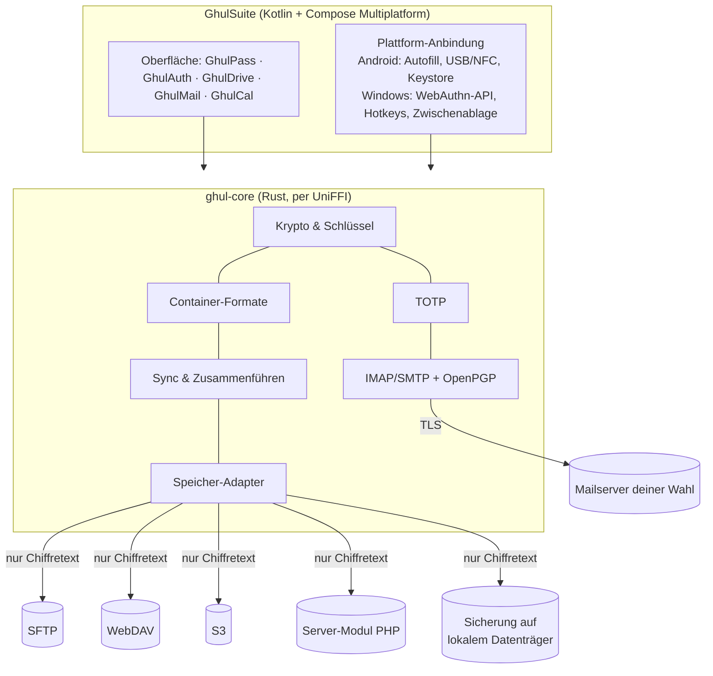
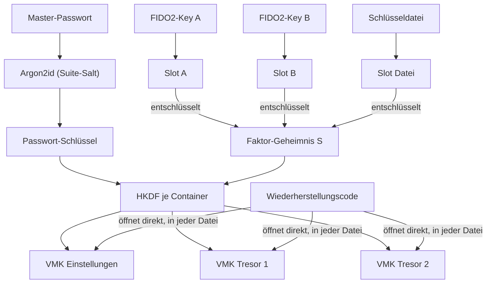

# GhulSuite: Sicherheits- und Architekturkonzept

**Stand:** Entwurf v0.7 · 11.11.2026 (v0.6: Einrichtungsassistent, zweiter Faktor Pflicht, der Ordner ist die Suite; **v0.7: eigene Server per SFTP, Synchronisation, GhulDrive und GhulMail umgesetzt**, Abschnitte 8 und 9 mit Stand der Umsetzung)
**App:** GhulSuite mit den Bereichen **GhulPass** (Passwörter) · **GhulAuth** (TOTP) · **GhulMail** (Mail) · **GhulDrive** (Dateien)
**Plattformen:** Android (nativ) **zuerst** · Windows (nativ, auch portabel vom USB-Stick) **später**
**Lizenz:** AGPL-3.0-or-later
**Sprachen:** Deutsch und Englisch ab der ersten Version

---

## 1. Ziel und Leitprinzipien

Eine benutzerfreundliche, universelle Suite, die ohne Anbieterbindung funktioniert. Alle Daten liegen in
verschlüsselten Dateien, die man überall ablegen kann. Speicher und Mailserver sind frei wählbar.

1. **Zero Knowledge:** Ver- und entschlüsselt wird nur auf deinen Geräten. Speicher, Server und Netzwerk sehen nur Chiffretext.
2. **Zwei Faktoren sind kryptografisch erzwungen:** Ohne Master-Passwort **und** zweiten Faktor (FIDO2-Key oder
   Schlüsseldatei) lässt sich nichts entschlüsseln, auch nicht offline, auch nicht mit der Datei in der Hand.
   Einzige Ausnahme ist der ausgedruckte **Wiederherstellungscode**: Er öffnet bewusst alles allein (Abschnitt 6.3).
3. **Keine eigene Kryptografie:** Nur etablierte Verfahren aus geprüften Bibliotheken.
4. **Ein Kern für alles:** Ein Rust-Kern (`ghul-core`) für Krypto, Formate, Sync, TOTP, Drive und Mail-Protokolle, identisch auf Android und Windows.
5. **Offline zuerst:** Passwörter und TOTP sind immer lokal verfügbar. Speicher dienen nur der Synchronisation.
6. **Universell:** Kein bestimmter Hoster, Mailanbieter oder Cloud-Dienst wird vorausgesetzt.
7. **Benutzerfreundlich:** Sicherheit über verständliche Abläufe, nicht über Fachbegriffe.
8. **Öffentlich prüfbar:** Das Repository wird später veröffentlicht. Die Sicherheit hängt nie davon ab, dass der Code
   geheim ist. Im Repository liegen keine Geheimnisse.

---

## 2. Getroffene Entscheidungen

| Thema | Entscheidung |
|---|---|
| App-Struktur | **Eine App „GhulSuite“** mit fünf Bereichen (GhulPass, GhulAuth, GhulCal, GhulDrive, GhulMail; der Kalender kam als fünfter dazu) |
| Web-Client | **Keiner.** Ersatz für unterwegs: portables Windows-Programm auf dem USB-Stick |
| Ablage der Tresore | **Überall:** USB-Stick, Cloud, NAS, eigener Server |
| Teilen | Tresore: „überall ablegen“, nicht mit anderen Personen. Dateien und einzelne Einträge: **Ende-zu-Ende-verschlüsselte Freigabelinks** über den eigenen Server (Abschnitt 10, Teilen) |
| Mail-Benachrichtigung | **Ja, auch bei gesperrter App**: mit eigenem, gerätegebundenem Mail-Zugang (Abschnitt 9.3); geändert am 11.11.2026 |
| Schnell-Entsperren | **Fingerabdruck und/oder App-PIN**, optional und mit engen Grenzen (Abschnitt 6.5) |
| Module | Jeder Bereich (GhulPass, GhulAuth, später GhulMail, GhulDrive) ist in den Einstellungen **abschaltbar**; er verschwindet dann aus dem Menü, die Daten bleiben erhalten |
| Sofortsperre | **Sofort sperren** (Stufe 1), auch durch **Schütteln**; kein Löschen, kein Notfall-Passwort (Abschnitt 6.6) |
| Erster Speicher-Adapter | **SFTP**: eigener Server mit SSH/SFTP ist vorhanden |
| Drive-Speicher | **Eigene Server bzw. vServer** (SFTP, WebDAV, S3, Server-Modul); lokale Datenträger nur als verschlüsseltes Sicherungsziel |
| Plattformen | **Zuerst nur Android.** Windows folgt später; die Architektur ist von Anfang an darauf ausgelegt (Abschnitt 4.1) |
| Schutz | **Master-Passwort plus zweiter Faktor, immer.** Zweiter Faktor: Security Key (empfohlen) oder Schlüsseldatei; beliebig viele, jederzeit austauschbar, ohne dass etwas ungültig wird. Einen Schutz nur mit Passwort gibt es nicht (geändert am 11.11.2026) |
| Wiederherstellungscode | **Pflicht** bei jeder Suite; öffnet alles allein, auch ohne Passwort, Key und Schlüsseldatei; danach wird ein neues Passwort gesetzt |
| Suite und Tresore | **Der Ordner ist die Suite:** Alle Tresordateien im Ordner gehören dazu, es gibt keine Liste und keine Frage „gehört das dazu?“. Je Bereich beliebig viele Tresore (z. B. GhulPass „Privat“ und „Arbeit“), später ebenso mehrere Mail- und Drive-Konten. `suite.ghlsuite` hält nur Einstellungen (geändert am 11.11.2026, Konzept A) |
| Erster Start | Auswahl: **neu einrichten**, **vorhandene Suite öffnen** (Ordner) oder **einzelnen Tresor öffnen** (Datei; um ihn wird eine neue Suite gebaut, nur dieser Bereich wird eingeschaltet) |
| Speicherort | Standard: privater App-Speicher; optional ein eigener Ordner (z. B. USB-Stick). Suite und Tresore liegen im **selben Ordner**. „Speicherort wechseln“ (Optionen → Tresore) kopiert alle Dateien, prüft jede Kopie Byte für Byte und nutzt erst dann den neuen Ort; ein Ordner mit einer anderen Suite wird nie überschrieben, die alten Dateien bleiben liegen |
| GhulAuth-Passwort | Alle Tresore einer Suite haben dasselbe Passwort und dieselben Faktoren. Wer ein getrenntes Passwort will, legt eine zweite Suite an |
| Lizenz | **AGPL-3.0-or-later** |
| Windows-Code-Signatur | **Nein** (SmartScreen-Warnung beim ersten Start wird in Kauf genommen) |
| Sprachen | Deutsch und Englisch |

---

## 3. Ergebnis der kritischen Überprüfung

Was sich gegenüber v0.1 geändert hat und warum:

| # | Befund | Änderung |
|---|---|---|
| 1 | Ohne Web-Client entfällt der Grund für Tauri (gemeinsame Oberfläche mit dem Web). Zwei getrennte Oberflächen für Android und Windows wären doppelte Arbeit für alle Bereiche. | **Kotlin + Compose Multiplatform** für beide Plattformen: eine Oberfläche, einheitliche Bedienung. Der Rust-Kern hängt per UniFFI an beiden. |
| 2 | Android bindet FIDO2 für Apps über den Credential Manager an eine **eigene, verifizierte Web-Domain**. Für eine universelle, öffentliche App hat nicht jeder Nutzer eine. | **Direkter CTAP2-Zugriff** auf den Key über USB (später NFC). Keine Domain nötig, keine Abhängigkeit von Google-Diensten, läuft auch auf Android ohne Google (z. B. GrapheneOS). |
| 3 | Die Credential-ID und der PRF-Salt stehen offen im Datei-Header. Wäre die RP-ID eine echte Domain, könnte deren Besitzer eine Webseite bauen, die mit einer Key-Berührung den geheimen Wert abfragt. | **Feste RP-ID, die keine gültige Web-Domain ist** (Vorschlag: `ghulsuite.invalid`, reservierte Endung). Kein Browser kann sie je anfragen. |
| 4 | Cloud-Anbindungen über den Android-Dateidialog (z. B. Google Drive) sind beim Zurückschreiben bekanntermaßen unzuverlässig: Zwischenspeicher, verzögerter Upload, Konflikte. | Sync läuft **direkt über die Speicher-Adapter** (wie bei Drive). Der Dateidialog dient nur zum **Export und Import** (USB-Stick, Cloud, E-Mail an sich selbst). |
| 5 | Geräte-Registrierung am Server mit FIDO2-Freigabe ist aufwendig und bringt kaum Gewinn: Wer den Suite-Container entschlüsseln kann, hat ohnehin alle Zugänge. | **Zugangsdaten für alle Speicher stehen verschlüsselt im Suite-Container.** Ein neues Gerät muss nur den Container öffnen, ohne Konto und ohne Freischaltung. |
| 6 | Vier Container einzeln zu entsperren wäre umständlich; WebAuthn-PRF liefert pro Berührung nur zwei Werte. | Alle Container einer Suite teilen sich Passwort-Ableitung und Faktor-Geheimnis. **Ein Passwort, eine Berührung, alles offen**: die Container bleiben dabei kryptografisch getrennt. |
| 7 | HTML-Mails sind der größte Angriffsweg. Eine Browser-Engine zur Anzeige ist zudem unter Compose Desktop schwierig. | **Standard: native, vereinfachte Darstellung** (Text, Formatierung, Links, Bilder nach Klick) **ohne Browser-Engine**. Original-HTML nur auf Wunsch in einer abgeschotteten Ansicht ohne Skripte. |
| 8 | Gmail und Microsoft-Konten verlangen inzwischen OAuth2. Für Gmail braucht eine öffentliche App dazu eine kostenpflichtige Sicherheitsprüfung durch Google. | GhulMail unterstützt **Standard-IMAP/SMTP** (eigener Server, Posteo, mailbox.org, GMX, Web.de, die meisten Hoster). Gmail nur über App-Passwort, OAuth-Anbieter frühestens später. |
| 9 | Ein lokaler Ordner als Drive-Speicher wirkte unsicher. | Jeder Adapter speichert **ausschließlich verschlüsselte Blöcke**, auch ein lokaler Datenträger. Er bleibt als **Sicherungsziel** (z. B. externe Festplatte) erhalten, nicht als Hauptspeicher. |
| 10 | FTP ist auf vServern unnötig und war schon beim Deployment unzuverlässig. | **Kein FTP-Adapter.** Für reines Webhosting ohne SSH gibt es das PHP-Server-Modul. |
| 11 | Mail-Abruf im Hintergrund braucht Zugangsdaten bei gesperrter App. | Seit v0.5 gewünscht: eigener, gerätegebundener Mail-Zugang nur für den Abruf (Abschnitt 9.3). |
| 12 | Die Drive-Schlüssel liegen nur im Suite-Container. Geht er verloren, sind die Drive-Daten weg. | Der Suite-Container wird **automatisch auf jeden eingerichteten Speicher mitgesichert**, mit Versionen. Die Sicherheitszentrale warnt, wenn es keine aktuelle Kopie gibt. |

---

## 4. Architektur



| Baustein | Technik | Begründung |
|---|---|---|
| Kern | **Rust** | Speichersicher, Schlüssel im RAM werden überschrieben (`zeroize`), eine Implementierung für beide Plattformen |
| Oberfläche | **Kotlin + Compose Multiplatform** | Eine Oberfläche für Android und Windows; auf Android echt nativ (Autofill, Credential-Provider, Kamera) |
| Anbindung | **UniFFI** | Erzeugt sichere Kotlin-Anbindungen an den Rust-Kern für Android und Windows |
| Windows-Paket | Installer **und** portable Version (Ordner mit Programm und Laufzeit, startet vom Stick) | Die Java-Laufzeit wird mitgeliefert, auf dem PC muss nichts installiert sein |

### 4.1 Android zuerst, Windows später

Windows später nachzuziehen ist **kein großer Mehraufwand, wenn das Projekt von Anfang an dafür angelegt ist**:

- **Gemeinsamer Code (`commonMain`):** Oberfläche, Abläufe, Texte (Deutsch/Englisch) und die gesamte Logik im Rust-Kern.
  Erfahrungsgemäß sind das deutlich mehr als drei Viertel des Codes.
- **Plattform-Code nur hinter klaren Schnittstellen:** FIDO2-Zugriff, Fingerabdruck, Zwischenablage, Dateiauswahl,
  Autofill bzw. Auto-Type, Hintergrundaufgaben, Bewegungssensor. Für Windows wird später nur dieser Teil neu geschrieben.
- Der Windows-Build bleibt bis dahin abgeschaltet, das Projekt kompiliert aber gegen beide Ziele, damit sich keine
  Android-Abhängigkeiten in den gemeinsamen Code einschleichen.

**Echter Mehraufwand für Windows später:** FIDO2 über die Windows-WebAuthn-API, Auto-Type und Tastenkürzel,
Windows Hello, portabler Modus und das Paket. Das ist überschaubar, aber nicht null.

**Risiko RP-ID:** Sollte die Windows-API die RP-ID `ghulsuite.invalid` nicht annehmen, ist das kein Problem für bestehende
Daten. Die Android-App kann für denselben Key einen **zusätzlichen Slot** mit einer anderen RP-ID anlegen, ohne dass
Daten neu verschlüsselt werden müssen.

**Bekannte Risiken, die früh im Prototyp geprüft werden:**
- Direkter CTAP2-Zugriff per USB-C auf Android mit deinem Key (Phase 0b)
- Später für Windows: `hmac-secret` über die Windows-WebAuthn-API mit eigener RP-ID, Startzeit und Größe der portablen Version

---

## 5. FIDO2

- Jeder FIDO2-Key mit der Erweiterung **`hmac-secret`** funktioniert, z. B. Yubico, Nitrokey 3, Token2, Feitian, SoloKeys.
  Der Key liefert zu einem gespeicherten Salt einen geheimen 32-Byte-Wert, den nur dieser Key berechnen kann.
- **Android:** direkter CTAP2-Zugriff über USB-C, NFC später. Android fragt beim ersten Mal, ob GhulSuite auf den Key zugreifen darf.
- **Windows:** über die Windows-WebAuthn-API. Es erscheint der bekannte Windows-Sicherheitsdialog. Das funktioniert
  ohne Administratorrechte, also auch portabel auf fremden PCs.
- **PIN auf dem Key ist Pflicht.** Der Key sperrt sich nach 8 Fehlversuchen. `hmac-secret` wird immer „mit PIN“ ausgewertet,
  dieser Wert unterscheidet sich vom Wert ohne PIN.
- **Feste RP-ID** `ghulsuite.invalid` auf allen Plattformen, damit derselbe Key überall denselben Wert liefert
  und keine Webseite die Credentials ansprechen kann (siehe Abschnitt 3, Befund 3).
- **Nicht auffindbare Credentials:** Sie belegen keinen Speicher auf dem Key. Die Credential-ID steht im Container-Header.
- **Mindestens zwei Keys** werden empfohlen. Die App erinnert daran, solange nur einer registriert ist.
- Passkeys des Handys oder Windows Hello als zweiter Faktor sind vorerst **nicht** vorgesehen (Verfügbarkeit von `hmac-secret` uneinheitlich). Später prüfen.

---

## 6. Schlüsselkonzept

### 6.1 Faktoren

| Faktor | Rolle |
|---|---|
| **Master-Passwort** | immer erforderlich |
| **FIDO2-Key** (mit PIN) | zweiter Faktor (empfohlen), beliebig viele |
| **Schlüsseldatei** `.ghlkey` | zweiter Faktor, gleichwertig zum Key, beliebig viele; z. B. zum Einstieg oder als Reserve |
| **Wiederherstellungscode** (Notfallblatt) | öffnet allein **alles**: für den Fall, dass nichts anderes mehr da ist |

Mindestens ein Key oder eine Schlüsseldatei muss immer eingetragen sein. Jeder Key und jede Schlüsseldatei öffnet
zusammen mit dem Passwort dasselbe Faktor-Geheimnis `S`. Darum lässt sich eine Schlüsseldatei später gegen einen Key
tauschen (Key hinzufügen, Datei entfernen), ohne dass der Wiederherstellungscode oder die übrigen Keys ungültig werden.

### 6.2 Schlüsselhierarchie



1. `PK = Argon2id(NFC(Passwort), suite_salt)`: einmal pro Entsperren. Mindestens 64 MiB und 3 Durchläufe,
   kalibriert auf ca. 1 Sekunde am langsamsten Gerät.
2. Jeder zweite Faktor hat einen **Slot**, der das zufällige **Faktor-Geheimnis `S`** (256 Bit) verschlüsselt enthält.
   - FIDO2-Slot: privater X25519-Schlüssel = `HKDF(hmac-secret(Key, slot_salt))`
   - Schlüsseldatei-Slot: privater X25519-Schlüssel = `HKDF(Geheimnis der Datei)`
   - Im Slot steht der zugehörige **öffentliche** Schlüssel. Damit kann die App ein neues `S` für jeden Key
     verschließen, ohne ihn zu berühren (Formatversion 2; Slots älterer Versionen ziehen beim nächsten Entsperren
     mit diesem Key um).
3. Je Container: `KEK = HKDF-SHA256(PK ‖ S, info = "ghul/v1/kek" ‖ Container-UUID)`
4. Der `KEK` entschlüsselt den zufälligen **Container-Hauptschlüssel (VMK)**. Aus dem VMK wird der Inhalts-Schlüssel
   abgeleitet; der Header ist als AAD eingebunden. Exakte Ableitungen: [`docs/FORMAT.md`](FORMAT.md), Abschnitt 4.

**Eigenschaften:**
- Nur Key oder nur Schlüsseldatei → `S`, aber ohne Passwort kein `KEK` → wertlos.
- Nur Passwort → kein `S` → wertlos.
- **Ein Passwort, eine Berührung** öffnet alle Container. Jeder Container hat trotzdem seinen eigenen VMK.
- Jeder Container enthält alle Slots in seinem eigenen Header und lässt sich daher **auch einzeln** öffnen,
  z. B. nur `.ghlpss` vom USB-Stick ohne Suite-Container.
- Passwort ändern geht mit einem einzigen Key. Ein Key oder eine Schlüsseldatei wird hinzugefügt oder entfernt, indem man einen Slot hinzufügt oder löscht. Die App aktualisiert dabei alle Container. Der letzte zweite Faktor lässt sich nicht entfernen.
- **Erneuern bei jeder Schutzänderung:** Neues Notfallblatt, neues Passwort oder ein entfernter Key geben jedem
  Container einen neuen VMK; ein entfernter Key erneuert zusätzlich `S` für alle übrigen Keys. So öffnet ein
  verlorenes Notfallblatt oder ein entfernter Key zusammen mit einer **alten Sicherungskopie** nichts, was danach
  gespeichert wurde. Die alte Kopie selbst zeigt weiter den Stand von damals.
- **Dateinamen verraten nichts:** Tresordateien heißen nach ihrer zufälligen Kennung (`3f9a1c2b7d4e5f60.ghlpss`),
  der Name steht nur verschlüsselt darin.
- **Der Ordner ist die Suite:** Beim Entsperren öffnet die App jede Tresordatei im Ordner mit Passwort und Faktor.
  Eine Datei, die auf einem anderen Gerät angelegt und in den Ordner kopiert wurde, ist einfach dabei. Gelöscht wird ein
  Tresor, indem seine Datei verschwindet. Eine beschädigte Datei wird als „beschädigt“ angezeigt, der Rest öffnet sich.
  Liegen zwei Kopien desselben Tresors im Ordner, gilt die neuere. `suite.ghlsuite` enthält nur Einstellungen; fehlt sie,
  wird sie aus einer Tresordatei neu erzeugt.
- **Dateien mit anderem Passwort** (aus einer anderen Suite oder von vor einem Passwortwechsel) werden angeboten. Man öffnet
  sie einmal mit ihrem bisherigen Passwort und Key bzw. Schlüsseldatei; dann werden sie auf Passwort, Faktoren und Code
  der Suite **umgestellt** und gehören dazu. Es gibt keine Tresore mit dauerhaft eigenem Schutz, dafür einen zweiten Ordner nutzen.
- **Gleicher Stand überall:** Fehlt einer Datei ein neuer Key (z. B. eine alte Kopie), gleicht die App sie beim Entsperren an.
- **Älterer Stand:** Die Einstellungsdatei merkt sich je Tresor die höchste gesehene Revision. Ist die Datei älter,
  warnt die App, bis man den Stand bewusst übernimmt (z. B. nach dem Zurückspielen einer Sicherung).
- **Passwort vergessen heißt Daten weg.** Das ist bewusst so: Es gibt keine Hintertür.

### 6.3 Wiederherstellungscode und Notfallblatt

- **Pflicht** bei jeder Suite. Derselbe Code steckt in **jeder** Datei des Ordners und öffnet sie direkt (ohne Passwort,
  Key oder Schlüsseldatei), auch eine einzelne Tresordatei ohne den Rest. Danach wird ein neues Master-Passwort gesetzt; Keys, Schlüsseldateien und der
  Code selbst bleiben gültig. Empfohlen wird anschließend ein neuer Code. Ein neuer Code macht das alte Blatt
  wertlos, auch zusammen mit einer alten Sicherungskopie (für alles, was danach gespeichert wird).
- Bewusste Abwägung: Wer Notfallblatt **und** Dateien hat, hat Zugriff. Das Blatt ist wie ein Tresorschlüssel aufzubewahren.

- 256 Bit Zufall, dargestellt als 52 Zeichen Base32 in Vierergruppen mit Prüfsumme, zusätzlich als QR-Code.
- Das Notfallblatt wird **lokal** als PDF erzeugt. Es enthält Suite-Name, ID, Datum, den Code und eine Anleitung,
  **aber nicht das Passwort**.
- Nach dem Drucken tippt man zur Bestätigung vier Zeichen vom Ausdruck ab.
- Warnhinweis: Netzwerk- und Cloud-Drucker speichern Druckaufträge teilweise.

### 6.4 Schlüsseldatei `.ghlkey`

32 Byte Zufall mit Kennung und Prüfsumme. Sie ist ein **zweiter Faktor wie ein Key**: Sie verpackt `S` in einem eigenen
Slot. Gegenüber einem Key ist sie kopierbar, darum ist der Key empfohlen. Die App weist darauf hin, sie nie zusammen
mit dem Passwort aufzubewahren und eine Kopie anzulegen.

### 6.5 Schnell-Entsperren per Fingerabdruck oder App-PIN (optional)

Nach einer vollständigen Entsperrung (Passwort und Key) lässt sich die App für eine einstellbare Zeit per
**Fingerabdruck** und/oder **App-PIN** öffnen. Umgesetzt in Etappe 2a:

- Der Kern legt `PK` und den Suite-Schlüssel in `quick-<bio|pin>.ghlq` ab, verschlüsselt mit einem zufälligen Schnellschlüssel `QK`
  (bei der App-PIN zusätzlich mit Argon2id(PIN)). `QK` liegt nur verschlüsselt durch einen **Android-Keystore-Schlüssel** vor:
  - Fingerabdruck: Keystore-Schlüssel nur nach **starker biometrischer Prüfung** (Klasse 3) nutzbar, wird beim
    Registrieren eines **neuen Fingerabdrucks ungültig**.
  - App-PIN: 6 bis 12 Ziffern, Keystore-Schlüssel nur bei entsperrtem Gerät nutzbar, wenn vorhanden in **StrongBox**;
    nach **5 Fehlversuchen** wird der PIN-Zugang gelöscht.
- **Gültigkeit** (1 Stunde bis 7 Tage, Standard 24 Stunden) zählt ab dem **letzten vollständigen Entsperren**
  (signierter Zeitstempel, nur mit `S` fälschbar).
- Passwort und Key sind immer wieder nötig: nach **jedem Neustart**, nach Ablauf, nach einer **Sofortsperre**, nach
  einem **Passwortwechsel** und wenn Fingerabdrücke geändert wurden.
- **Ehrlich:** In der Gültigkeitszeit reichen das entsperrte Handy plus Finger bzw. App-PIN. Deshalb optional und
  standardmäßig aus. Ein Angreifer mit Root-Zugriff auf das laufende Gerät könnte den Fehlversuchszähler umgehen;
  die PIN ist aber an den Hardware-Schlüssel des Geräts gebunden, ein Durchprobieren außerhalb des Geräts ist nicht möglich.
- **Nicht verfügbar in der portablen Windows-Version.**

### 6.6 Sofortsperre

Ein Fingerabdruck kann erzwungen werden, ein Passwort im Kopf nicht so leicht. Deshalb gibt es eine Sofort-Sperre:

- **Wirkung:** Alle Bereiche werden gesperrt, alle Schlüssel aus dem Arbeitsspeicher gelöscht und Fingerabdruck- und
  App-PIN-Zugang werden **vernichtet** (Keystore-Schlüssel und Schnell-Dateien werden gelöscht). Danach öffnet die App
  nur noch mit Passwort **und** Key.
- **Das reicht kryptografisch vollständig:** Alle Dateien auf dem Gerät sind ohnehin verschlüsselt. Ohne
  Fingerabdruck-Zugang lassen sie sich ohne Passwort und Key nicht öffnen, auch nicht forensisch. Löschen ist nicht nötig.
- **Auslöser Android:**
  - **Schütteln** (Bewegungssensor, kurzes kräftiges Schütteln). Die Erkennung läuft nur, solange etwas entsperrt
    ist, danach gibt es nichts mehr zu sperren, und der Akku wird geschont.
  - Schnellkachel „GhulSuite sperren“ in den Schnelleinstellungen.
  - Der Sperr-Knopf in der App und der Knopf in der Benachrichtigung sperren dagegen **normal** (Schnell-Entsperren bleibt).
- **Auslöser Windows:** globales Tastenkürzel und Tray-Symbol.
- Ein versehentliches Auslösen schadet nicht: Man entsperrt danach einfach einmal mit Passwort und Key.
- Die Empfindlichkeit beim Schütteln ist einstellbar, Schütteln lässt sich abschalten.
- **Bewusst nicht vorgesehen:** Löschen der lokalen Daten, Notfall-Passwort, Fernsperre (siehe Abschnitt 14).

---

## 7. Dateien und Formate

| Datei | Magic | Inhalt |
|---|---|---|
| `.ghlpss` | `GHULPASS` | GhulPass-Tresor |
| `.ghltotp` | `GHULTOTP` | GhulAuth-Tresor |
| `.ghlcal` | `GHULCLDR` | GhulCal-Kalender (bewusst ohne CalDAV; Austausch per .ics) |
| `.ghlsuite` | `GHULSUIT` | Suite-Container: Speicherverbindungen, Mail-Konten, Drive-Schlüssel und -Index-Verweise, Einstellungen |
| `.ghlkey` | `GHULKEY\0` | Schlüsseldatei |

Gerätegebundene Daten (Mail-Zwischenspeicher, Drive-Offline-Dateien, Vorschaubilder) sind **keine** Austauschdateien.
Sie liegen verschlüsselt im App-Speicher, bzw. bei der portablen Version auf dem Stick.

### 7.1 Container-Aufbau (gemeinsam für alle drei)

Die verbindliche Byte-Spezifikation steht in **[`docs/FORMAT.md`](FORMAT.md)** (mit Testvektoren).

```
┌─ Präfix + Header (Klartext, authentifiziert) ──────────────────┐
│ Magic · Format-Version · Header-Länge                           │
│ Container-ID · Suite-ID · Argon2id-Parameter + Salt             │
│ Slots[]: Typ · ID · Credential-ID · PRF-Input · verpacktes S    │
│ Flags (derzeit 0) · verpackter VMK                              │
├─ Inhalt: XChaCha20-Poly1305, AAD = Präfix + Header ─────────────┤
│ CBOR-Dokument mit Revisionszähler, aufgefüllt auf Blockgrößen   │
└─────────────────────────────────────────────────────────────────┘
```

Ein separater Header-MAC (Entwurf v0.1 bis v0.4) entfällt: Der Header ist vollständig als AAD in die Verschlüsselung
des Inhalts eingebunden.

- **XChaCha20-Poly1305:** Zufalls-Nonces ohne Wiederverwendungsrisiko. Bewusst nur **ein** Verfahren je Formatversion.
- **Header als AAD:** Jede Änderung am Header macht die Entschlüsselung ungültig. Zusätzlich gelten Mindest- und Höchstwerte für Argon2id.
- **Auffüllen:** Die Dateigröße verrät nicht die Anzahl der Einträge.
- **Rollback-Schutz:** Jedes Gerät merkt sich die höchste gesehene Revision. Taucht eine ältere auf, warnt die App.
- **Einträge** haben UUID, Revision und Änderungszeit. Gelöschte Einträge bleiben als Löschmarker erhalten,
  damit das Zusammenführen funktioniert.

---

## 8. Speicherorte und Synchronisation

### 8.1 Zwei getrennte Wege

GhulSuite bringt keine Anbindung an Cloud-Ordner mit (kein Nextcloud-, Dropbox- oder Syncthing-Client). Wer die
Dateien in einem eigenen Ordner hält, kann ihn mit einem selbst installierten Programm abgleichen; das ist erlaubt,
aber nicht nötig. Entsteht dabei eine Konfliktkopie derselben Datei, führt die App beide beim Entsperren zusammen.
Tresordateien werden am Inhalt erkannt (Kennung im verschlüsselten Kopf), nicht am Namen: Umbenennen schadet nicht,
die App gibt der Datei beim nächsten Entsperren ihren neutralen Namen zurück.

1. **Speicher-Adapter (automatische Synchronisation):** für Tresore, Suite-Container und Drive.
2. **Export und Import (manuell, überall):** Container-Datei auf USB-Stick, in einen Cloud-Ordner, per Mail an sich selbst
   oder über das Android-Teilen-Menü. Die Datei ist in sich sicher.

### 8.2 Adapter

| Adapter | Für wen | Verbindung | Priorität |
|---|---|---|---|
| **SFTP** | Jeder vServer oder Root-Server, NAS, Raspberry Pi, Storage-Box-Angebote | SSH-Schlüssel, Server-Fingerabdruck wird beim ersten Verbinden fest gespeichert | **1**: Testserver vorhanden |
| **WebDAV** | Nextcloud, ownCloud, viele NAS, Webserver mit WebDAV | HTTPS mit Zertifikats-Pinning | 2 |
| **S3-kompatibel** | MinIO oder Garage auf dem eigenen Server, S3-Anbieter | HTTPS, Upload in Teilen mit Fortsetzen | 3 |
| **GhulSuite-Server-Modul** | Webhosting mit PHP, aber ohne SSH | HTTPS, signierte Anfragen | 3 |
| **Lokaler Datenträger** | Externe Festplatte, USB-Stick | keine (Inhalte trotzdem verschlüsselt) | nur als **Sicherungsziel** |

- **Mehrere Speicher gleichzeitig:** Ein Hauptspeicher plus Spiegel, z. B. vServer plus NAS. Fällt einer aus, ist der andere noch da.
- Alle Zugangsdaten (Host, Benutzer, SSH-Schlüssel, Passwörter) liegen **nur verschlüsselt**: der Sync-Server im
  Suite-Container, ein eigener Server nur für GhulDrive in der Drive-Datei. Ohne Entsperren ist nicht erkennbar,
  welche Server eingerichtet sind.
- **Synchronisation und GhulDrive sind unabhängig** (abgestimmt am 13.11.2026, #24): GhulDrive nutzt entweder
  „wie Synchronisation“ (nur ein Verweis auf den Sync-Server dieses Geräts, keine Kopie der Zugangsdaten) oder einen
  eigenen Server, auch mit anderer Methode. Wird der Sync-Server entfernt oder gewechselt, fragt die App vorher:
  Zugang für GhulDrive behalten (Kopie in die Drive-Datei) oder GhulDrive später neu einrichten.
- **Ein Server-Formular** für Assistent, GhulDrive und Optionen: SFTP/FTPS anmelden, **Ordner aus der Liste des
  Servers wählen**, Verbindung testen. PHP-Modul: einmal per FTPS anmelden, Ordner wählen, die App lädt das Modul mit
  eigenem Schlüssel hoch, leitet die Adresse aus Domain und Ordner ab und prüft sie; der FTPS-Zugang kann für
  Modul-Updates behalten werden. Eine Checkliste nennt den fehlenden Schritt.

### 8.2.1 SFTP im Detail

**Anmeldung und Rechte**
- **Ein SSH-Schlüssel je Gerät** (Ed25519), von der App erzeugt. Die App zeigt den öffentlichen Teil zum Kopieren an
  (Text und QR-Code). Der private Schlüssel liegt verschlüsselt im Suite-Container.
  Bei Geräteverlust wird nur dieser eine Schlüssel auf dem Server entfernt.
- **Eigener Benutzer, eingesperrt:** Er darf nur SFTP (`ForceCommand internal-sftp`), hat keine Kommandozeile und keine
  Weiterleitungen und sieht nur seinen Ordner (`ChrootDirectory`). Die App liefert dafür eine **Anleitung und ein kurzes
  Einrichtungsskript** mit, das du selbst auf dem Server ausführst. Ergebnis: Selbst mit einem gestohlenen Geräteschlüssel
  kommt man nur an verschlüsselte Blöcke, nicht an den Server.
- **Server-Fingerabdruck** wird beim ersten Verbinden angezeigt (zum Abgleich mit der Ausgabe des Einrichtungsskripts) und
  fest gespeichert. Ändert er sich, verbindet die App nicht und warnt.
- Passwort-Anmeldung wird nur angeboten, um einmalig den Schlüssel einzurichten, und danach nicht gespeichert.
- **Option „Hochsicher“:** Der SSH-Schlüssel liegt auf dem FIDO2-Key selbst (`ed25519-sk`, ab OpenSSH 8.2).
  Jede Verbindung braucht dann eine Key-Berührung. Für die automatische Foto-Sicherung ungeeignet, daher nur optional.

**Stabilität**
- Abgebrochene Uploads setzen an der letzten geschriebenen Stelle wieder an (SFTP erlaubt Schreiben ab einer Position).
- Hochladen unter temporärem Namen, danach **atomares Umbenennen** (`posix-rename@openssh.com`), nie halbe Dateien.
- Eine Verbindung für mehrere Übertragungen, Keep-Alive, automatischer Wiederaufbau bei Netzwechsel (WLAN ↔ Mobilfunk).
- Implementierung im Rust-Kern (reine Rust-SSH-Bibliothek), damit Android und Windows identisch arbeiten.

**Ordnerstruktur auf dem Server** (nur Chiffretext, Namen ohne Aussagekraft)
```
<chroot>/ghulsuite/<suite-id>/
  containers/   .ghlpss, .ghltotp, .ghlsuite (je mit Versionen)
  drive/blocks/ verschlüsselte Blöcke mit Zufalls-IDs
  drive/log/    Änderungsprotokolle je Gerät
  tmp/          laufende Uploads
```

**Stand der Umsetzung (0.4.0-dev):**
- Anmeldung mit einem Ed25519-Schlüssel **der Suite** (erzeugt beim ersten Bedarf, privat nur verschlüsselt in den
  Suite-Einstellungen, synchronisiert) oder mit Passwort (dann ebenfalls nur verschlüsselt gespeichert). Ein neues
  Gerät holt die Suite mit einem eigenen Geräteschlüssel („Von meinem Server holen“) und nutzt danach den der Suite.
  Schlüssel je Gerät, `ed25519-sk` und das Einrichtungsskript folgen später.
- Server-Fingerabdruck (SHA256, wie `ssh-keygen -lf`) wird beim ersten Verbinden gezeigt und festgehalten; bei
  Änderung bricht die Verbindung ab (`HostKeyChanged`).
- Atomares Schreiben: temporäre Datei, dann Umbenennen. Fortsetzen abgebrochener Uploads folgt.
- Ordnerstruktur tatsächlich: `<Ordner>/suite/` (Tresore und `suite.ghlsuite`) und `<Ordner>/drive/`
  (`index.ghldrv`, `blocks/<ab>/<id>`).

**Server zu Hause hinter dem Router:** über DynDNS oder ein VPN (z. B. WireGuard). Den SSH-Port nur mit
Schlüsselanmeldung ins Internet stellen, idealerweise zusätzlich mit `fail2ban` o. Ä.

### 8.3 Stabile Übertragung

- **Blöcke** von 4 bis 16 MiB, jeder einzeln verschlüsselt und geprüft. Nach einem Abbruch geht es beim letzten Block weiter.
- **Dauerhafte Warteschlange:** übersteht App-Abstürze, Neustarts und Funklöcher. Auf Android optional nur im WLAN oder beim Laden.
- **Erst Blöcke, dann Eintrag:** Eine Datei erscheint erst, wenn alle Blöcke angekommen sind. Reste räumt die App automatisch auf.
- Automatische Wiederholung mit wachsenden Pausen, parallele Übertragung, einstellbare Bandbreite.
- Nach jedem Upload wird geprüft, ob der Block korrekt angekommen ist (Größe und Prüfsumme des Chiffretexts).

### 8.4 Zusammenführen ohne Sperren

Einfache Speicher wie S3 oder WebDAV können nicht zuverlässig sperren. Deshalb:

- **Tresore** (klein): Die App lädt die aktuelle Fassung, führt Eintrag für Eintrag zusammen und schreibt eine neue Version.
  Beim Server-Modul geschieht das mit Versionsprüfung (`ETag`), bei den anderen Adaptern mit Gerätekennung und anschließender Kontrolle.
- **Drive-Index** (groß, häufige Änderungen): Jedes Gerät schreibt seine Änderungen in **eigene, verschlüsselte Protokolldateien**.
  So überschreibt nie ein Gerät die Datei eines anderen. In Abständen fasst ein Gerät alles zu einem Schnappschuss zusammen.
- Echte Konflikte, derselbe Eintrag wurde auf zwei Geräten unterschiedlich geändert, zeigt die App nebeneinander zur Auswahl.

**Stand der Umsetzung (0.4.0-dev):** Tresore werden Eintrag für Eintrag zusammengeführt (höhere Revision gewinnt, bei
Gleichstand die spätere Änderung; Löschungen als Grabsteine). Gelöschte Tresore werden auf den anderen Geräten gelöscht.
Den Schutz (Passwort, Keys, Schlüsseldateien, Code) übernimmt die zuletzt geänderte Seite; ein neues Passwort von einem
anderen Gerät muss einmal eingegeben werden. Einstellungen werden zusammengeführt (Listen nach ID vereinigt), **Grenze:**
ein entfernter Server oder ein entferntes Mail-Konto kann durch ein anderes Gerät wieder auftauchen; Grabsteine dafür
folgen. Der Drive-Index wird vor jeder Änderung neu geladen (kein eigenes Protokoll je Gerät); bei gleichzeitiger Änderung
desselben Eintrags gewinnt die letzte. Eine Konfliktansicht folgt.

### 8.5 Server-Modul (PHP)

Für Webhosting ohne SSH, läuft auf **jedem PHP-Webhosting ab 8.1 ohne Datenbank**.
- **Grenzen des Webhostings:** Das Modul meldet das Upload-Limit des Hostings. Die App teilt große Dateien, auch
  Tresordateien mit großen Anhängen, in passende Teile (höchstens 4 MiB) und ersetzt die Datei erst nach dem letzten
  Teil atomar. Liegt das Limit unter 4 MiB, zeigt die App das an. GhulDrive zerlegt ohnehin in 4-MiB-Blöcke;
  Freigaben bis 1 GiB, „Als ZIP“ bis 200 MB.
- Speichert nur verschlüsselte Dateien und Blöcke, mit Versionen. Schreibt atomar (temporäre Datei, dann `rename`, mit `flock`).
- **Anfragen werden signiert**, mit einem Zugangsschlüssel, der verschlüsselt im Suite-Container liegt.
  Zeitstempel und Einmal-Werte verhindern Wiederholungen. Es gibt keine Sitzungen und keine Cookies.
- Rate-Limiting, Zugriffsprotokoll (in der App einsehbar). Der Datenordner liegt außerhalb des Web-Verzeichnisses
  oder wird zusätzlich per Serverkonfiguration gesperrt.
- Zugang wechseln bei Verdacht: ein Knopf in der App erzeugt einen neuen Zugangsschlüssel.

---

## 9. Die Bereiche

**Ein Bereich, eine Datei** (abgestimmt am 13.11.2026, #24): GhulPass `.ghlpss`, GhulAuth `.ghltotp`, GhulDrive
`.ghldrv`, GhulMail `.ghlmail`, GhulCal `.ghlcal`. Jede Datei trägt die Einstellungen ihres Bereichs, die auf allen
Geräten gelten; was nur dieses Gerät betrifft (Sperren, Schnell-Entsperren, Thema, Benachrichtigungen, Foto-Sicherung,
Datenleck-Prüfung …), bleibt auf dem Gerät. Die Bereichsseiten der Optionen zeigen beides getrennt.
- **Bereich entfernen** löscht die Datei auf allen Geräten (mit Rückfrage). **Auf diesem Gerät ausblenden** ändert nur
  die Anzeige. Ein später eingeschalteter Bereich fragt sofort nach seiner Einrichtung; nichts wird still angelegt.
- **GhulDrive und GhulMail ohne Zugang** zeigen auf ihrem Hauptbildschirm „Noch nicht eingerichtet“ mit der
  Einrichtung direkt dort (Drive: Speicherwahl; Mail: vollständiges Kontoformular mit Benutzername, IMAP, SMTP).

**Einrichtungsassistent** in acht Schritten: Master-Passwort, zweiter Faktor, Speicherort, Synchronisation (optional),
Bereiche (mit Speicherwahl für GhulDrive), Sperren, Entsperren (Schnell entsperren = Fingerabdruck oder App-PIN; gültig
4 Std., 24 Std., 3 Tage, 7 Tage oder immer, nach Neustart, Sofortsperre oder Passwortwechsel trotzdem wieder Passwort
und Key), Wiederherstellungscode. Die Suite entsteht nach Schritt 3; der Code gilt erst als bestätigt, wenn ein Block
richtig abgetippt wurde. **Absturzsicher:** Wurde der Code nie bestätigt, verlangt die App nach dem Entsperren einen
neuen (ohne „später“). Liegen Tresordateien ohne Suite-Datei vor, erkennt die App die unterbrochene Einrichtung, und
das Entsperren vervollständigt die Suite. Auf dem Security Key ist nichts aufzuräumen: GhulSuite legt nicht-residente
Zugänge an (`rk = false`), der Key speichert nichts.

### 9.1 GhulPass

- Eintragstypen: Login, sichere Notiz, Karte, Identität, SSH-Schlüssel, WLAN. Dazu eigene Felder, Tags, Ordner,
  kleine Anhänge und die Passwort-Historie.
- Passwort-Generator (Zeichen oder gut merkbare Passphrase in Deutsch bzw. Englisch).
- **Android:** Autofill-Dienst (umgesetzt in Etappe 2b), später Credential-Provider (ab Android 14). Webseiten werden über
  die Basis-Domain erkannt und direkt angeboten. Apps werden nur direkt angeboten, wenn sie einer Anmeldung mit
  **Paketname plus Signaturzertifikat** zugeordnet sind (`androidapp://paket?cert=sha256`); diese Zuordnung entsteht,
  wenn man die Anmeldung einmal von Hand auswählt. Ein bloß passender Paketname ist nur ein Vorschlag, eine Zuordnung
  mit anderem Zertifikat schließt den Eintrag aus. Gesperrt erscheint nur „GhulSuite entsperren“. Neue Anmeldungen
  und geänderte Passwörter werden auf Wunsch gespeichert.
- **Windows:** Kopieren mit automatischem Leeren der Zwischenablage, ohne Eintrag im Zwischenablage-Verlauf.
  **Auto-Type** per Tastenkürzel: Benutzername, Tab, Passwort und Enter werden ins aktive Fenster getippt.
- Nach dem Ausfüllen eines Logins bietet die App den passenden **TOTP-Code aus GhulAuth** an.
- Import (umgesetzt): Proton Pass (ZIP/JSON/CSV), Bitwarden (JSON/CSV), KeePass/KeePassXC- und andere CSV-Dateien;
  Duplikate werden übersprungen. `.kdbx` direkt folgt später. Export: `.ghlpss` (verschlüsselt) und unverschlüsselt
  als CSV nur mit Master-Passwort und deutlicher Warnung; `.kdbx` als Notausgang später.
- Optionaler Leak-Check (Have I Been Pwned, k-Anonymität), standardmäßig aus.

### 9.2 GhulAuth

- TOTP/HOTP nach RFC 6238/4226, SHA-1/256/512, 6 bis 8 Stellen.
- QR-Scan mit der Kamera (Android) bzw. per Bildschirmausschnitt (Windows), `otpauth://`-Links.
- Import: Proton Authenticator, Aegis, 2FAS, Google Authenticator (Migrations-QR).
- Optional: Codes erst nach Antippen zeigen. Warnung, wenn die Geräteuhr abweicht.
- Vollständig offline.

### 9.3 GhulMail

- **Standard-IMAP/SMTP** über TLS, mehrere Konten, gemeinsamer Posteingang.
- **Einrichtung:** Server werden über DNS-Einträge (RFC 6186) und die Autoconfig-Adresse des eigenen Anbieters gefunden.
  **Keine** Abfrage bei zentralen Verzeichnissen Dritter, die verraten würden, welchen Anbieter du nutzt.
- Zugangsdaten und Kontoeinstellungen nur im Suite-Container. Der Mail-Zwischenspeicher liegt verschlüsselt auf dem Gerät.
- **Benachrichtigungen auch bei gesperrter App** (Entscheidung vom 11.11.2026). Damit der Tresor dafür nicht offen
  bleiben muss, bekommt jedes Mail-Konto einen **eigenen Abruf-Zugang auf dem Gerät**: Die IMAP-Zugangsdaten werden
  zusätzlich mit einem gerätegebundenen Android-Keystore-Schlüssel gespeichert (ohne Biometrie, im Sicherheitschip
  **StrongBox**, wo vorhanden, sonst in der geschützten Umgebung des Keystores). Er ist auch bei gesperrtem Gerät
  nutzbar, sonst kämen bei gesperrtem Handy keine Benachrichtigungen. Der Hintergrunddienst kann damit nur **prüfen,
  ob neue Mails da sind**: Inhalte und alle anderen Geheimnisse bleiben im gesperrten Tresor.
  - Inhalt der Benachrichtigung einstellbar: neutral („Neue Nachricht“, Standard), Absender, oder Absender und Betreff.
  - Standardmäßig an, pro Konto abschaltbar. Die Sofortsperre lässt die Abruf-Zugänge bestehen, damit Mails weiter
    ankommen; wahlweise löscht sie sie mit („Sofortsperre stoppt auch Mail-Benachrichtigungen“, bis zum nächsten Entsperren).
  - Wo der Anbieter es erlaubt, sollte dafür ein **App-Passwort** genutzt werden, das sich einzeln widerrufen lässt.
  - **Ehrlich:** Wer das entsperrte Handy samt Root-Zugriff hat, kommt an diesen Abruf-Zugang, also an das Postfach,
    nicht an Passwörter, 2FA oder Drive.
- **Darstellung:** standardmäßig nativ und vereinfacht, ohne Browser-Engine. Externe Bilder (Tracking) erst nach Klick.
  Original-HTML nur auf Wunsch, abgeschottet und ohne Skripte.
- **OpenPGP** (rPGP) mit Autocrypt und WKD: läuft automatisch, ein Schloss-Symbol zeigt verschlüsselte Mails.
- Import aus dem Proton-Mail-Export (EML/MBOX).
- **Bewusst nicht:** Kalender, Kontakte-Synchronisation (CardDAV), OAuth-Anbieter. Adressvorschläge kommen aus bisherigen Mails.

**Stand der Umsetzung (0.4.0-dev):**
- IMAP (TLS oder STARTTLS, nie unverschlüsselt) und SMTP (TLS oder STARTTLS, AUTH PLAIN), mehrere Konten.
  Server-Vorschläge aus einer eingebauten Liste bekannter Anbieter, sonst `imap.`/`smtp.` + Domain, ohne Anfrage bei
  Dritten. DNS-Suche (RFC 6186) und Autoconfig folgen.
- Eigene Server mit selbst signiertem Zertifikat: Fingerabdruck (SHA-256 des Zertifikats) wird angezeigt und nach
  Bestätigung festgehalten.
- Lesen nur als Text (HTML wird in Text umgewandelt), keine Bilder oder Inhalte aus dem Internet. Anhänge speichern und
  senden, Antworten (mit `In-Reply-To`/`References`), Allen antworten, Weiterleiten, Markieren, Ungelesen, Verschieben,
  Löschen über den Papierkorb, Suche, Kopie gesendeter Mails im Ordner „Gesendet“.
- Kein Zwischenspeicher auf dem Gerät (alles wird bei Bedarf geladen).
- Benachrichtigungen: siehe oben (Abruf-Zugang je Konto, AES-GCM mit einem Keystore-Schlüssel, StrongBox wo
  vorhanden). Sofort per IMAP IDLE, zusätzlich alle 15 Minuten (WorkManager). Inhalt wählbar (neutral, Absender,
  Absender und Betreff); auf dem Sperrbildschirm immer die neutrale Fassung.

**Ehrliche Grenzen:**
- Mails von außen liegen beim Anbieter im Klartext, sofern nicht mit PGP verschlüsselt.
- Wer dein Netzwerk beobachtet, sieht, welchen Mailserver du ansprichst (DNS und TLS-Verbindungsaufbau).
  Abhilfe: privates DNS bzw. DNS-over-HTTPS, VPN.
- Manche Mailserver schreiben beim Versand deine IP-Adresse in den Mail-Header.

**Auswahl und Aufräumen (abgestimmt am 14.11.2026):**
- Mehrfachauswahl per langem Drücken, „Alle“ wählt die geladenen Mails. Sind alle geladen ausgewählt, erscheint
  „Alle N Mails in diesem Ordner auswählen“; die Aktionen (gelesen, markieren, archivieren, verschieben, löschen)
  wirken dann auf den ganzen Ordner. Löschen heißt wie überall: in den Papierkorb.
- **„Ordner leeren“** nur in Papierkorb und Spam: Rückfrage mit Anzahl, danach beim Anbieter endgültig gelöscht.

#### 9.3.1 Verschlüsseltes Mail-Archiv (abgestimmt am 14.11.2026, umgesetzt in 0.6.0-dev)

**Ziel:** Beim Anbieter liegt nur noch Neues im Klartext; alles Ältere liegt verschlüsselt auf dem eigenen Server
(oder im Suite-Ordner), auf allen Geräten sichtbar, durchsuchbar, offline lesbar. Kein POP3-Prinzip: Ein einzelnes
Gerät ist nie der einzige Aufbewahrungsort.

**Grundgesetz:** Zu keinem Zeitpunkt darf eine Mail weder beim Anbieter noch geprüft im Archiv liegen. Löschen gibt es
nur bewusst, nie als Nebenwirkung einer Frage. Jede Rückfrage hat eine harmlose Antwort, und Wegtippen ist „Später“.

**Einstellungen**
- *Frist* bis zum Archivieren: frei wählbar, Auswahl 1, 7, 30 (vorausgewählt), 90, 365 Tage oder eigener Wert.
- *Löschen beim Anbieter* nach dem Archivieren: **aus**, muss von Hand eingeschaltet und bestätigt werden.
- *Gesendete Mails* werden mit archiviert.
- *Spam und Papierkorb* je Ordner wählbar: archivieren, nach der Frist beim Anbieter löschen, oder in Ruhe lassen.
- *Ort:* „wie Synchronisation“, eigener Server (wie GhulDrive) oder der Suite-Ordner (nur dieses Gerät).
- *Offline:* standardmäßig alle Texte, Anhänge bis 10 MB je Anhang und nur im WLAN, alles Geöffnete; Speicherbalken und
  „Offline-Speicher leeren“ wie bei GhulDrive. Je Gerät „Vollständige Archivkopie auf diesem Gerät“ (Windows: an,
  Android: aus).

**Einrichtung** (Assistent beim Hinzufügen eines Kontos, später in den Mail-Optionen änderbar):
„Wo sollen deine Mails liegen?“ Beim Anbieter lassen / Verschlüsselt archivieren (empfohlen, nur mit eigenem Server,
sonst ausgegraut mit Begründung) / Archivieren, beim Anbieter aber behalten.

**Anzeige:** keine eigene Archiv-Ansicht. Die Ordner zeigen die neuen Mails vom Anbieter und darunter nahtlos die
archivierten (kleines Symbol). Suche über alles, auch offline (Suchindex verschlüsselt auf dem Gerät). Gelesen,
Markieren, Verschieben, Löschen, Antworten wie gewohnt; Änderungen werden wie Tresoreinträge zusammengeführt.
Löschen im Archiv: 30 Tage im Archiv-Papierkorb. Export als `.eml`/`.mbox` jederzeit.

**Ablage und Format**
- In der Mail-Datei (`.ghlmail`): Archiv-Kennung, Archiv-Schlüssel (je Epoche), Verweis auf den Ort, Einstellungen,
  je Gerät eine kurze Angabe, wie viel es offline hat und von wann (keine Inhalte). Die Suite-Datei ändert sich nicht.
- Auf dem Server ein eigener Ordner: verschlüsselte Kopfdatei mit der Archiv-Kennung, Index je Konto und Monat,
  Mails und Anhänge als verschlüsselte Blöcke wie bei GhulDrive. Doppelte Anhänge nur einmal (geheime Prüfsumme, die
  der Server nicht zuordnen kann). Der Server sieht nur Anzahl und ungefähre Größe.
- Mail-Datei plus Archiv-Ordner sind ein eigenständiges Postfach: öffnet mit Master-Passwort und Key, ohne Anbieter,
  ohne Internet; lässt sich wie ein Tresor zu einer Suite hinzufügen.
- *Schlüssel-Epochen:* Ein Archiv mit Gigabytes wird bei einer Schutzänderung nicht neu verschlüsselt. Nach neuem
  Notfallblatt oder entferntem Key bekommen neue Mails einen neuen Archiv-Schlüssel; eine alte Sicherung samt altem
  Faktor öffnet nur, was bis dahin archiviert war.

**Archivieren**
1. Vorab zählen und anzeigen (Anzahl, Größe, freier Platz auf dem Server, geschätzte Dauer); reicht der Platz nicht,
   fragen oder ein Teilarchiv wählen (z. B. die letzten 5 Jahre).
2. Im Hintergrund in Paketen von etwa 200 Mails, die neuesten zuerst; jedes Paket einzeln abgeschlossen, nach Abbruch
   geht es genau dort weiter. Standardmäßig nur im WLAN, der große erste Lauf nur beim Laden. Fortschritt in den
   Mail-Optionen, auf Android als stille Benachrichtigung.
3. Eine Mail gilt erst als archiviert, wenn sie über eine neue Verbindung zurückgelesen wurde und Byte für Byte
   übereinstimmt.
4. Beim Anbieter gelöscht wird nur, wenn das eingeschaltet ist, nur geprüft Archiviertes und nur genau diese Mail (per
   UID, nie „alles Markierte“). Der erste große Lauf löscht gar nichts; am Ende fragt die App einmal: „Alles sicher
   archiviert. Jetzt N Mails beim Anbieter entfernen?“
5. Neu nummerierter Ordner beim Anbieter (UIDVALIDITY): sofort anhalten und neu abgleichen, nichts zuordnen.
6. Je Konto archiviert immer nur ein Gerät (Sperre im Archiv), die anderen warten.
7. Liegt das Archiv nur im Suite-Ordner (ohne Server), wird beim Anbieter nur gelöscht, wenn eine Sicherung des
   Archivs jünger ist als die zu löschenden Mails. Gibt es weder Server noch vollständige Kopie noch frische
   Sicherung, pausiert das Löschen und die Mail-Optionen warnen („Letzte Archiv-Sicherung: vor 34 Tagen“).

**Archiv nicht erreichbar** (Server gewechselt, Ordner verschoben, offline)
- Die Suite öffnet normal, Mails beim Anbieter und alles Offline-Gespeicherte bleiben nutzbar. In GhulMail oben:
  „Mail-Archiv nicht erreichbar“ mit „Erneut versuchen“ und „Archiv-Ort ändern“. Das Archivieren pausiert, beim
  Anbieter wird nichts gelöscht.
- „Archiv-Ort ändern“: Server-Formular, Ordner aus der Liste wählen. Liegt dort dasselbe Archiv (gleiche Kennung):
  verbinden. Leer: „Archiv hierher umziehen?“ (vom alten Ort kopieren, prüfen, umschalten). Ein fremdes Archiv: ablehnen.
  Der neue Ort wird über die Mail-Datei synchronisiert, die anderen Geräte ziehen nach.
- Wechsel des Sync-Servers in den Optionen: Rückfrage „Dein Mail-Archiv liegt auf diesem Server. Mitnehmen?“ (wie bei
  GhulDrive).

**Wiederherstellen aus Geräte-Kopien** (alter Server weg, keine Sicherung)
- Der Neuaufbau läuft auf dem Gerät mit der Kopie; Geräte sprechen nie direkt miteinander. Andere Geräte zeigen:
  „Eine Kopie des Archivs hat: Windows-PC (34.512 Mails, Stand 12.11.). Öffne GhulSuite dort.“
- Das Gerät mit der Kopie fragt einmal und lädt dann in den neuen Ort hoch, in Paketen, geprüft wie beim Archivieren.
  Mehrere Geräte mit Teilkopien tragen bei, was sie haben (Zusammenführen über die Kennung jeder Mail).
- Wiederherstellen fügt nur hinzu, löscht nie etwas. „Später“ oder Wegtippen ändert nichts; die Frage kommt beim
  nächsten Entsperren wieder, dauerhaft gibt es „Archiv aus dieser Kopie wiederherstellen“ in den Mail-Optionen.
- Solange das Archiv fehlt oder ein Gerät die einzige vollständige Kopie hat, räumt dessen Offline-Speicher nichts
  auf. Diese Kopie zu löschen („Offline-Speicher leeren“, „Bereich entfernen“, „Hier neu anfangen“) verlangt das
  Abtippen eines Worts.
- Alternativ: verschlüsselte Archiv-Sicherung auf einen USB-Stick und am anderen Gerät einlesen.

**Tests (vor jeder Nutzung)**
- Abbruch nach jedem einzelnen Schritt (hochgeladen, geprüft, gelöscht): danach ist jede Mail an mindestens einem Ort
  vollständig. Zählregel nach jedem Schritt: Anbieter plus Archiv ist nie weniger als vorher.
- Chaos-IMAP-Server: abbrechende Verbindungen, doppelt gemeldete Mails, neu nummerierte Ordner, volles Postfach,
  kaputte Mails. Großes Postfach (30.000 Mails, Hunderte Anhänge) gegen echte Testserver, einmal hin und zurück
  (Export, Import, Vergleich).
- Zwei Geräte gleichzeitig, eines tagelang offline; Server umgezogen, leerer Ordner, fremdes Archiv, Server weg;
  Kopie nur auf einem anderen Gerät; Teilkopien zweier Geräte; jede Antwort jeder Rückfrage und das Wegtippen.
- Im Nachtlauf lang und mit Zufallsfehlern.

**Stand der Umsetzung (0.6.0-dev), Format in [`FORMAT.md`, Abschnitt 12](FORMAT.md#12-mail-archiv-seit-060):**
- Umgesetzt: Frist (1, 7, 30, 90, 365 Tage oder eigener Wert, 30 vorausgewählt), Löschen beim Anbieter von Hand
  einschalten und einmal bestätigen, gesendete Mails, Spam und Papierkorb je Regel, Ort „wie Synchronisation“ oder eigener
  Server, Schlüssel-Epochen, Sperre je Konto, Prüfen über eine zweite Verbindung, Löschen nur per UID bei unveränderter
  UIDVALIDITY, neu nummerierte Ordner über den Inhalt neu zugeordnet, Archiv-Ort ändern und umziehen, fremdes Archiv
  ablehnen, vollständige Kopie auf dem Gerät, Wiederherstellen aus dieser Kopie (nur hinzufügen), Löschen der Kopie mit
  getipptem Wort, solange sie die einzige sein könnte, Archiv-Papierkorb (30 Tage), archivierte Mails unter den Mails
  des Anbieters, Lesen, Antworten, Weiterleiten, Anhänge und `.eml`, Suche.
- **Abweichungen:**
  - Kein Ort „Suite-Ordner (nur dieses Gerät)“: Das Archiv braucht immer einen Server. Damit entfällt die Sonderregel
    für Sicherungen; die vollständige Kopie auf dem Gerät ist die zusätzliche Absicherung.
  - Doppeltes wird je gleicher Mail und je gleichem Block (bis 4 MiB) einmal gespeichert, nicht je einzelnem Anhang.
  - Die Suche läuft über Betreff, Absender und Textanfang aus dem Archiv-Verzeichnis (auch offline, weil die
    Verzeichnisse auf dem Gerät mitgeführt werden), nicht über den ganzen Text.
  - Archiviert wird, solange die Suite entsperrt ist (beim Entsperren und alle 30 Minuten, auf Android standardmäßig nur
    im WLAN, „Jetzt archivieren“ jederzeit). Gesperrt fehlen die Schlüssel. Während eines Laufs wartet die Auto-Sperre
    (Zeit im Hintergrund, Bildschirm aus, Windows-Sperre), damit der lange erste Lauf nicht bei jedem App-Wechsel
    abbricht; die Benachrichtigung der entsperrten Suite zeigt den Fortschritt, „Sperren“, Schütteln und die Kachel
    sperren weiterhin sofort.
  - Mails über 100 MB werden nicht archiviert: Sie bleiben beim Anbieter und werden dort nie gelöscht; die Mail-Optionen
    nennen ihre Anzahl. (Eine solche Mail müsste sonst auf einmal in den Speicher, auf einem Handy zu viel.)
  - Die Frage „Wo sollen deine Mails liegen?“ kommt nach dem ersten hinzugefügten Konto, nicht im Einrichtungsassistenten.
  - **Gmail: vorerst kein Löschen beim Anbieter.** Gmail bildet Labels als IMAP-Ordner ab; ob eine Mail beim Löschen
    aus einem Ordner nur ein Label verliert oder ganz verschwindet, hängt von den IMAP-Einstellungen des Kontos ab. Bis
    das mit echten Konten erprobt ist, archiviert GhulSuite Gmail-Konten (`imap.gmail.com`, `imap.googlemail.com`)
    nur: Löschen beim Anbieter und die Regel „nach der Frist löschen“ wirken dort nicht, die Rückfrage entfällt, die
    Mail-Optionen sagen das beim Konto.
  - Die Mail-Datei enthält Schlüssel und Ort des Archivs; ein eigener Server liegt mit in ihr. Das Öffnen nur der
    Mail-Datei mit dem Archiv ist damit möglich, aber noch nicht eigens getestet.
- **Tests:** `app::mailarchive::tests` (simulierter Anbieter): Abbruch nach jedem einzelnen Schritt, Verbindungsabbruch
  beim Abholen, kleine Schritte, neu nummerierte Ordner (auch zwischen Prüfen und Löschen), doppelt gemeldete und
  doppelte Mails, kaputte, leere und große Mails, beschädigte, fehlende und vertauschte Archivdateien, Spam- und
  Papierkorb-Regeln, Sperre, Schlüssel-Epochen, Umzug, der Server sieht keine Inhalte und Namen; nach jedem Schritt die
  Zählregel. Im Nachtlauf 30.000 Mails mit Zufallsabbrüchen. `app::tests::mail_archive_against_imap_and_sftp` geht den
  ganzen Weg über die App-Schnittstelle gegen Dovecot und SFTP.

### 9.4 GhulDrive

- Jede Datei hat einen eigenen Schlüssel. Sie wird in Blöcke zerlegt und im STREAM-Verfahren verschlüsselt
  (Reihenfolge und Vollständigkeit sind gesichert).
- Blöcke haben **zufällige IDs**, keine Inhalts-Hashes. Sonst ließe sich prüfen, ob du eine bestimmte Datei besitzt.
- Dateinamen, Ordner und Vorschaubilder sind verschlüsselt. Vorschaubilder werden auf dem Gerät erzeugt.
- Der Speicher sieht nur Anzahl, ungefähre Größe und Zeitpunkte der Blöcke.
- **Funktionen:** Ordner, Upload und Download (fortsetzbar), Vorschau, Suche, Papierkorb, Versionen, Videos ansehen ohne vollständigen Download.
- **Android:** automatische Foto- und Video-Sicherung (ein Schalter), „In GhulDrive speichern“ im Teilen-Menü,
  GhulDrive erscheint im Dateiauswahl-Dialog jeder App, Offline-Dateien.
- **Windows:** Drive-Ansicht in der App mit Drag & Drop. Ordner-Synchronisation kommt in einer späteren Ausbaustufe (siehe Abschnitt 14).

**Teilen (abgestimmt am 11.11.2026, umgesetzt in 0.5.0-dev):**
- *An eine andere App:* immer möglich, entschlüsselt auf dem Gerät, über das Android-Teilen-Menü.
- *Freigabelink:* nur mit Verbindungen, die Dateien im Web ausliefern können: **SFTP** (eigener Server mit Webserver),
  **FTPS** (Webhosting) und das **GhulSuite-Server-Modul (PHP 8.1, ohne Datenbank)**. Kein Nextcloud, kein lokaler Ordner.
- *Einrichtung einmalig per Assistent:* Ordner auf dem Server wählen (der Tresor-Ordner ist gesperrt), Adresse bestätigen
  (Vorschlag aus dem Servernamen), dann prüft die App selbst: Testdatei per SFTP/FTPS schreiben, über https abrufen und
  vergleichen, Zertifikat gültig, kein Verzeichnis-Listing (legt `index.html` und `.htaccess` an). Nur https.
- *Kryptografie:* Jede Freigabe ist eine eigene Kopie mit neuem, zufälligem 256-Bit-Schlüssel (AES-256-GCM in Stücken,
  damit Browser große Dateien entschlüsseln können; Dateiname und Typ ebenfalls verschlüsselt). Zufälliger, nicht
  erratbarer Dateiname. Der Schlüssel steht nur im Teil nach `#`: Browser schicken ihn nie an den Server.
  Optionales Passwort: Schlüssel = HKDF(Link-Schlüssel ‖ PBKDF2-SHA256(Passwort, 600 000 Runden)); Link allein reicht dann nicht.
- *Empfängerseite:* eine kleine, statische Seite ohne fremde Inhalte (strenge CSP), entschlüsselt im Browser. Sie prüft
  das verschlüsselte Ablaufdatum selbst, so gilt der Ablauf auch auf reinen Webservern sofort, nicht erst beim nächsten
  Aufräumen durch die App.
- *Ablauf und Widerruf:* Beenden löscht die Kopie sofort. Abgelaufene Freigaben löscht die App beim nächsten Verbinden
  (auf Wunsch täglich im Hintergrund). Ein reiner Webserver kann Downloads nicht zählen, Download-Limit und Einmal-Link
  gibt es nur mit dem Server-Modul, das auch Ablauf serverseitig erzwingt.
- *Mehrfachauswahl:* mehrere Dateien oder Ordner werden zu einer Freigabe (verschlüsseltes Archiv) zusammengefasst.
- *GhulPass:* einzelne Einträge als Einmal-Link (Text, standardmäßig 1 Tag und, mit Server-Modul, 1 Abruf).
- *Strikt modular:* Teilen hängt nur an einem Server mit eingerichtetem Teilen-Ordner, nicht an einem Modul.
  „Als Mail-Anhang“ und „Mit GhulMail senden“ erscheinen nur, wenn GhulMail eingeschaltet ist **und** ein Konto hat;
  sonst bleiben Link kopieren und „An App senden“. GhulMail selbst kennt GhulDrive nicht, es bekommt nur einen fertigen
  Entwurf (Text, Anhänge). Anhänge über 20 MB werden nicht angeboten (Mailserver lehnen sie meist ab), dann als Link.
- *Server-Modul:* eine einzelne PHP-Datei mit eigenem 256-Bit-Zugangsschlüssel, von der App erzeugt; speichern oder über
  einen schon eingerichteten Server (z. B. FTPS desselben Webspace) hochladen. Anfragen sind mit HMAC-SHA256 signiert
  (Zeitfenster ±5 min, Einmal-Nonce, Sperre nach 20 Fehlversuchen in 10 min). Es speichert Drive-Daten wie ein Ordner und
  liefert Freigaben mit Ablauf, Abrufzähler und Einmal-Links aus. Ausführbare Dateien und Server-Konfiguration können
  auch mit dem Schlüssel nicht abgelegt werden. Format und API: [`FORMAT.md`, Abschnitt 11](FORMAT.md#11-freigaben-seit-050).

**Stand der Umsetzung (0.4.0-dev), Format in [`FORMAT.md`](FORMAT.md#drive):**
- Ein zufälliger Drive-Schlüssel (in den verschlüsselten Suite-Einstellungen, synchronisiert). Daraus per HKDF ein
  Index-Schlüssel und ein Block-Schlüssel; jeder Block ist mit XChaCha20-Poly1305 verschlüsselt und über die
  zusätzlichen Daten an seine ID gebunden. Dateien werden in Blöcke bis 4 MiB zerlegt, die Reihenfolge steht im
  verschlüsselten Index.
- **Abweichung von oben:** Block-IDs sind ein **geheimer** HMAC über den Klartext (Schlüssel aus dem Drive-Schlüssel),
  keine Zufalls-IDs. Ohne den Schlüssel kann niemand prüfen, ob du eine bestimmte Datei besitzt; gleiche Blöcke werden
  nur einmal gespeichert, der Server sieht also, wenn dieselben Daten mehrfach vorkommen.
- Ordner, Hoch- und Herunterladen (gestreamt), Umbenennen, Verschieben, Löschen (nicht mehr genutzte Blöcke werden
  entfernt), Suche nach Namen. Papierkorb, Versionen, Vorschau, Fortsetzen, Foto-Sicherung, Teilen-Menü und
  Dateiauswahl-Anbieter folgen.

---

## 10. Benutzerfreundlichkeit

1. **Erster Start:** „Neu einrichten“, „Vorhandene Suite öffnen“ oder „Einzelnen Tresor öffnen“.
   **Einrichtung:** zweiter Faktor wählen (Key empfohlen oder Schlüsseldatei) → Passwort (Stärkeanzeige, Vorschlag) →
   ggf. Schlüsseldatei erstellen und speichern → Bereiche und Tresornamen, Speicherort → Key berühren →
   Notfallblatt drucken und Gruppe 3 bestätigen.
2. **Neues Gerät:** App installieren, Container öffnen (vom Stick, aus der Cloud oder per Speicher-Adresse), Passwort, Key, fertig.
   Kein Konto, keine Registrierung.
3. **Ein Entsperren für alles.** Die automatische Sperre ist pro Bereich einstellbar (z. B. GhulPass 2 Minuten, GhulMail 1 Stunde).
4. **Ein einheitliches Schutzmodell** statt Stufen: Passwort plus Key oder Schlüsseldatei, Ersatz jederzeit hinzufügbar. Fachbegriffe nur unter „Experte“.
5. **Umzugsassistent von anderen Anbietern** für Pass, Authenticator, Mail und Drive.
6. **Sicherheitszentrale:** schwache oder doppelte Passwörter, kein Ersatzkey, altes Notfallblatt, Sicherungsstand, Erreichbarkeit der Speicher.
7. **Geführte Notfälle:** „Key verloren“, „Neues Notfallblatt“, „Gerät verloren“ (Zugänge erneuern).
8. **Ruhige Synchronisation:** Die App fragt nur bei echten Konflikten nach. Der Status ist immer sichtbar.
9. **Gemeinsame Suche** über alle Bereiche.
10. **Sprache:** Deutsch und Englisch von Anfang an, umschaltbar, Standard ist die Systemsprache. Fehlermeldungen in Klartext, mit einem Vorschlag, was zu tun ist.
11. Barrierefreiheit (Schriftgröße, Screenreader, Kontrast), heller und dunkler Modus.

---

## 11. Gerätesicherheit

| Maßnahme | Android | Windows (installiert / portabel) |
|---|---|---|
| Automatische Sperre (Zeit, Bildschirm aus, Hintergrund bzw. Windows-Sperre) | ✓ | ✓ |
| Bildschirmfotos und Aufnahmen verhindern | `FLAG_SECURE` | `SetWindowDisplayAffinity` |
| Zwischenablage leeren, als sensibel markieren | ✓ (Android 13+) | ✓, nicht im Verlauf |
| Keine Cloud-Sicherung der App-Daten durch das System | `allowBackup=false` | - |
| Tastatur lernt keine Eingaben | `IME_FLAG_NO_PERSONALIZED_LEARNING` | - |
| Schlüssel im RAM überschreiben | Rust `zeroize` | Rust `zeroize`, `VirtualLock` |
| Portabler Modus: nichts in Registry/Benutzerprofil, temporäre Dateien beim Beenden löschen | - | ✓ |

**Grenzen:**
- Ein mit Schadsoftware infiziertes Gerät kann bei geöffnetem Tresor mitlesen. Das verhindert keine Software.
- Ein fremder PC hinterlässt trotz portablem Modus Spuren (z. B. Auslagerungsdatei, Verlauf gestarteter Programme).
  Fremde PCs nur im Notfall nutzen.
- Firmen-PCs blockieren oft Programme vom USB-Stick.

---

## 12. Bedrohungsmodell

| Szenario | Ergebnis |
|---|---|
| Container-Datei gestohlen (Stick, Cloud, Server, Gerät) | wertlos ohne Passwort **und** Key bzw. Schlüsseldatei (oder das Notfallblatt) |
| Passwort ausgespäht | wertlos ohne Key |
| Key gestohlen | wertlos ohne Passwort; der Key sperrt sich nach 8 falschen PINs |
| Entsperren per Fingerabdruck wird erzwungen | Sofortsperre vorher auslösen (Schütteln); danach nur noch Passwort und Key |
| Gerät mit aktivem Fingerabdruck-Zugang gestohlen | ohne deinen Finger wertlos; erlischt spätestens nach Neustart oder Ablauf der Frist |
| SFTP-Geräteschlüssel gestohlen | nur Zugriff auf verschlüsselte Blöcke im eingesperrten Ordner; Schlüssel auf dem Server entfernen |
| Key **und** Passwort gestohlen | Zugriff, sofort Slot des Keys löschen (von jedem anderen Gerät aus) |
| Notfallblatt gefunden | zusammen mit den Dateien voller Zugriff (bewusst so gewählt); sofort neuen Code erzeugen, der alte wird damit ungültig |
| Schlüsseldatei kopiert | wertlos ohne Passwort; Datei in den Einstellungen entfernen (andere Keys bleiben gültig) |
| Speicher kompromittiert | nur Chiffretext; Löschen oder Zurückhalten fällt durch Spiegel, Versionen und Rollback-Schutz auf |
| Speicher liefert alte Version | Rollback-Warnung |
| Angreifer im Netzwerk | TLS bzw. SSH plus gespeicherte Fingerabdrücke, Inhalte ohnehin verschlüsselt |
| Präparierte Webseite will den Key-Wert abfragen | unmöglich durch die RP-ID `ghulsuite.invalid` |
| Gefälschte Android-App will Autofill-Daten | Zuordnung über das Signaturzertifikat |
| Präparierte HTML-Mail | native, vereinfachte Darstellung ohne Browser-Engine und ohne Skripte |
| Manipuliertes Update | Release-Signaturen, die die App vor dem Update prüft |
| GitHub-Konto übernommen | 2FA mit FIDO2 auf GitHub, Branch-Schutz, signierte Releases |
| Passwort vergessen | Daten weg, bewusst keine Hintertür |

---

## 13. Lieferkette, Qualität, Veröffentlichung

- **Bibliotheken:** RustCrypto (`chacha20poly1305`, `argon2`, `hkdf`, `hmac`, `sha2`, `zeroize`), `rpgp`,
  bewährte Bibliotheken für SSH/SFTP, WebDAV, S3 und IMAP. Für CTAP2 eine etablierte Rust-Implementierung. Keine eigenen Krypto-Primitive.
- **Abhängigkeiten festgeschrieben** (`Cargo.lock`, Gradle-Prüfsummen), geprüft mit `cargo-audit`, `cargo-deny` und Dependabot.
  GitHub Actions auf Commit-Hashes festgelegt, CodeQL.
- **Tests:** Testvektoren für jede Ableitung, Fuzzing des Container-Parsers, Tests über beide Plattformen hinweg
  (sobald Windows dazukommt: eine Datei von Android öffnet sich unter Windows identisch und umgekehrt), Tests jedes Adapters gegen echte Testserver in CI.
- **Signierte Releases** (`.github/workflows/release.yml`):
  - Zwei Kanäle: **stabil** aus `main` (`v0.6.0`) und **Vorab** aus `dev` (`v0.6.0-dev.3`, GitHub-Pre-Release). Die
    Nummer zählt der Workflow selbst weiter (nach `v0.5.0` kommt `0.6.0`); die Datei `VERSION` braucht man nur für
    einen Sprung oder eine Fehlerbehebung.
  - Android-APK mit dem Signaturschlüssel der App.
  - `SHA256SUMS` mit den Prüfsummen aller Dateien, signiert mit **demselben Schlüssel** (`SHA256SUMS.sig`; ein
    Schlüssel für alles, siehe AUDIT 4.1). Abweichung vom ursprünglichen Plan einer zweiten, offline liegenden
    Ed25519-Signatur: Ein zweiter Schlüssel müsste in der CI liegen, um automatisch zu signieren, und brächte dort
    keinen zusätzlichen Schutz.
  - Windows: **keine** kostenpflichtige Code-Signatur. SmartScreen warnt beim ersten Start („Weitere Informationen → Trotzdem ausführen“).
    Zur Prüfung der Echtheit gibt es die signierten SHA-256-Prüfsummen.
  - Die Signaturschlüssel trägt der Inhaber selbst als GitHub-Secrets ein.
- **Updates aus der App** (`core/ghul-core/src/update.rs`): Optionen → Über → Updates, Kanal „Stabil“ oder „Vorab“,
  automatische Prüfung höchstens einmal am Tag nach dem Entsperren (abschaltbar), Installation nur nach Zustimmung.
  Angenommen wird eine Datei nur, wenn die Signatur über `SHA256SUMS` zum eingebauten öffentlichen Schlüssel passt und
  Größe und SHA-256 stimmen; geladen wird nur per `https` von GitHub (auch nach Weiterleitungen). Android installiert
  über den System-Installer (der zusätzlich den Signaturschlüssel vergleicht), Windows-MSI über `msiexec` mit
  Neustart der App, die portable Version öffnet nur die Release-Seite. Testversionen, Builds ohne Update-Schlüssel
  (lokal, F-Droid, Forks) und Installationen aus einem Store aktualisieren sich nicht selbst.
- **Sprache im Repository:** Code und Kommentare auf Englisch (öffentliches Projekt), Oberfläche Deutsch und Englisch.
  Konzept-Dokumente vorerst auf Deutsch, README zur Veröffentlichung zweisprachig.
- **Lizenz: AGPL-3.0-or-later** für App, Kern und Server-Modul. Alle Abhängigkeiten müssen AGPL-3.0-kompatibel sein (MIT, Apache-2.0,
  BSD, LGPL, MPL-2.0); `cargo-deny` und ein Gradle-Lizenz-Check prüfen das automatisch. Jede Quelldatei bekommt einen
  SPDX-Kopf (`SPDX-License-Identifier: AGPL-3.0-or-later`). GPL-3.0 passt zur Verbreitung über F-Droid.
- **Veröffentlichung später:** `SECURITY.md`, offene Format-Spezifikation, Bedrohungsmodell.
  Im README steht ehrlich „nicht unabhängig auditiert“, bis eine Prüfung erfolgt ist.

---

## 14. Bewusst gestrichen oder verschoben

| Thema | Status | Grund |
|---|---|---|
| Web-Client | gestrichen | schwächstes Glied; ersetzt durch die portable Windows-Version |
| Anbindung über den Android-Dateidialog als Sync | gestrichen | unzuverlässig; bleibt für Export und Import |
| FTP-Adapter | gestrichen | unsicher bzw. unzuverlässig; Server-Modul als Alternative |
| Mail-Abruf im Hintergrund | geplant (v0.5) | mit eigenem Abruf-Zugang, siehe Abschnitt 9.3 |
| Sofortsperre: lokale Daten löschen, Notfall-Passwort, Fernsperre | nicht geplant | Stufe 1 reicht kryptografisch; Täuschung ist schwer überzeugend umzusetzen |
| OAuth-Mailanbieter (Gmail, Microsoft) | später, vielleicht | Aufwand und Kosten der Google-Prüfung |
| Windows-Ordner-Synchronisation für Drive | später | aufwendig; zuerst Drive-Ansicht in der App |
| Browser-Erweiterung für Windows | später | zuerst Auto-Type |
| Passkeys im Tresor speichern | später | eigenes Teilprojekt |
| Tresore mit anderen Personen teilen | später | vorerst nicht benötigt; das Format lässt es zu (zusätzlicher Slot) |
| Linux, macOS, iOS | später | Linux ist mit Compose Multiplatform wenig Mehraufwand |
| Kalender und Kontakte | nicht geplant | außerhalb des Ziels |

---

## 15. Fahrplan

| Phase | Inhalt | Ergebnis |
|---|---|---|
| 0 ✓ | PRF-Test im Browser | Key liefert deterministisch und offline |
| 0b ✓ | **Android-Prototyp:** CTAP2 per USB-C mit deinem Key (`hmac-secret`, PIN, RP-ID `ghulsuite.invalid`), Rust-Kern per UniFFI in einer Compose-Multiplatform-App | Technische Machbarkeit auf Android bestätigt |
| 1 ✓ | `docs/FORMAT.md` und `ghul-core`: Schlüssel, Container, Testvektoren, Fuzzing | Geprüfter Kern |
| 2 | **GhulPass + GhulAuth** für Android: Einrichtung, Notfallblatt, Fingerabdruck, Sofortsperre, Autofill, QR-Scan, Import, Export | Ersetzt Proton Pass und den Authenticator (lokal und per Export) |
| 3 | **Speicher-Adapter** SFTP (zuerst, gegen deinen Server) und WebDAV, Synchronisation der Container, Spiegel | Automatische Synchronisation und Sicherung |
| 4 | **GhulDrive** für Android, dazu die Adapter S3 und Server-Modul | Ersetzt Cloud-Speicher von Drittanbietern |
| 5 | **GhulMail** für Android | Ersetzt Mail-Apps von Drittanbietern |
| 6 | **Windows-App** mit vollem Funktionsumfang (inkl. portabler Version) | GhulSuite auf dem PC |
| 7 | Härtung, Review, `SECURITY.md`, Veröffentlichung unter AGPL-3.0 | Öffentliches Repository |

Windows kann je nach Bedarf auch früher kommen, z. B. direkt nach Phase 2 oder 3.

**Ehrlich zum Aufwand:** Phasen 0b bis 2 sind der Kern und schon für sich ein großes Projekt. Drive und Mail sind jeweils noch
einmal ein Projekt in ähnlicher Größe. Jede Phase ist für sich nutzbar.

---

## 16. Offene Punkte

1. RP-ID `ghulsuite.invalid`: auf Android bestätigt (Phase 0b), auf Windows später (Ausweg siehe Abschnitt 4.1)
5. Argon2id-Standardwerte: Messung auf dem Testhandy 256 MiB / 3 Durchläufe ≈ 0,8 s. Vorschlag: beim Anlegen kalibrieren,
   Ziel ca. 1 s, Untergrenze 128 MiB; die Werte stehen im Container-Header und gelten dann auf allen Geräten
7. Key-Bedienung: Ist beim Entsperren kein Key eingesteckt, wartet die App auf das Einstecken (USB-Ereignis) und macht
   automatisch weiter, statt sofort einen Fehler zu zeigen
6. Credentials mit `credProtect` Stufe 3 anlegen (vom Key unterstützt): Der Key gibt das Credential dann nur nach PIN-Prüfung preis
2. Für Phase 3: einen eigenen SFTP-Testbenutzer auf deinem Server anlegen (Anleitung kommt mit dem Adapter).
   Zugangsdaten gehören nie ins Repository; für automatische Tests in CI trägst du sie selbst als GitHub-Secrets ein.
3. Android-Mindestversion (Vorschlag: Android 10 / API 29, deckt fast alle aktiven Geräte ab und bringt die nötigen Sicherheitsfunktionen mit)
4. Verbreitung der APK: GitHub Releases, später ggf. F-Droid
8. Idee: **GhulCal, Kalender als Tresor** (`.ghlcal`): Termine verschlüsselt im Suite-Ordner, Synchronisation wie die
   anderen Tresore über den eigenen Server, Erinnerungen auf dem Gerät, Import/Export als `.ics`. Ein CalDAV-Server
   kann verschlüsselte Termine nicht lesen; Abos fremder Kalender (nur lesen) wären zusätzlich möglich.
