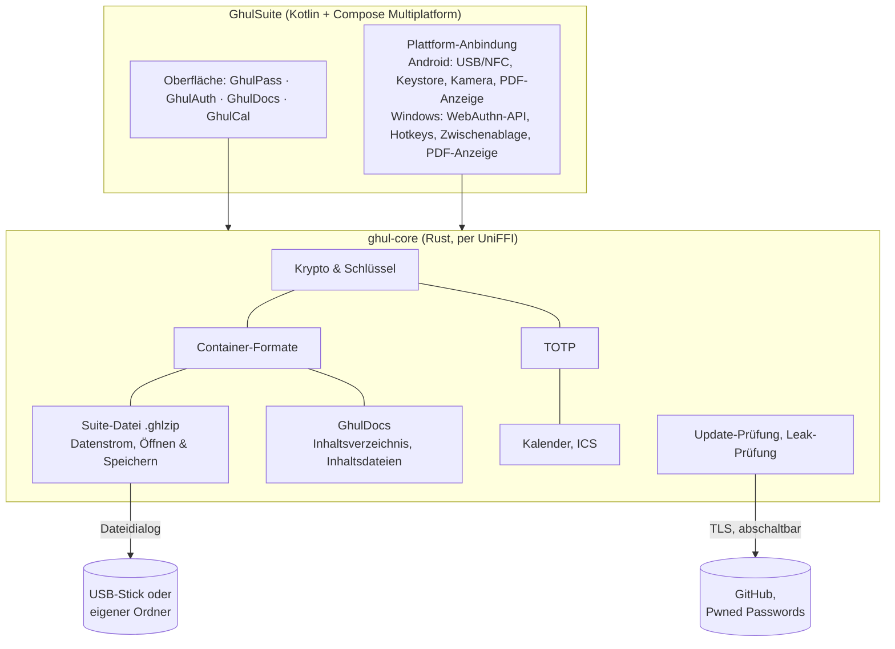
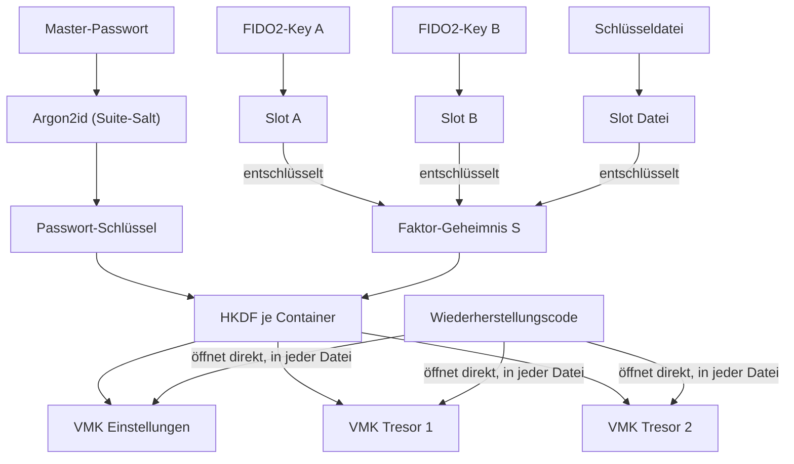

# GhulSuite: Sicherheits- und Architekturkonzept

**Stand:** Entwurf v0.9 · 20.11.2026 (v0.8: ohne Synchronisation, die Suite ist eine Datei (`.ghlzip`), Formatversion 3 mit Schreibsiegel, [`UMBAU-OHNE-SYNC.md`](UMBAU-OHNE-SYNC.md); **v0.9: eine reine Offline-App. GhulDocs statt GhulDrive und GhulMail, keine Server, keine Freigabelinks, kein Schlüsselwechsel; die Suite-Datei als Datenstrom; Dokumente scannen auf Android**, Abschnitte 8 und 9. Begründung und Pakete: [`UMBAU-GHULDOCS.md`](UMBAU-GHULDOCS.md). Seit 20.11.2026 wieder mehrere GhulDocs-Tresore je Suite, höchstens 3 mit je bis 1 GB; die Suite-Datei bis 3,75 GiB; jeder Tresor lässt sich als Ganzes weitergeben)
**App:** GhulSuite mit den Bereichen **GhulPass** (Passwörter) · **GhulAuth** (TOTP) · **GhulDocs** (Dokumente) · **GhulCal** (Kalender)
**Plattformen:** Android (nativ) und Windows (nativ, auch portabel vom USB-Stick); Android kam zuerst (Abschnitt 4.1)
**Lizenz:** AGPL-3.0-or-later
**Sprachen:** Deutsch und Englisch ab der ersten Version

---

## 1. Ziel und Leitprinzipien

Eine benutzerfreundliche, universelle Suite, die ohne Anbieterbindung funktioniert. Die Suite ist **eine
verschlüsselte Datei**, die man öffnet, darin arbeitet und speichert, und die man überall hin mitnehmen kann
(z. B. auf einem USB-Stick). Es gibt keine Server und keine Konten; die App braucht kein Netz.

1. **Zero Knowledge:** Ver- und entschlüsselt wird nur auf deinen Geräten. Datenträger und Suite-Datei enthalten nur Chiffretext.
2. **Zwei Faktoren sind kryptografisch erzwungen:** Ohne Master-Passwort **und** zweiten Faktor (FIDO2-Key oder
   Schlüsseldatei) lässt sich nichts entschlüsseln, auch nicht offline, auch nicht mit der Datei in der Hand.
   Einzige Ausnahme ist der ausgedruckte **Wiederherstellungscode**: Er öffnet bewusst alles allein (Abschnitt 6.3).
3. **Keine eigene Kryptografie:** Nur etablierte Verfahren aus geprüften Bibliotheken.
4. **Ein Kern für alles:** Ein Rust-Kern (`ghul-core`) für Krypto, Formate, die Suite-Datei, TOTP, GhulDocs und Kalender, identisch auf Android und Windows.
5. **Offline:** Alles ist lokal verfügbar und braucht keinen Server. Ins Netz gehen nur die Update-Prüfung und die
   Leak-Prüfung von GhulPass; beide lassen sich abschalten (Abschnitt 8.4).
6. **Universell:** Kein bestimmter Speicherort, Hoster oder Cloud-Dienst wird vorausgesetzt. Wohin die Suite-Datei wandert, entscheidet der Nutzer.
7. **Benutzerfreundlich:** Sicherheit über verständliche Abläufe, nicht über Fachbegriffe.
8. **Öffentlich prüfbar:** Das Repository wird später veröffentlicht. Die Sicherheit hängt nie davon ab, dass der Code
   geheim ist. Im Repository liegen keine Geheimnisse.

---

## 2. Getroffene Entscheidungen

| Thema | Entscheidung |
|---|---|
| App-Struktur | **Eine App „GhulSuite“** mit vier Bereichen: GhulPass, GhulAuth, GhulDocs, GhulCal. GhulDocs ersetzt seit dem 17.11.2026 GhulDrive und GhulMail ([`UMBAU-GHULDOCS.md`](UMBAU-GHULDOCS.md)) |
| Netz | **Offline.** Keine Server, keine Konten. Nur zwei Verbindungen, beide abschaltbar: Update-Prüfung (GitHub) und Leak-Prüfung von GhulPass (Pwned Passwords, k-Anonymität). Ein Fehlerbericht wird nur angezeigt (Abschnitt 8.4) |
| Altlasten | **Keine** (17.11.2026): Die App hat noch keine Nutzer. Ältere Formate werden nicht gelesen; nach einer Schutzänderung öffnet die App keine Suite-Datei mit älterem Schutz mehr, auch nicht nach Rückfrage |
| Web-Client | **Keiner.** Ersatz für unterwegs: portables Windows-Programm auf dem USB-Stick |
| Ablage der Suite | **Eine Datei** (`.ghlzip`), die der Nutzer speichert und öffnet, wo er will (USB-Stick, eigener Ordner). Kein Abgleich zwischen Geräten: Aktuell ist der Stand, der zuletzt gespeichert wurde (geändert am 17.11.2026) |
| Synchronisation | **Keine** (entfernt am 17.11.2026): kein Sync-Server, kein Zusammenführen, kein „Von meinem Server holen“, keine eigene Sicherung/Wiederherstellung. Ersetzt durch Öffnen und Speichern der Suite-Datei (Abschnitt 8.1) |
| Teilen | Tresore werden nicht gemeinsam mit anderen Personen bearbeitet; ein ganzer Tresor jedes Bereichs oder ausgewählte Einträge lassen sich aber **als eigener Tresor weitergeben** (eigenes Passwort, neue Schlüsseldatei oder Security Key, Abschnitt 8.3), ein GhulDocs-Tresor mit seinen Dokumenten. Einzelne Dokumente gehen über „Exportieren“ oder „Mit App öffnen“ hinaus. Freigabelinks gibt es nicht mehr (17.11.2026) |
| Schnell-Entsperren | **Fingerabdruck und/oder App-PIN**, optional und mit engen Grenzen (Abschnitt 6.5) |
| Module | Jeder Bereich (GhulPass, GhulAuth, GhulDocs, GhulCal) ist in den Einstellungen **abschaltbar**; er verschwindet dann aus dem Menü, die Daten bleiben erhalten |
| Sofortsperre | **Sofort sperren** (Stufe 1), auch durch **Schütteln**; kein Löschen, kein Notfall-Passwort (Abschnitt 6.6) |
| Dokumente | **GhulDocs** in der Suite: fest **1 GB** Inhalt je GhulDocs-Tresor, höchstens **3** GhulDocs-Tresore je Suite, zusammen also **3 GB** (seit 20.11.2026; vorher genau ein Tresor mit 1 GB), jede Datei mit eigenem Schlüssel, in der Suite-Datei mit unterwegs (Abschnitt 9.3). Eigene Server, SFTP und das PHP-Modul sind entfernt (17.11.2026) |
| Plattformen | **Android und Windows**; Android kam zuerst, die Architektur war von Anfang an auf beide ausgelegt (Abschnitt 4.1). Scannen nur auf Android. Android ab **Version 12** (API 31, seit 22.11.2026; vorher Android 10), Abschnitt 16 |
| Schutz | **Master-Passwort plus zweiter Faktor, immer.** Zweiter Faktor: Security Key (empfohlen) oder Schlüsseldatei; beliebig viele, jederzeit austauschbar, ohne dass etwas ungültig wird. Einen Schutz nur mit Passwort gibt es nicht (geändert am 11.11.2026) |
| Wiederherstellungscode | **Pflicht** bei jeder Suite; öffnet alles allein, auch ohne Passwort, Key und Schlüsseldatei; danach wird ein neues Passwort gesetzt |
| Suite und Tresore | **Die Suite ist eine Datei:** Der Suite-Container `suite.ghlsuite`, alle Tresore mit den Inhaltsdateien von GhulDocs und eine Kopfdatei liegen zusammen in der `.ghlzip`. Je Bereich beliebig viele Tresore, GhulDocs höchstens 3 (z. B. GhulPass „Privat“ und „Arbeit“). Auf dem Gerät gibt es eine Arbeitskopie (geändert am 17.11.2026; davor „Der Ordner ist die Suite“) |
| Erster Start | Auswahl: **neu einrichten**, **Suite-Datei öffnen** (`.ghlzip`) oder **einzelnen Tresor öffnen** (Tresordatei: nur diesen Tresor öffnen, zur eigenen Suite hinzufügen oder eine neue Suite damit anlegen; Abschnitt 8.3) |
| Speicherort | Die **Arbeitskopie** liegt im privaten App-Speicher (Windows portabel: im Ordner `GhulSuite-Daten` neben dem Programm), damit die App auch ohne den Stick funktioniert. Die **Suite-Datei** liegt, wo der Nutzer sie speichert; die App merkt sich die zuletzt geöffnete Datei und speichert direkt dorthin |
| GhulAuth-Passwort | Alle Tresore einer Suite haben dasselbe Passwort und dieselben Faktoren. Wer ein getrenntes Passwort will, legt eine zweite Suite an |
| Lizenz | **AGPL-3.0-or-later** |
| Windows-Code-Signatur | **Nein** (SmartScreen-Warnung beim ersten Start wird in Kauf genommen) |
| Sprachen | Deutsch und Englisch |

---

## 3. Ergebnis der kritischen Überprüfung

Was sich gegenüber v0.1 geändert hat und warum:

| # | Befund | Änderung |
|---|---|---|
| 1 | Ohne Web-Client entfällt der Grund für Tauri (gemeinsame Oberfläche mit dem Web). Zwei getrennte Oberflächen für Android und Windows wären doppelte Arbeit für alle Bereiche. | **Kotlin + Compose Multiplatform** für beide Plattformen: eine Oberfläche, einheitliche Bedienung. Der Rust-Kern hängt per UniFFI an beiden. |
| 2 | Android bindet FIDO2 für Apps über den Credential Manager an eine **eigene, verifizierte Web-Domain**. Für eine universelle, öffentliche App hat nicht jeder Nutzer eine. | **Direkter CTAP2-Zugriff** auf den Key über USB (später NFC). Keine Domain nötig, keine Abhängigkeit von Google-Diensten, läuft auch auf Android ohne Google (z. B. GrapheneOS). |
| 3 | Die Credential-ID und der PRF-Salt stehen offen im Datei-Header. Wäre die RP-ID eine echte Domain, könnte deren Besitzer eine Webseite bauen, die mit einer Key-Berührung den geheimen Wert abfragt. | **Feste RP-ID, die keine gültige Web-Domain ist** (Vorschlag: `ghulsuite.invalid`, reservierte Endung). Kein Browser kann sie je anfragen. |
| 4 | Cloud-Anbindungen über den Android-Dateidialog (z. B. Google Drive) sind beim Zurückschreiben bekanntermaßen unzuverlässig: Zwischenspeicher, verzögerter Upload, Konflikte. | Seit 17.11.2026 gibt es keine Synchronisation mehr: Die Suite wandert als **eine Datei**, die der Nutzer über den Dateidialog öffnet und speichert (z. B. auf einem USB-Stick). Die App schreibt die ganze Datei auf einmal und prüft beim Öffnen alles, bevor sie etwas ersetzt (Abschnitt 8.1). |
| 5 | Geräte-Registrierung am Server mit FIDO2-Freigabe ist aufwendig und bringt kaum Gewinn: Wer den Suite-Container entschlüsseln kann, hat ohnehin alle Zugänge. | Ein neues Gerät muss nur die Suite-Datei öffnen, ohne Konto und ohne Freischaltung. Seit dem 17.11.2026 gibt es keine Server mehr, also auch keine Zugänge dazu. |
| 6 | Vier Container einzeln zu entsperren wäre umständlich; WebAuthn-PRF liefert pro Berührung nur zwei Werte. | Alle Container einer Suite teilen sich Passwort-Ableitung und Faktor-Geheimnis. **Ein Passwort, eine Berührung, alles offen**: die Container bleiben dabei kryptografisch getrennt. |
| 7 | HTML-Mails sind der größte Angriffsweg. Eine Browser-Engine zur Anzeige ist zudem unter Compose Desktop schwierig. | Damals: native, vereinfachte Darstellung ohne Browser-Engine. **Seit dem 17.11.2026 gegenstandslos:** GhulMail ist entfernt. |
| 8 | Gmail und Microsoft-Konten verlangen inzwischen OAuth2. Für Gmail braucht eine öffentliche App dazu eine kostenpflichtige Sicherheitsprüfung durch Google. | Damals: nur Standard-IMAP/SMTP. **Seit dem 17.11.2026 gegenstandslos:** GhulMail ist entfernt. |
| 9 | Ein lokaler Ordner als Drive-Speicher wirkte unsicher. | Damals lag GhulDrive auf dem eigenen Server. **Seit dem 17.11.2026:** Dokumente liegen in GhulDocs, verschlüsselt in der Arbeitskopie und in der Suite-Datei; jede Datei mit eigenem Schlüssel, Namen und Ordner nur im verschlüsselten Inhaltsverzeichnis (Abschnitt 9.3). |
| 10 | Unverschlüsseltes FTP ist unsicher; ein gespeichertes Server-Passwort kann die App nach einer Schutzänderung nicht selbst wechseln. | Erst nur noch SFTP mit SSH-Schlüssel, **seit dem 17.11.2026 gar keine Server mehr** (auch kein PHP-Modul, keine Freigabelinks). |
| 11 | Mail-Abruf im Hintergrund braucht Zugangsdaten bei gesperrter App. | **Gegenstandslos** mit GhulMail (17.11.2026). |
| 12 | Die Schlüssel liegen nur in der Suite. Geht sie verloren, sind die Daten weg. | Die Suite-Datei ist das, was man aufbewahrt (auch in Kopien an mehreren Orten). Die App zeigt **„Nicht gespeicherte Änderungen“** und fordert nach jeder Schutzänderung auf, die Datei zu speichern. |
| 13 | GhulDrive, GhulMail und die Server waren die Quelle der meisten offenen Befunde (Sperren auf dem Server, Schlüsselwechsel, PHP-Modul, Mail-Parser, Benachrichtigungen). | **Offline-App mit GhulDocs** (17.11.2026): Dokumente verschlüsselt in der Suite, bis 1 GB, mit Scannen auf Android. Rund 70 offene Befunde entfallen ([`UMBAU-GHULDOCS.md`](UMBAU-GHULDOCS.md), Abschnitt 9). |

---

## 4. Architektur



| Baustein | Technik | Begründung |
|---|---|---|
| Kern | **Rust** | Speichersicher, Schlüssel im RAM werden überschrieben (`zeroize`), eine Implementierung für beide Plattformen |
| Oberfläche | **Kotlin + Compose Multiplatform** | Eine Oberfläche für Android und Windows; auf Android echt nativ (Kamera mit CameraX, PDF-Anzeige des Systems) |
| Anbindung | **UniFFI** | Erzeugt sichere Kotlin-Anbindungen an den Rust-Kern für Android und Windows |
| Windows-Paket | Installer **und** portable Version (Ordner mit Programm und Laufzeit, startet vom Stick) | Die Java-Laufzeit wird mitgeliefert, auf dem PC muss nichts installiert sein |

### 4.1 Android zuerst, Windows später

Windows später nachzuziehen ist **kein großer Mehraufwand, wenn das Projekt von Anfang an dafür angelegt ist**:

- **Gemeinsamer Code (`commonMain`):** Oberfläche, Abläufe, Texte (Deutsch/Englisch) und die gesamte Logik im Rust-Kern.
  Erfahrungsgemäß sind das deutlich mehr als drei Viertel des Codes.
- **Plattform-Code nur hinter klaren Schnittstellen:** FIDO2-Zugriff, Fingerabdruck, Zwischenablage, Dateiauswahl,
  Auto-Type, Hintergrundaufgaben, Bewegungssensor. Für Windows wird später nur dieser Teil neu geschrieben.
- Der Windows-Build bleibt bis dahin abgeschaltet, das Projekt kompiliert aber gegen beide Ziele, damit sich keine
  Android-Abhängigkeiten in den gemeinsamen Code einschleichen.

**Echter Mehraufwand für Windows später:** FIDO2 über die Windows-WebAuthn-API, Auto-Type und Tastenkürzel,
Windows Hello, portabler Modus und das Paket. Das ist überschaubar, aber nicht null.

**Risiko RP-ID:** Sollte die Windows-API die RP-ID `ghulsuite.invalid` nicht annehmen, ist das kein Problem für bestehende
Daten. Die Android-App kann für denselben Key einen **zusätzlichen Slot** mit einer anderen RP-ID anlegen, ohne dass
Daten neu verschlüsselt werden müssen.

**Bekannte Risiken, die früh im Prototyp geprüft werden:**
- Direkter CTAP2-Zugriff per USB-C auf Android mit deinem Key (Phase 0b)
- Später für Windows: `hmac-secret` über die Windows-WebAuthn-API mit eigener RP-ID, Startzeit und Größe der portablen Version

---

## 5. FIDO2

- Jeder FIDO2-Key mit der Erweiterung **`hmac-secret`** funktioniert, z. B. Yubico, Nitrokey 3, Token2, Feitian, SoloKeys.
  Der Key liefert zu einem gespeicherten Salt einen geheimen 32-Byte-Wert, den nur dieser Key berechnen kann.
- **Android:** direkter CTAP2-Zugriff über USB-C, NFC später. Android fragt beim ersten Mal, ob GhulSuite auf den Key zugreifen darf.
- **Windows:** über die Windows-WebAuthn-API. Es erscheint der bekannte Windows-Sicherheitsdialog. Das funktioniert
  ohne Administratorrechte, also auch portabel auf fremden PCs.
- **PIN auf dem Key ist Pflicht.** Der Key sperrt sich nach 8 Fehlversuchen. `hmac-secret` wird immer „mit PIN“ ausgewertet,
  dieser Wert unterscheidet sich vom Wert ohne PIN (ab CTAP 2.1).
- **`credProtect` für neue Keys** (seit 22.11.2026, Runde 9): Ein Key nur mit CTAP 2.0 hat einen einzigen
  `hmac-secret`-Wert mit und ohne PIN; ohne `credProtect` beantwortet er eine Abfrage auch ohne PIN, die Key-PIN
  schützte den zweiten Faktor dann nicht. Darum legt GhulSuite Credentials mit `credProtect` Stufe 3
  (`userVerificationRequired`) an und lehnt beim Registrieren einen Key ab, der weder `credProtect` noch CTAP 2.1
  kann (Meldung wie bei fehlendem `hmac-secret`). Unter Windows verlangt die App `credProtect` immer
  (`bRequireCredProtect`). Schon eingetragene Keys entsperren weiter.
- **Feste RP-ID** `ghulsuite.invalid` auf allen Plattformen, damit derselbe Key überall denselben Wert liefert
  und keine Webseite die Credentials ansprechen kann (siehe Abschnitt 3, Befund 3).
- **Nicht auffindbare Credentials:** Sie belegen keinen Speicher auf dem Key. Die Credential-ID steht im Container-Header.
- **Mindestens zwei Keys** werden empfohlen. Die App erinnert daran, solange nur einer registriert ist.
- Passkeys des Handys oder Windows Hello als zweiter Faktor sind vorerst **nicht** vorgesehen (Verfügbarkeit von `hmac-secret` uneinheitlich). Später prüfen.

---

## 6. Schlüsselkonzept

### 6.1 Faktoren

| Faktor | Rolle |
|---|---|
| **Master-Passwort** | immer erforderlich |
| **FIDO2-Key** (mit PIN) | zweiter Faktor (empfohlen), beliebig viele |
| **Schlüsseldatei** `.ghlkey` | zweiter Faktor, gleichwertig zum Key, beliebig viele; z. B. zum Einstieg oder als Reserve |
| **Wiederherstellungscode** (Notfallblatt) | öffnet allein **alles**: für den Fall, dass nichts anderes mehr da ist |

Mindestens ein Key oder eine Schlüsseldatei muss immer eingetragen sein. **Ein Security Key braucht immer ein Backup**
(seit 21.11.2026): einen zweiten Key oder eine Schlüsseldatei. Der Assistent fragt bei einem Key gleich danach, und das
letzte Backup eines Keys lässt sich nicht entfernen; ältere Suiten mit nur einem Key zeigen unter Optionen → Schlüssel
einen Hinweis. Das Backup funktioniert genau wie der erste Key. Jeder Key und jede Schlüsseldatei öffnet zusammen mit
dem Passwort dasselbe Faktor-Geheimnis `S`. Darum lässt sich eine Schlüsseldatei später gegen einen Key tauschen (Key
hinzufügen, Datei entfernen), ohne dass der Wiederherstellungscode oder die übrigen Keys ungültig werden.

**Schutzänderungen brauchen beide Faktoren** (seit 21.11.2026): ein neuer Wiederherstellungscode, ein Key oder eine
Schlüsseldatei hinzufügen oder entfernen verlangt das Master-Passwort plus einen Key oder eine Schlüsseldatei von jetzt,
geprüft wie beim Entsperren. Ebenso brauchen beide Faktoren: Fingerabdruck oder App-PIN einrichten (und ihre
Gültigkeit ändern, Abschnitt 6.5), einen Tresor als Tresor weitergeben (Abschnitt 8.3) und die Suite auf dem Gerät
löschen oder durch eine andere ersetzen (Abschnitt 9; dort genügt statt der Faktoren auch der Wiederherstellungscode).
Mit einem Security Key berührt man ihn einmal (`confirm_factors`); danach reicht für diesen einen Schritt das Passwort.
Schutzänderungen werden vollständig versiegelt, bevor etwas geschrieben wird, und über ein Journal geschrieben
(Abschnitt 8.2): Es bleibt immer der alte oder der neue Schutz, nie eine Mischung.
So kann sich niemand, der die App kurz entsperrt in der Hand hat, dauerhaften Zugang verschaffen oder den Besitzer
aussperren. **Ausnahme nach dem Notfallblatt:** Wurde mit dem Wiederherstellungscode entsperrt, reicht bis zum
nächsten Sperren das neue Master-Passwort allein (Abschnitt 6.3).

**Das Master-Passwort** (ohne zweiten Faktor) fragen App und Kern vor Schritten, die den Schutz auf dem Gerät
abschwächen oder ein Geheimnis zeigen: die automatische Sperre verlängern, „Sperren, wenn der Bildschirm ausgeht“,
das Schütteln oder „Sofortsperre löscht auch die Termin-Erinnerungen“ ausschalten, die Schüttel-Empfindlichkeit
senken, Bildschirmfotos erlauben, die Zwischenablage länger oder nie leeren, mehr Inhalt in den Erinnerungen
zeigen; **„Papierkorb leeren“ und das endgültige Löschen von 10 oder mehr Einträgen auf einmal** (seit 22.11.2026,
damit niemand an einer offenen Suite alles löscht und speichert; kleinere Mengen und das Verschieben in den
Papierkorb gehen ohne Abfrage); dazu ein 2FA-Geheimnis als QR-Code oder `otpauth://`-Link (`totp_uri` gibt es nur mit dem Passwort heraus)
und der gespeicherte 2FA-Schlüssel eines GhulPass-Logins im Editor. Strenger stellen geht ohne Abfrage.

**Regeln für Passwort und PIN** prüft der Kern selbst (`security_rules`, die App übernimmt sie): Ein neues
Master-Passwort (Einrichten, Passwort ändern, nach dem Wiederherstellungscode, das Passwort einer Weitergabe) hat
mindestens 10 Zeichen und eine Stärke von mindestens 3 nach zxcvbn (Skala 0 bis 4); sonst „zu kurz“ bzw. „zu
schwach“. Die App-PIN hat 8 bis 12 Ziffern (der Kern verlangt mindestens 8 Ziffern, seit 22.11.2026; vorher 6).
**Leicht zu erratende App-PINs** lehnen Kern und App beim Einrichten ab (seit 22.11.2026, Runde 9): nur eine Ziffer
(`11111111`), wiederholte Blöcke (`12121212`), auf- oder absteigende Folgen (`12345678`) und achtstellige Daten
(`TTMMJJJJ`, `MMTTJJJJ`, `JJJJMMTT` der Jahre 1900 bis 2099); bei zwei Versuchen wären sie zu leicht. Eine schon
eingerichtete PIN entsperrt weiter.

**Beim Entsperren und Öffnen** werden immer beide Wege angeboten, Key und Schlüsseldatei (vorgewählt ist, was auf
diesem Gerät zuletzt benutzt wurde): Die Oberfläche verrät nicht, womit eine Datei geschützt ist. Der Kopf einer
Datei nennt die Arten ihrer Slots allerdings unverschlüsselt (FORMAT 1), wer die Datei selbst hat, sieht das also.

### 6.2 Schlüsselhierarchie



1. `PK = Argon2id(NFC(Passwort), suite_salt)`: einmal pro Entsperren. Mindestens 64 MiB und 3 Durchläufe,
   kalibriert auf ca. 1 Sekunde am langsamsten Gerät.
2. Jeder zweite Faktor hat einen **Slot**, der das zufällige **Faktor-Geheimnis `S`** (256 Bit) verschlüsselt enthält.
   - FIDO2-Slot: privater X25519-Schlüssel = `HKDF(hmac-secret(Key, slot_salt))`
   - Schlüsseldatei-Slot: privater X25519-Schlüssel = `HKDF(Geheimnis der Datei)`
   - Im Slot steht der zugehörige **öffentliche** Schlüssel. Damit kann die App ein neues `S` für jeden Key
     verschließen, ohne ihn zu berühren.
3. Je Container: `KEK = HKDF-SHA256(PK ‖ S, info = "ghul/v1/kek" ‖ Container-UUID)`
4. Der `KEK` entschlüsselt den zufälligen **Container-Hauptschlüssel (VMK)**. Aus dem VMK wird der Inhalts-Schlüssel
   abgeleitet; der Header ist als AAD eingebunden. Exakte Ableitungen: [`docs/FORMAT.md`](FORMAT.md), Abschnitt 4.
5. **Schreibsiegel (Formatversion 3):** Jede Datei endet mit einem HMAC über alle Bytes davor, mit einem Schlüssel aus
   `PK` und `S`. Es entsteht nur mit dem Passwort. Wer eine alte Kopie und einen alten Code hat, kann damit lesen, was
   damals galt, aber keine Datei bauen, die ein Gerät annimmt. Dass eine Datei aktuell ist, beweist das Siegel nicht;
   dafür sorgen Zähler und Schutz-Epoche der Suite-Datei (Abschnitt 8.1). Ältere Formatversionen werden nicht mehr
   gelesen.

**Eigenschaften:**
- Nur Key oder nur Schlüsseldatei → `S`, aber ohne Passwort kein `KEK` → wertlos.
- Nur Passwort → kein `S` → wertlos.
- **Ein Passwort, eine Berührung** öffnet alle Container. Jeder Container hat trotzdem seinen eigenen VMK.
- Jeder Container enthält alle Slots in seinem eigenen Header und lässt sich daher **auch einzeln** öffnen,
  z. B. nur eine `.ghlpss` vom USB-Stick ohne Suite-Datei (Abschnitt 8.3).
- Passwort ändern verlangt das aktuelle Passwort und **einen** zweiten Faktor (ein Key oder eine Schlüsseldatei genügt, nicht alle). Ein Key oder eine Schlüsseldatei wird hinzugefügt oder entfernt, indem man einen Slot hinzufügt oder löscht; auch das verlangt beide Faktoren. Die App aktualisiert dabei alle Container. Der letzte zweite Faktor lässt sich nicht entfernen, und solange ein Security Key eingetragen ist, auch nicht der vorletzte (das Backup). Denselben Key ein zweites Mal einzutragen lehnt der Key selbst ab (excludeList): er wäre kein Backup.
- Öffnet ein Gerät einen neueren Stand derselben Suite mit **demselben** Schutz (gleiche Epoche, gleicher KDF-Salt und gleiche Faktor-Slots im Klartext-Header, kein Wiederherstellungscode), bleiben Fingerabdruck und App-PIN eingerichtet; sie halten denselben Passwortschlüssel. Bei anderem Schutz werden sie gelöscht. Jedes Gerät merkt sich die Schutzstände, die es selbst hatte. Eine Suite-Datei dieser Suite mit einem davon ist älter: Überschreiben wird angeboten. Eine mit einem Schutz, den das Gerät nie hatte (anderswo geändert), wird beim Speichern nicht überschrieben: das machte die Änderung rückgängig. Sie ist zuerst zu öffnen.
- **Erneuern bei jeder Schutzänderung:** Neues Notfallblatt, neues Passwort oder ein entfernter Key geben jedem
  Container einen neuen VMK; ein entfernter Key erneuert zusätzlich `S` für alle übrigen Keys. So öffnet ein
  verlorenes Notfallblatt oder ein entfernter Key zusammen mit einer **alten Kopie der Suite-Datei** nichts, was
  danach gespeichert wurde. Die alte Kopie selbst zeigt weiter den Stand von damals; wie man sie unbrauchbar macht,
  steht in Abschnitt 8.2.
- **Dateinamen verraten nichts:** Tresordateien heißen nach ihrer zufälligen Kennung (`3f9a1c2b7d4e5f60.ghlpss`),
  der Name steht nur verschlüsselt darin.
- **Die Suite ist eine Datei:** Der Suite-Container `suite.ghlsuite` (Schutz-Epoche, Stand, Einstellungen) und alle
  Tresore samt den Inhaltsdateien von GhulDocs gehören zusammen und reisen gemeinsam in der `.ghlzip` (Abschnitt 8.1). Auf dem Gerät arbeitet die App in
  einer Arbeitskopie; sie gleicht nichts mit Dateien in fremden Ordnern ab und übernimmt nichts von selbst.
- **Tresore mit anderem Schutz** (aus einer anderen Suite) kommen nur auf ausdrücklichen Wunsch dazu: „Zu meiner Suite
  hinzufügen“ öffnet sie einmal mit ihrem bisherigen Passwort und Key bzw. Schlüsseldatei und stellt sie auf Passwort,
  Faktoren und Code der Suite um. Oder man öffnet sie einzeln, mit ihrem eigenen Schutz (Abschnitt 8.3).
- **Älterer Stand:** Ob eine Suite-Datei älter, abgezweigt oder mit einem älteren Schutz ist, erkennt die App beim
  Öffnen an Zähler, Stand-ID und Schutz-Epoche in der Kopfdatei (Abschnitt 8.1).
- **Passwort vergessen heißt Daten weg.** Das ist bewusst so: Es gibt keine Hintertür.

### 6.3 Wiederherstellungscode und Notfallblatt

- **Pflicht** bei jeder Suite. Derselbe Code steckt in **jeder** Datei der Suite und öffnet sie direkt (ohne Passwort,
  Key oder Schlüsseldatei), auch eine einzelne Tresordatei ohne den Rest und eine ganze `.ghlzip`. Danach wird ein neues
  Master-Passwort gesetzt; Keys, Schlüsseldateien und der Code selbst bleiben gültig. Empfohlen wird anschließend ein
  neuer Code. Ein neuer Code macht das alte Blatt wertlos, auch zusammen mit einer alten Kopie der Suite-Datei (für
  alles, was danach gespeichert wird), **sofern danach jedes Gerät zuerst die neue Suite-Datei öffnet** (Abschnitt
  8.2).
- **Danach bis zum Sperren das Passwort allein:** Wer mit dem Code öffnet, hat oft keinen Faktor mehr. Bis zum
  nächsten Sperren genügt darum für jede Schutzänderung das neue Master-Passwort (`opened_with_recovery_code`). Die
  App zeigt eine Anleitung (neuen Key oder neue Schlüsseldatei hinzufügen, bei einem Key auch sein Backup, dann den
  verlorenen Faktor entfernen und einen neuen Code erstellen). Solange so entsperrt ist, steht ein Hinweis über den
  Bereichen, und die automatische Sperre beträgt mindestens 5 Minuten. Eine mit dem Code geöffnete Suite-Datei wird
  nicht Speicherziel; der Speicherdialog lässt danach einen Ort wählen.
- **Notfall-Ausnahme beim Siegel:** Ohne Passwort lässt sich das Schreibsiegel nicht prüfen, nur lesen. Die App sagt
  das beim Öffnen, prüft Stand und Schutz-Epoche trotzdem und versiegelt danach alles mit dem neuen Passwort neu.
- Bewusste Abwägung: Wer Notfallblatt **und** Dateien hat, hat Zugriff. Das Blatt ist wie ein Tresorschlüssel aufzubewahren.

- 256 Bit Zufall mit 16 Bit Prüfsumme, dargestellt als 55 Zeichen Base32 in 11 Gruppen zu 5 Zeichen (FORMAT 6),
  zusätzlich als QR-Code. (Bis 22.11.2026 stand hier „52 Zeichen in Vierergruppen“; das entsprach nicht dem Code.)
- Das Notfallblatt wird **lokal** als PDF erzeugt. Es enthält Suite-Name, ID, Datum, den Code und eine Anleitung,
  **aber nicht das Passwort**.
- **Bestätigung des ganzen Codes** (seit 22.11.2026, Runde 9; vorher nur Gruppe 3): Man tippt den ganzen Code ab, am
  besten vom Ausdruck; Leerzeichen, Bindestriche und Groß- und Kleinschreibung zählen nicht. Der Kern liest ihn mit
  Prüfsumme und vergleicht ihn mit dem gespeicherten (`confirm_whole_recovery_code`), so fällt ein Tippfehler in
  jeder Gruppe jetzt auf und nicht erst im Notfall. Das Feld ist sichtbar, aber für die Tastatur ein Passwortfeld
  ohne Autokorrektur (sie lernt den Code nicht).
- Warnhinweis: Netzwerk- und Cloud-Drucker speichern Druckaufträge teilweise.

### 6.4 Schlüsseldatei `.ghlkey`

32 Byte Zufall mit Kennung und Prüfsumme. Sie ist ein **zweiter Faktor wie ein Key**: Sie verpackt `S` in einem eigenen
Slot. Gegenüber einem Key ist sie kopierbar, darum ist der Key empfohlen. Die App weist darauf hin, sie nie zusammen
mit dem Passwort aufzubewahren und eine Kopie anzulegen.

### 6.5 Schnell-Entsperren per Fingerabdruck oder App-PIN (optional)

Nach einer vollständigen Entsperrung (Passwort und Key) lässt sich die App für eine einstellbare Zeit per
**Fingerabdruck** und/oder **App-PIN** öffnen. Umgesetzt in Etappe 2a:

- Der Kern legt `PK` und den Suite-Schlüssel in `quick-<bio|pin>.ghlq` ab (nur im App-Speicher des Geräts, nie in der
  Suite-Datei).
  - **Fingerabdruck** (Schnell-Datei Version 3): verschlüsselt mit einem zufälligen Schnellschlüssel `QK`, der nur
    verschlüsselt durch einen **Android-Keystore-Schlüssel** vorliegt. Dieser ist nur nach **starker biometrischer
    Prüfung** (Klasse 3) nutzbar und wird beim Registrieren eines **neuen Fingerabdrucks ungültig**.
  - **App-PIN** (Schnell-Datei Version 4, seit 22.11.2026): 8 bis 12 Ziffern. Jeder Versuch braucht einen
    Keystore-Schlüssel, der **genau einmal** geht (HMAC-SHA256, `setMaxUsageCount(1)`), und die PIN geht in das ein,
    was dieser Schlüssel rechnet: `T = HMAC(K, "ghul/v4/quick-pin-tag" || Argon2id(PIN, salt))`, daraus mit HKDF
    (dazu Suite-Kennung, Generation und Slot) der Schlüssel der Datei. Es gibt **zwei** solche Schlüssel (Slots), also
    zwei Versuche; jeder Slot hat in der Datei seine eigene verschlüsselte Kopie. Die App erzeugt die beiden Schlüssel
    zufällig, der Kern versiegelt die Datei damit, danach importiert die App sie in den Keystore (StrongBox, sonst
    TEE; nach dem Import wird geprüft, dass der Schlüssel in sicherer Hardware liegt und genau eine Nutzung übrig hat,
    sonst wird die PIN nicht eingerichtet). Durch den Import verbraucht das Einrichten die eine Nutzung nicht. Hat das
    Gerät eine Displaysperre, gehen die Schlüssel nur bei entsperrtem Gerät.
  - **Ein Versuch** verbraucht einen Slot, ob die PIN stimmt oder nicht. Eine richtige PIN versiegelt die Datei sofort
    neu für zwei neue Schlüssel (die nächste **Generation**, sie steht im authentifizierten Kopf der Datei; Salt,
    Einrichtungszeit und Gültigkeit bleiben, das Neuversiegeln verlängert die Gültigkeit also nicht). Danach gibt es
    wieder zwei Versuche. **Nach 2 falschen PINs** ist kein Slot mehr übrig: Die App-PIN ist gelöscht, es öffnen nur
    noch Passwort und zweiter Faktor. Verbleibende Versuche sind die vorhandenen Slots der Generation in der Datei,
    kein Zähler in den Einstellungen; Schlüssel anderer Generationen (aus einem abgebrochenen Versuch) löscht die App
    vor jedem Versuch. Ein Absturz mitten im Versuch kostet höchstens diesen einen Slot.
  - **Kein Versuch verbraucht** wird bei gesperrtem Gerät (der Keystore lehnt ab, bevor der Schlüssel benutzt ist), bei
    abgelaufener Gültigkeit (der Kern prüft sie vorher am Kopf der Datei) und wenn das Vorbereiten der neuen Schlüssel
    scheitert. Scheitert das **Neu-Einrichten** (falsches Passwort, abgebrochene Berührung des Keys), bleibt die
    vorhandene App-PIN, wie sie war.
  - Die Datei allein erlaubt **keine Prüfung** einer PIN, auch nicht außerhalb des Geräts: Ohne den
    Keystore-Schlüssel fehlt `T`.
- **Einrichten nur mit beiden Faktoren** (seit 21.11.2026): Fingerabdruck oder App-PIN einschalten verlangt das
  Master-Passwort und einen Key oder eine Schlüsseldatei (`quick_unlock_enable` bzw. `quick_unlock_enable_pin` mit `FactorProof`). Der Assistent
  (Schritt 6) nimmt dafür den Faktor, mit dem die Suite gerade angelegt wurde.
- **Gültigkeit** (1, 4 oder 8 Stunden, 1, 3 oder 7 Tage oder „Immer“, Standard 24 Stunden) wird beim Einrichten gewählt und steht **fest in der Schnell-Datei** (Version 3 bzw. 4,
  `max_age_ms` in den zusätzlich authentifizierten Daten): Die App kann sie nicht nachträglich verlängern. Jede
  Methode (Fingerabdruck, App-PIN) hat ihre eigene Gültigkeit; eine andere Dauer richtet die Methode neu ein, wieder
  mit beiden Faktoren. Gezählt wird ab dem **letzten vollständigen Entsperren** (signierter Zeitstempel, nur mit dem
  Passwortschlüssel fälschbar) bzw. ab dem Einrichten. Die App prüft die Frist zusätzlich an der Zeit seit dem Start
  des Geräts (seit 22.11.2026): Eine zurückgestellte Uhr hebt sie nicht auf.
- **Abgelaufen heißt abgelehnt, nicht gelöscht:** Nach Ablauf lehnt der Kern das Schnell-Entsperren ab
  (`QuickUnlockExpired`), die Datei bleibt. Nach dem nächsten vollständigen Entsperren geht es wieder.
- **Ältere Schnell-Dateien** (Version 2, und für die App-PIN auch Version 3 aus einer Version vor dem 22.11.2026)
  öffnet der Kern nicht mehr (`QuickUnlockOutdated`): Die Datei wird entfernt, die App sagt, dass Fingerabdruck bzw.
  App-PIN nach einem vollständigen Entsperren unter Optionen → Entsperren neu einzurichten sind. Eine alte App-PIN
  bietet die App gar nicht erst an. Der Fingerabdruck (Version 3) bleibt unverändert.
- Passwort und Key sind immer wieder nötig: nach **jedem Neustart** und nach Ablauf. Das Ende nach dem Neustart setzt
  die App durch (Zähler der Starts in ihren Einstellungen), nicht der Keystore; mit Root ließe es sich umgehen, der
  Faktor (Finger, App-PIN) bliebe trotzdem nötig. **Neu einrichten** muss man das
  Schnell-Entsperren nach einer **Sofortsperre**, nach 2 falschen App-PINs, wenn Fingerabdrücke geändert wurden, nach
  einem **Passwortwechsel**, nach dem **Entfernen** eines Keys oder einer Schlüsseldatei, nach dem Entsperren mit dem
  **Wiederherstellungscode** (die Schnell-Dateien werden dabei gelöscht) und nach dem **Öffnen einer Suite-Datei** mit
  anderem Schutz (Abschnitt 6.2). Ein neuer Wiederherstellungscode und ein hinzugefügter Faktor lassen es bestehen.
- **Ehrlich:** In der Gültigkeitszeit reichen das entsperrte Handy plus Finger bzw. App-PIN. Deshalb optional; der
  Assistent schlägt den Fingerabdruck vor, wenn das Gerät einen Sensor hat, „Immer Passwort und zweiter Faktor“ ist
  wählbar.
- **Grenze gegen Root:** Ob ein Slot wirklich nur einmal geht, erzwingt bei Root die Hardware nur auf Geräten mit
  rollback-festem Keystore (KeyMint mit Rollback-Schutz, typisch StrongBox). Auf den übrigen Geräten (die meisten ohne
  StrongBox) zählt Android die Nutzung in seiner Keystore-Datenbank; wer Root hat, könnte sie zurückspielen und so
  weiter raten, aber nur **auf dem Gerät**. **Richtiggestellt am 22.11.2026 (Runde 9):** Hier stand „langsam (je
  Versuch Argon2id und ein Zurückspielen), bei 8 Ziffern über Jahre“. Das ist zu günstig: Argon2id(PIN, Salt) lässt
  sich mit dem Salz aus der Datei für alle PINs vorab auf fremder Hardware rechnen, auf dem Gerät bleibt je Versuch
  nur ein HMAC und das Zurückspielen; zusammen **Tage bis wenige Wochen**. Ob die Einmal-Nutzung eines importierten
  Schlüssels in der Hardware gezählt wird, kann die App nicht prüfen. Dass StrongBox das hart erzwingt, beruht auf der AOSP-Dokumentation und ist auf einem Gerät noch nicht
  nachgeprüft. **Richtiggestellt am 22.11.2026:** Hier stand, ein Durchprobieren der App-PIN außerhalb des Geräts
  sei nicht möglich. Für die App-PIN bis dahin (Schnell-Datei Version 3, Zähler in den Einstellungen der App) stimmte
  das nicht: Der Keystore-Schlüssel gab den Schnellschlüssel ohne PIN frei, die PIN steckte nur im Argon2id. Mit
  Root reichte ein Aufruf, danach ließ sich die PIN mit der Datei auf fremder Hardware durchprobieren, ohne Zähler.
- **Nicht verfügbar in der portablen Windows-Version.**

### 6.6 Sofortsperre

Ein Fingerabdruck kann erzwungen werden, ein Passwort im Kopf nicht so leicht. Deshalb gibt es eine Sofort-Sperre:

- **Wirkung:** Alle Bereiche werden gesperrt, alle Schlüssel aus dem Arbeitsspeicher gelöscht und Fingerabdruck- und
  App-PIN-Zugang werden **vernichtet** (Keystore-Schlüssel und Schnell-Dateien werden gelöscht). Danach öffnet die App
  nur noch mit Passwort **und** Key.
- **Das reicht kryptografisch für die Tresore:** Alle Tresordateien auf dem Gerät sind ohnehin verschlüsselt. Ohne
  Fingerabdruck-Zugang lassen sie sich ohne Passwort und Key nicht öffnen, auch nicht forensisch. Löschen ist nicht
  nötig. **Ausnahme: die Termin-Erinnerungen** (Abschnitt 9.4). Sie müssen auch auf dem gesperrten Handy erscheinen
  und liegen darum mit einem Keystore-Schlüssel ohne Bindung an ein entsperrtes Gerät verschlüsselt vor, im
  gewählten Umfang für die nächsten 30 Tage. Die Sofortsperre lässt sie stehen, außer „Sofortsperre löscht auch die
  Termin-Erinnerungen“ ist eingeschaltet (beim nächsten Entsperren werden sie neu geplant).
- **Auslöser Android:**
  - **Schütteln** (Bewegungssensor, kurzes kräftiges Schütteln). Die Erkennung läuft nur, solange etwas entsperrt
    ist, danach gibt es nichts mehr zu sperren, und der Akku wird geschont.
  - Schnellkachel „GhulSuite sperren“ in den Schnelleinstellungen.
  - Der Sperr-Knopf in der App und der Knopf in der Benachrichtigung sperren dagegen **normal** (Schnell-Entsperren bleibt).
- **Auslöser Windows:** globales Tastenkürzel und Tray-Symbol.
- Ein versehentliches Auslösen schadet nicht: Man entsperrt danach einfach einmal mit Passwort und Key.
- Die Empfindlichkeit beim Schütteln ist einstellbar, Schütteln lässt sich abschalten.
- **Bewusst nicht vorgesehen:** Löschen der lokalen Daten, Notfall-Passwort, Fernsperre (siehe Abschnitt 14).

---

## 7. Dateien und Formate

| Datei | Magic | Inhalt |
|---|---|---|
| `.ghlpss` | `GHULPASS` | GhulPass-Tresor |
| `.ghltotp` | `GHULTOTP` | GhulAuth-Tresor |
| `.ghlcal` | `GHULCLDR` | GhulCal-Kalender (bewusst ohne CalDAV; Austausch per .ics) |
| `.ghldoc` | `GHULDOCS` | GhulDocs-Tresor: das Inhaltsverzeichnis (Ordner, Namen, Größen, Typen, Favoriten, Papierkorb, je Datei ihr Schlüssel und ihre Prüfsumme) |
| `.ghlblob` | `GHULBLOB` | Inhaltsdatei von GhulDocs: der verschlüsselte Inhalt einer Datei, in Abschnitten zu 4 MiB, aufgefüllt auf 64 KiB (eigenes Format, kein Container) |
| `.ghlsuite` | `GHULSUIT` | Suite-Container: Schutz-Epoche, Stand der Suite-Datei, Einstellungen |
| `.ghlkey` | `GHULKEY\0` | Schlüsseldatei |
| `.ghlzip` | ZIP | Die ganze Suite zum Mitnehmen: `suite.ghlsuite`, alle Tresore, die Inhaltsdateien von GhulDocs und die Kopfdatei `export.ghlexp` (ein eigener, versiegelter Container mit Liste, Hashes, Stand-ID, Zähler und Schutz-Epoche). Bis 3,75 GiB, kein zweites Passwort; Abschnitt 8.1. Ein einzelner GhulDocs-Tresor reist als GhulDocs-Paket `.ghldocs` (Abschnitt 8.3) |

Gerätegebundene Daten (Arbeitskopie, Schnell-Entsperren, befristete Kopien für „Mit App öffnen“) sind **keine**
Austauschdateien. Sie liegen im App-Speicher, bzw. bei der portablen Version auf dem Stick; die Arbeitskopie ist
verschlüsselt, die befristeten Kopien werden beim Sperren gelöscht.

### 7.1 Container-Aufbau (gemeinsam für alle Container)

Die verbindliche Byte-Spezifikation steht in **[`docs/FORMAT.md`](FORMAT.md)** (mit Testvektoren).

```
┌─ Präfix + Header (Klartext, authentifiziert) ──────────────────┐
│ Magic · Format-Version · Header-Länge                           │
│ Container-ID · Suite-ID · Argon2id-Parameter + Salt             │
│ Slots[]: Typ · ID · Credential-ID · PRF-Input · verpacktes S    │
│ Flags (derzeit 0) · verpackter VMK                              │
├─ Inhalt: XChaCha20-Poly1305, AAD = Präfix + Header ─────────────┤
│ CBOR-Dokument mit Revisionszähler, aufgefüllt auf Blockgrößen   │
├─ Schreibsiegel: HMAC-SHA256 über alles davor (nur mit Passwort) ┤
└─────────────────────────────────────────────────────────────────┘
```

Ein separater Header-MAC (Entwurf v0.1 bis v0.4) entfällt: Der Header ist vollständig als AAD in die Verschlüsselung
des Inhalts eingebunden.

- **XChaCha20-Poly1305:** Zufalls-Nonces ohne Wiederverwendungsrisiko. Bewusst nur **ein** Verfahren je Formatversion.
- **Header als AAD:** Jede Änderung am Header macht die Entschlüsselung ungültig. Zusätzlich gelten Mindest- und Höchstwerte für Argon2id.
- **Auffüllen:** Die Dateigröße verrät nicht die Anzahl der Einträge.
- **Schreibsiegel:** Eine Datei, die mit Passwort und `S` aufgeht, deren Siegel aber nicht stimmt, gilt als verändert
  und wird nicht verwendet.
- **Rollback-Schutz:** Für die ganze Suite über Zähler, Stand-ID und Schutz-Epoche der `.ghlzip` (Abschnitt 8.1).
- **Einträge** haben UUID, Revision und Änderungszeit.

---

## 8. Suite-Datei und einzelne Tresore

Bis zum Umbau hielt eine Synchronisation über den eigenen Server (später auch über fremde Sync-Programme im Ordner) die
Geräte gleich. Sie war die Quelle der meisten Sicherheitsfunde und ist seit dem 17.11.2026 vollständig entfernt
([`UMBAU-OHNE-SYNC.md`](UMBAU-OHNE-SYNC.md)). Mit dem Umbau zu GhulDocs am selben Tag fielen auch GhulDrive, GhulMail,
alle Server (SFTP, PHP-Modul), Freigabelinks und der Schlüsselwechsel auf Servern weg
([`UMBAU-GHULDOCS.md`](UMBAU-GHULDOCS.md)). Seitdem ist GhulSuite eine reine Offline-App.

### 8.1 Die Suite als Datei (`.ghlzip`)

**Die Suite ist eine Datei. Man öffnet sie, arbeitet darin und speichert sie.** Wohin die Datei wandert (USB-Stick,
eigener Ordner), entscheidet der Nutzer; die App gleicht nichts ab und führt nichts zusammen. Aktuell ist immer der
Stand, der zuletzt in die Datei gespeichert wurde.

Beispiel: Handy: Datei auf dem Stick öffnen, arbeiten, speichern. Windows: dieselbe Datei öffnen, arbeiten,
speichern. Wieder auf dem Handy: öffnen.

- **Arbeitskopie:** Öffnen lädt die Datei (nach allen Prüfungen) in die Arbeitskopie im App-Speicher. Sie bleibt
  bestehen, damit die App auch ohne den Stick funktioniert; sie ist Zwischenstand, nicht die Datenbank. In der
  Arbeitskopie schreibt die App nur, was sich ändert (eine neue Inhaltsdatei von GhulDocs, das Inhaltsverzeichnis,
  einen Tresor); das geht sofort.
- **Die zuletzt geöffnete Datei** merkt sich die App (Android: über die Dateiauswahl des Systems mit dauerhafter
  Berechtigung; Windows: Pfad). „Speichern“ schreibt dorthin, „Speichern unter“ an einen neuen Ort. Ist der Stick
  nicht da, sagt die App das und bietet „Speichern unter“ an. Zu finden unter Optionen → Suite-Datei.
- **Eigene Endung**, damit Android und Windows die Datei der App zuordnen. **Kein zweites Passwort:** Die Inhalte sind
  die verschlüsselten, versiegelten Container und die verschlüsselten Inhaltsdateien; die ZIP fügt nichts hinzu.

**Inhalt.** Genau diese Einträge, keine Ordner-Einträge, keine doppelten oder zusätzlichen; Größen werden beim Lesen
gezählt, nicht aus dem ZIP-Verzeichnis übernommen:

- `suite.ghlsuite` und alle Tresore (neutrale Dateinamen);
- je Dokument in GhulDocs seine Inhaltsdatei `docs-<Tresor-ID>/<Kennung>.ghlblob`, schon verschlüsselt, unverändert
  und unkomprimiert hineinkopiert;
- die Kopfdatei `export.ghlexp` als erster Eintrag, ein eigener kleiner Container, verschlüsselt und versiegelt wie
  die Tresore, mit: Suite-ID und `container_id` der Suite-Datei; je Datei `container_id`, Art, Dateiname und
  SHA-256; **Stand-ID** (zufällig, neu bei jedem Speichern), **Vorgänger** (die Stand-IDs, aus denen dieser Stand
  hervorging) und **Zähler**; **Schutz-Epoche** (wächst bei jeder Schutzänderung); Zeitpunkt und Gerätename. Die
  Prüfsummen der Inhaltsdateien stehen im verschlüsselten Inhaltsverzeichnis ihres Tresors.

**Größe:** höchstens **3,75 GiB** (3 GB Dokumente in allen GhulDocs-Tresoren zusammen, höchstens 3,3 GB
Inhaltsdateien, und bis 200 MiB für die übrigen Tresore) und 21 000 Einträge. Das bleibt unter 4 GiB: Die ZIP hat kein
ZIP64, und FAT32-Sticks nehmen Dateien bis 4 GiB. (Bis 20.11.2026, mit genau einem GhulDocs-Tresor: 1,25 GiB.) Die
Datei wird beim Speichern und Öffnen als **Datenstrom** geschrieben und gelesen, nie ganz im Arbeitsspeicher, mit
Fortschritt. Geschätzte Dauer beim Speichern, wenn alle GhulDocs-Tresore zusammen voll sind (3 GB); das ist grob
dreimal so lang wie die frühere Schätzung für 1 GB, gemessen ist es nicht:

| Ziel | Dauer (Schätzung) |
|---|---|
| Windows, SSD | etwa 6 bis 15 s |
| Handy, interner Speicher | etwa 15 bis 40 s |
| USB-Stick oder SD-Karte | etwa 2 bis 4,5 min |

Mit typischen 100 bis 300 MB ist es ein Bruchteil davon.

**Speichern.**

1. Alle Container werden frisch versiegelt und mit der Kopfdatei und den Inhaltsdateien als Datenstrom geschrieben.
   Unter Windows erst in eine Zwischendatei neben dem Ziel, die zurückgelesen und dann in einem Schritt über die alte
   geschoben wird (kurzzeitig ist doppelter Platz nötig). Unter Android ebenso, wenn der Ordner der Suite-Datei der
   App freigegeben ist (`<Name>.neu` daneben schreiben, prüfen, dann tauschen). Ohne Freigabe (und bei Orten, die
   kein Austauschen erlauben, etwa Cloud-Apps) gibt Android nur das gewählte Dokument frei: Dort wird direkt
   hineingeschrieben und danach zurückgelesen; ein Abbruch kann eine halbe Datei hinterlassen. Darum bietet der
   Speicherdialog in diesem Fall zuerst „Sicheren Speicherort wählen“ an: Der Nutzer wählt oder legt einen eigenen
   Ordner an (nicht „Download“ und nicht die oberste Ebene, die Android für keine App freigibt), die App behält das
   Recht darauf und legt die Suite-Datei dort neu an; sie wird der Speicherort, die alte Datei bleibt liegen und wird
   mit „Alte Datei löschen“ angeboten. „Speichern“ am unsicheren Ort fragt mit einem Risikotext und bietet
   „Als neue Datei speichern“ oder „Trotzdem überschreiben“. Einen Cloud-Ordner empfiehlt die App nicht (Cloud-Apps
   behalten ältere Fassungen, auch nach dem Löschen). In jedem Fall gilt die Arbeitskopie erst als gespeichert, wenn
   die geschriebene Datei zurückgelesen und geprüft ist; bis dahin hält sie den ganzen Stand.
   **Freier Platz:** Vor dem Schreiben schätzt der Kern die Größe der Suite-Datei (`archive_estimated_size`), und die
   App vergleicht sie mit dem freien Platz am Ziel (unter Windows immer, unter Android, wenn der Ort ein Pfad auf dem
   Gerät, einer SD-Karte oder einem Stick ist). Reicht er nicht, sagt sie das, bevor etwas geschrieben wird, mit
   Bedarf und freiem Platz. Ist der Speicher beim Schreiben oder beim Öffnen voll, erkennt der Kern das am
   Fehlercode des Systems und meldet „Nicht genug freier Speicherplatz“ statt eines rohen Fehlers; vor dem Öffnen
   prüft er den Platz für den Zwischenordner.
2. Vorher vergleicht die App die Zieldatei mit der Arbeitskopie. Wurde sie seit dem Öffnen anderswo gespeichert
   (andere Stand-ID), fragt sie: „Die Datei wurde inzwischen anderswo gespeichert. Überschreiben (die Änderungen von
   dort gehen verloren) oder unter neuem Namen speichern?“ Liegt dort eine andere Suite oder gar keine GhulSuite-Datei,
   fragt sie ebenfalls. Zusammengeführt wird nicht. Hat die Datei dort einen **neueren Schutz** (eine höhere
   Schutz-Epoche: neues Passwort, entfernter Faktor oder, seit 22.11.2026, auch ein neuer Wiederherstellungscode),
   bietet der Dialog kein Überschreiben an, nur den Weg über „Als Tresor weitergeben“; Überschreiben machte die
   Änderung des Schutzes rückgängig.
3. Danach merkt sich das Gerät Stand-ID, Zähler und Schutz-Epoche. Eine Änderung, die während des Schreibens
   entstand, bleibt als „nicht gespeichert“ markiert.
4. **Nach einer Schutzänderung** (neues Passwort, neuer Code, Faktor entfernt, Öffnen mit dem Code) wird die ersetzte
   alte Fassung der Suite-Datei an genau diesem Ort beim nächsten Speichern mit Nullen überschrieben, erst wenn die
   neue Datei liegt und geprüft ist (Anzeige „Alte Fassung wird überschrieben …“). Auf Flash-Speichern ist das nicht
   verlässlich; nach einem Verlust empfiehlt die App einen frisch formatierten Stick.

**Öffnen.**

1. Die App liest die Kopfdatei und fragt nach Passwort und Key bzw. Schlüsseldatei.
2. **Alles wird geprüft, bevor etwas ersetzt wird:** das Schreibsiegel jeder Datei und der Kopfdatei; jede Datei steht
   in der Liste mit Art, `container_id` und Hash; die Liste stimmt genau mit den Tresoren der Suite-Datei überein,
   nichts fehlt, nichts ist zu viel; alles gehört zu derselben Suite. Jede Inhaltsdatei steht im Inhaltsverzeichnis
   ihres Tresors, hat die erwartete Länge und Prüfsumme, keine fehlt. Inhaltsdateien werden dabei in einen
   Zwischenordner geschrieben und erst nach dem Bestätigen an ihren Platz gebracht. Schlägt etwas fehl, wird nichts
   geladen, und die App sagt, was nicht stimmt.
3. **Rückfragen** (alle auf einmal, in einem Dialog, vor dem Ersetzen):
   - **Andere Suite** als die auf dem Gerät: „Diese Datei enthält eine andere Suite als die auf diesem Gerät. Sie
     ersetzt alles hier.“
   - **Älterer Stand** (kleinerer Zähler als hier zuletzt gesehen): „Diese Datei ist älter als dein Stand hier.“
   - **Abzweig** (von einem anderen Stand aus weiterbearbeitet als dem hier bekannten): „Diese Datei wurde von einem
     anderen Stand aus weiterbearbeitet als deinem hier.“
   - **Nicht gespeicherte Änderungen** auf dem Gerät: Sie gehen verloren; die App bietet an, vorher zu speichern.
     Ändert sich nach der Prüfung noch ein Tresor der Arbeitskopie, wird die geprüfte Datei verworfen und muss neu
     geöffnet werden; während Dokumente hinzugefügt oder kopiert werden, wird nicht übernommen.
   - **Andere Suite** ersetzt die Suite auf dem Gerät nur mit deren Nachweis (Passwort mit Key oder Schlüsseldatei
     der vorhandenen Suite, oder ihr Wiederherstellungscode).
4. **Älterer Schutz** (kleinere Schutz-Epoche als hier zuletzt gesehen): **wird nie geöffnet**, auch nicht nach
   Rückfrage und nicht mit dem Wiederherstellungscode. Die Datei ist durch eine neuere mit geändertem Schutz ersetzt.
5. Ersetzt wird in einem Schritt; bricht es mittendrin ab, bleibt der bisherige Stand.
6. **Gerätedaten des alten Stands werden gelöscht:** Schnell-Entsperren (Dateien und Zeitstempel, sie enthalten den
   alten Passwort-Schlüssel und `S`).
7. **Mit dem Wiederherstellungscode** (Passwort vergessen): Die Siegel lassen sich dann nicht prüfen, nur lesen. Das ist
   die bewusste Notfall-Ausnahme; die App weist darauf hin, prüft Stand und Schutz-Epoche trotzdem, setzt ein neues
   Passwort und versiegelt alles neu.

Was ein Gerät zuletzt gesehen hat (höchster Zähler, Stand-ID, Schutz-Epoche), steht je Suite in seinem eigenen Ordner,
nicht in der Arbeitskopie: Eine ältere Datei, ein Abzweig oder ein älterer Schutz fallen auch auf, nachdem die
Arbeitskopie ersetzt wurde.

**Speichern nur von Hand** (seit 21.11.2026; ein automatisches Speichern gab es kurz in einer Testversion, es passt
nicht zu einem Tresor auf einem Stick): Jede Änderung liegt sofort verschlüsselt in der Arbeitskopie auf dem Gerät. In
die Suite-Datei kommt sie erst, wenn der Nutzer speichert. Dafür gibt es den **Speichern-Button**: in der Kopfzeile
neben „Sperren“ (in breiten Fenstern in der Seitenleiste über „Sperren“, unter Windows auch **Strg+S**), mit einem
Punkt, solange etwas ungespeichert ist; ebenso ein Punkt am Reiter Optionen. Er erscheint auch ohne Suite-Datei
(dann wird ein Ort gewählt), nicht aber auf Seiten, die gerade etwas bearbeiten.

Ein Tippen öffnet den **Speichern-Dialog**: „Änderungen jetzt in die Suite-Datei schreiben?“, Datei, „Zuletzt
gespeichert: …“ und der Hinweis, den Stick nicht abzuziehen und die App offen zu lassen.
Zuerst wird nur der Kopf der Datei am Ort gelesen. Wurde sie inzwischen anderswo gespeichert, nennt der Dialog Gerät
und Zeit und bietet zuerst „Meine als neue Datei sichern …“, dann „Überschreiben“ (rot) und „Abbrechen“; ebenso bei
einer anderen oder unlesbaren Datei. Ist der Ort nicht erreichbar oder scheitert das Speichern, sagt der Dialog
warum, mit „Erneut versuchen“ und „Speichern unter …“. Gespeichert wird als **Hintergrundauftrag ohne „Abbrechen“**
mit Fortschritt in Prozent (geschrieben und zurückgelesen in einem Balken); „Im Hintergrund weiter“ schließt den
Dialog, der Auftrag steht dann unter der Kopfzeile. Kamen während des Schreibens Änderungen hinzu, sagt „Gespeichert“
das dazu, sie bleiben ungespeichert.

**Sperren während des Speicherns:** Das Speichern läuft weiter (es braucht nach dem Versiegeln keinen Schlüssel
mehr), der Kern trägt den gespeicherten Stand auch gesperrt ein; der Entsperren-Bildschirm zeigt „Die Suite-Datei
wird noch gespeichert (… %). USB-Stick nicht abziehen.“. Die automatische Sperre wartet, solange es vorangeht. Unter
Android hält eine Benachrichtigung ohne Namen die App bis zum Ende am Leben. Android schreibt direkt in das gewählte
Dokument (es gibt keinen Ordner für eine Zwischendatei); geöffnet wird es erst, wenn alles versiegelt ist. Bricht das
Schreiben trotzdem ab (Stick gezogen), sagt die App, dass die Datei am Ort unvollständig sein kann; die Arbeitskopie
ist vollständig. Windows schreibt in eine Zwischendatei und ersetzt erst dann; eine liegengebliebene Zwischendatei
wird beim nächsten Start entfernt.

**Beenden unter Windows** mit ungespeicherten Änderungen: „Speichern“ (danach beendet sich die App),
„Ohne Speichern beenden“ (die Änderungen bleiben auf dem Gerät) oder Wegklicken; gesperrt zuerst entsperren. Läuft
ein Speichern, beendet sich die App erst danach. Unter Android gibt es kein verlässliches Beenden: dort bleiben Button
und Hinweise.

**Erinnerung:** Gleich nach einem neuen oder geänderten Eintrag in GhulPass oder GhulAuth steht über den Listen, dass
er erst auf diesem Gerät ist, noch nicht in der Suite-Datei. Ist seit drei Tagen etwas ungespeichert, steht dort „Seit … nicht in der Suite-Datei
gespeichert. Tippen zum Speichern.“. **Nach dem Entsperren** liest die App im Hintergrund den Kopf der gemerkten
Suite-Datei; wurde sie inzwischen woanders gespeichert (auch mit anderem Schutz), bietet ein Dialog „Jetzt öffnen“
oder „Später“ an. Die Markierung „ungespeichert“ schreibt der Kern **vor** jeder Änderung der
Arbeitskopie (mit fsync), mit der Zeit der ersten Änderung: Auch nach einem Absturz fehlt der Button nie. Beim Öffnen
einer anderen Suite-Datei mit ungespeicherten Änderungen gibt es „Erst speichern“. Der letzte Schritt der Einrichtung
(8 von 8) legt die Suite-Datei an einem gewählten Ort an; nur wenn das scheitert, geht es nach einer Warnung ohne sie
weiter (der Button bleibt dann). Exportieren und Teilen ersetzen das
Speichern nicht. Ein einzeln geöffneter Tresor wird weiter gleich in seine Datei zurückgeschrieben.

**Auf dem Entsperren-Bildschirm** steht bei ungespeicherten Änderungen ein Hinweis ohne Tippen („… Entsperre und tippe
oben auf das Speichern-Symbol.“): gespeichert wird nur entsperrt. Ohne Änderungen sagt Optionen → Suite-Datei: „Alles
ist in der Suite-Datei gespeichert.“

**Schutzänderungen** wirken in der Arbeitskopie und reisen mit dem nächsten Speichern mit; sie erneuern die inneren
Schlüssel (Abschnitt 6.2) und erhöhen die Schutz-Epoche. Danach entfernt der Kern die älteren Kopien der Tresordateien
auf dem Gerät (`.bak`, `.tmp`), damit kein Rest mit dem alten Schutz bleibt; lässt sich eine nicht entfernen, wird es
beim nächsten Entsperren und beim nächsten Start erneut versucht.

**Schutz anderswo geändert:** Liegt am Ort eine Suite-Datei mit einem Schutz, den dieses Gerät nie hatte, sagt der
Speicherdialog ehrlich, was passiert: Öffnen kostet die Änderungen dieses Geräts, die nicht in ihr sind; eine neue
Datei mit dem alten Schutz öffnet sich danach nirgends mehr (der Knopf dafür ist nur zweitrangig). Als Weg nennt er
„Als Tresor weitergeben“ für jeden Tresor mit Änderungen und danach „Tresordatei hinzufügen“ in der neuen Suite. Keys und Schlüsseldateien funktionieren auf jedem Gerät;
Schnell-Entsperren bleibt je Gerät.

**Dateizuordnung:** Unter Android öffnet ein Tippen auf eine `.ghlzip` im Dateimanager GhulSuite, unter Windows ein
Doppelklick (MSI); läuft GhulSuite schon, übernimmt das laufende Programm die Datei. Das ist dasselbe wie
„Suite-Datei öffnen“. Format: [`FORMAT.md`](FORMAT.md), Abschnitt 10.

### 8.2 Alte Kopien nach einer Schutzänderung

Nach einer **Schutzänderung** (neues Passwort, neuer Wiederherstellungscode, Key oder Schlüsseldatei entfernt) fordert
die App auf, die Suite-Datei jetzt zu speichern, und sagt deutlich: **Alte Kopien der Suite-Datei löschen.** Ein Gerät,
das den neuen Stand kennt, öffnet keine Suite-Datei mit älterem Schutz mehr.

**Was technisch nicht geht:** Eine Kopie, die schon irgendwo liegt (Stick, Cloud, anderes Gerät), lässt sich ohne
Server nicht nachträglich unbrauchbar machen. Wer das alte Passwort **und** den alten zweiten Faktor hat, öffnet sie
mit einer frischen Installation (wie bei VeraCrypt) und sieht den Stand von damals, einschließlich der Dokumente von
damals. Was danach gespeichert wurde, sieht er nicht.

**Sicher unbrauchbar** werden alte Kopien, wenn der zweite Faktor getauscht wird: neuen Security Key oder neue
Schlüsseldatei hinzufügen, den alten entfernen und die alte Schlüsseldatei vernichten bzw. den alten Key
zurücksetzen, **und** einen neuen Wiederherstellungscode erstellen. Ohne den alten Faktor öffnet keine alte Kopie
mehr, auch nicht mit dem alten Passwort. Der Wiederherstellungscode bleibt beim Tausch eines Faktors gleich und öffnet
alte Kopien allein; deshalb gehört nach einem Verlust ein neuer Code dazu und das alte Notfallblatt vernichtet.

**Nach einem neuen Wiederherstellungscode muss jedes Gerät zuerst die neue Suite-Datei öffnen** (Runde 9, Krypto H1).
Ein neuer Code erneuert nur den Containerschlüssel; Passwort und Faktor bleiben, also öffnet ein anderes Gerät die
neue Datei weiter. Speichert es auf die neue Datei, erkennt die App den neueren Schutz an der Schutz-Epoche und lehnt
das Überschreiben ab. Ohne Server nicht zu verhindern ist: Ein Gerät mit dem alten Stand schreibt mit „Speichern
unter“ eine neue Datei, und eine alte Suite-Datei auf einem neuen Gerät (ohne Notiz, was es gesehen hat) öffnet mit
dem aktuellen Passwort und Key. Beide tragen dann den **alten** Code weiter, der wieder alles öffnet, was so
gespeichert wird. Darum: nach einem neuen Code auf jedem Gerät zuerst die neue Suite-Datei öffnen, alte Kopien
löschen.

**Wie eine Schutzänderung geschrieben wird** (seit 22.11.2026, Runden 9 bis 14): Erst werden alle Container mit dem
neuen Schutz versiegelt, im Arbeitsspeicher; scheitert eines (etwa ein Tresor über seiner Grenze), wird nichts
geschrieben. Dann legt der Kern von jeder Datei, die sich ändert, eine Kopie `<Datei>.prev` an, schreibt ein
**Speicher-Journal** (`save-journal` im Ordner des Geräts, Zeilen `keep` für vorhandene und `new` für neu angelegte
Dateien), schreibt die neuen Dateien, markiert das Journal als erledigt und löscht danach Journal und Kopien. Scheitert
ein Schreiben, wird der alte Stand sofort zurückgeschrieben; bricht es ab (App beendet, Akku leer), beim nächsten
Entsperren. Zurückgeschrieben wird nur in dieselbe Suite (Kennung der Suite aus der ersten `keep`-Kopie); Löschen der
Suite und Neuanlegen verwerfen ein liegengebliebenes Journal mit seinen Kopien. Eine Sperre (`save_lock`) und ein
Zähler der Schutzänderungen sorgen dafür, dass ein gleichzeitiges Entsperren, Löschen oder Übernehmen einer
Suite-Datei weder dazwischenschreibt noch mit Schlüsseln öffnet, die es vor der Änderung gelesen hat; es meldet dann
„Bitte noch einmal versuchen“. Lässt sich der vorige Stand gerade nicht zurückschreiben (Speicher voll, Datei
gesperrt), wartet das Entsperren mit einer eigenen Meldung, statt einen gemischten Stand zu öffnen. Ergebnis: Nach
einer Schutzänderung gilt auf der Platte entweder ganz der alte oder ganz der neue Schutz, und „erfolgreich“ heißt,
dass der neue auf der Platte steht.

### 8.3 Einzelne Tresore

Jede Tresordatei (`.ghlpss`, `.ghltotp`, `.ghlcal` …) trägt alle Slots und den Wiederherstellungscode in sich und
lässt sich deshalb auch ohne die übrige Suite öffnen. Startbildschirm → „Einzelnen Tresor öffnen“ bzw. eine
Tresordatei mit der App öffnen bietet:

- **Nur diesen Tresor öffnen:** Die App öffnet ihn mit seinem eigenen Passwort und Key bzw. Schlüsseldatei in einer
  eigenen, leeren Umgebung; die eigene Suite bleibt gesperrt. Sein Schutz bleibt, wie er ist; jede Änderung wird direkt
  in die Datei zurückgeschrieben, aus der er kam. Wurde die Datei inzwischen anderswo geändert, fragt die App, ob sie
  überschreiben oder als neue Datei speichern soll. Schutz und weitere Tresore gibt es in diesem Modus nicht.
- **Zu meiner Suite hinzufügen:** nach dem Entsperren der eigenen Suite. Hat der Tresor deren Schutz, gehört er
  sofort dazu; sonst wird er einmal mit seinem bisherigen Passwort und Key bzw. Schlüsseldatei geöffnet und auf
  Passwort, Keys und Wiederherstellungscode der Suite umgestellt (mit neuem Inhalts-Schlüssel, damit die alte Datei
  nichts öffnet, was danach gespeichert wird).
- **Neue Suite damit anlegen** (wenn auf dem Gerät noch keine ist): Um den Tresor wird eine neue Suite gebaut, nur
  dieser Bereich wird eingeschaltet. Sie bekommt **immer einen neuen Wiederherstellungscode** und einen neuen
  Containerschlüssel (`create_from_vault`, seit 22.11.2026; vorher blieb ein vorhandener Code): Die Datei kann von
  jemand anderem stammen, der den alten Code kennt. Weil der Absender auch Passwort und Schlüsseldatei kennt, rät die
  App danach, das Passwort zu ändern und einen eigenen Key oder eine eigene Schlüsseldatei anzulegen.

**Ein GhulDocs-Tresor** reist nie ohne seine Dokumente: Er wird für sich als **GhulDocs-Paket** gespeichert, einer
eigenen Dateiart mit der Endung `.ghldocs` (die Suite-Datei bleibt `.ghlzip`), mit seiner Tresordatei als erstem
Eintrag und genau seinen Inhaltsdateien, ohne Kopfdatei und Suite-Container. Geöffnet, geprüft und zurückgeschrieben
wird er wie oben, als Datenstrom. Beim **Hinzufügen** zu einer Suite (Optionen → Tresore → „Tresordatei hinzufügen“,
Antippen im Dateimanager, Doppelklick unter Windows) wird ein Paket **immer ein eigener GhulDocs-Tresor** der Suite,
wie jede andere Tresordatei: Dialog „Tresor übernehmen“, als Name ist der Name der Datei vorgeschlagen (änderbar);
einmal mit seinem eigenen Passwort und Key bzw. seiner Schlüsseldatei geöffnet, wird er auf den Schutz der Suite
umgestellt (neue Schlüssel). Dabei gelten die Grenzen von GhulDocs (1 GB je Tresor, alle GhulDocs-Tresore zusammen
3 GB und 20 000 Dokumente, Abschnitt 9.3). Erst wird alles geprüft und in einen Zwischenordner gelegt; scheitert
etwas, bleibt die Suite, wie sie war. Dasselbe Paket ein zweites Mal: „schon vorhanden“, nichts hinzugefügt. Wer ein
GhulDocs ersetzen will, löscht den alten Tresor (Optionen → Tresore → Löschen) und fügt das Paket hinzu. (Bis zum
20.11.2026 hatte eine Suite genau einen GhulDocs-Tresor; ein Paket wurde als Ordner in ihn einsortiert oder ersetzte
ihn. Beides ist entfallen.) Eine Suite-Datei, die als Paket geöffnet werden soll, und ein Paket, das als Suite-Datei
geöffnet werden soll, lehnt die App mit einer Meldung ab, die sagt, was die Datei ist.

**Exportieren und Weitergeben** sind für alle Bereiche gleich und stehen im Menü jedes Tresors (Optionen → Tresore →
⋮); ein Hinweis über der Tresorliste erklärt den Unterschied:

- **Exportieren** ist **für dich**: „Für dich, verschlüsselt mit deinem Passwort und Key bzw. deiner Schlüsseldatei:
  als Sicherung oder für ein anderes Gerät“ (GhulDocs als `.ghldocs`). „Vorher exportieren“ beim Löschen eines Tresors
  startet genau diesen verschlüsselten Export; beim Entfernen eines Bereichs führt es zu Optionen → Tresore.
- **Als Tresor weitergeben** ist **für jemand anderen**: eine Kopie mit eigenem Passwort, eigenem Key bzw. eigener
  Schlüsseldatei und eigenem Wiederherstellungscode.

**Als Tresor weitergeben:** Aus dem Menü eines Tresors geht der **ganze Tresor** weiter, in allen vier Bereichen:
GhulPass, GhulAuth, GhulDocs (als GhulDocs-Paket `.ghldocs`, ohne Papierkorb) und GhulCal; der Name ist mit dem
Tresornamen vorbelegt. In den Listen von GhulPass, GhulAuth und GhulDocs lassen sich auch nur **ausgewählte
Einträge** (bzw. Ordner und Dateien) weitergeben; einzelne Termine gehen über `.ics`. Der neue Tresor bekommt eine
eigene Suite-ID, ein eigenes Passwort, als zweiten Faktor eine **neue Schlüsseldatei** oder einen **Security Key**
(zwei Berührungen) und einen eigenen Wiederherstellungscode (wird nur einmal angezeigt). Nichts vom Schutz der eigenen
Suite geht mit. Alle Einträge bekommen neue Kennungen, Passwort-Verläufe bleiben zurück; die Termine eines
GhulCal-Tresors zeigen danach auf die neuen Kennungen ihrer Kalender. Kommt der Tresor in dieselbe Suite zurück, gibt
es darum nichts doppelt (Durchsicht 20.11.2026: vorher behielten Kalender ihre Kennungen, und Löschen traf den
falschen Kalender). Auch ein leerer Tresor lässt sich so weitergeben (es entsteht ein leerer Tresor). Im
Kern ist das `share_as_vault`; eine leere Liste `ids` heißt „der ganze Tresor“. Die Inhaltsdateien von GhulDocs werden
unverändert kopiert, ihre Schlüssel stehen im neuen Inhaltsverzeichnis. Zur Bestätigung fragt die App das eigene
Master-Passwort und einen Key oder eine Schlüsseldatei ab (seit 21.11.2026), damit niemand an einem entsperrten Gerät
Einträge unter eigenem Passwort mitnimmt; das neue Passwort muss die Passwortregel erfüllen (Abschnitt 6.1). Eine
einzeln geöffnete Tresordatei bietet das Weitergeben nicht an. Tresordatei, Schlüsseldatei und
Passwort gibt man getrennt weiter.

### 8.4 Verbindungen nach draußen

GhulSuite braucht kein Netz. Von sich aus baut die App nur zwei Verbindungen auf, beide über TLS mit
Zertifikatsprüfung und beide abschaltbar:

| Verbindung | Wann | Was hinausgeht |
|---|---|---|
| **Update-Prüfung** (`core/ghul-core/src/update.rs`) | höchstens einmal am Tag nach dem Entsperren und auf Wunsch; Optionen → Über → Updates | Anfragen an `api.github.com`, `github.com` und die Download-Server von GitHub; IP-Adresse und der Programmname „GhulSuite“, keine Kennung (Abschnitt 13) |
| **Leak-Prüfung** von GhulPass | nur wenn im Sicherheitscheck eingeschaltet (standardmäßig aus), dann beim Öffnen des Sicherheitschecks | je Passwort die ersten 5 Zeichen seines SHA-1-Werts an `api.pwnedpasswords.com/range/…` (k-Anonymität), nie das Passwort; ob es betroffen ist, rechnet die App selbst aus |

- **Fehlerbericht:** Die App zeigt ihn nur an (Version, Gerät, letzter Absturz, keine Tresor-Inhalte), zum Kopieren,
  Speichern oder Teilen über eine andere App. Hochgeladen wird nichts; `report.php` auf der Website ist entfernt.
- **Android:** Die Berechtigung `INTERNET` bleibt nur für diese beiden Verbindungen. Berechtigungen, die nur Mail oder
  Server brauchten (Netzwerkstatus, Dauerdienst für Mail, Akku-Ausnahme), sind entfernt.
- Keine Telemetrie, keine Absturzberichte im Hintergrund, keine Werbung.

---

## 9. Die Bereiche

**Ein Bereich, eigene Tresore** (abgestimmt am 13.11.2026, #24): GhulPass `.ghlpss`, GhulAuth `.ghltotp`, GhulDocs
`.ghldoc` (mit seinen Inhaltsdateien), GhulCal `.ghlcal`. Je Bereich kann es mehrere Tresore geben. Jede Datei trägt
die Einstellungen ihres Bereichs, die auf allen Geräten gelten; was nur dieses Gerät betrifft (Sperren,
Schnell-Entsperren, Thema, Benachrichtigungen, Update- und Datenleck-Prüfung …), bleibt auf dem Gerät. Die
Bereichsseiten der Optionen zeigen beides getrennt.
- **Bereich entfernen** löscht seine Tresore aus der Suite (mit Rückfrage); andere Geräte bekommen das mit der nächsten
  gespeicherten Suite-Datei. **Auf diesem Gerät ausblenden** ändert nur die Anzeige. Ein später eingeschalteter Bereich fragt sofort nach seiner Einrichtung; nichts wird still angelegt.

**Einrichtungsassistent** in acht Schritten: Master-Passwort, zweiter Faktor, Anlegen, Bereiche, Sperren, Entsperren
(Schnell entsperren = Fingerabdruck oder App-PIN, eingerichtet mit dem Faktor, mit dem die Suite gerade angelegt
wurde; nach Neustart, Sofortsperre oder Passwortwechsel trotzdem wieder Passwort und Key, Abschnitt 6.5),
Wiederherstellungscode, Suite-Datei. Die Suite entsteht nach Schritt 3 im App-Speicher; als Datei zum Mitnehmen
legt sie Schritt 8 an einem gewählten Ort an (Abschnitt 8.1); der Code gilt
erst als bestätigt, wenn ein Block richtig abgetippt wurde. **Absturzsicher:** Wurde der Code nie bestätigt, verlangt
die App nach dem Entsperren einen neuen (ohne „später“). Liegen Tresordateien ohne Suite-Datei vor, erkennt die App
die unterbrochene Einrichtung, und das Entsperren vervollständigt die Suite. Auf dem Security Key ist nichts
aufzuräumen: GhulSuite legt nicht-residente Zugänge an (`rk = false`), der Key speichert nichts.
**Über eine vorhandene Suite:** Liegt auf dem Gerät schon eine, sagt Schritt 3 das einmal und bietet drei Wege:
„Diese Suite öffnen“, „Vorhandene sichern und ersetzen“ (mit ihrem Passwort und Key entsperren, als `.ghlzip` an einem
Ort deiner Wahl speichern, zurücklesen und vergleichen; erst dann wird sie gelöscht und die neue eingerichtet;
abgebrochen oder gescheitert wird nichts gelöscht) und „Vorhandene löschen und ersetzen“ (Rückfrage in Rot mit
eingetipptem Wort). **Löschen nur mit Nachweis** (seit 21.11.2026): In beiden Fällen braucht das Löschen das
Master-Passwort mit Key oder Schlüsseldatei der vorhandenen Suite oder ihren Wiederherstellungscode; ein falscher
Nachweis löscht nichts. Ohne einen lesbaren Tresor der alten Suite braucht es keinen Nachweis. Wer gar keinen
Nachweis mehr hat, findet im Dialog den letzten Ausweg (Android: den Speicher der App löschen; Windows: den
Datenordner löschen). Bricht das Löschen mittendrin ab, sagt die App das; erneutes Löschen entfernt den Rest.
Gelöscht wird alles der alten Suite auf dem Gerät: Tresordateien, Suite-Datei, die Dokumente von
GhulDocs (auch Zwischen- und gerettete Ordner), die Schnellentsperrung samt Schlüsseln im Android-Keystore, ihre
Kalender-Erinnerungen, der vermerkte Ort ihrer Suite-Datei, was das Gerät von ihren Suite-Dateien gesehen hat, und
Einstellungen, die ihre Einträge nennen (zuletzt geöffnet, ausgeblendete Kalender). Eine Suite-Datei an einem anderen
Ort bleibt unberührt.

### 9.1 GhulPass

- Eintragstypen: Login, sichere Notiz, Karte, Identität, SSH-Schlüssel, WLAN. Dazu eigene Felder, Tags, Ordner,
  kleine Anhänge und die Passwort-Historie.
- Passwort-Generator (Zeichen oder gut merkbare Passphrase in Deutsch bzw. Englisch).
- **Windows:** Kopieren mit automatischem Leeren der Zwischenablage, ohne Eintrag im Zwischenablage-Verlauf.
  (Auto-Type per Tastenkürzel ist für später vorgesehen.)
- Import (umgesetzt): Proton Pass (ZIP/JSON/CSV), Bitwarden (JSON/CSV), KeePass/KeePassXC- und andere CSV-Dateien;
  Duplikate werden übersprungen. `.kdbx` direkt folgt später. Export: `.ghlpss` (verschlüsselt) und unverschlüsselt
  als CSV nur mit Master-Passwort und deutlicher Warnung; `.kdbx` als Notausgang später. Der **Tabellenschutz** (ein
  Apostroph vor Werten, die mit `=`, `+`, `-` oder `@` beginnen, damit Excel oder LibreOffice sie nicht als Formel
  ausführen) ist ein eigener Schalter im Export, standardmäßig aus: Für den Umzug in einen anderen Passwortmanager
  stünde das Apostroph sonst im Passwort. Der eigene Import liest beide Formen.
- Bearbeiten behält Tags und Ordner eines Eintrags (etwa aus einem Import), auch wenn die App sie nicht bearbeiten kann.
- Optionaler Leak-Check (Have I Been Pwned, k-Anonymität), standardmäßig aus, im Sicherheitscheck abschaltbar; eine
  der beiden Verbindungen nach draußen (Abschnitt 8.4).

### 9.2 GhulAuth

- TOTP nach RFC 6238, SHA-1/256/512, 6 bis 8 Stellen, dazu Steam-Codes (HOTP-Konten werden beim Import genannt und übersprungen).
- QR-Scan mit der Kamera (Android) bzw. per Bildschirmausschnitt (Windows), `otpauth://`-Links.
- Import: Proton Authenticator, Aegis, 2FAS, Google Authenticator (Migrations-QR).
- Optional: Codes erst nach Antippen zeigen.
- Vollständig offline.

### 9.3 GhulDocs (abgestimmt und umgesetzt am 17. bis 19.11.2026)

Ein verschlüsselter Speicher für wichtige Scans und Dokumente (Ausweis, Verträge, Zeugnisse, Steuer). Ersetzt
GhulDrive, das auf einem eigenen Server lag. Format: [`FORMAT.md`](FORMAT.md), Abschnitt 11.

**Aufbau.** Ein GhulDocs-Tresor besteht aus

- der Tresordatei `<id>.ghldoc`: ein Container wie bei GhulPass (gleiche Schlüssel, gleiches Schreibsiegel) mit dem
  **Inhaltsverzeichnis**: Ordner, Dateinamen, Größen, Datum, Typ, Favoriten, Papierkorb und je Datei ihr eigener
  Schlüssel und ihre Prüfsumme;
- je Datei einer **Inhaltsdatei** `docs-<Tresor-ID>/<zufällige Kennung>.ghlblob` mit dem verschlüsselten Inhalt. Sie
  wird einmal geschrieben und nie geändert.

Eine Suite kann **bis zu 3** GhulDocs-Tresore haben (seit 20.11.2026; vom 17. bis 20.11.2026 war es genau einer).
Der Kern lehnt einen vierten ab, wo immer einer hinzukommt (Neuer Tresor, Bereich einrichten, Paket hinzufügen;
Kernfehler `a suite has at most 3 GhulDocs vaults`); die App sagt „Eine Suite hat höchstens 3 GhulDocs-Tresore (je bis 1 GB). Lösche einen, um einen neuen anzulegen oder ein GhulDocs-Paket hinzuzufügen.“ „Neuer Tresor“ zeigt
GhulDocs dann gar nicht mehr an (nur den Hinweis), die Tresorwahl bietet keinen neuen an. Eine Suite-Datei mit mehr als 3
GhulDocs-Tresoren wird nicht geöffnet. Die 3 GB für alle zusammen ergeben sich daraus (3 × 1 GB). Jeder ist in sich geschlossen: eigene Ordner, eigener Papierkorb, eigene Favoriten,
eigene Inhaltsdateien `docs-<Tresor-ID>/`. „Neuer Tresor“ bietet GhulDocs an, solange es weniger als 3 sind. Bei mehreren Tresoren zeigt GhulDocs
„Alle Tresore“ und eine Tresorwahl in der Kontextzeile oben (wie GhulPass und GhulAuth); die Ordnerwahl und „Teilen →
In GhulDocs speichern“ können den Tresor wählen. Jeder Tresor lässt sich wie jeder andere für sich öffnen, speichern
und weitergeben, immer mit seinen Dokumenten, als GhulDocs-Paket `.ghldocs` (Abschnitt 8.3).

**Verschlüsselung.**
- Das Inhaltsverzeichnis ist durch den Container geschützt: Argon2id mit Passwort und zweitem Faktor, Schreibsiegel.
- Jede Datei hat einen eigenen zufälligen Schlüssel (32 Byte), der nur im Inhaltsverzeichnis steht.
- Der Inhalt wird in Abschnitten zu 4 MiB mit XChaCha20-Poly1305 verschlüsselt. Jeder Abschnitt ist an die Kennung
  der Datei, seine Nummer und „letzter Abschnitt ja/nein“ gebunden: Abschnitte lassen sich weder vertauschen noch
  weglassen noch an eine andere Datei hängen, ohne dass es auffällt.
- Dateinamen, Ordner und Typen stehen nur im verschlüsselten Inhaltsverzeichnis. Von außen sichtbar sind nur die
  Anzahl der Inhaltsdateien und ihre ungefähre Größe (aufgerundet auf 64 KiB).
- Eine Schutzänderung gibt dem Inhaltsverzeichnis einen neuen Container-Schlüssel; die Inhaltsdateien bleiben, ihre
  Schlüssel stehen nur im neu verschlüsselten Verzeichnis.

**Funktionen.**
- Dateien hinzufügen: aus dem Dateisystem, mehrere auf einmal, als Aufgabe im Hintergrund mit Fortschritt und
  „Abbrechen“; auf Android auch per „Teilen“ aus anderen Apps („In GhulDocs speichern“) und per Scan (9.3.1). Der
  Inhalt wird beim Einlesen verschlüsselt; Klartext erreicht den Datenträger nie.
- Ordner anlegen, umbenennen, verschieben; Mehrfachauswahl; Suche über Namen; Favoriten; Papierkorb (Wiederherstellen,
  endgültig löschen, leeren).
- **Ansehen in der App** ohne Klartext auf dem Datenträger: Bilder, PDF und Text, entschlüsselt in den
  Arbeitsspeicher und beim Verlassen oder Sperren überschrieben. PDF unter Android mit dem `PdfRenderer` des Systems
  über eine anonyme Datei im Arbeitsspeicher (`memfd`; die App braucht Android 12, ein Rückfallpfad für ältere
  Versionen entfällt), unter Windows mit **Apache PDFBox** nur im Arbeitsspeicher. Größere Dateien und andere Typen: mit
  einer App öffnen oder exportieren.
- **Exportieren** (entschlüsselt an einen gewählten Ort, mit Rückfrage) und **Mit App öffnen** (befristete Kopie,
  gelöscht, sobald GhulSuite sperrt, wie bisher bei Anhängen; in der portablen Windows-Version im Temp-Ordner des PCs,
  nicht auf dem Stick).
- **„Mit App öffnen“ lehnt ausführbare Dateien ab**, bevor etwas entschlüsselt wird: unter Windows Programme,
  Skripte, Verknüpfungen, Installer, Abbilder, Webseiten und andere Endungen, die Code ausführen (dazu alle aus
  `PATHEXT`), unter Android Pakete (`.apk` …), Skripte für eine Terminal-App und Abbilder. Die Meldung rät, die Datei zu
  exportieren und zuerst zu prüfen. Archive (`.zip`, `.7z`, `.rar` …) öffnet die App nach einer Rückfrage. Unter
  Windows bekommt jede Kopie die Kennzeichnung „aus dem Internet“ (`Zone.Identifier`); scheitert das, wird sie nicht
  geöffnet. Unter Android bestimmt die App den Dateityp aus der Endung, nie als Installationspaket.
- **Belegung:** Ein einzelner Tresor (auch aus „Alle Tresore“ angetippt) zeigt oben die Belegungskarte „… von 1 GB“, bei mehreren Tresoren darunter „Alle GhulDocs-Tresore: … von 3 GB“, und die Kacheln Favoriten und Papierkorb; „Alle Tresore“ zeigt als Hauptzeile die Summe „… von 3 GB“ und darunter die Liste der Tresore (keine Dateien; Suche, Favoriten und Papierkorb nennen dort zu jeder Datei ihren
  Tresor). Ein Tresor aus „Alle Tresore“ hat darunter den Brotkrumen „Alle Tresore › Name“. Fast voll: „Dieser
  GhulDocs-Tresor ist fast voll.“ bzw., wenn nur alle zusammen fast voll sind, „Alle GhulDocs-Tresore zusammen sind
  fast voll (höchstens 3 GB je Suite).“ Optionen → GhulDocs zeigt bei einem Tresor „… von 1 GB“, erst bei mehreren die
  Summe „… von 3 GB“ und darunter jeden Tresor einzeln.
- **Dokumente prüfen** (jedes Dokument gegen seine Prüfsumme lesen, ohne
  etwas zu ändern) unter Optionen → GhulDocs.

**Grenzen.**
- Fest **1 GB Inhalt je GhulDocs-Tresor** (1 000 000 000 Byte, mit dem Papierkorb, bis er geleert wird), eine
  einzelne Datei ebenfalls bis 1 GB. Höchstens **3 GhulDocs-Tresore** je Suite, zusammen also höchstens **3 GB**,
  und für alle zusammen höchstens **20 000 Dokumente**. Darüber lehnt die App das Hinzufügen mit einer klaren Meldung ab, bevor etwas geschrieben wird; sie
  sagt, ob der Tresor voll ist („Dieser GhulDocs-Tresor ist voll …“, „… in diesem GhulDocs-Tresor sind noch … frei“)
  oder alle zusammen („… in allen GhulDocs-Tresoren zusammen sind noch … frei (höchstens 3 GB je Suite)“).
- Zusätzlich: höchstens 1 100 000 000 Byte Inhaltsdateien auf dem Datenträger je Tresor, 3 300 000 000 Byte für alle
  zusammen (Inhalt plus Aufrundung auf 64 KiB), damit volle GhulDocs-Tresore mit den übrigen Tresoren (höchstens
  200 MiB) immer in die größte Suite-Datei (3,75 GiB) passen.
- Keine Fassungen: Eine Datei hat einen Inhalt.

#### 9.3.1 Dokumente scannen (nur Android)

- **Fotografieren** mit der Kamera in der App (eigener Bildschirm mit CameraX, nicht die Kamera-App des Systems, keine
  Google-Dienste), auch mehrere Seiten nacheinander, mit Licht.
- **Zuschneiden** je Seite mit einem Rahmen, dessen vier Ecken man mit dem Finger verschiebt (mit Lupe). Die App
  schlägt die Ecken des Blatts vor (Erkennung in eigenem Kotlin-Code: Schwellwerte und Kantenlinien, ohne
  Bibliothek) und entzerrt das Bild danach: Ein schräg fotografiertes Blatt wird gerade. „Ganzes Foto“ und „Neu
  aufnehmen“ sind jederzeit möglich.
- **Drehen** und optional **„Dokument“**: Graustufen und mehr Kontrast für Text, für eine Seite oder alle.
- **Als PDF speichern:** alle Seiten in einer PDF-Datei (ein eigener, kleiner PDF-Schreiber bettet die JPEG-Seiten
  unverändert ein), Name vorgeschlagen (Datum), änderbar, in den offenen Ordner. Gespeichert wird über das normale
  Hinzufügen, also mit Prüfung der Grenze vorher.
- **Kein Klartext auf dem Datenträger:** Fotos, Seiten und die PDF bleiben im Arbeitsspeicher, bis die PDF
  verschlüsselt im Tresor liegt. Beim Speichern, Verlassen und Sperren (auch Auto- und Sofortsperre) werden sie
  überschrieben. Reicht der Arbeitsspeicher für keine weitere Seite, sagt die App das.
- Unter Windows gibt es keinen Scan; dort werden Dateien hinzugefügt. Im Emulator gibt es keinen Ablauf mit der
  Kamera; geprüft wird das Scannen mit gezeichneten Fotos in den Desktop-Tests und von Hand (Testplan, Abschnitt 38).

### 9.4 GhulCal

- Termine verschlüsselt im Kalender-Tresor (`.ghlcal`), unterwegs in der Suite-Datei; bewusst ohne CalDAV (ein
  CalDAV-Server kann verschlüsselte Termine nicht lesen).
- **Mehrere Kalender-Tresore:** Im Kalenderblatt (Kopfzeile „Alle Kalender“) stehen die Kalender bei mehreren
  GhulCal-Tresoren unter dem Namen ihres Tresors. „Neuer Kalender“ fragt bei mehreren (oder keinem) GhulCal-Tresor,
  in welchen Tresor (Tresorwahl mit „Neuer Tresor“, wie beim neuen Eintrag in GhulPass).
- Monat, Woche, Tag und Liste; mehrere Kalender in eigenen Farben; Serien mit Ausnahmen; Geburtstage mit Alter;
  Feiertage nach Bundesland, für Österreich und die Schweiz; Schnell-Eintragen in Alltagssprache.
- Erinnerungen plant das Gerät selbst (Android: exakte Wecker, auch nach einem Neustart; Windows: solange GhulSuite
  läuft), ohne Server, beim Entsperren für die nächsten 30 Tage. **Inhalt der Erinnerungen** (je Gerät): „Nur
  Hinweis“ („Termin in 15 Minuten“, ohne Titel und Ort), „Mit Titel“ (Titel und Uhrzeit, Standard) oder „Alles“
  (Titel, Uhrzeit und Ort); mehr Inhalt erst nach dem Master-Passwort. Gespeichert wird nur der gewählte Umfang, unterhalb
  von „Alles“ wird der volle Text gar nicht erst erzeugt. Was angezeigt wird, sehen auch der Sperrbildschirm und Apps mit
  Zugriff auf Benachrichtigungen (unter Windows das Info-Center). Lässt sich die Liste beim Planen nicht lesen,
  bleiben die geplanten Erinnerungen. Zur Sofortsperre siehe Abschnitt 6.6.
- Präparierte `.ics`-Dateien: höchstens 20 000 Termine je Import und 1000 Ausnahmen je Serie (beim Import die
  neuesten); beim Bearbeiten bleiben Felder erhalten, die diese Version nicht kennt.
- Import und Export als `.ics`, Termine aus anderen Zeitzonen werden richtig umgerechnet; Einladungen gehen als Datei
  über eine andere App.

---

## 10. Benutzerfreundlichkeit

1. **Erster Start:** „Neu einrichten“, „Suite-Datei öffnen“ oder „Einzelnen Tresor öffnen“.
   **Einrichtung:** Passwort (Stärkeanzeige, Vorschlag) → zweiter Faktor (Key empfohlen oder Schlüsseldatei, ggf.
   erstellen und speichern) → Key berühren → Bereiche und Tresornamen → Sperren und Entsperren →
   Notfallblatt drucken und den ganzen Code abtippen (Abschnitt 6.3).
2. **Neues Gerät:** App installieren, Suite-Datei öffnen (z. B. vom Stick), Passwort, Key, fertig. Kein Konto, keine
   Registrierung. GhulDocs ist mit allen Dokumenten dabei, weil es in der Suite-Datei steckt.
3. **Ein Entsperren für alles.** Die automatische Sperre ist pro Bereich einstellbar (z. B. GhulPass 2 Minuten, GhulCal 1 Stunde).
4. **Ein einheitliches Schutzmodell** statt Stufen: Passwort plus Key oder Schlüsseldatei, Ersatz jederzeit hinzufügbar. Fachbegriffe nur unter „Experte“.
5. **Umzugsassistent von anderen Anbietern** für Passwörter, 2FA und Kalender; Dokumente kommen als normale Dateien.
6. **Sicherheitszentrale:** schwache oder doppelte Passwörter, kein Ersatzkey, altes Notfallblatt, nicht gespeicherte Änderungen.
7. **Geführte Notfälle:** „Key verloren“, „Neues Notfallblatt“, „Gerät verloren“ (Schutz ändern, die Suite-Datei speichern, alte Kopien löschen; den zweiten Faktor tauschen, damit alte Kopien sicher unbrauchbar werden, Abschnitt 8.2).
8. **Klarer Stand statt Abgleich:** Der Hinweis „Nicht gespeicherte Änderungen“ zeigt, ob die Suite-Datei aktuell ist. Rückfragen kommen nur, wenn beim Öffnen oder Speichern etwas verloren ginge.
9. **Gemeinsame Suche** über alle Bereiche.
10. **Sprache:** Deutsch und Englisch von Anfang an, umschaltbar, Standard ist die Systemsprache. Fehlermeldungen in Klartext, mit einem Vorschlag, was zu tun ist.
11. Barrierefreiheit (Schriftgröße, Screenreader, Kontrast), heller und dunkler Modus.

---

## 11. Gerätesicherheit

| Maßnahme | Android | Windows (installiert / portabel) |
|---|---|---|
| Automatische Sperre (Zeit, Bildschirm aus, Hintergrund bzw. Windows-Sperre) | ✓ | ✓ |
| Bildschirmfotos und Aufnahmen verhindern | `FLAG_SECURE` | `SetWindowDisplayAffinity` |
| Zwischenablage leeren, als sensibel markieren | ✓ (Android 13+) | ✓, nicht im Verlauf |
| Keine Cloud-Sicherung der App-Daten durch das System | `allowBackup=false` | - |
| Tastatur lernt keine Eingaben | `IME_FLAG_NO_PERSONALIZED_LEARNING` | - |
| Schlüssel im RAM überschreiben | Rust `zeroize` | Rust `zeroize`, `VirtualLock` |
| Dokumente ansehen und scannen ohne Klartext auf dem Datenträger | ✓ (PDF über `memfd`, Scan im Arbeitsspeicher) | ✓ (PDFBox nur im Arbeitsspeicher; kein Scan) |
| Befristete Kopien („Mit App öffnen“) beim Sperren löschen | ✓ | ✓, überschrieben, auch wenn ein Programm sie erst später freigibt |
| Portabler Modus: nichts in Registry/Benutzerprofil, temporäre Dateien beim Beenden löschen | - | ✓ |

**Regeln der automatischen Sperre** (seit 22.11.2026, Runden 9 bis 11):
- **Untätigkeit im Vordergrund:** Ohne Eingabe sperrt die App nach der eingestellten Zeit der automatischen Sperre,
  mindestens 5 und höchstens 15 Minuten (Android und Windows). Als Eingabe zählen Berührungen und Tasten, auch über
  die Bildschirmtastatur, in Textfeldern und in Dialogen. Ungespeicherte Eingabe in einem Editor oder eine laufende
  Aktion (etwa das Warten auf den Key) schieben die Sperre nur auf, höchstens auf die doppelte Zeit, mindestens
  15 Minuten; eine Minute vorher warnt die App, dass Ungespeichertes verloren geht.
- **Bildschirm aus** (Android) bzw. **Windows gesperrt**: „Sperren, wenn der Bildschirm ausgeht“ ist eine feste
  Sperre; Zurückkommen hebt sie nicht auf. Unter Windows wartet eine Sperre durch Win+L auf einen laufenden Auftrag
  (zurück in die Sitzung kommt man nur mit dem Windows-Passwort).
- **Nach dem Ruhezustand** (Windows): Merkt die App beim Aufwachen eine Lücke von über 30 Sekunden, sperrt sie sofort.
  Vor dem Einschlafen sperren kann sie nicht; Schlüssel bleiben bis dahin im Arbeitsspeicher bzw. in `hiberfil.sys`
  (Geräteverschlüsselung nutzen).
- **Anzeige an während eines Auftrags** (Android): Solange ein Auftrag des Nutzers Fortschritt meldet (Dokumente
  hinzufügen, exportieren, speichern), bleibt die Anzeige an, damit sie nicht von selbst ausgeht und die feste Sperre
  den Auftrag abbricht. Ein Auftrag ohne Fortschritt hält sie nicht an.

**Grenzen:**
- Ein mit Schadsoftware infiziertes Gerät kann bei geöffnetem Tresor mitlesen. Das verhindert keine Software. Unter
  Windows reicht dafür Schadsoftware mit den Rechten des Benutzers: Die App ist für den Benutzer installiert und lässt
  sich von ihm verändern; eine so veränderte App liest auch die nächste Entsperrung mit.
- **Portabel auf dem Stick:** Programm und Einstellungen liegen ohne Siegel auf dem Stick. Wer ihn eine Weile hatte,
  kann das Programm austauschen. Einen Stick, der aus der Hand war, nicht mehr starten: die portable Version neu von
  der Release-Seite laden und die Prüfsumme prüfen (die App sagt das in „Über und Hilfe“).
- Ein fremder PC hinterlässt trotz portablem Modus Spuren (z. B. Auslagerungsdatei, Verlauf gestarteter Programme).
  Fremde PCs nur im Notfall nutzen.
- Firmen-PCs blockieren oft Programme vom USB-Stick.

---

## 12. Bedrohungsmodell

| Szenario | Ergebnis |
|---|---|
| Suite-Datei oder Tresordatei gestohlen (Stick, Gerät) | wertlos ohne Passwort **und** Key bzw. Schlüsseldatei (oder das Notfallblatt); zu sehen sind nur Anzahl und ungefähre Größe der Dokumente |
| Hat den Stick, sonst nichts | kann die Datei kopieren, löschen oder durch eine ältere ersetzen; kann sie nicht lesen, nichts unterschieben (Schreibsiegel, Prüfsumme jeder Inhaltsdatei) und eine ältere Datei nicht unbemerkt öffnen lassen (Zähler, Rückfrage) |
| Hat Stick und einen alten Code | liest, was im alten Stand galt; kann nichts unterschieben und den aktuellen Stand nicht lesen |
| Hat eine alte Suite-Datei (von vor einer Schutzänderung) und den alten Schutz (Passwort und zweiter Faktor) | öffnet diese alte Kopie mit einer frischen Installation, mit dem Stand und den Dokumenten von damals; nichts, was danach gespeichert wurde. Ein Gerät, das den neuen Stand kennt, öffnet sie nicht (Schutz-Epoche). Abhilfe: alte Kopien löschen und den zweiten Faktor tauschen (Abschnitt 8.2) |
| Passwort ausgespäht | wertlos ohne Key |
| Key gestohlen | wertlos ohne Passwort; der Key sperrt sich nach 8 falschen PINs |
| Entsperren per Fingerabdruck wird erzwungen | Sofortsperre vorher auslösen (Schütteln); danach nur noch Passwort und Key |
| Gerät mit aktivem Fingerabdruck-Zugang gestohlen | ohne deinen Finger wertlos; erlischt spätestens nach Neustart oder Ablauf der Frist |
| Gerät mit App-PIN gestohlen, Displaysperre bekannt | 2 Versuche, danach nur noch Passwort und zweiter Faktor; leicht zu erratende PINs (Daten, Folgen) lassen sich nicht einrichten. Mit Root auf Geräten ohne rollback-festen Keystore: Tage bis Wochen (Abschnitt 6.5) |
| Key **und** Passwort gestohlen | Zugriff, sofort Slot des Keys löschen (von jedem anderen Gerät aus) und die Suite-Datei speichern |
| Notfallblatt gefunden | zusammen mit den Dateien voller Zugriff (bewusst so gewählt); sofort neuen Code erzeugen, der alte wird damit ungültig, sobald jedes Gerät die neue Suite-Datei geöffnet hat und alte Kopien gelöscht sind (Abschnitt 8.2) |
| Schlüsseldatei kopiert | wertlos ohne Passwort; Datei in den Einstellungen entfernen (andere Keys bleiben gültig) |
| Präparierte Suite-Datei, präparierter GhulDocs-Tresor | fehlende, vertauschte, zusätzliche, zu große oder fremde Teile, vertauschte oder abgeschnittene Abschnitte eines Dokuments: abgelehnt, bevor etwas ersetzt wird |
| Eine App, mit der ein Dokument geöffnet wird | bekommt genau diese befristete Kopie; was sie damit tut, liegt bei ihr (die App sagt das) |
| Angreifer im Netzwerk | sieht nur, dass GhulSuite GitHub (Update-Prüfung) und, falls eingeschaltet, Pwned Passwords anfragt; TLS mit Zertifikatsprüfung, keine Inhalte |
| Präparierte Webseite will den Key-Wert abfragen | unmöglich durch die RP-ID `ghulsuite.invalid` |
| Manipuliertes Update | Release-Signaturen, die die App vor dem Update prüft |
| GitHub-Konto übernommen | 2FA mit FIDO2 auf GitHub, Branch-Schutz, signierte Releases |
| Schadsoftware auf dem entsperrten Gerät | sieht alles, was gerade angezeigt wird; nicht verhinderbar. Unter Windows kann Schadsoftware desselben Benutzers auch die App selbst verändern und die nächste Entsperrung mitlesen |
| App mit Zugriff auf Benachrichtigungen (Android) | sieht „entsperrt“ und „gesperrt“ und die Erinnerungen im gewählten Umfang; kann „Sperren“ und „Abbrechen“ auslösen, nicht das Speichern und keine Sofortsperre |
| Hat den Stick der portablen Version eine Weile | kann Programm und Einstellungen austauschen und die nächste Entsperrung mitlesen; Abhilfe: einen solchen Stick nicht mehr starten, die portable Version neu laden (Abschnitt 11) |
| Kurz an der offenen Suite | Schutzänderungen, Abschwächen der Sperre, „Papierkorb leeren“ und Löschen von 10 oder mehr Einträgen verlangen das Passwort (Abschnitt 6.1); Lesen und Löschen kleinerer Mengen nicht |
| Passwort vergessen | Daten weg, bewusst keine Hintertür |

Klartext entsteht nur beim Ansehen (im Arbeitsspeicher), beim Scannen (im Arbeitsspeicher) und beim Exportieren oder
Öffnen mit einer anderen App (befristete Kopie).

Ausführlich, mit Grenzen und Befunden: [`AUDIT.md`](AUDIT.md), Abschnitt 2.

---

## 13. Lieferkette, Qualität, Veröffentlichung

- **Bibliotheken:** RustCrypto (`chacha20poly1305`, `argon2`, `hkdf`, `hmac`, `sha2`, `zeroize`), `rustls` mit
  `webpki` für die beiden Verbindungen. Die Suite-Datei schreibt und liest der Kern selbst (ein ZIP in einer festen,
  einfachen Form als Datenstrom). Für CTAP2 eine etablierte Rust-Implementierung. In der App: CameraX (Android) und
  Apache PDFBox (Windows). Keine eigenen Krypto-Primitive.
- **Abhängigkeiten festgeschrieben** (`Cargo.lock`, Gradle-Prüfsummen, dazu die Prüfsummen des Gradle-Wrappers und
  der Gradle-Verteilung), geprüft mit `cargo audit` (in der CI und nachts) und Dependabot.
  GitHub Actions auf Commit-Hashes festgelegt, CodeQL.
- **Tests:** Testvektoren für jede Ableitung, Fuzzing des Container-Parsers, Tests über beide Plattformen hinweg
  (eine Suite-Datei von Android öffnet sich unter Windows identisch und umgekehrt), Angriffe auf Suite-Datei und
  GhulDocs, Oberflächen-Tests am Desktop (auch das Scannen mit gezeichneten Fotos) und im Emulator. Testserver gibt es
  nicht mehr (weder für Tests noch für App-Pakete).
- **Signierte Releases** (`.github/workflows/release.yml`):
  - Zwei Kanäle: **stabil** aus `main` (`v0.6.0`) und **Vorab** aus `dev` (`v0.6.0-dev.3`, GitHub-Pre-Release). Die
    Nummer zählt der Workflow selbst weiter (nach `v0.5.0` kommt `0.6.0`); die Datei `VERSION` braucht man nur für
    einen Sprung oder eine Fehlerbehebung.
  - Android-APK mit dem Signaturschlüssel der App.
  - `SHA256SUMS` mit den Prüfsummen aller Dateien, signiert mit **demselben Schlüssel** (`SHA256SUMS.sig`; ein
    Schlüssel für alles, siehe AUDIT 4.1). Abweichung vom ursprünglichen Plan einer zweiten, offline liegenden
    Ed25519-Signatur: Ein zweiter Schlüssel müsste in der CI liegen, um automatisch zu signieren, und brächte dort
    keinen zusätzlichen Schutz.
  - Windows: **keine** kostenpflichtige Code-Signatur. SmartScreen warnt beim ersten Start („Weitere Informationen → Trotzdem ausführen“).
    Zur Prüfung der Echtheit gibt es die signierten SHA-256-Prüfsummen.
  - Die Signaturschlüssel trägt der Inhaber selbst als Secrets der GitHub-Environments `signing` und `release` ein;
    alle anderen Läufe signieren mit einem Wegwerf-Schlüssel (PROJEKT.md, „Signatur“, und AUDIT 4.1). Kein Release
    von Hand.
- **Updates aus der App** (`core/ghul-core/src/update.rs`): Optionen → Über → Updates, Kanal „Stabil“ oder „Vorab“,
  automatische Prüfung höchstens einmal am Tag nach dem Entsperren (abschaltbar), Installation nur nach Zustimmung.
  Angenommen wird eine Datei nur, wenn die Signatur über `SHA256SUMS` zum eingebauten öffentlichen Schlüssel passt und
  Größe und SHA-256 stimmen; geladen wird nur per `https` von GitHub (auch nach Weiterleitungen). Android installiert
  über den System-Installer (der zusätzlich den Signaturschlüssel vergleicht), Windows-MSI über `msiexec` mit
  Neustart der App, die portable Version öffnet nur die Release-Seite. Testversionen, Builds ohne Update-Schlüssel
  (lokal, F-Droid, Forks) und Installationen aus einem Store aktualisieren sich nicht selbst.
- **Sprache im Repository:** Code und Kommentare auf Englisch (öffentliches Projekt), Oberfläche Deutsch und Englisch.
  Konzept-Dokumente vorerst auf Deutsch, README zur Veröffentlichung zweisprachig.
- **Lizenz: AGPL-3.0-or-later** für App und Kern. Alle Abhängigkeiten müssen AGPL-3.0-kompatibel sein (MIT, Apache-2.0,
  BSD, LGPL, MPL-2.0); ein automatischer Lizenz-Check (etwa `cargo-deny`) ist nicht eingerichtet. Jede Quelldatei bekommt einen
  SPDX-Kopf (`SPDX-License-Identifier: AGPL-3.0-or-later`). GPL-3.0 passt zur Verbreitung über F-Droid.
- **Veröffentlichung später:** `SECURITY.md`, offene Format-Spezifikation, Bedrohungsmodell.
  Im README steht ehrlich, dass es keine Prüfung durch Dritte gibt.

---

## 14. Bewusst gestrichen oder verschoben

| Thema | Status | Grund |
|---|---|---|
| Web-Client | gestrichen | schwächstes Glied; ersetzt durch die portable Windows-Version |
| Synchronisation zwischen Geräten (Sync-Server, Zusammenführen, „Der Ordner ist die Suite“, Konfliktkopien fremder Sync-Programme) | gestrichen (17.11.2026) | Quelle der meisten Sicherheitsfunde; ersetzt durch Öffnen und Speichern der Suite-Datei ([`UMBAU-OHNE-SYNC.md`](UMBAU-OHNE-SYNC.md)) |
| Sicherung/Wiederherstellung als ZIP, „Von meinem Server holen“ | gestrichen (17.11.2026) | ungeprüfte Ladewege ohne Kopfdatei; ersetzt durch die geprüfte `.ghlzip` |
| **GhulMail** (IMAP/SMTP, Konten, OpenPGP und Autocrypt, Mail-Archiv, Benachrichtigungen, Dauerdienst, „Standard-App für Mail“) | gestrichen (17.11.2026) | viele Befunde, ein dauernder Netzzugang; dafür gibt es gute Mail-Apps ([`UMBAU-GHULDOCS.md`](UMBAU-GHULDOCS.md)) |
| **GhulDrive** (Speicherorte, Index auf dem Server, `index.lock`, Aufräumen, Offline-Kopien) | gestrichen (17.11.2026) | ersetzt durch GhulDocs in der Suite (Abschnitt 9.3) |
| **Eigene Server** (SFTP, SSH-Schlüssel der Suite, PHP-Modul), Freigabelinks und Einmal-Links | gestrichen (17.11.2026) | ohne GhulDrive kein Zweck; ohne Server keine Verbindung, die angegriffen werden kann |
| Schlüsselwechsel auf Servern und in GhulDrive | gestrichen (17.11.2026) | ohne Server gibt es nichts zu wechseln; alte Kopien macht der Tausch des zweiten Faktors unbrauchbar (Abschnitt 8.2) |
| FTP, FTPS, WebDAV, S3 | gestrichen | erst nur noch SFTP, seit 17.11.2026 gar keine Server mehr |
| Fehlerbericht hochladen (`report.php`) | gestrichen (17.11.2026) | der Bericht wird nur angezeigt; geschickt wird er vom Nutzer selbst |
| Lesen älterer Formate und Übernahme alter Daten | gestrichen (17.11.2026) | die App hat noch keine Nutzer; weniger Code, weniger Angriffsfläche |
| Autofill unter Android (Anmeldungen in anderen Apps und Browsern ausfüllen) | gestrichen (16.11.2026) | funktionierte nicht zuverlässig (F136) |
| Foto-Sicherung | gestrichen (16.11.2026) | funktionierte nicht zuverlässig (F136) |
| Sofortsperre: lokale Daten löschen, Notfall-Passwort, Fernsperre | nicht geplant | Stufe 1 reicht kryptografisch; Täuschung ist schwer überzeugend umzusetzen |
| Scannen unter Windows | nicht geplant | dort werden Dateien hinzugefügt |
| Mehr als 1 GB je GhulDocs-Tresor oder 3 GB je Suite, Fassungen von Dokumenten | nicht geplant | die Suite-Datei bleibt unter 4 GiB (höchstens 3,75 GiB: kein ZIP64, FAT32-Sticks) |
| Texterkennung (OCR) in Scans | später, vielleicht | nur auf dem Gerät denkbar |
| Browser-Erweiterung für Windows | später | zuerst Auto-Type |
| Passkeys im Tresor speichern | später | eigenes Teilprojekt |
| Tresore mit anderen Personen teilen | später | vorerst nicht benötigt; das Format lässt es zu (zusätzlicher Slot) |
| Linux, macOS, iOS | später | Linux ist mit Compose Multiplatform wenig Mehraufwand |
| Kontakte | nicht geplant | außerhalb des Ziels |

---

## 15. Fahrplan

| Phase | Inhalt | Ergebnis |
|---|---|---|
| 0 ✓ | PRF-Test im Browser | Key liefert deterministisch und offline |
| 0b ✓ | **Android-Prototyp:** CTAP2 per USB-C mit deinem Key (`hmac-secret`, PIN, RP-ID `ghulsuite.invalid`), Rust-Kern per UniFFI in einer Compose-Multiplatform-App | Technische Machbarkeit auf Android bestätigt |
| 1 ✓ | `docs/FORMAT.md` und `ghul-core`: Schlüssel, Container, Testvektoren, Fuzzing | Geprüfter Kern |
| 2 | **GhulPass + GhulAuth** für Android: Einrichtung, Notfallblatt, Fingerabdruck, Sofortsperre, QR-Scan, Import, Export | Ersetzt Proton Pass und den Authenticator (lokal und per Export) |
| 3 ✓ | **Eigene Server** per SFTP; die damalige Synchronisation ist seit 17.11.2026 durch die Suite-Datei (`.ghlzip`) ersetzt, die Server sind mit dem Umbau zu GhulDocs entfernt | Suite auf mehreren Geräten |
| 4 ✓ | **GhulDrive** mit Server-Modul für Freigabelinks; seit 17.11.2026 ersetzt durch GhulDocs | Ersetzte Cloud-Speicher von Drittanbietern |
| 5 ✓ | **GhulMail** für Android; seit 17.11.2026 entfernt | Ersetzte Mail-Apps von Drittanbietern |
| 6 | **Windows-App** mit vollem Funktionsumfang (inkl. portabler Version) | GhulSuite auf dem PC |
| 7 | Härtung, Review, `SECURITY.md`, Veröffentlichung unter AGPL-3.0 | Öffentliches Repository |
| 8 ✓ | **Offline-App mit GhulDocs** (Pakete G1 bis G8 in [`UMBAU-GHULDOCS.md`](UMBAU-GHULDOCS.md)): GhulMail, GhulDrive und Server raus, Suite-Datei als Datenstrom (damals bis 1,25 GiB, seit 20.11.2026 mit mehreren GhulDocs-Tresoren bis 3,75 GiB), GhulDocs mit Scannen auf Android | Dokumente verschlüsselt in der Suite, ohne Server |

Windows kann je nach Bedarf auch früher kommen, z. B. direkt nach Phase 2 oder 3.

**Ehrlich zum Aufwand:** Phasen 0b bis 2 sind der Kern und schon für sich ein großes Projekt. Drive und Mail waren jeweils
noch einmal ein Projekt in ähnlicher Größe; mit Servern brachten sie die meisten Befunde. Deshalb wurden sie durch
GhulDocs ersetzt, das ohne Netz auskommt. Jede Phase ist für sich nutzbar.

---

## 16. Offene Punkte

1. RP-ID `ghulsuite.invalid`: auf Android bestätigt (Phase 0b), auf Windows später (Ausweg siehe Abschnitt 4.1)
5. Argon2id-Standardwerte: Messung auf dem Testhandy 256 MiB / 3 Durchläufe ≈ 0,8 s. Vorschlag: beim Anlegen kalibrieren,
   Ziel ca. 1 s, Untergrenze 128 MiB; die Werte stehen im Container-Header und gelten dann auf allen Geräten
7. Key-Bedienung: Ist beim Entsperren kein Key eingesteckt, wartet die App auf das Einstecken (USB-Ereignis) und macht
   automatisch weiter, statt sofort einen Fehler zu zeigen
6. Credentials mit `credProtect` Stufe 3 anlegen (vom Key unterstützt): Der Key gibt das Credential dann nur nach PIN-Prüfung preis. **Umgesetzt am 22.11.2026** (Abschnitt 5): Keys ohne `credProtect` und ohne CTAP 2.1 werden beim Registrieren abgelehnt
3. Android-Mindestversion: **entschieden am 22.11.2026: Android 12 / API 31** (vorher Android 10 / API 29). Ab API 31
   gibt es die Einmal-Schlüssel der App-PIN (`setMaxUsageCount`), der Schutz vor überlagernden Fenstern gilt immer,
   die PDF-Anzeige gibt es immer. Wer die App auf Android 10 oder 11 direkt installiert hat, bekommt keine Updates
   mehr: Der Updater lädt die neue Version, der System-Installer lehnt sie ab, die App meldet nur „Das Update
   konnte nicht installiert werden …“, ohne Grund; die installierte Version läuft weiter
4. Verbreitung der APK: GitHub Releases, später ggf. F-Droid
8. **GhulCal, Kalender als Tresor** (`.ghlcal`, umgesetzt): Termine verschlüsselt in der Suite, reisen mit der
   Suite-Datei wie die anderen Tresore, Erinnerungen auf dem Gerät, Import/Export als `.ics`. Ein CalDAV-Server
   kann verschlüsselte Termine nicht lesen; Abos fremder Kalender (nur lesen) wären zusätzlich möglich.
